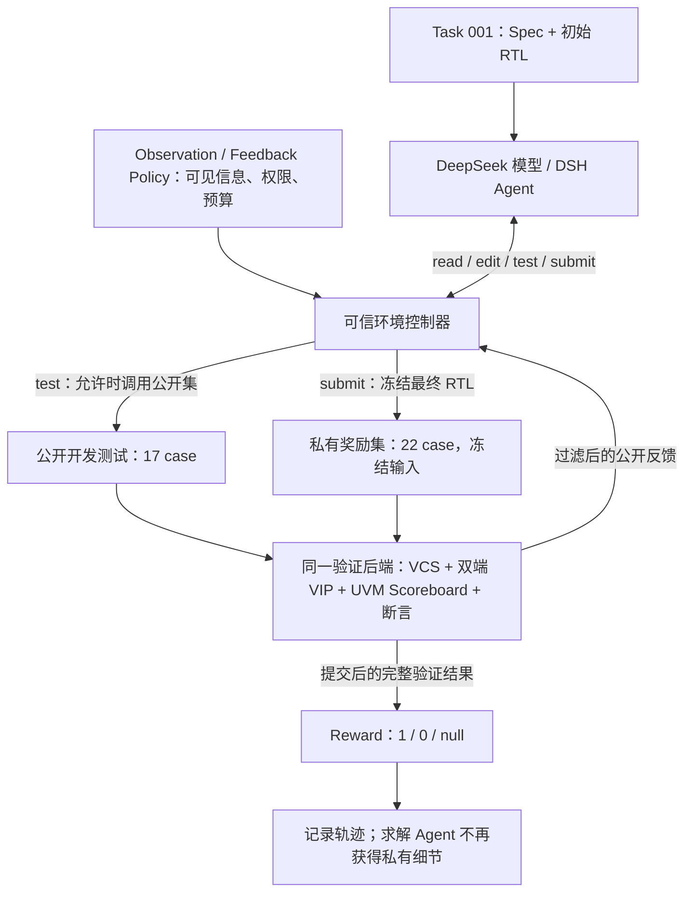
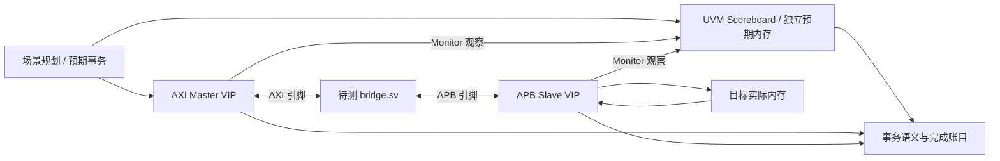

# ProtocolBridge-RL

**用工业协议验证能力构建可执行的 RTL Agent 任务、程序化奖励与模型能力评测环境。**

当前项目已经完成 **4 个真实 RTL 任务的 Agent 求解与独立评分闭环**，并开展了 **Observation / Feedback Policy** 和批量模型能力研究。它的研究重点是：**任务怎样定义、答案怎样验证、反馈怎样影响 Agent，以及怎样判断一项任务是否具有训练价值。**

> **当前范围：** AXI4-Lite → APB4（Task 001 单目标、Task 002 三目标路由、Task 003 有限队列与仲裁、Task 004 执行与响应解耦）｜VCS + Synopsys AMBA VIP + UVM｜固定模型的 Agent Rollout 与评测。**尚未训练或更新模型参数，也尚未实现多任务自动生成。**

## 1. 当前进度：实现了什么，得到了什么结果

| 工作 | 已完成的能力与证据 | 状态 |
| --- | --- | --- |
| Task 001 | 规范化 Spec、只有接口的初始 RTL、独立提交与复现入口 | 已实现 |
| 工业验证与 Reward | 双端主动 AXI/APB VIP、UVM Scoreboard、时序断言；完整 22 case 通过，必要交叉覆盖 576/576 | 已实测 |
| 验证器正反对照 | 1 份正确参考 RTL 通过，10 种故意错误的 RTL 均被拒绝 | 已实测 |
| 真实 Agent 求解 | DSH 读取、编辑、公开测试、提交；终局私有评分与保留评估已实际运行 | 已实测 |
| Observation / Feedback Policy | A/C/E 三种权限与反馈策略、工具/预算约束、受控反馈投影 | 已实测 |
| 批量 Agent 评测 | 新版协议下自主生成 30 次、固定错误 RTL 配对修复 6 次；另保留旧协议的 17 次停止批次 | 已完成首轮研究 |
| Task 002 与任务质量门禁 | 三目标路由；两种参考、13错误对照、40机制检查通过；9条Agent试次，A/C/E各2/3成功 | 已实测，难度待进一步校准 |
| Task 003 | 深度2独立队列和仲裁；两种参考、15错误对照、40机制检查通过；独立9条A0/3、C1/3、E0/3；同起点修复6条均未成功 | 已实测，难度待进一步校准 |
| Task 004 | APB独立执行与B/R响应FIFO；两种参考、额外合法延迟参考、14错误对照、40机制检查通过；A/E各0/2 | 已实测；3/4形成编辑候选，难度与策略效果尚不能可靠标定 |
| 受控工程工具 | Task003 可选独立编译与公开需求诊断查询；20项机制验收，4条同起点修复试次 | 已实测；基线/增强均0/2，不能据小样本判定工具效果 |
| 综合与实现检查 | 可选 `synth_check`；可信侧 DC→Formality、PT/PX 教学测量；27项验收，1条真实 Agent 试次 | 已实测；最终 RTL 综合/自身网表等价通过，但功能 Reward=0，工具效果尚未做对照估计 |
| 运行时观测与主动实验 | Task003 公开场景/结构化事务实验、接口握手采样及周期查询；41项实测验收、2条同起点真实修复轨迹 | 已实测；两组均0/1，详细反馈已曝光但未修复容量错误 |
| 多任务统一入口 | Registry与Schema，统一reset/test/submit/quality/rollout | 已实现并测试；尚无自动任务生成器 |
| 轨迹数据交付准备 | v2交换覆盖九批85条结果、45条已审查工具轨迹；能力配置与保留评估分开记录，历史v1不变 | 已在真实发布证据上验证；不是完整on-policy训练数据 |
| 模型强化学习训练 | Rollout 与 Reward 已有；Policy Optimizer/参数更新及训练收益评估 | 尚未开展 |

**标准验证基线：** 正确参考实现通过 22/22 个 case；共 2,868 笔计划事务，其中 **2,842 笔正常检查完成、26 笔按规格复位取消**。这不是 2,868 笔全部正常完成。验证包含定向、随机、字节使能/等待/背压、事务中复位和交叉覆盖；10 个错误对照只需在确认错误的场景中判负，不宣称它们各自运行了全部 22 个 case。

[Task 001 入口](tasks/axil_to_apb4_001/README.md) · [完整验证报告](mvp-evaluation-report.md) · [工业验证证据](experiments/industrial-v3/README.md)

[Task 002 任务包](tasks/axil_to_apb4_router_002/README.md) · [路由研究报告与9条试次](docs/task002-evaluation-report.md) · [Task Quality Gate](docs/task-quality-gate.md)。以下22/17case及10个错误对照的说明专指001；002完整26/公开21case，使用三个独立APB目标。

[Task 003 任务包](tasks/axil_to_apb4_queue_003/README.md) · [队列研究报告与9条试次](docs/task003-evaluation-report.md) · [统一任务入口](docs/task-catalog.md) · [轨迹交换与训练数据边界](docs/rollout-data-contract.md)。003完整21/公开19case，检查FIFO容量与顺序、仲裁、响应和复位账目；不同任务的case数量不代表难度排序。

[Task 004 任务包](tasks/axil_to_apb4_decoupled_004/README.md) · [解耦设计报告与4条试次](docs/task004-evaluation-report.md)。004完整23/公开21case，明确区分接收、执行和退休；首批A/E均0/2，其中一条被动作格式错误阻碍，不能把它等同于RTL能力失败。

[工程工具权限与实测能力](docs/engineering-tools.md) · [固定错误RTL工具对照报告](docs/engineering-tools-evaluation.md)。新增工具与任务复杂度分别冻结；编译PASS不代表功能正确，具体诊断曝光也不等于成功修复。

[综合工具接口与边界](docs/synthesis-tools.md) · [综合、等价与功能正确性的实测研究](docs/synthesis-tools-evaluation.md)。Agent 只收到受控综合诊断；Formality 和教学库时序/功耗结果留在可信侧，不进入功能奖励。

[运行时实验接口与权限](docs/runtime-experiments.md) · [事件时间线与主动调试研究](docs/runtime-tools-evaluation.md)。新增 v3 交换支持综合及运行时工具轨迹；本轮两条和此前一条综合试次分别记录，不混合统计。

## 2. 一个 Agent 任务究竟怎样运行

本项目的 **Task** 向求解 Agent 提供两类初始材料：

- **Spec**：明确写出协议转换、握手、等待、错误响应、复位、时序上限和不支持的场景。
- **初始 RTL**：只有 `bridge` 的端口声明和待实现部分；Agent 必须自行完成电路逻辑。

真实求解过程中，由 **Observation / Feedback Policy** 决定 Agent 可以读取哪些内容、执行哪些动作、获得多少测试反馈。基础接口的动作名称是 **`read`、`edit`、`test`、`submit`**；Task003可选的[工程工具配置](docs/engineering-tools.md)另允许受控`compile/inspect`，不改变基础Policy。注意 **`submit` 是第四个动作**，不是前三个动作的自动结束。



这里有两个重要的边界：

1. **公开测试是开发工具。** Agent 只有在策略允许时才能调用，并根据允许的反馈修改代码。
2. **私有评分是提交后的验收。** 控制器保存最终 RTL，停止求解进程后用另一组预先冻结的输入执行完整验证；具体私有 case 不回流给这次求解。随后还用另一组冻结输入做**保留评估**，结果不改变本次终局 Reward。

**A / C / E 的区别仅在求解阶段：**

| 策略 | 可用动作 | 公开测试给 Agent 的信息 |
| --- | --- | --- |
| A · Spec-only | read、edit、submit | 不能调用公开功能测试 |
| C · Test-verdict | read、edit、test、submit | PASS / FAIL / ENV_ERROR，最多两次 |
| E · Test-diagnostic | 同 C | 额外给错误类别、首个失败 case 和受控短诊断，最多两次 |

所有策略使用同一任务规范和终局判定要求。**隐藏的是测试输入及内部证据，不是功能规格。** 当前三种策略为固定模型推理对照，不代表已经进行 RL 参数训练。

[Agent 执行与权限](docs/agent-workflow.md) · [Policy 的实现与边界](docs/observation-policy.md)

## 3. VCS、VIP、Scoreboard 和 Reward 分别负责什么

在一次真实仿真中，**待测 DUT 是当前提交的 `bridge.sv`**：

- **VCS**：编译 SystemVerilog 并执行仿真，是运行工具，本身不等于功能正确性的判定器。
- **主动 AXI4-Lite Master VIP**：按照场景向 Bridge 发起事务，监视 AXI 握手和响应，并执行自身协议检查。
- **主动 APB4 Slave VIP**：在 APB 侧提供等待、错误响应和读数据，并监视实际事务及协议时序。
- **UVM Scoreboard / Reference Model**：独立维护预期事务与预期内存，比较原计划请求、AXI Monitor 与 APB Monitor 的地址、数据、WSTRB/PSTRB、响应、事务顺序与完成/复位取消账目。
- **任务时序断言与覆盖检查**：补充检查请求接受、响应稳定、复位、必要场景是否真正发生。

**协议合规不等于转换功能正确**：两端 VIP 都没有报错，Bridge 仍可能把正确的 AXI 地址转换成错误的 APB 地址；需要 Scoreboard 检查跨协议语义。



**参考 RTL + 10 个错误 RTL 是另一条独立的验证器自检流程，不是 Agent 的输入。**

它们位于 `fixtures/`：参考 RTL 是预期能够通过的**正对照（positive control）**；十份故意植入地址、字节使能、响应、等待、背压、复位等错误的 RTL 是**负对照（negative controls / mutants）**。验收脚本分别将候选接到同一个 VIP/UVM 验证环境，检查 **正确的能被接受、已知错误能被拒绝**。Scoreboard 并不是同时拿这 11 份 RTL 做比较，也不使用参考 RTL 的源码来计算 Agent 答案。

[Scoreboard 具体原理](docs/architecture.md) · [错误对照脚本](environment/validate_v3.py) · [验证覆盖与缺口](docs/verification-plan.md)

### Reward 从何而来？

完整测试结果先由 VCS/UVM/VIP 生成，可信 Python 评分器在 `verifier/campaign.py` 中核对测试是否完整、是否有明确的 DUT 错误、事务账目与必要覆盖，再给出：

| 结果 | 终局输出 | 含义 |
| --- | --- | --- |
| 所有必要 case 完整通过 | `Reward = 1.0` | 本次任务通过规定的验证范围 |
| 确认 RTL 编译、功能、协议/时序或周期超时错误 | `Reward = 0.0` | 当前提交有可判定错误；可在首个错误处停止 |
| 许可/工具故障、验证不完整、无效提交等 | `Reward = null` | 未获得可靠的数值奖励；不能误记为 RTL 功能失败 |

`null` 是本项目为无效/不可判定状态保留的标记，**不是数值 0，也不是可以不经处理直接交给训练器的奖励**。未来接入训练器时，需要单独处理这些样本。

[评分代码](verifier/campaign.py) · [Reward 与提交隔离](docs/agent-workflow.md)

## 4. 用这套环境研究出了什么？

以下为**真实 Agent 固定模型试次**，不是模拟模型、不是模型参数训练。模型为 `deepseek-flash`；成功表示最终私有 Reward=1。

### 实验 A：同一任务，不同信息条件下自主生成 RTL

新版 `text-json-atomic-v2` 动作协议，A/C/E 各 10 次，30 次全部有效提交：

| 策略 | 私有成功 | 实际获得过公开反馈的试次 |
| --- | --- | --- |
| A · 不给功能反馈 | **7 / 10** | 0 / 10 |
| C · 只给 PASS/FAIL | **8 / 10** | 9 / 10 |
| E · 给受控诊断 | **8 / 10** | 7 / 10 |

三组差异很小、样本量有限，**不能据此声称哪种反馈策略更优**。同时，这道受限单任务对该模型的成功比例较高，但尚不能说已经完全饱和。

### 实验 B：从同一份真实错误 RTL 出发，比较修复反馈

取历史 Agent 产生的一份 WREADY/AW 独立握手错误 RTL，C/E 使用相同起点和修复预算。六条试次都真实收到首次 FAIL、修改 RTL 并重新测试：

| 反馈条件 | 修复后私有成功 |
| --- | --- |
| C · 只有 FAIL | **1 / 3** |
| E · 错误类别、case 与受控诊断 | **3 / 3** |

两组的实际修改位置不同，提示详细诊断**可能**帮助定位该类握手错误；但只有一个错误起点、每组三次，不能推广为普遍优势。

### 实验 C：Agent 动作协议会污染能力测量

最初的文本 JSON 协议出现 **41/133** 次格式错误动作（30.8%），执行到 17 次时按预定质量门槛停止并保留全部轨迹。改进格式说明与拒绝反馈后，新协议 30 次自主生成中只有 **2/153** 次格式错误（1.3%），且均在后续动作中恢复。

这说明工具动作接口质量会显著影响 Agent 评测；旧、新批次的其他条件未完全随机控制，**不能将差异完全归因于某一句 Prompt**。

本轮共有 **53 条**批量研究真实轨迹：旧协议停止批次 17、新版自主生成 30、独立配对修复 6。这三批不能合并计算为一个成功率。最新实验报告另记录了时序/功能失败归因、Token 用量、EDA 编译/仿真耗时以及审计情况。

[批量研究报告（推荐先读）](docs/batch-evaluation-report.md) · [53 条证据索引](experiments/batch-study-001/README.md) · [实验执行与审计契约](docs/batch-study.md)

## 5. 当前 Agent 调用工具的方式，以及与 RL 训练的距离

当前使用的是 **DSH + 自定义文本 JSON 动作协议**：模型在文本回复中输出一个动作对象，可信控制器解析后执行 `read/edit/test/submit`，再把允许的结果送回下一轮模型上下文。它已实现多轮 Agent–Environment 交互、权限控制、轨迹记录和终局可验证奖励。

这符合 Agent Rollout 的**基本逻辑**，但**还不是模型 API 的原生 Tool Calls**。后者通常以工具 Schema 和专门的工具调用/结果消息传递动作，能够减少文本格式解析问题。当前 DSH 适配尚未实现并验收这种原生工具接口，也尚未接入使用轨迹和 Reward 更新模型参数的 RL Trainer。

因此准确的定位是：**可执行、可评测、能收集训练候选轨迹的环境原型**，不是已经完成大模型后训练。

## 6. 代码入口、复现与下一阶段

| 目的 | 入口 |
| --- | --- |
| Task 规范与初始 RTL | [tasks/axil_to_apb4_001/](tasks/axil_to_apb4_001/README.md) |
| Agent 生命周期、Policy 与反馈 | [environment/](environment/) |
| 场景生成、VCS/UVM 验证和 Reward | [verifier/](verifier/) |
| 正确/错误 RTL 对照 | [fixtures/](fixtures/) |
| 批量执行、审计和统计 | [scripts/](scripts/) |
| 技术解释与运行说明 | [docs/](docs/README.md) |
| 冻结实验及脱敏证据 | [experiments/](experiments/batch-study-001/README.md) |

在准备好**合法授权的 VCS / AMBA VIP** 与对应运行环境后，可以从仓库根目录执行：

```bash
# 只核对历史源码与证据，不启动仿真
python3 -m environment.check_baseline

# 真实运行参考 RTL 与十个错误 RTL 对照
bash environment/reproduce.sh .local/reproduction-new
```

模型批量试次需要另行配置 DSH 与 API 凭据；具体参数、版本、冻结和断点恢复方法见[运行手册](docs/mvp-running.md)和[批量实验契约](docs/batch-study.md)。历史运行工具链与当前运行工具链分别记录在对应实验清单里；个人 SSH、机器路径、许可证、完整原始日志和私有输入不作为仓库交付物。

**下一阶段优先事项：** ① 在更多不同错误起点上复验反馈对修复的影响；② 对比更可靠的结构化/原生工具调用协议；③ 基于已验收的队列任务继续难度校准；④ 通过已交付多任务入口与轨迹交换约定对接后续采集器。

**当前边界：** 仅有一个标准任务；有限测试与 10 个故障对照不能证明所有 RTL 都正确；私有奖励与保留评估使用同一验证器，存在共同盲区；尚无完整代码覆盖闭合、综合/形式证明、全面恶意代码沙箱、规模化任务生产与 RL 参数训练。
