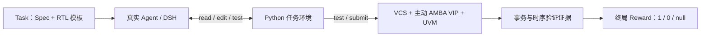

# ProtocolBridge-RL

用真实 RTL 仿真和工业协议 VIP，为编程 Agent 提供可复现的协议转换任务及程序化奖励。

当前唯一标准基线是 **001 X2P（AXI4-Lite → APB4）** 任务：单时钟、32-bit、单笔未完成事务。Agent 读取 Spec、修改 RTL、调用公开测试并提交；VCS 中的主动 AXI/APB VIP 与 UVM Scoreboard 执行验证。Python 负责调度和 Reward 封装，不承担功能比对。



## 如何理解和讲解本项目

固定的人类阅读入口：[docs/README.md](docs/README.md)。新任务和版本更新也在此维护导航、图示、用法和证据。

| 想了解什么 | 阅读入口 |
|---|---|
| 整体结构；task、环境、验证器和评分器的分工；Scoreboard 如何工作 | [当前架构与 Scoreboard](docs/architecture.md)（含系统与 UVM 数据流框图） |
| DSH 在哪里运行；Agent 能看什么、做什么；真实动作与奖励如何产生 | [真实 Agent 的执行与奖励](docs/agent-workflow.md)（含执行时序图、权限表和评分规则） |
| 如何配置、手动迭代、重放提交或再跑模型 | [环境配置与复用命令](docs/mvp-running.md) |
| 定向／随机／边界测试如何安排、是否充分 | [验证计划与覆盖](docs/verification-plan.md) |
| 实际证明了什么、证据在哪里、还缺什么 | [评估报告](mvp-evaluation-report.md)与[验收证据](experiments/industrial-v3/README.md) |

建议讲解顺序：本页概览 → 架构与 Scoreboard → Agent 执行时序 → 真实结果与限制。当前已经跑通任务和奖励闭环，尚未进行 RL 参数训练。

## 标准基线

revision 3 单任务闭环已实际验证。DSH 在 UTM 内运行并调用 API；真实 Agent 经公开测试失败后自行修复，私有终局 Reward=1.0，独立保留评估也通过。

| 检查 | 实测结果 |
|---|---|
| 正确参考 | 22 个 case 通过；2868 笔计划事务，2842 笔正常完成、26 笔复位取消 |
| 必要交叉覆盖 | 576 / 576 个 bin 命中 |
| 随机流 | 4 组 × 256 笔，全部实际仿真通过 |
| 错误实现 | 10 / 10 被检出，包括两项商业 VIP 协议报错 |
| UTM 内真实 Agent | 10 轮动作；私有 22 case 通过，Reward=1.0；另一个保留评估集通过 |

这些结果证明计划内检查通过，不是所有输入的正确性证明，也不是完整工业签核。

旧 128 笔版本已废弃，其源码、向量生成器、导出脚本及交付记录已从当前版本删除。标准定义见[任务入口](tasks/axil_to_apb4_001/README.md)与[机器可读基线清单](tasks/axil_to_apb4_001/baseline.json)。

## 运行

需要自行准备有授权的 VCS / AMBA SVT 环境，并配置 SSH。已实测 VCS V-2023.12-SP2、AMBA SVT R-2020.12。仓库不包含商业 VIP、许可证或密钥。

先按[环境配置与运行说明](docs/mvp-running.md)完成配置，然后在仓库根目录执行：

```bash
# 检查标准基线与已保存证据的一致性（不启动仿真）
python3 -m environment.check_baseline

# 参考实现及十个错误实现的真实 VCS 回归
bash environment/reproduce.sh .local/reproduction-001

# 在 UTM 安装 DSH 并提供 API key 后，增加真实 Agent 试次
bash environment/reproduce.sh .local/reproduction-002 --agent
```

也可单独调用 `python3 -m environment.reset`、`environment.test`、`environment.submit`；具体参数见运行说明。模型 API 调用消耗用户自己的额度。

## 交付内容

- `tasks/`：Spec、初始 RTL 和任务元数据。
- `environment/`：reset/test/submit、受限工具接口和 DeepSeek Harness。
- `verifier/v3/`：当前主动 VIP／UVM 验证实现。
- `fixtures/`：正确参考与十个故障实现。
- `experiments/industrial-v3/`：结果、精简工具轨迹、实际修复差异、最终 RTL 和证据哈希。
- `scripts/`：脱敏证据导出；`docs/`：复现说明及研究资料。

UVM Scoreboard 通过 analysis port 接收两端 VIP monitor 事务，并与计划请求和独立期望内存状态比较。最终评分在新的仿真目录执行；编译产物只有在代码及验证输入哈希一致时才允许复用。

## 边界

已实现求解进程的文件系统／进程／权限隔离，以及私有输入分层。仍需区分运行时文件隔离、网络限制和恶意 RTL 执行隔离；当前没有完整网络／编译器沙箱。公开参考答案还存在预训练污染风险。

事务中复位、随机和交叉覆盖的实现与实际验收分开记录；尚无完整代码覆盖闭合、综合／形式证明或 RL 训练。详见[验证计划](docs/verification-plan.md)与[工具能力](docs/toolchain.md)。

[原研究设计](docs/research-design.md) · [VIP 资源盘点](docs/vip-inventory-r2020.12.md) · [早期 VIP 审计](docs/vip-audit-2026-11-24.md)

研究资料描述长期方向和当时的证据状态；当前实现与验收状态以本页和评估报告为准。
