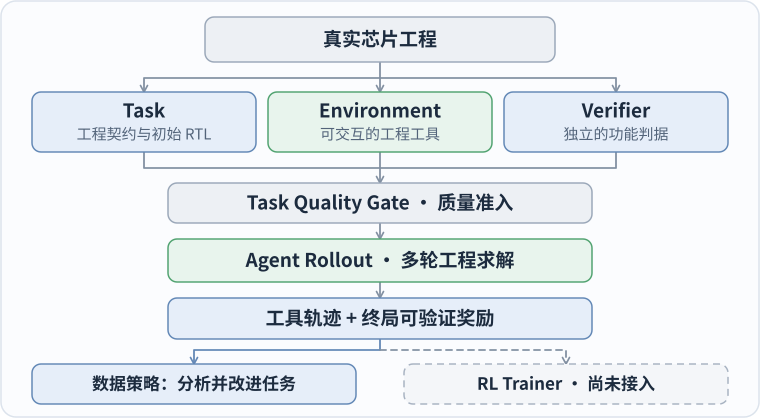
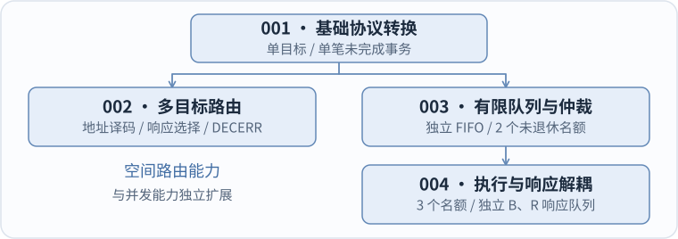
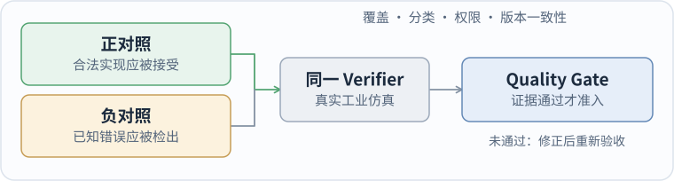
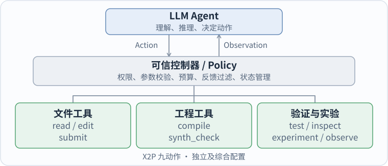
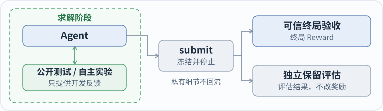
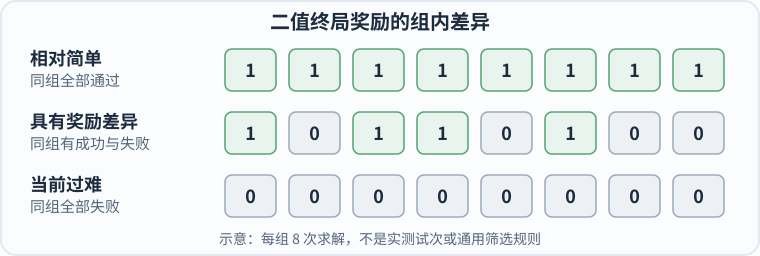
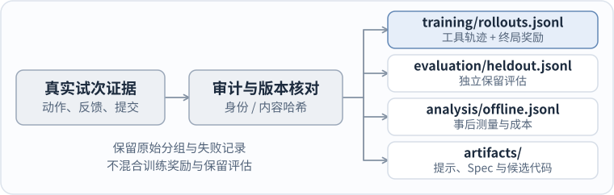

# ProtocolBridge-RL

**将真实芯片工程问题转化为可执行、可交互、具有可信奖励的 Agent 强化学习任务。**

如果希望通过强化学习提高大模型解决芯片工程问题的能力，仅有专业知识与代码样本还不足以构成一套可交互、可验证的训练环境。模型需要面对具体的工程任务，能够调用真实工具、尝试不同方案，并得到可靠的结果反馈。

ProtocolBridge-RL 围绕这一问题展开研究。项目以 AXI → APB 协议桥（X2P）为切入点，利用工业电子设计自动化工具（EDA）与独立功能验证，将数字电路设计与调试转化为模型可以反复求解、探索和验证的任务。它既关注设计是否正确，也关注如何构建有训练价值的求解过程。

<p align="center">
<strong>35 个历史任务身份 + 5 个新准入生成实例</strong>　·　<strong>X2P 九动作环境</strong>　·　<strong>145 条研究试次</strong>　·　<strong>轨迹交换 v1–v10</strong>
</p>

> **当前阶段：** 已建立任务、环境、独立奖励与固定模型 Rollout 的工程闭环；尚未进行模型参数训练或训练收益评估。保留独立工具配置，并已在三深度队列上完成九种动作联用验收。

[任务体系](#2-任务体系) · [验证与奖励](#3-验证与奖励) · [Agent 环境](#4-agent-工程环境) · [研究成果](#5-数据策略与研究发现) · [项目结构](#7-项目结构) · [快速开始](#8-快速开始)

**任务生产开始接受新契约。** 新生产链以合法地址窗口为输入，无需为每个实例增加 Task ID 分支，就能装配规格、初始材料、独立检查和正反对照。两轮各生成 20 份新契约；当前仅五份完成修订后来源匹配准入，不能把 40 份候选都算作可采样任务。例如，从 `0x100c` 开始、跨页的窗口要求精确减去基址，旧的低位截取不能替代。这引入新的边界义务，而非仅换随机种子。[两轮生产、真实成本及边界](docs/task-space-production.md)解释第二轮如何使用前一轮的质量与耗时证据选择工业样本。

---

## 1. 项目整体逻辑

设想一个模型需要独立完成一项数字电路设计工作。我们希望它不只是一次性输出代码，而是能够阅读需求、编写设计、运行工程工具、观察结果、定位问题并尝试修复。

要把这种工作方式转化为 Agent 强化学习任务，需要回答五个相互关联的问题：**让模型做什么？它可以怎样探索？谁来判断结果正确与否？怎样评价任务与反馈的训练价值？如何持续生产这样的任务？**

<p align="center"></p>

这些问题分别对应项目中的几个核心对象：

| 对象 | 在整个系统中负责什么 |
| :--- | :--- |
| Task（任务） | 把专业工程要求变成模型可以接收和求解的问题 |
| Environment（环境） | 规定模型能操作哪些文件、调用哪些工具、看到哪些结果 |
| Verifier / Reward（验证器与奖励） | 独立检验交付物，产生可用于后训练的结果信号 |
| Task Quality Gate（任务质量门禁） | 检验任务、验证器与运行边界是否具备可信的准入证据 |
| Rollout（一次求解过程） | 记录模型实际采取的动作、获得的反馈与最终结果 |
| 数据策略研究 | 根据真实求解表现判断任务、工具与轨迹的价值，并反向改进它们 |

**本项目负责从真实工程问题到交互轨迹与可验证奖励的过程。** 后续训练器可以根据具体强化学习算法使用这些数据来优化模型参数，但目前还没有接入实际的在线训练闭环。

## 2. 任务体系

### 从芯片通信问题到可求解的任务

芯片内部的处理器、存储器和外设需要交换数据。AXI 与 APB 是两种片上总线协议：AXI 更适合较高性能的通信，APB 面向相对简单的外设访问。协议桥负责把一侧的读写请求转换为另一侧能够执行的事务，并将结果返回请求方。

这样的工程问题具有明确的输入输出、成熟的协议规范和丰富的设计空间，能够利用现有工业工具自动验证。因此，项目以协议桥为实验对象，研究如何将专业工程能力封装为可重复执行的 Task。

**以 [Task003](tasks/axil_to_apb4_queue_003/README.md) 为例。** 模型需要设计一个支持多笔未完成请求的 AXI4-Lite → APB4 模块。它不仅要正确传递地址和数据，还要管理有限的请求容量、读写执行顺序与响应返回。

| Agent 获得的材料 | 实际内容 |
| :--- | :--- |
| [spec.md](tasks/axil_to_apb4_queue_003/spec.md) | 规格（Spec）：定义功能要求、信号接口行为、时序和边界条件 |
| [bridge.sv](tasks/axil_to_apb4_queue_003/workspace/bridge.sv) | 初始 RTL：固定 SystemVerilog 接口与待实现逻辑；RTL 是用于描述数字电路行为和结构的硬件设计代码 |

模型交付符合 Spec 的 RTL。修复任务也可以从历史 Agent 产生的真实错误 RTL 出发，而不是从空模板开始。任务版本、验证场景、独立评分器、参考实现和错误对照则由可信侧管理，不作为求解答案提供给模型。

Task003 的一个关键规定是：每个 AXI 请求通道最多允许两笔已接受但尚未退休的请求。写地址（AW）、写数据（W）和读地址（AR）独立接收；FIFO（先进先出队列）维护各通道的请求顺序，仲裁逻辑在符合条件的读写之间选择执行对象。Outstanding 指已经发出或接受、但尚未完成的事务；在本任务中，直到相应写响应（B）或读响应（R）被请求方握手消费，才释放对应的未退休名额。这条规格将在后面的真实调试案例中再次出现。

除下文 X2P 样板外，当前另有 [串行协议、测试生成、参考修复、Checker、状态与综合修复任务](docs/tasks/README.md)。它们分别交付 RTL 或事务表，使用不同的可信判据；共同方法仍是明确规格、独立验收与真实求解。

### 工程能力怎样逐步扩展

<p align="center"></p>

| Task | 核心能力与工程约束 | 任务包 / 报告 |
| :--- | :--- | :--- |
| **001** 单事务 | 独立 AW/W、等待、错误、复位；单目标、全局一笔 Outstanding | [任务](tasks/axil_to_apb4_001/README.md) · [报告](mvp-evaluation-report.md) |
| **002** 多目标 | 三目标译码、局部地址转换、响应 MUX、DECERR；仍为单事务 | [任务](tasks/axil_to_apb4_router_002/README.md) · [报告](docs/task002-evaluation-report.md) |
| **003** 队列仲裁 | 独立 AW/W/AR FIFO、配对与轮询；每通道两个未退休名额，执行与响应消费耦合 | [任务](tasks/axil_to_apb4_queue_003/README.md) · [报告](docs/task003-evaluation-report.md) |
| **004** 执行解耦 | 每通道三个未退休名额；独立 B/R 响应 FIFO、并发更新、非二次幂回绕与数据快照 | [任务](tasks/axil_to_apb4_decoupled_004/README.md) · [报告](docs/task004-evaluation-report.md) |

002 与 003 分别扩展空间路由和时间并发能力，并非简单线性升级。004 则允许 APB 在旧 AXI 响应积压时继续执行新事务。目前四个任务均为 AXI4-Lite → APB4；表中的 MUX 指响应多路选择逻辑，DECERR 指无法译码地址时返回的错误响应。

这些 Task 是更大工程能力空间中的代表样本。长期希望积累的不是大量孤立的手工题目，而是可以系统组织、组合与生成的专业任务体系，例如沿协议类型、目标数量、队列深度、仲裁规则、位宽与性能约束等维度扩展。

**首个有限任务族已经完成生产验收。** 以 Task002 为基础，生成器把三种经审阅的地址契约分别转成完整任务源码包，包含 Spec、初始 RTL、独立验证、正反对照及执行入口。它们保持三个目标和单事务规则，只改变地址译码要求；例如同一地址在一个契约中是未映射请求，在另一个契约中则必须路由到目标 1。三份包均通过两种合法参考、14 个错误对照及 40 项机制检查，但不能把三个地址组合称为三种独立工程能力。

这一过程中也发现了真实漏检：旧生成验证器的 27 个 case 全部通过，却没有访问非二次幂窗口的关键中间区域，使错误局部地址映射获得了 Reward=1。修正后的生成方法增加内部偏移进位激励，并用完全相同的错误 RTL 确认拒绝。这个结果说明，**任务生成必须同时生成并验收新的验证义务，不能只替换 Spec 参数。** [任务族方法与具体例子](docs/task-family-production.md)、[漏检分析与工业证据](docs/router-family-evaluation.md)解释了其机制和边界。

**第二类任务族把生产方法扩展到动态状态。** 基于 Task003，生成每通道一个名额、三个名额以及读写不对称容量的三份契约。每份不仅改变队列参数，还派生占用边界、多轮存储使用与退休时刻的验证义务，并通过两种合法结构及 12–14 个错误对照。额外的引脚握手账本与 Scoreboard 相互核对：如果可信检查器错误地提前出队，评分应停止并返回不可判定，而不是给模型一个不可靠的奖励。见[生命周期与生产方法](docs/queue-family-production.md)、[真实准入及研究结果](docs/queue-family-evaluation.md)。

新的[路由 × 队列组合契约](docs/composed-task-production.md)进一步检查排队请求的目标身份，以及未映射 DECERR 如何参与仲裁、背压与退休。例如，一个错误地址虽然不访问 APB，仍必须占用名额直到 AXI 消费错误响应，不能提前让队列多收一笔。该契约的验证器修订 2 已通过两种合法实现、19 个错误对照和 40 项真实机制检查。初版即使覆盖全满，仍漏掉了目标相关的复位错误；[同源码复验](docs/composed-environment-evaluation.md)记录了漏检、修正及剩余边界。当前 X2P 子集合包含四个原始任务、六个路由／队列生成实例和一个组合实例，共 **11 个已验收 Task ID**；参数实例数不等于独立工程能力数，生成与实际模型校准也分别记录。

**实现入口：** [Task Registry](tasks/registry.json) · [Registry Schema](tasks/registry.schema.json) · [任务目录与统一 CLI](docs/task-catalog.md)

## 3. 验证与奖励

### 独立 Verifier：谁来判断模型的设计正确？

如果每次求解都需要芯片工程师手工阅读代码和评分，就无法高效收集大量可验证的求解轨迹。因此，项目将专业验证判断转化为可重复执行的程序化机制，而不是让另一个大模型主观评判答案。

<p align="center"></p>

上图以 X2P 为具体例子：验证器把候选 RTL 当作待测电路（DUT），让它在实际的协议激励下运行。VCS 是执行 SystemVerilog 仿真的工具；Synopsys AMBA VIP（Verification IP，验证知识产权组件）负责模拟协议通信双方、产生请求与响应，并监测协议行为；UVM 是组织可复用验证环境的方法学。

项目在这个环境中建立了独立的 Scoreboard（事务记分板 / 检查器）：根据规格和实际接受的请求计算预期行为，再与两侧观察到的事务进行比较，核对地址、数据、字节使能、响应、顺序及事务账目。

**协议合规不等于跨协议功能正确。** 例如，AXI 发起对地址 A 的写请求，但候选 Bridge 把数据送到了 APB 地址 B。两侧的信号握手都可能符合各自的协议，可实际访问的对象却错了。这个跨协议语义错误必须由任务专用 Scoreboard 检出。

工业 VIP 提供成熟的协议验证能力，项目负责建立任务特有的功能判据。Scoreboard 不使用参考 RTL 作为运行时答案，也不依赖候选自己的计数器决定正确行为。

### Reward：如何形成训练信号？

可信 Python 评分器根据实际验证证据汇总终局结果。对于同一任务，求解结果可通过程序判定，这就是可验证奖励（Verifiable Reward）的基础。

| Reward | 终局含义 |
| :--- | :--- |
| `1.0` | 所有必要测试、检查与覆盖条件完整通过 |
| `0.0` | 有效交付已确认不满足任务：例如 RTL 编译／功能错误，或激励未触发必要活动、未检出必要缺陷 |
| `null` | 无有效提交、验证不完整或基础设施问题，无法可靠判定 |

测试生成中的编译失败或超时不能算成功检出错误 DUT；参考修复还须检查等价比较是否完整。具体分类见[有限工程契约的判据](docs/tasks/README.md)。

`null` 不是数值零，无法归因的超时不直接记为 RTL 失败；Reward=1 也不是对任意输入的正确性证明。

**实现入口：** [评分与场景](verifier/) · [003 Scoreboard](verifier/task003/scoreboard.sv) · [004 Scoreboard](verifier/task004/scoreboard.sv) · [验证架构](docs/architecture.md)

### Task Quality Gate：谁来验证我们的验证器？

如果 Scoreboard 自身有缺陷，或者测试遗漏了关键情形，错误 RTL 也可能得到 Reward=1。这会向后训练提供错误的学习信号。反过来，如果验证器只接受某一种参考结构，也可能把合法的其他设计误判为错误。

所以项目在允许任务进入正式模型评测前建立质量门禁，用多种合法参考（正对照）、植入明确需求违例的错误实现（负对照）、必要覆盖与机制检查验证判定能力。仅有一份正确参考 PASS 不足以完成这项工作。

<p align="center"></p>

| Task | 合法参考通过 | 已知错误检出 | 完整 / 公开 case | 验收证据 |
| :--- | :---: | :---: | :---: | :--- |
| 001 | 1/1 | 10/10 | 22 / 17 | [576/576 必要交叉 bin](experiments/industrial-v3/README.md) |
| 002 | 2/2 | 13/13 | 26 / 21 | [40 项机制检查](experiments/task002-v1/quality/result.json) |
| 003 | 2/2 | 15/15 | 21 / 19 | [33/33 需求 bin、40 项机制检查](experiments/task003-v1/quality/result.json) |
| 004 | 2/2 + 额外合法延迟参考通过 | 14/14 | 23 / 21 | [37/37 需求 bin、40 项机制检查](experiments/task004-v1/quality/result.json) |

001 完整回归的 2,868 笔计划事务包含 2,842 笔正常检查完成、26 笔按规格复位取消。错误对照可在首个明确错误处停止，不将未运行 case 记作通过。002–004 的准入证据绑定源码与工具链，变更后须重新获得匹配证据。

**实现入口：** [正反对照 RTL](fixtures/) · [质量门禁](environment/task_quality.py) · [验收方法](docs/task-quality-gate.md) · [验证计划与盲区](docs/verification-plan.md)

## 4. Agent 工程环境

如果只给模型一份 Spec，让它一次性生成 RTL，再给出终局奖励，主要测量的是一次性设计能力。但实际工程师会编译、测试、观察电路运行、提出假设、设计实验，并根据结果反复调整代码。

因此，本项目构建了模型与真实工程工具之间的可信控制环境。模型选择一个 Action（动作），控制器核对权限与参数后执行对应操作，并返回允许模型看到的 Observation（观察结果）。模型据此决定下一步动作，形成多轮工程求解。

<p align="center"></p>

| 能力 | 动作 | 当前范围 / 入口 |
| :--- | :--- | :--- |
| 文件操作与交付 | `read` / `edit` / `submit` | 阅读、修改、冻结候选；[Session](environment/policy_session.py) |
| 公开功能验证 | `test` | 当前设计是否通过规定测试；[反馈策略](docs/observation-policy.md) |
| 独立编译与诊断 | `compile` / `inspect` | RTL 是否能编译、违反了什么需求（Task003）；[工程工具](docs/engineering-tools.md) |
| 综合与结构检查 | `synth_check` | RTL 是否能够综合成硬件结构（Task003/004）；[综合工具](docs/synthesis-tools.md) |
| 主动实验与观测 | `experiment` / `observe` | 自选激励下电路实际如何运行（Task003 / 新队列族）；[运行时接口](docs/runtime-experiments.md) · [事件导航 v2](docs/runtime-events-v2.md) |

这些动作提供的是不同的工程认识能力：编译检查语法与结构，功能测试检查结果，运行时实验让模型主动观察特定条件下的行为。研究的目标不是增加工具数量，而是让模型有机会建立并验证关于工程对象的假设。

X2P 与历史有限任务使用 DeepSeek Harness（DSH）和自定义文本 JSON 动作协议。新有限任务另有独立版本的[原生工具接口](docs/native-tool-delivery-evaluation.md)，已通过实际 SDK 权限、预算与隔离检查，首批运行五条工程试次，后续新增寄存器检查器与SWD试次；它严格区分模型提案、实际执行与反馈送达，没有自动修复非法动作。不同工具集合以版本化 Capability Profile（能力配置）管理。新的 [engineering-lab-v1](docs/engineering-lab.md) 已在三深度队列上完成九种动作联用验收，并把每条开发反馈绑定到对应 RTL 版本；历史独立配置保持不变，其他任务不会自动继承这份验收。

生成任务包现已接入独立版本的原生 `read/edit/test/submit` 运行链。每次采样核对实际包清单、当前准入、候选与公开反馈；提交后才运行终局与独立保留评估。首批两条完整试次一胜一负，独立的字对齐契约试次终局通过，另有一条因可信分类异常而中断并保留 null；不同批次不合并估计成功率，详见[生成任务真实校准](docs/generated-task-calibration.md)。这项验收没有把九动作工具组合自动授予生成包。

新接口研究也说明，交付可靠与求解成功必须分开：固定文件名条件下，RFFE 模型完成七次编辑和四次公开测试，功能仍失败；I²C 完成编辑并获得公开 PASS，却未提交，因此终局保持 null。具体行为与成本见[五条真实试次](docs/native-tool-delivery-evaluation.md)。

### 从被动测试到主动实验

Agent 可以选取公开场景、构造受限自定义事务，并查询最近实验的接口信号与握手时间线。例如下列两个动作需逐次调用：

```json
{"tool":"experiment","scenario":"write_fifo"}
{"tool":"observe","start":24,"count":8}
```

实验复用真实 VIP 和 Scoreboard，通过[只读引脚观测器](environment/runtime/observer.sv)采样边沿前后信号，按实际握手计算未退休额度。观测绑定具体 RTL 版本。当前不支持任意内部信号查询或可执行自建 SV Testbench。

新队列包的事件导航 v2 可以用 `B:0` 选择第一次写响应退休附近的窗口，成功实验默认返回首个有效事务附近，而不是空闲尾部。它解决的是“如何找到真实行为”的问题；工具验收通过不等于模型已经能利用这些行为修复错误。旧工具配置与历史观察保持不变。

综合检查使用 Design Compiler；可信侧已实测 DC → Formality 自身网表等价 → PrimeTime/PX 教学库测量流程。综合及自身网表等价通过不代表功能正确，教学库面积、时序和功耗不进入功能奖励，也不是工业 PPA 签核证据。

### 信息边界：求解与评分为什么必须分离？

同一个工程任务可以给模型不同程度的开发反馈。模型知道测试失败与知道哪条需求被违反，是两种不同的信息条件；能够主动实验并查看信号变化，又是另一种条件。项目将这些差异配置成可研究的变量，而不改变最终功能契约。

<p align="center"></p>

| 基础策略 | 求解时可见信息 |
| :--- | :--- |
| A · Spec-only | Spec 与 RTL，不允许公开功能测试 |
| C · Test-verdict | 公开测试判定 |
| E · Test-diagnostic | 额外提供错误类别、首错 case 与受控诊断 |

增强配置分别在 E 上增加工程检查、综合或运行时实验；权限、预算和实际反馈曝光均独立记录。这样可以比较反馈与工具条件怎样影响模型求解，而不是把不同环境下的结果简单混在一起。

开发测试的职责是提供学习与调试机会，而私有奖励的职责是独立验收。如果模型能够修改最终评分器，或者让自己编写的容易通过的测试直接决定奖励，就会产生 Reward Hacking（奖励投机）空间。因此，自主实验的 PASS 不直接产生终局奖励；提交后停止求解，由冻结的私有输入独立评分。另一组冻结输入用于保留评估，其结果不替换终局 Reward。

隐藏的是测试输入与内部证据，而非规格。私有评分与保留评估共享验证后端，可能存在共同盲区；受限 HDL、白名单、进程隔离和超时也不构成针对任意恶意代码的完整安全证明。

### 一次实际 Rollout：从 Task003 的容量错误到最终奖励

Task 是可重复使用的工程问题；Rollout 则是模型在某个任务和环境条件下实际进行的一次完整求解。

下面选取已发布的真实修复轨迹 `runtime-observe-v1`。模型从一份已知功能失败的历史 RTL 出发，而非空模板。任务规定：**每个请求通道最多两个未退休名额，APB 执行结束不等于 AXI 响应已经被消费。**

| 实际动作序号 | 模型做了什么，环境返回了什么 |
| :--- | :--- |
| 1–3 · read / test | 阅读 Spec 和起始 RTL，公开测试返回 FAIL。 |
| 4 · experiment | 运行 `address_data` 场景，看到真实容量违规：连续接受两笔写请求后，在没有 B 响应退休的情况下又接受第三笔。 |
| 5–6 · experiment / observe | 单笔自定义写事务通过，但直接沿用 Prompt 示例；默认观测落在空闲周期，后续查询只看到复位，未验证原容量问题。 |
| 7–9 · edit / test / experiment | 修改队列相关逻辑，公开测试仍失败；重复实验的关键引脚窗口逐行不变。 |
| 10–11 · edit / experiment | 再次编辑；实验预算耗尽，后续实验请求被拒绝。 |
| 12 · submit | 冻结最终 RTL、结束求解；独立私有评分与保留评估均判定容量错误，终局 Reward=0。 |

[真实轨迹（JSONL）](experiments/runtime-tools-v1/exchange/training/rollouts.jsonl) · [行为分析与证据](docs/runtime-tools-evaluation.md) · [最终提交](experiments/runtime-tools-v1/final-runtime-observe-v1.sv)

这条失败轨迹揭示了项目各部分的关系：Task 给出工程要求，Environment 使模型能够尝试并观察，Verifier 给出独立判断，最终 Reward 告诉我们这次交付是否通过。在数据中还保留了求解动作、实际反馈与候选版本，因此即使终局失败，也能研究模型在哪一步未能有效利用信息。

**进一步阅读：** [Agent 工作流（历史基础入口）](docs/agent-workflow.md) · [Observation / Feedback Policy](docs/observation-policy.md) · [环境源码](environment/)

---

## 5. 数据策略与研究发现

前面的工程系统回答了任务如何运行、模型如何探索、结果如何验证的问题。数据策略研究则进一步回答：**我们应该生产什么样的任务与求解轨迹，为什么这些数据具有训练价值？**

项目因此具有两个嵌套的循环：**内循环**是 Agent 对具体任务的多轮求解，模型参数在当前试次中保持不变；**外循环**是研究者依据实际结果改进任务、环境、验证器与数据生产方法。

<p align="center"></p>

### 任务难度：不是越难越好

固定模型 `deepseek-flash` 的主要独立生成批次如下。成功表示私有 Reward=1，并非训练后的能力提升。

| 任务 | A | C | E | 成功 / 启动 |
| :--- | :---: | :---: | :---: | :---: |
| 001 · 基础转换 | 7/10 | 8/10 | 8/10 | **23/30** |
| 002 · 多目标路由 | 2/3 | 2/3 | 2/3 | **6/9** |
| 003 · 队列仲裁 | 0/3 | 1/3 | 0/3 | **1/9** |
| 004 · 执行解耦 | 0/2 | — | 0/2 | **0/4** |

003/004 暴露出并发状态及事务生命周期问题。任务契约、样本量与条件不同，不能据此严格排名；004 有一条因动作格式问题未形成编辑候选，仍保留在启动分母中。

新路由任务族另有一次预先选定的 irregular 契约试次：E 模式下一次编辑即通过公开、私有和保留验证，Reward=1。它证明生成包的真实求解链路可用，但没有失败诊断曝光，不能据此说明诊断帮助了修复，更不能用 1/1 判定任务饱和；该样本与上表独立统计，详见[任务族研究](docs/router-family-evaluation.md)。

队列任务族此前进行了三条预先规定的探索：一名额基础 E 失败，三名额基础 E 在收到失败反馈并修改后通过，三名额加事件实验失败。最后一条的首候选事后通过公开 21 case，却在后续未经测试的编辑中引入调度回归；仅看最终 Reward=0 会遗漏这个过程。每种条件只有一条，不能把它们作为容量难度排序或工具效果结论。见[具体代码变化、反馈与证据](docs/queue-family-evaluation.md)。

组合与综合环境阶段另完成三条限定试次：同一起点的基础诊断／综合工具修复，以及组合任务的独立求解。三条都有效提交、没有动作格式错误，终局与保留评分均为 0。综合条件确实查询了局部周期信息，但未修复；基础诊断条件则放弃了一份事后通过公开 21 case 的中间候选，回到已失败版本。这个 PASS 当时没有反馈给模型，也未测中间候选的私有正确性，因此最终奖励保持不变。[完整研究](docs/composed-environment-evaluation.md)将信息曝光、实际修改、局部进展和终局结果分开分析；每种条件 n=1，不能据此判断工具优劣。

这些结果为什么值得研究？当一个任务对某个模型过于简单时，多次求解可能全部得到 Reward=1；过难时则可能全部为 0。对于依赖组内相对奖励差异的训练方法（例如使用组内相对优势估计的 GRPO），同组二值奖励没有变化时，这部分奖励信号缺乏区分度。

<p align="center"></p>

这并不意味着全失败或全成功任务对所有训练方法都没有价值，也不存在仅靠通过率就能判断数据价值的普遍阈值。对于当前模型条件，003/004 的结果提示我们既要继续扩展工程能力，也要拆解复杂能力、建立更细致的难度梯度，而不是单纯追求更复杂的电路。

### 工具、反馈与有效修复

| 真实实验 | 终局成功 | 研究报告 |
| :--- | :---: | :--- |
| 001 同握手错误起点：C vs E | 1/3 vs 3/3 | [批量研究](docs/batch-evaluation-report.md) |
| 003 同队列错误起点：C vs E | 0/3 vs 0/3 | [配对修复](docs/task003-repair-report.md) |
| 003 原 E vs E + 编译/诊断 | 0/2 vs 0/2 | [工程工具](docs/engineering-tools-evaluation.md) |
| 003 E + 综合检查（独立生成） | 0/1 | [综合研究](docs/synthesis-tools-evaluation.md) |
| 003 主动实验：判定 vs 时间线 | 0/1 vs 0/1 | [运行时研究](docs/runtime-tools-evaluation.md) |

#### 代表性发现：队列空位不等于 Outstanding 额度

Task003 的未退休容量必须保留到相应 AXI 响应握手。多个真实候选却在 APB 选择或完成时提前释放额度。以下是已知错误 RTL 的实际仿真事件：

| 周期 | 接口事件 | 未退休 AW / W / AR |
| ---: | :--- | :--- |
| 14 | 接受 AW、W | 2 / 2 / 0 |
| 15 | APB Setup | 2 / 2 / 0 |
| 16 | APB 完成 | 2 / 2 / 0 |
| 17 | 再次接受 AW，尚无 B 退休 | **3 / 2 / 0（违规）** |

[真实事件证据](experiments/runtime-tools-v1/observed-capacity-counterexample.json)

前面的真实修复轨迹中，模型也收到了类似容量违规信息，却没有改变关键错误窗口。另一条独立生成试次的错误 RTL 甚至通过了综合和自身网表等价。

这说明研究不仅要看模型能否完成任务，还要区分**工具可用、实际使用、有效反馈、错误定位与成功修复**。如果模型获得了相关证据仍无法修改正确的状态更新逻辑，那么需要进一步区分工程知识、时序推理、问题定位、主动实验等可能的能力短板；它们需要不同的任务和反馈设计。当前证据不能单独确定模型的内部失败原因。

这些仍是探索性证据，不能宣称某种反馈具有普遍优势或无效。动作格式问题与基础设施故障也必须同 RTL 缺陷分开分析。

### 验证机会增加以后，模型怎样选择最终版本？

修复任务还有一个容易被最终分数掩盖的问题：模型可能修改了正确的位置，却没有验证这份源码；也可能反复测试失败版本，直到没有动作完成提交。为区分测试机会与实际验证决策，项目在同一三深度队列任务上冻结三个错误起点，只改变公开 test 额度为 2 或 6，两组都保留九种工具和 20 次总动作，完成 12 条预定试次。

6 次条件中 4/6 条使用了额外测试，共 10 次，全部 FAIL。终局结果分别是 2 次条件 **3 成功、3 失败**，6 次条件 **2 成功、1 失败、3 未提交（null）**；未提交不能记作 RTL 错误。5 条成功轨迹都在首份编辑获得公开 PASS 后提交，本轮没有观察到新增测试带来成功修复。这个小样本不能证明大预算更差，却提示应把工程理解、候选验证与总动作分配分别研究。

例如，一条同周期插入修复虽然改对了尾部索引，却将“响应退休时移位”改为“队列非空就移位”，提前丢掉队头。模型多次收到失败反馈后仍未修复，最后用完动作而未提交。这个具体失败说明更多观察机会与正确理解状态更新并不是同一件事。[预算研究报告](docs/verification-budget-study.md)连接源码、实际反馈、独立结果与成本；终局和保留评估分别统计，没有用私有结果替模型选择中间版本。

### 验证资源能否支持不同形式的工程任务？

有限任务的[逐任务指南](docs/tasks/README.md)提供 Spec、修改范围与执行命令。它们的已发布试次开放 read/edit/test/submit，不自动继承上文 X2P 的九动作综合配置。

X2P 要求模型交付桥接 RTL，但芯片工程还有另一类工作：编写能暴露缺陷的测试，或在保持明确行为的条件下修复数据通路。第一轮资源任务研究增加三类、每类两个有限契约：UART 发送器的无校验／偶校验，X2P 映射／时序测试生成，回绕／饱和累加器的独立参考修复。原 X2P 集合与历史结果保持不变。

三者不能共用一句“工具不报错就通过”。UART 用工业接收 Monitor 解码，再核对每位时间、接受数据和完成数量；测试生成先确认合法设计通过，再要求固定 Scoreboard 检出明确功能错误；累加器由 Formality 与独立可信参考比较，并用整数状态模型检查参考本身。

<p align="center"></p>

实际调查也暴露了验收缺陷：遍历 256 个字节仍可能漏掉 busy 期间重复装载；按位置连接端口会让违规改名通过；过宽的日志匹配会把候选编译错误误判成环境故障。对应修订均保留同源码证据，旧奖励不回写。该阶段三类共 51 项准入检查符合预期。后续又发现停止位最后边界和材料包依赖集合缺口；当前采用独立版本修正，历史证据保留，见下文。

新增 14 条预声明真实试次中，既有首份编辑通过，也有实际失败后修复：例如 UART 候选把 10 位帧放入 8 位寄存器，收到 FAIL 后修正位宽并重新验证。另有动作格式导致的未编辑／未提交，以及可信分类器故障导致的中断；它们没有从研究库存删除。各版本样本少且条件不同，不合并成稳定成功率。[三类任务研究报告](docs/verification-resources-tasks.md)连接工程契约、实际失败、修订、成本与复现；[该阶段证据入口](experiments/verification-resources-v1/README.md)保留全部批次。

### 从写电路到写检查器与共享状态修复

新的[任务生产阶段](docs/task-production-stage-v2.md)增加四份契约：深度 2／3 的 FIFO 身份检查器，以及硬件置位／软件清除优先的状态寄存器。前者把检查器本身作为被测对象，由独立事件模型评价误报与漏报；后者由独立参考 Formality 和逐位真值表共同核查软硬件同时更新的语义。分别完成 36 与 39 项门禁，并运行四条预声明真实试次。

一条 Checker 轨迹连续三次遗漏单独退休时的身份比较，第四个候选修复后通过公开与终局检查；另一条状态寄存器轨迹始终没有有效编辑，最终提交已知错误起点。四条均保留并审计，不能将后者解释为已经尝试修复却不具备 RTL 能力。两族仅各两个样本，不给稳定成功率或训练收益结论。

任务生产本身也接受反例检验：UART 修订 5 拒绝了停止位结束边界提前接受的同源码错误；Checker 修订 2 补上“回绕后错误身份”的交互激励。该阶段十份有限契约完成严格材料化和 520 次依赖遗漏拒绝检查。当时 RFFE 仅确认厂商读回事务，后续任务级验收见下文。[方法、成本、真实失败与复现入口](docs/task-production-stage-v2.md)。

### 串行时序与事务边界怎样成为新任务？

[I²C 写入任务族](docs/i2c-sink-evaluation.md)新增字节交付与双字节组字两份契约。第一笔写入 `12 34 56`、第二笔写入 `AB CD` 时，组字版本应输出 `1234`、`ABCD`，不能让残余 `56` 跨越 STOP。工业 VIP 检查传输协议，项目的独立引脚解码和输出账目检查这种端到端关系。

两个契约通过 32 项正反对照与 28 项真实接口检查。首次生成曾因词法拼接错误被门禁拒绝；修订还明确要求功能反例必须实际进入功能／时序检查，不能把编译失败当作有效检错。该阶段十二份材料包另通过 736 次单项依赖遗漏拒绝。

两条预声明试次展示了不同的工程过程：字节版本在 4 次公开 FAIL 后加入 ACK 延迟计数，最后未公开测试的版本通过终局和保留验证；组字版本经历编译修复和输出连接回归，最终提交同一已失败源码，终局／保留均为 0。两者最终差异不能直接解释为组字难度：失败仍发生在共有的 ACK 时序要求上。每份契约 n=1，只支持具体行为分析。[源码演变、实际反馈、成本与限制](docs/i2c-sink-evaluation.md)保持分层核查。

### 同一验证资源如何支持新的工程要求？

[多验证资源阶段](docs/task-production-stage-v3.md)把 RFFE 从例程推进到有限寄存器任务：工业 VIP 检查普通读写协议，独立引脚解码和寄存器模型检查地址、数据及 RW／W1C 更新。另有两种组合运算修复任务，要求既保持计算结果，又能综合成无状态电路。一个数据相关的 `while` 循环可以算对全部输入，却无法由 DC 展开；这说明“功能对”与“满足明确结构条件”是不同的工程判断。

该阶段八个新任务身份已通过共 121 项工业门禁，包括深度 1／5 Checker 和两个 I²C 骨架补全起点。后者源自真实失败：先前模型在组字任务中首先遇到 ACK 时序困难，因此提供经过验证的协议前端，只把交付状态留给模型补全。评分仍检查完整总线行为，编辑骨架造成的回归也会被拒绝。它们是同一功能契约下的新起点，不是两种新协议能力。

[验收依据、生产成本与校准状态](docs/task-production-stage-v3.md)分别记录。综合检查、独立参考等价和候选自身网表等价具有不同职责；没有将教学库的时序或功耗值用于奖励。

### 数据生产成本

收集一条专业 Agent 轨迹的成本，并不只是模型的 Token 开销：工具调用背后还需要真实的编译、仿真与独立评分。

已发布的两条 `runtime-tools-v1` 试次合计约 **866 秒**，其中 VCS 编译约 753 秒、仿真约 64 秒、模型请求约 44 秒（含 SDK/网络开销；总耗时包含公开、实验、终局和保留执行，不含前置门禁）。在这组试次中编译是主要时间成本。未来规模化采集时，编译复用、仿真并发、任务调度和质量准入成本都会影响可获得的有效数据量。

[多任务研究总结](docs/multi-task-research-report.md) · [原工程阶段索引](experiments/engineering-stage-research-index.json) · [队列任务族研究](docs/queue-family-evaluation.md) · [组合与综合环境研究](docs/composed-environment-evaluation.md) · [全部研究报告](docs/README.md)

## 6. Rollout 数据交付

如果只保存最终代码与一个分数，就会丢掉模型如何获得信息、采取什么动作以及为何失败的过程。因此项目把一次 Rollout 记录为有顺序的交互轨迹（Trajectory）：初始信息 → 动作 → 观察 → 下一步动作 → 最终提交及终局奖励。

轨迹交换保留任务、模型、环境版本、实际动作与观察、候选、提交、终局奖励及失败归因。任务包与可运行环境让未来的训练采集器可以重新执行求解；已经审查的轨迹则为行为研究和数据策略提供实际证据。两者不是同一种交付物。

<p align="center"></p>

| 版本 | 已验证的交付范围 |
| :--- | :--- |
| v1 | 六批 77 条结果记录、37 条已审查工具轨迹 |
| v2 | 九批 85 条结果记录、45 条已审查工具轨迹；支持编译/诊断 |
| v3 | 额外三条试次；支持综合、主动实验和运行时观测 |
| v4 | 新队列任务的三条试次；支持生成任务身份、事件选择与真实窗口 |
| v5 | 统一包来源与候选版本绑定；原组合阶段 4 条导出，新增预算研究 12 条真实轨迹 |
| v6 | 三类有限工程交付的 14 条工具轨迹；支持实际反馈重放、不同制品及中断状态 |
| v7 | Checker、状态寄存器及 I²C 的 6 条真实轨迹；重放实际反馈、候选身份及运行器来源 |
| v8 | 多验证资源的 4 条分层试次及 1 条独立反馈版本试次；新增综合成本、未提交与末次反馈未送达的审计 |
| v9 | 原生交付研究 5 条、寄存器检查器 2 条、SWD 1 条与结构优化 1 条试次；区分原始提案、执行与实际反馈曝光 |
| v10 | 生成包求解新增 4 条启动记录：3 条完整交换轨迹，1 条单独审计的中断研究记录，不导入训练目录 |

合计 **145 条研究记录，104 条已交付审查工具轨迹，另有 1 条单独审计的中断研究记录**（历史 v1 已包含于 v2，旧记录不重复计数）。保留失败与不可判定记录，不根据统计补造轨迹，也不混合不同实验条件计算成功率。

v5 中的[历史路由记录](experiments/composed-stage-v1/historical-router-exchange/manifest.json)此前已计入研究库存，这次只是首次进入统一交换；没有增加模型调用或重复计算样本。[当前研究库存与交换集合](experiments/task-space-v1/exchange-inventory.json)逐层保留此前 141／101 条库存，再增加三条完整生成任务求解和一条中断记录；后者有实际操作审计，但没有终局提交或训练导出。接口夹具不作为工程任务计数。库存包括未提交、中断及已被取代的验证器版本；审计通过不表示每条都有有效终局奖励，也不表示全部适合训练。[历史用途规则](docs/trajectory-data-uses.md)在固定的 132 条历史记录中识别出 30 条实现示范待审查候选，其中 15 条有实际失败后修复证据；不使用保留评估筛选，也不把候选清单称为已证明的训练收益。

当前交付尚缺原始模型采样、Token IDs、行为策略 Log Probability 与精确权重版本，不是无损 on-policy 训练数据。在线 Collector 与 RL 参数优化尚未接入。

**实现入口：** [数据契约](docs/rollout-data-contract.md) · [导出器](scripts/export_rollout_exchange.py) · [v3 导出](scripts/rollout_exchange_v3.py) · [v2 验收](experiments/trajectory-exchange-v2/validation.json) · [v3 证据](experiments/runtime-tools-v1/exchange/manifest.json) · [v4 核对](experiments/queue-family-v1/exchange/validation.json) · [v5–v10 任务交付入口](docs/task-rollout-exchange.md)

---

### 同一工程对象也可以改变交付形式

新[寄存器检查器](docs/register-checker-evaluation.md)复用 RFFE 的 RW／W1C 状态语义，让模型预测并检查已解码事务，可信侧独立评价误报与漏报。两种契约的 38 项工业门禁均符合预期，各一条真实试次在首份编辑后通过并提交；它们没有经历失败后修复。这个结果帮助区分寄存器状态建模与串行引脚实现，但尚不能证明稳定难度梯度。

### 保持功能的工程优化

[固定流程结构任务](docs/bitfold-optimization-evaluation.md)要求位计数功能保持正确，并将映射实例数从初始33降到最多22。两个合法结构分别实测22、19，错误功能不能靠较小电路通过。真实Agent首个测试候选已保持功能并降到23，后续修改却引入功能错误，最终为0。这使我们能够区分资源未达标与优化破坏功能；教学库数量不表示真实工艺PPA收益。

[本阶段综合报告](docs/task-production-stage-v4.md)将原生交付、检查器、SWD与结构优化连接起来，说明哪些方法已复用、哪些失败值得继续研究，以及下一轮为什么优先研究阶段级定位反馈。

### 新协议样板：SWD 的驱动权交接

[有限SWD读响应](docs/swd-read-evaluation.md)进一步考察一根双向数据线怎样从主机交给目标、传完数据后再归还。工业VIP提供真实请求与接收，独立引脚判据检查换向、载荷捕获、奇偶校验和完成数量；19项修订门禁符合预期。一个真实模型试次完成8次编辑和4次公开测试，仍在最初线复位期间错误驱动总线，终局与保留评估均为0。这是有效交付之后的工程失败，不能归为动作格式问题，也不能凭一个样本判断绝对难度。任务只覆盖有限DP读传输，不是完整调试端口。

## 7. 项目结构

```text
ProtocolBridge-RL/
├── tasks/          # 任务包、有限工程交付、Spec、初始材料、Registry
├── task_families/  # 路由 / 队列任务族、组合契约与共享生产步骤
├── verification_resources/ # 实际能力审计与有限契约生产
├── environment/    # Agent Session、Policy、工程工具、质量门禁
│   ├── policies/
│   ├── synthesis/  # DC / Formality / PT 脚本
│   └── runtime/    # 只读接口观测器
├── verifier/       # 任务专用场景、VIP/UVM、Scoreboard、评分器
├── fixtures/       # 合法参考与错误 RTL 对照
├── scripts/        # 任务 CLI、批量分析、审计、轨迹导出
├── schemas/        # 已版本化的数据交换约束
├── tests/          # 自动化机制与边界测试
├── experiments/    # 已审查实验及证据
└── docs/           # 架构、运行手册、研究报告、diagrams/
```

| 阅读目的 | 建议入口 |
| :--- | :--- |
| 复用任务与运行流程 | [Task Catalog](docs/task-catalog.md) · [原始／生成 X2P CLI](scripts/tasks.py) |
| 生成并验收任务实例 | [路由任务族](docs/task-family-production.md) · [队列任务族](docs/queue-family-production.md) · [有限工程任务及运行方法](docs/tasks/README.md) |
| 理解核心源码 | [任务](tasks/) · [环境](environment/) · [验证器](verifier/) |
| 查阅工程与验证方法 | [架构](docs/architecture.md) · [质量门禁](docs/task-quality-gate.md) · [001 历史运行手册](docs/mvp-running.md) |
| 查阅研究证据 | [文档索引](docs/README.md) · [实验目录](experiments/) |
| 复用数据交换 | [当前 v5–v10 入口](docs/task-rollout-exchange.md) · [历史契约演进](docs/rollout-data-contract.md) |

## 8. 快速开始

以下查询、历史基线核对和自动化测试不启动商业仿真，也不调用模型：

```bash
git clone https://github.com/5Mcv4He/ProtocolBridge-RL.git
cd ProtocolBridge-RL
python3 scripts/tasks.py list  # 四个原始 X2P 任务
python3 -m environment.artifact_task.cli_v2 list  # 二十二个有限任务身份
python3 scripts/tasks.py show axil_to_apb4_queue_003
python3 -m environment.check_baseline
python3 -m unittest discover -s tests -v
```

X2P 工业验证需要合法授权的 VCS、AMBA SVT VIP、UVM 与对应 Linux 环境；UART 使用对应 UART VIP，独立参考修复使用 Formality。真实试次另需 DSH Runtime 和模型 API 配置。工具需求按任务选择，不是每个任务都需要全部工具。参见[配置示例](environment/config.example.json)、[001 历史运行手册](docs/mvp-running.md)及[工具链说明](docs/toolchain.md)。

<details>
<summary><strong>实际运行 Task003：reset / test / submit / quality / rollout</strong></summary>

创建工作区，再编辑其中的 `bridge.sv`：

```bash
python3 scripts/tasks.py reset axil_to_apb4_queue_003 .local/queue-work
python3 scripts/tasks.py test axil_to_apb4_queue_003 .local/queue-work .local/queue-public
python3 scripts/tasks.py submit axil_to_apb4_queue_003 .local/queue-work .local/queue-submit
```

对当前源码与工具链完成质量验收，再启动真实模型评测：

```bash
python3 scripts/tasks.py quality axil_to_apb4_queue_003 .local/queue-gate
python3 scripts/tasks.py rollout axil_to_apb4_queue_003 -- \
  --admission .local/queue-gate --out .local/queue-pilot \
  --protocol text-json-atomic-v2 --repeats 3 --limit 9 \
  --max-tokens 600000 --max-seconds 5400
```

手动 submit 使用可重放的默认验证输入，正式试次则冻结私有评分与保留输入。所有运行使用新输出目录，不覆盖历史证据。商业工具与库、私有输入不随仓库分发；公开哈希用于核对证据同一性，非确定性模型采样也不保证生成相同 RTL。

</details>

---

## 当前边界与下一阶段

| 已建立 | 研究方向 |
| :--- | :--- |
| 11 个 X2P 与 22 个有限任务身份（含两种 I²C 骨架起点） | 复用生产方法，校准不同交付类型与工程能力 |
| 独立 Verifier 与质量门禁 | 补足验证盲区，探索可信奖励 |
| 九种动作的综合配置、事件导航 v2 与候选版本绑定 | 研究实际定位、有效修复及回归控制 |
| 固定模型 Rollout 与失败归因 | 更多错误起点、模型及推理条件对照 |
| 离线轨迹交换 | 在线采集、资源调度、训练接口及收益评估 |

任意契约的通用任务生成、完整自建 Testbench、全设计形式属性证明、工业 PPA 奖励及模型参数训练尚未实现。历史 X2P 生产路径保留三种路由配置、三种队列配置和一个组合契约；新生产器另已支持受限的三目标页对齐与字对齐地址域，五个新实例完成当前来源匹配准入，其余候选仍待工业验收。有限交付进一步覆盖 RFFE 寄存器与组合运算综合修复，并为 I²C 提供保留原功能判据的协议骨架起点。Checker 当前准入覆盖深度 1、2、3、5，不推断其他深度已经可靠。任务身份与不同功能契约分别统计；参数变化和起点变化不等于新的独立工程能力。它们不支持任意工程能力组合。有限仿真和正反对照不能证明验证器完备，公开 Spec、参考实现及验证代码也存在预训练污染可能。

[此前分层研究](docs/task-production-stage-v3.md)观察到深度 5 Checker 修正回绕后通过、位计数综合修复首候选通过，也保留了两条没有有效编辑的失败提交。仅增强动作拒绝提示的独立 RFFE 试次完成三次编辑和测试，却未修复或提交，Reward 为 null。五条共消耗 351,210 Token；这些不同条件的小样本不合并为稳定成功率。

当前已实际验证原生动作交付与控制银行的严格来源绑定编译复用；两份新路由与队列组合契约也已通过目标身份与生命周期的功能质量挑战，仍待独立运行准入；APB 主动角色及两份新寄存器契约也已通过有限功能对照，下一步补齐这些任务域的运行准入，再据真实成本选择扩张范围。I²C 受控引脚反馈、更广工程角色与任务域仍需独立证据。没有将有限生成域、可运行任务池或已导出轨迹描述为任意任务生成或已证明的训练收益。

### 项目的长期价值

| 持续积累的工程与研究资产 | 可复用价值 |
| :--- | :--- |
| 专业任务体系 | 将工程知识结构化为可求解、可组合的任务 |
| 工业验证与奖励机制 | 将专业判断转化为独立、可执行的验收 |
| Agent 交互环境 | 将工程探索、调试与验证过程转化为模型可操作的环境 |
| 数据策略与实验依据 | 依据真实表现选择任务、校准难度并改善工具和数据生产方法 |

即使未来扩展到其他协议、数字电路模块、RTL Debug 或性能优化，仍可以检验和复用这套方法，而不是局限于 AXI → APB 本身。

**长期目标：** 建立能够持续生产、验证、校准与改进专业 Agent 强化学习任务和环境的体系，让真实芯片工程经验成为可执行、可验证、可研究的后训练资源。
