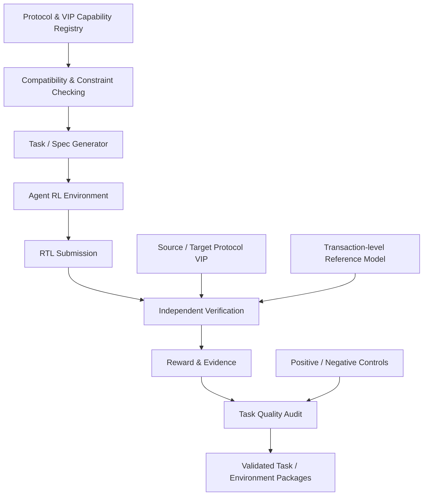

# ProtocolBridge-RL

> **VIP-Grounded Protocol Conversion Tasks and Environments for RTL Agent Reinforcement Learning**  
> 基于协议验证 IP 的 RTL 协议转换任务生成、Agent 交互环境与可验证奖励研究。

**研究问题：如何将成熟的硬件协议知识与验证机制，系统地转化为具有真实工程意义、可执行且具有可信奖励的 Agent RL 任务？**

[系统架构与方法](#方法概览) · [任务包规范](#计划交付的任务包规范) · [研究资料与证据](#研究资料与证据)

## 项目简介

ProtocolBridge-RL 旨在将数字芯片领域成熟的**协议规范、验证 IP（Verification IP, VIP）与仿真检查机制**转化为可供大语言模型（LLM）和编程 Agent 学习、评测的任务资产。

项目以 **RTL 协议转换器（Protocol Bridge / Adapter）** 为主要任务对象：在给定源协议、目标协议及功能约束的条件下，由 Agent 阅读设计规格、开发可综合 RTL、调用编译与仿真工具，并提交设计。可信验证环境根据两端协议行为、跨协议事务映射和独立参考模型生成程序化反馈与终局奖励。

目标不仅是判断一份 RTL 能否通过测试，还包括研究：**怎样自动生成工程上有效的任务、怎样使奖励足够可信，以及怎样让任务具备可重复采样和训练泛化价值。**

## 核心研究问题

- **任务可生成性**：如何从协议功能集合中自动识别有意义、可实现、可验证的转换关系，并形成无歧义的设计规格？
- **专业能力覆盖**：如何构造覆盖协议理解、RTL 实现、时序与握手、错误处理、复位、参数化和验证反馈利用的任务？
- **验证可信度**：如何结合 VIP 的 BFM、Monitor、Protocol Checker、Assertion 和 Coverage，以及独立的端到端事务级参考模型，判断提交的 RTL 是否真正正确？
- **奖励质量**：如何发现测试空洞、错误接受、错误拒绝、测试投机及基础设施异常，避免产生误导训练的奖励？
- **Agent RL 适配**：如何把任务封装为可重置、可交互、可重复执行、能输出机器可读奖励的 Task / Environment Package？
- **训练价值**：任务多样性、反馈方式和难度设置会如何影响模型行为？如何通过独立留出任务检验泛化，而非仅记住公开测试？

## 方法概览



### 1. 协议与 VIP 能力登记（Capability Registry）

记录每个协议与验证后端可用的能力及限制，例如：

- 协议、版本与角色（Master、Slave、Initiator、Target 等）；
- 通道、事务类型、突发、响应、背压、错误及重试语义；
- 地址／数据宽度、时钟／复位模型、允许的并发与顺序规则；
- 可用的 BFM、Monitor、Checker、Assertion、Sequence、Coverage；
- 仿真器、许可证、运行成本与允许公开的资产边界。

**协议组合不等于任意两种接口的随机配对。** 系统应首先判断两者是否存在明确的事务映射，必要时限定功能子集或补充应用层语义；无法形成确定契约的组合不应发布为训练任务。

### 2. 任务与规格生成（Task / Spec Generation）

针对有效的协议组合，生成具有明确接口和验收要求的设计规格。规格应覆盖：

- 两端信号、事务及支持的协议功能子集；
- 地址、数据、字节使能、响应码及事务映射；
- 事务顺序、拆分／合并、背压、等待与超时；
- 时钟域、复位、未完成事务及异常处理；
- 参数范围、资源约束和明确不支持的行为。

生成的规格须通过结构化约束检查、可实现性审查及参考行为模型校验，避免把模糊或不可满足的要求交给模型。

### 3. Agent 交互环境（Agent Environment）

任务环境向求解 Agent 提供公开规格、初始 RTL 工作区以及受限工具接口。

```text
reset(task_id)
  → observe(spec, workspace)
  → edit / compile / simulate / inspect
  → receive development feedback
  → revise
  → submit(RTL)
  → independent verification
  → terminal reward
```

Agent 可以利用**公开开发测试**进行调试；最终提交后应在干净、受信的环境中独立评分。评分器、隐藏测试与参考答案不得向 Agent 暴露，也不得被 Agent 的文件操作修改。

### 4. 分层验证（VIP-Grounded Verification）

验证不依赖单一 PASS 标志，而采用互相补充的检查：

| 层次 | 检查内容 | 主要依据 |
| --- | --- | --- |
| RTL / 工程有效性 | 文件、模块接口、编译与展开、必要的可综合性约束 | 编译器、Lint、综合工具 |
| 源端协议合规性 | 输入握手、合法事务接收及响应行为 | Source-side VIP / Checker |
| 目标端协议合规性 | 输出时序、等待、响应和协议状态 | Target-side VIP / Checker |
| **跨协议功能正确性** | 地址／数据映射、事务完整性、顺序、响应、错误传播 | **独立 Transaction Oracle + Scoreboard** |
| 执行完整性 | 测试是否真正执行、事务是否完成、是否超时或提前退出 | Test Runner / Monitors |
| 覆盖与鲁棒性 | 边界条件、保留随机种子、断言及已知错误变体 | Coverage / Mutation Tests |

**两端 VIP 的协议检查全部通过，不等于桥接功能正确。** 即使两侧事务各自合规，仍可能出现数据映射错误、事务丢失／重复、顺序破坏或响应错误。因此，独立的跨协议语义参考模型是本项目的核心组件。

协议 VIP 的 Sequence 需要按照具体任务规格筛选；不要求也不应该无条件执行所有 Sequence。仅支持特定协议子集的任务，应当据此生成适用的测试计划。

### 5. 奖励与任务质量审计（Reward & Quality Audit）

终局奖励优先采用**受信正确性门控**，而不是将编译成功、覆盖率和断言数量随意加权。

- `pass`：提交有效、必要检查全部执行且通过、事务与期望一致；
- `fail`：存在已确认的设计错误、协议违规或必要测试失败；
- `invalid`：评分器故障、环境错误、测试未完整运行或结果不可判定；不应将这类情况当作模型的设计失败。

在数据发布前，对奖励机制开展正反对照审计：

1. 正确参考实现应当通过；
2. 已确认不符合规格的错误变体应当被检出；
3. 采用不同实现方式的合法设计不应因依赖参考实现细节而被拒绝；
4. 固定候选在相同环境中重放，应当得到稳定且可解释的结果；
5. 提交代码无法读取、覆盖、伪造或跳过评分过程；
6. 验证报告记录实际执行量、反例、工具日志及测试版本。

开发反馈、训练终局奖励与最终独立评测使用不同的权限和数据边界；训练期间不可见的测试**不自动等于**独立的泛化测试集。

## 计划交付的任务包规范

每个通过质量审查的任务应能够以自包含或依赖可解析的方式导出，例如：

```text
protocolbridge-task/
├── task.yaml                 # 任务 ID、能力标签、参数、预算与终止规则
├── spec.md                   # Agent 可见的完整设计规格
├── workspace/                # Agent 初始工程（RTL、构建文件等）
├── environment/              # reset / step / submit 工具和运行配置
├── verifier/                 # 受信测试、协议适配、事务参考模型与评分
├── controls/                 # 已知正确／错误对照及变异审计材料
├── metadata/                 # 来源、版本、许可、任务家族和数据划分
└── quality_report.json       # 正反对照、覆盖、重放及风险记录
```

该结构是**预期接口草案**，不是当前已经发布的任务包清单。目标是方便外部训练系统加载任务、重置环境、执行模型动作、获取程序化反馈，并可追溯每次评分的依据。

## 实验与评估原则

项目将区分三个不能相互替代的目标：

1. **任务有效性**：规格清晰、可实现，验证器能够正确判断答案。
2. **环境可训练性**：Agent 能进行真实的多步操作，能够获得适度反馈；任务可重置、隔离、重复采样。
3. **能力提升证据**：训练后的模型能够在独立、非重叠的任务家族和场景中表现出可重复的改进。

拥有可运行的任务包不代表已经证明训练收益；最终训练效果需通过单独的训练前后对照与留出集实验检验。

## 开源与商业 VIP 边界

项目拟采用**公开可复现的基础验证路径**与**在合法许可环境中运行的工业 VIP 后端**相分离的架构。

- 公开部分仅包含允许再分发的原创代码、任务规格、示例数据、环境接口和验证材料；
- 商业 VIP、专有 Sequence、预编译库、许可证以及受限制的测试资料不纳入公开仓库；
- 不将商业 VIP 文件或其专有内容发送给第三方模型服务，除非授权明确允许；
- 需要商业工具的检查应通过可配置适配器接入，并明确标注其复现条件；
- 来自开源协议实现或测试框架的衍生资产保留相应许可证和来源记录。

公开仓库不包含、也不提供 Synopsys 等厂商的商业验证 IP。

## 研究资料与证据

项目将架构设计、协议资源研究、仿真验收和任务质量实验分别记录。主页描述研究目标与方法论；**具体已完成的调查、测试条件和证据边界以带日期的研究文档及仓库中实际可检索的产物为准**。

| 研究资料 | 内容与证据范围 |
| --- | --- |
| [R-2020.12 VIP Resource Inventory](docs/vip-inventory-r2020.12.md) | 对 50 个分发包及其协议定位进行初步分类，定义能力矩阵与待核字段 |
| [VIP Capability Audit — 2026-11-24](docs/vip-audit-2026-11-24.md) | 本地审计报告显示 50/50 包可读取；五个重点包有文档级能力证据；I²C、AMBA 存在历史运行线索 |

后续研究重点是将文档中确认的协议能力与可执行工具链连接起来，以实际事务、Checker 启用状态、正反对照和独立 Scoreboard 检验 Verifier 的有效性。**截至上述审计日期，这些材料尚不能证明完整 RL 环境已经实现，或者存在任何通过全部运行及负例验收的商业 VIP 后端。**

本仓库不发布未获授权的商业 VIP、专有 Sequence、许可证文件或受限文档；来自本地环境的成果将先做证据与公开权限检查。

## 相关技术与研究

- **RTL / SystemVerilog**：数字硬件设计与可综合实现。
- **UVM / VIP / cocotb**：协议激励、事务监测、断言与功能验证。
- **VCS / Verilator / Icarus Verilog**：可配置仿真后端（可用性取决于具体任务和环境）。
- **Yosys / SymbiYosys**：适用情况下的综合、等价性和形式验证。
- **Agent RL / RLVR**：可重置任务环境、工具使用轨迹、程序化可验证奖励与训练评估隔离。

可参考的开源工作：

- [HWE-bench](https://github.com/pku-liang/hwe-bench)：真实硬件 Bug 修复任务与可复现执行环境。
- [EquivSVA](https://github.com/aditigupta96/EquivSVA)：行为规格、等价 RTL、断言与变异验证数据。
- [VeriRL](https://github.com/SupreethRao99/veriRL)：多步 RTL Agent 环境与工具奖励接口。
- [cocotbext-axi](https://github.com/alexforencich/cocotbext-axi)：公开的 AXI / AXI-Lite / APB 仿真模型。

---

**ProtocolBridge-RL focuses on turning protocol knowledge and verification evidence into reproducible, reward-verifiable RTL Agent tasks—not merely generating more RTL examples.**