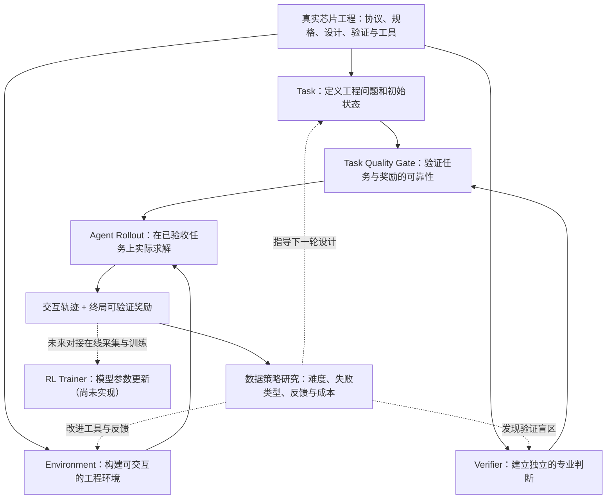
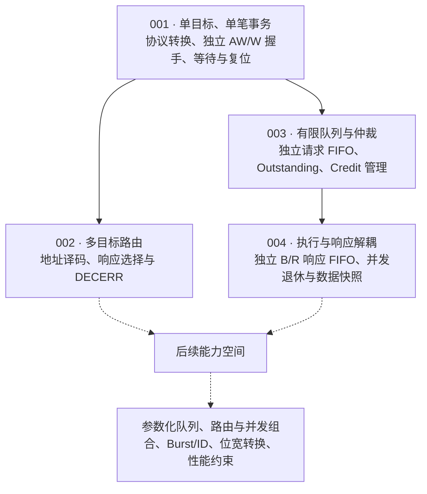
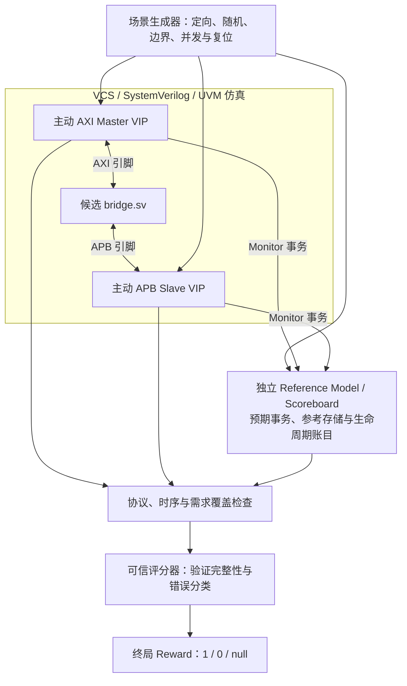
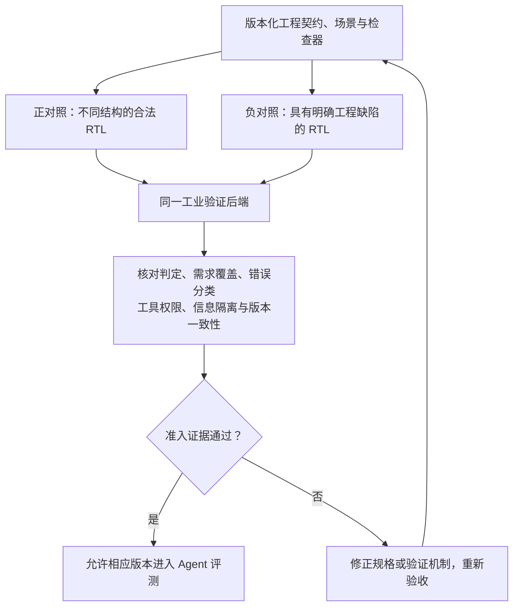
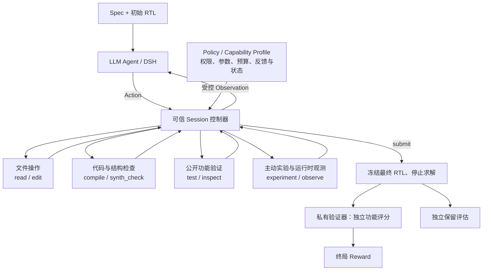
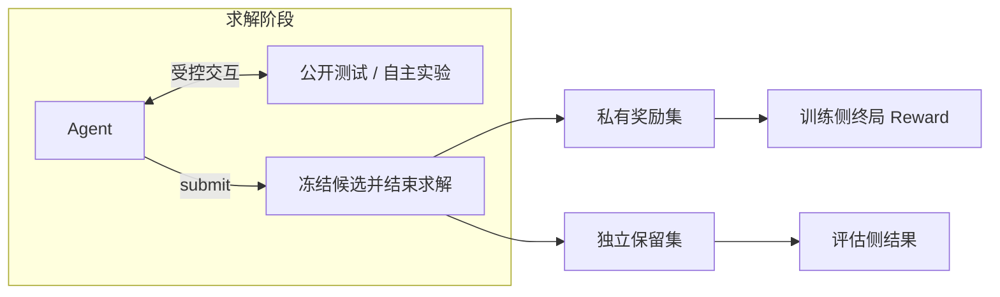
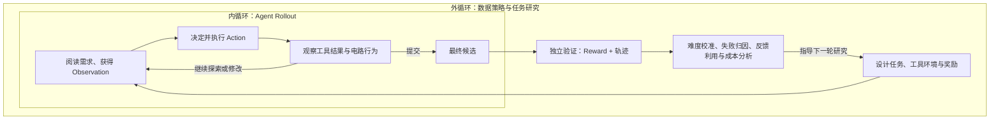
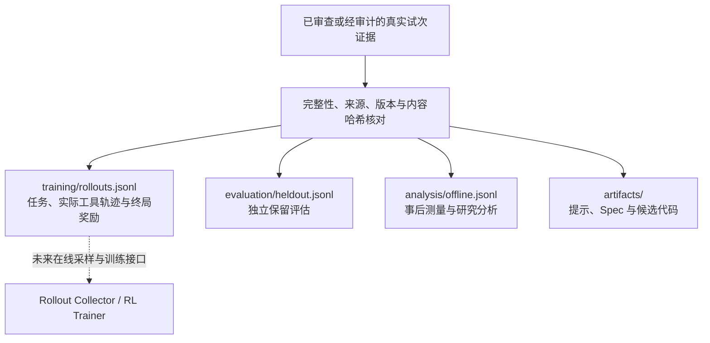

# ProtocolBridge-RL

**将真实芯片工程问题转化为可执行、可交互、具有可信奖励的 Agent 强化学习任务。**

ProtocolBridge-RL 以 AXI → APB 协议桥设计（X2P）为切入点，利用工业协议 VIP、独立功能验证和真实 EDA 工具，构建面向大模型后训练的专业任务与交互环境。项目不仅研究模型能否生成正确 RTL，也研究它如何理解规格、调用工具、观察电路、构造实验和修复缺陷，以及这些过程怎样形成有价值的训练数据。

**当前成果：** 4 个已完成独立验证验收的 RTL 任务 · 9 种已实现的受控 Agent 动作（分配置开放） · 88 条分批研究试次记录 · 版本化轨迹交换 v1–v3。

> 当前是 Agent RL 任务、环境、奖励与数据策略的工程研究原型。已实际运行固定模型 Rollout，**尚未开展模型参数更新或训练收益评估**。

[任务体系](#1-任务体系从工程能力到-task) · [验证与奖励](#2-验证与奖励将专业判断程序化) · [Agent 环境](#4-agent-环境从代码生成到主动工程探索) · [研究结果](#6-数据策略真实-rollout-与研究发现) · [项目结构](#8-项目结构) · [快速开始](#9-快速开始)

## 项目整体逻辑

面向芯片专业能力的强化学习，首先需要解决三个问题：**让模型做什么、允许它通过什么方式完成、如何可靠判断它做得对不对。**



项目的核心不是一个特定的 Bridge 或 Agent Harness，而是一套将专业工程知识转化为任务、交互机制、验证能力与训练数据的方法。工业工具提供实际执行能力，项目自身负责工程契约、独立判据、信息边界和研究设计。

## 1. 任务体系：从工程能力到 Task

协议转换具有明确的输入输出、成熟协议规范、丰富的微架构设计空间和可执行的验收标准，适合探索专业领域的可验证奖励任务。

每个 Task 包含：

- **Spec**：协议子集、功能需求、时序约束、复位语义和不支持的行为。
- **初始 RTL**：固定接口的实现模板；修复研究也可使用历史 Agent 生成的真实错误 RTL。
- **任务元数据**：能力标签、版本、验证后端、运行入口和奖励契约。
- **验证与验收材料**：任务专用场景、独立检查逻辑、合法参考实现及已知错误对照。后两者不向求解 Agent 开放。

### 已构建的四个任务



| Task | 核心工程能力 | 事务能力与约束 | 任务包与报告 |
| --- | --- | --- | --- |
| 001 | 基础 AXI4-Lite → APB4 转换 | 单 APB 目标；全局一笔 Outstanding | [任务包](tasks/axil_to_apb4_001/README.md) · [验证报告](mvp-evaluation-report.md) |
| 002 | 三目标地址译码、路由、局部地址转换、响应 MUX、DECERR | 三 APB 目标；全局一笔 Outstanding | [任务包](tasks/axil_to_apb4_router_002/README.md) · [研究报告](docs/task002-evaluation-report.md) |
| 003 | 独立 AW/W/AR 请求队列、FIFO 配对、容量和读写轮询仲裁 | 每通道两个未退休名额；APB 执行与 AXI 响应消费耦合 | [任务包](tasks/axil_to_apb4_queue_003/README.md) · [研究报告](docs/task003-evaluation-report.md) |
| 004 | 请求、执行与响应生命周期解耦；非二次幂 FIFO、数据快照、同周期入队出队 | 每通道三个未退休名额；APB 串行执行，B/R 响应可独立积压 | [任务包](tasks/axil_to_apb4_decoupled_004/README.md) · [研究报告](docs/task004-evaluation-report.md) |

002 与 003 分别扩展空间路由和时间并发能力，并非简单的线性难度递增。004 则要求在旧 AXI 响应积压时仍推进可执行的 APB 事务，显著增加事务生命周期管理要求。

四个任务均使用 AXI4-Lite；完整 AXI4 Burst/ID、参数化深度、CDC 和工业 PPA 优化尚不在当前任务契约内。

**实现入口：** [Task Registry](tasks/registry.json) · [Registry Schema](tasks/registry.schema.json) · [统一任务目录与 CLI](docs/task-catalog.md)

## 2. 验证与奖励：将专业判断程序化

大模型提交 RTL 后，不依赖另一个模型或人工主观评分，而是由工业仿真环境和独立任务检查器判定其行为。



各部分的职责：

| 组件 | 工程职责 |
| --- | --- |
| VCS | 编译并执行 SystemVerilog 仿真 |
| Synopsys AMBA VIP | 产生协议激励、模拟目标等待与错误、观察实际事务并检查协议合规性 |
| 独立 UVM Scoreboard / Reference Model | 根据 Spec 与实际接受的请求维护预期行为，检查跨协议地址、数据、字节使能、响应、顺序与事务账目 |
| 时序检查与功能覆盖 | 验证请求接受、响应稳定、复位、仲裁及关键需求场景是否真实发生 |
| Python 评分器 | 汇总仿真证据，检查必要测试、事务计数与覆盖是否满足，区分 DUT 错误与不可判定结果 |

**协议合规不等于转换功能正确。** 例如，Bridge 将 AXI 地址 A 错误地转换为 APB 地址 B，两侧协议都可能合法；只有任务特有的跨协议功能检查能够判定该错误。

Task003/004 的 Scoreboard 进一步独立建模请求队列、仲裁、未退休额度和完成响应。它不读取 DUT 自己的计数器来决定正确答案，也不把参考 RTL 的源码作为运行时答案。

### Reward 契约

| 终局结果 | 含义 |
| --- | --- |
| `1.0` | 所有必要验证条件完整通过 |
| `0.0` | 确认存在候选 RTL 编译、功能、协议或时序错误 |
| `null` | 无有效提交、验证不完整或基础设施问题导致不可可靠判定 |

`null` 不是数值零；接入训练框架时需要独立处理。Reward=1 只代表通过规定的验证范围，并非对所有输入序列的正确性证明。无法归因的超时也不能直接判为 RTL 错误。

**实现入口：** [场景与评分器](verifier/) · [003 Scoreboard](verifier/task003/scoreboard.sv) · [004 Scoreboard](verifier/task004/scoreboard.sv) · [架构与检查原理](docs/architecture.md)

## 3. Task Quality Gate：验证我们的验证器

用于后训练的奖励必须可靠。仅有一份参考实现 PASS，不能证明错误答案会被拒绝，也不能证明其他合法实现会被接受。



| Task | 合法参考通过 | 已知错误检出 | 完整 / 公开 case | 代表性验收证据 |
| --- | ---: | ---: | ---: | --- |
| 001 | 1/1 | 10/10 | 22 / 17 | 576/576 必要交叉覆盖 bin；[工业验证](experiments/industrial-v3/README.md) |
| 002 | 2/2 | 13/13 | 26 / 21 | 40 项机制检查；[质量门禁](experiments/task002-v1/quality/result.json) |
| 003 | 2/2 | 15/15 | 21 / 19 | 33/33 必要需求 bin、40 项机制检查；[质量门禁](experiments/task003-v1/quality/result.json) |
| 004 | 2/2 + 额外合法延迟参考 | 14/14 | 23 / 21 | 37/37 必要需求 bin、40 项机制检查；[质量门禁](experiments/task004-v1/quality/result.json) |

001 冻结基线的完整回归包含 2,868 笔计划事务，其中 2,842 笔正常检查完成、26 笔按规格复位取消。错误对照要求在真实仿真中检出明确缺陷，可在首错处结束，不将未运行 case 记为通过。必要需求覆盖也不等于穷尽全部组合与状态空间。

002–004 使用源码与工具链绑定的准入机制；改变相关实现后，必须重新获得匹配证据。001 保留原有 revision 3 验收与冻结基线。

**实现入口：** [正反对照](fixtures/) · [Task Quality Gate](environment/task_quality.py) · [验收方法](docs/task-quality-gate.md) · [验证计划与盲区](docs/verification-plan.md)

## 4. Agent 环境：从代码生成到主动工程探索

真实工程师不会只写一次代码并等待最终评分，还会编译、测试、观察、设计实验、定位问题和验证修复。因此，项目将这些工作方式转化为受控的 Agent–Environment 交互。



目前实现九种动作，具体能力由独立版本化配置决定，**并非每个任务或每次试次都同时开放全部工具**。

| 动作 | 功能 | 实现 |
| --- | --- | --- |
| `read` / `edit` / `submit` | 阅读需求和 RTL、修改候选、冻结最终提交 | [Session](environment/policy_session.py) |
| `test` | 执行公开功能测试 | [Policy 与反馈](docs/observation-policy.md) |
| `compile` | 独立编译 RTL，无需加载完整 VIP 功能仿真 | [工程工具](environment/engineering_tools.py) |
| `inspect` | 查询最近公开测试违反的具体需求 | [工程工具](docs/engineering-tools.md) |
| `synth_check` | DC 逻辑综合和受控结构诊断 | [综合工具](docs/synthesis-tools.md) |
| `experiment` | 选择公开 case，或自行构造受限事务激励 | [运行时工具](environment/runtime_tools.py) |
| `observe` | 查询实验的逐周期接口信号、握手事件和未退休计数 | [运行时实验接口](docs/runtime-experiments.md) |

### 主动实验与运行时观测

Agent 可以选取特定公开场景：

```json
{"tool":"experiment","scenario":"write_fifo"}
```

也可以构造自定义读写事务，配置地址、数据、字节使能、AW/W 延迟、APB 等待、响应背压等条件，再查询最近一次实验的真实运行过程：

```json
{"tool":"observe","start":24,"count":8}
```

目前仅 Task003 已验收该实验能力。其底层复用真实 VIP 与独立 Scoreboard，并增加[只读 SystemVerilog 接口观测器](environment/runtime/observer.sv)，在时钟边沿前后采样引脚。未退休额度通过实际 AXI 握手独立累计；观测绑定具体候选 RTL，不将旧结果误作新候选的证据。

### 综合与实现检查

`synth_check` 已在 Task003/004 的可选配置中接入 Design Compiler。可信侧还打通了 DC 映射综合 → Formality 自身网表等价检查 → PrimeTime/PX 教学库测量流程。

Formality 检查的是候选 RTL 与**其自身综合网表**的一致性，而非与正确参考实现的任务语义等价。当前面积、时序、功耗使用教学库与假设活动率，不作为工业 PPA 签核证据，也不进入功能 Reward。

**实现入口：** [Agent 生命周期](docs/agent-workflow.md) · [独立编译与诊断](docs/engineering-tools.md) · [综合检查](environment/synthesis/) · [运行时实验](docs/runtime-experiments.md)

## 5. 信息边界：公开探索、私有奖励与保留评估

同一个 Task 可以配置不同的可见信息与工具能力，以研究反馈怎样影响求解过程，同时保持终局任务判据不变。

| 基础策略 | 求解阶段可用信息 |
| --- | --- |
| A · Spec-only | Spec、RTL；不允许公开功能测试 |
| C · Test-verdict | 可执行公开测试，获得 PASS / FAIL / ENV_ERROR |
| E · Test-diagnostic | 在 C 的基础上提供错误类别、首错 case 和受控诊断 |

增强配置在 E 基础上分别增加 `compile/inspect`（Task003）、`synth_check`（Task003/004）或 `experiment/observe`（Task003）。运行时实验还区分只返回判定和返回详细事件时间线的两种匹配条件。每种配置的动作、预算、反馈与实际曝光均独立记录。



三个区域承担不同职责：

- **公开开发测试与自主实验**帮助模型获得信息、定位缺陷；实验 PASS 不直接产生终局奖励。
- **私有奖励集**在提交且求解停止后使用冻结输入验证最终候选；测试细节不回流给该次 Agent。
- **独立保留集**使用另一组冻结输入评估同一提交，不替换终局 Reward。

隐藏的是测试输入与内部证据，而不是任务规格。公开、私有与保留测试共享任务语义和验证后端，因此仍可能存在共同盲区。控制器使用受限 HDL、文件和工具白名单、调用预算、进程隔离及超时等机制控制信息与执行边界，尚不构成针对任意恶意代码的完整安全证明。

**实现入口：** [Policy 配置](environment/policies/) · [反馈投影](environment/feedback.py) · [批量执行与审计](docs/batch-study.md)

## 6. 数据策略：真实 Rollout 与研究发现

本项目同时运行两个循环：**内循环**是模型解决工程任务的多轮交互，**外循环**是研究者依据真实求解结果改进任务、环境、验证和数据策略。



### 任务能力与难度校准

以下为固定模型 `deepseek-flash` 的主要独立生成批次，成功表示最终私有 Reward=1。不是参数训练结果。

| 任务 | A：Spec-only | C：判定 | E：诊断 | 独立生成成功数 |
| --- | ---: | ---: | ---: | ---: |
| 001 | 7/10 | 8/10 | 8/10 | 23/30 |
| 002 | 2/3 | 2/3 | 2/3 | 6/9 |
| 003 | 0/3 | 1/3 | 0/3 | 1/9 |
| 004 | 0/2 | 未测 | 0/2 | 0/4 |

001 的新版批次成功较多；003/004 暴露出并发状态更新、请求容量与响应生命周期方面的困难。但各任务规格、样本量和运行条件不同，不能把这些数字当作严格难度排序。004 有一条试次因动作格式错误未形成编辑候选，故四条启动试次中只有三条实际形成 RTL 编辑候选。

研究目标不是一味提高难度，而是根据模型实际表现、失败类型和奖励分布寻找具有工程意义且能够提供有效训练信号的任务。

### 工具与反馈如何影响修复？

| 对照或探索实验 | 真实结果 | 证据 |
| --- | --- | --- |
| 001：同一握手错误起点，C vs E | 1/3 vs 3/3 | [批量研究报告](docs/batch-evaluation-report.md) |
| 003：同一队列错误起点，C vs E | 0/3 vs 0/3 | [配对修复报告](docs/task003-repair-report.md) |
| 003：原 E vs E+编译/具体诊断 | 0/2 vs 0/2；增强组出现与缺陷相关的修改 | [工程工具研究](docs/engineering-tools-evaluation.md) |
| 003：E+综合检查，独立生成 | 0/1；最终 RTL 综合和自身网表等价 PASS，功能 FAIL | [综合工具研究](docs/synthesis-tools-evaluation.md) |
| 003：主动实验的判定 vs 时间线反馈 | 0/1 vs 0/1；真实错误窗口已曝光但仍未修复 | [运行时研究](docs/runtime-tools-evaluation.md) |

**代表性发现：队列空位不等于 Outstanding 额度。**

Task003 规定从 AXI 接受到对应响应被消费前，请求始终占用未退休额度。多个真实 Agent 候选却在 APB 选择或执行完成时提前释放容量。

在已知错误对照 `bad_early_credit.sv` 的真实仿真中，运行时观测捕获了如下过程：

| 周期 | 实际接口事件 | 未退休 AW / W / AR |
| ---: | --- | --- |
| 14 | 接受 AW、W | 2 / 2 / 0 |
| 15 | APB Setup | 2 / 2 / 0 |
| 16 | APB 完成 | 2 / 2 / 0 |
| 17 | 再次接受 AW，尚无 B 退休 | **3 / 2 / 0，违反容量上限** |

[实际仿真证据](experiments/runtime-tools-v1/observed-capacity-counterexample.json)

进一步的真实修复试次中，Agent 获得了类似的错误时间线，并修改代码，但重复实验的局部引脚记录逐行不变；另一项试次中的错误 RTL 甚至能够通过综合及自身网表等价检查。这些观察说明：

- 能生成可编译、可综合的 RTL，不等于满足工程契约。
- 工具可用、实际调用、获得有效反馈、定位根因和完成有效修复是不同层次。
- 自主实验需要测量实际验证目标，而不只统计工具调用次数。
- 动作格式问题和基础设施故障必须与真正的 RTL 错误区分。

这些结论基于有限的探索性样本，不能推出某一种反馈必然更优或无效。模型参数固定、采样不完全确定，也未验证训练收益。

### 数据生产效率

专业 Agent 数据的成本不只是模型 Token。最新两条运行时试次合计约 866 秒，其中 VCS 编译累计约 753 秒、仿真约 64 秒、模型请求约 44 秒（含 SDK/网络开销；不含前置质量门禁）。因此，编译复用、局部实验与评分调度也是规模化采集需要研究的问题。

更多证据：[001–003 多任务研究总结](docs/multi-task-research-report.md) · [研究索引](experiments/engineering-stage-research-index.json) · [全部技术文档](docs/README.md)

## 7. Rollout 数据交付与后训练接口

Task 定义了可重复执行的问题；Rollout 是某个模型在特定 Task 与环境条件下的一次完整求解。当前 DSH 使用自定义文本 JSON 动作协议，可信控制器严格解析并执行动作，再将受控 Observation 送回模型。该机制已实现真实多轮交互，并不等同于模型 API 的原生 Tool Calling。

当前交付保留任务与环境版本、模型标识、实际工具动作和反馈、候选 RTL、最终提交、终局奖励、失败归因及成本信息。不同任务、策略、生成/修复条件分别归档。



| 交付版本 | 已实际验证的范围 |
| --- | --- |
| v1 | 六批 77 条结果记录，37 条已审查工具轨迹 |
| v2 | 九批 85 条结果记录，45 条已审查工具轨迹；支持编译/诊断增强配置 |
| v3 | 额外三条真实试次（综合一条、运行时两条）；记录综合、主动实验与观测反馈 |

当前研究范围合计 **88 条结果记录、48 条已审查工具轨迹**（v2 与新增 v3 合计，v1 已包含于 v2，不重复计数）。保留全部启动试次与不可判定状态，不凭统计补造缺失轨迹，不混合不同实验条件计算成功率。

**尚缺原始模型采样、Token IDs、行为策略 Log Probability 和精确权重修订等训练所需信息。** 目前是可复用的 Task/Environment、可验证奖励和可审计轨迹交换基础，尚不是无损的 on-policy RL 训练数据，也没有接入在线 Collector 或参数优化器。

**实现入口：** [数据交付契约](docs/rollout-data-contract.md) · [轨迹导出](scripts/export_rollout_exchange.py) · [v3 导出](scripts/rollout_exchange_v3.py) · [v2 验收](experiments/trajectory-exchange-v2/validation.json) · [v3 证据](experiments/runtime-tools-v1/exchange/manifest.json)

## 8. 项目结构

```text
ProtocolBridge-RL/
├── tasks/                         # 任务契约、初始 RTL、版本与能力目录
│   ├── registry.json
│   ├── axil_to_apb4_001/
│   ├── axil_to_apb4_router_002/
│   ├── axil_to_apb4_queue_003/
│   └── axil_to_apb4_decoupled_004/
├── environment/                   # Agent 生命周期、权限、工具与质量准入
│   ├── policies/                  # A/C/E 策略
│   ├── policy_session.py          # 基础交互控制
│   ├── policy_experiment.py       # 批量 Rollout
│   ├── task_quality.py            # 新任务质量门禁
│   ├── engineering_tools.py       # 编译与需求级诊断
│   ├── synthesis/                # DC / Formality / PT 脚本
│   └── runtime/                  # 只读接口观测器
├── verifier/                      # 场景生成、工业验证与程序化评分
│   ├── v3/                       # 001 冻结验证后端
│   ├── task002/
│   ├── task003/
│   └── task004/
├── fixtures/                      # 合法参考及错误 RTL 对照
├── scripts/                       # 统一入口、批量分析、审计与数据导出
├── schemas/                       # 已版本化的轨迹交换约束
├── tests/                         # 自动化机制、兼容性与边界测试
├── experiments/                   # 已审查的实验结果和证据
└── docs/                          # 架构、工作流、研究报告与复现说明
```

| 想了解或复用什么 | 从这里开始 |
| --- | --- |
| 任务定义与统一运行 | [Task Catalog](docs/task-catalog.md) · [CLI](scripts/tasks.py) |
| Agent 与验证机制 | [架构](docs/architecture.md) · [Agent 工作流](docs/agent-workflow.md) |
| Verifier 可靠性 | [质量门禁](docs/task-quality-gate.md) · [验证计划](docs/verification-plan.md) |
| 受控工程工具 | [工程工具](docs/engineering-tools.md) · [综合](docs/synthesis-tools.md) · [运行时实验](docs/runtime-experiments.md) |
| 真实研究证据 | [实验目录](experiments/) · [报告导航](docs/README.md) |
| 数据导出与后训练边界 | [Rollout Data Contract](docs/rollout-data-contract.md) |

## 9. 快速开始

在仓库根目录运行以下命令。任务目录查询、历史基线核对和 Python 单元测试无需启动工业仿真或调用模型。

```bash
git clone https://github.com/5Mcv4He/ProtocolBridge-RL.git
cd ProtocolBridge-RL

python3 scripts/tasks.py list
python3 scripts/tasks.py show axil_to_apb4_queue_003

# 核对冻结源码与证据（不执行新的 RTL 仿真）
python3 -m environment.check_baseline
python3 -m unittest discover -s tests -v
```

### 实际运行与验收

工业验证需要合法授权的 VCS、AMBA SVT VIP、UVM 与对应 Linux 执行环境；真实 Agent Rollout 另需 DSH Runtime 和模型 API 配置。配置示例见 [environment/config.example.json](environment/config.example.json)，完整步骤见[运行手册](docs/mvp-running.md)与[工具链说明](docs/toolchain.md)。商业工具及库不随仓库分发。

以下使用 Task003 展示统一入口：

```bash
# 创建独立求解工作区，再编辑其中的 bridge.sv
python3 scripts/tasks.py reset axil_to_apb4_queue_003 .local/queue-work

# 公开功能测试与独立提交验证
python3 scripts/tasks.py test axil_to_apb4_queue_003 .local/queue-work .local/queue-public
python3 scripts/tasks.py submit axil_to_apb4_queue_003 .local/queue-work .local/queue-submit

# 对当前源码与工具链执行真实正反例质量验收
python3 scripts/tasks.py quality axil_to_apb4_queue_003 .local/queue-gate

# 小规模真实 Agent 评测（按需配置模型 API）
python3 scripts/tasks.py rollout axil_to_apb4_queue_003 -- \
  --admission .local/queue-gate --out .local/queue-pilot \
  --protocol text-json-atomic-v2 --repeats 3 --limit 9 \
  --max-tokens 600000 --max-seconds 5400
```

手动 `submit` 使用可重放的默认验证输入；正式 Agent 试次由可信控制器冻结私有评分与保留输入，并在求解停止后执行。新增工具的具体验收、调用方式和配对实验方法见各工具文档。

全部运行使用新输出目录，不能覆盖冻结历史成果。公开证据与哈希可用于核对同一性、理解研究方法；精确重放未公开的私有输入仍需要可信侧记录，非确定性模型采样也不保证产生相同 RTL。

## 10. 当前边界与研究方向

| 已建立 | 下一阶段研究 |
| --- | --- |
| 四个工程任务与统一 Registry | 更细粒度的能力分类、难度梯度与任务组合，探索可扩展任务生成 |
| 工业仿真、独立 Scoreboard 与质量门禁 | 持续补足 Verifier 盲区，研究更丰富且可信的奖励 |
| 九种分配置开放的受控动作 | 改进事件定位与实验契约，逐步组合工程工具、探索更自主的验证方式 |
| 固定模型 Rollout 与失败分析 | 更多错误起点、模型与推理条件的对照，研究奖励分布与轨迹价值 |
| 版本化离线数据交换 | 在线 Collector、资源调度、训练接口及最终训练收益评估 |

目前没有自动 Task Generator、完整任意 Testbench 执行环境、全设计形式属性证明、工业 PPA 奖励或大规模在线采集与 RL 参数更新。有限仿真和正反例不能证明验证器完备；公开 Spec、参考实现和验证代码存在预训练污染可能。

**最终目标是建立一套可以持续生产、验证、校准和改进专业 Agent 强化学习任务与环境的体系，让真实芯片工程经验能够成为可执行、可验证、可研究的后训练资源。**
