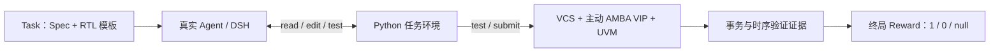

# ProtocolBridge-RL

用真实 RTL 仿真和工业协议 VIP，为编程 Agent 提供可复现的协议转换任务及程序化奖励。

当前唯一标准基线是 **001 X2P（AXI4-Lite → APB4）** 任务：单时钟、32-bit、单笔未完成事务。Agent 读取 Spec、修改 RTL、调用公开测试并提交；VCS 中的主动 AXI/APB VIP 与 UVM Scoreboard 执行验证。Python 负责调度和 Reward 封装，不承担功能比对。



## 如何理解和讲解本项目

固定的人类阅读入口：[docs/README.md](docs/README.md)。新任务和版本更新也在此维护导航、图示、用法和证据。

| 想了解什么 | 阅读入口 |
|---|---|
| 整体结构；task、环境、验证器和评分器的分工；Scoreboard 如何工作 | [当前架构与 Scoreboard](docs/architecture.md)（含系统与 UVM 数据流框图） |
| DSH 在哪里运行；Agent 能看什么、做什么；真实动作与奖励如何产生 | [真实 Agent 的执行与奖励](docs/agent-workflow.md)（含执行时序图、权限表和评分规则） |
| 如何配置、手动迭代、重放提交或再跑模型 | [环境配置与复用命令](docs/mvp-running.md) |
| 定向／随机／边界测试如何安排、是否充分 | [验证计划与覆盖](docs/verification-plan.md) |
| Agent 可见信息、工具权限和反馈粒度怎样控制 | [Observation / Feedback Policy](docs/observation-policy.md) |
| A／C／E 真实对照怎样运行、模型收到什么、结果能说明什么 | [Policy 实验报告](docs/policy-evaluation-report.md)与[可审计证据](experiments/policy-v1/README.md) |
| 批量能力评测、动作协议质量和配对修复如何研究 | [批量实验报告](docs/batch-evaluation-report.md) · [执行契约](docs/batch-study.md) · [全部试次统计与典型轨迹](experiments/batch-study-001/README.md) |
| 实际证明了什么、证据在哪里、还缺什么 | [评估报告](mvp-evaluation-report.md)与[验收证据](experiments/industrial-v3/README.md) |

建议讲解顺序：本页概览 → 架构与 Scoreboard → Agent 执行时序 → 真实结果与限制。当前已经跑通任务和奖励闭环，尚未进行 RL 参数训练。

## 标准基线

revision 3 单任务闭环已实际验证。DSH 在 UTM 内运行并调用 API；真实 Agent 经公开测试失败后自行修复，私有终局 Reward=1.0，独立保留评估也通过。

| 检查 | 实测结果 |
|---|---|
| 正确参考 | 22 个 case 通过；2868 笔计划事务，2842 笔正常完成、26 笔复位取消 |
| 必要交叉覆盖 | 576 / 576 个 bin 命中 |
| 随机流 | 4 组 × 256 笔，全部实际仿真通过 |
| 错误实现 | 10 / 10 被检出，包括两项商业 VIP 协议报错 |
| UTM 内真实 Agent | 10 轮动作；私有 22 case 通过，Reward=1.0；另一个保留评估集通过 |

这些结果证明计划内检查通过，不是所有输入的正确性证明，也不是完整工业签核。

旧 128 笔版本已废弃，其源码、向量生成器、导出脚本及交付记录已从当前版本删除。标准定义见[任务入口](tasks/axil_to_apb4_001/README.md)与[机器可读基线清单](tasks/axil_to_apb4_001/baseline.json)。

## Observation / Feedback Policy

在 revision 3 上新增独立实验入口，保留原验证器和旧复现命令。可信控制器执行文件白名单、工具权限、20 次动作预算及测试次数限制；完整结果经字段白名单投影后才返回求解者。提交后停止求解进程，再进行私有评分和独立保留评估。

| 模式 | 模型可用的公开功能反馈 | 公开调用预算 |
|---|---|---|
| A：Spec-only | 无；可以直接提交 | 0 |
| C：Test-verdict | PASS／FAIL／ENV_ERROR、剩余次数 | 2 |
| E：Test-diagnostic | C 的字段，加错误类别、首个失败 case 和受控短诊断 | 2 |

C／E 使用相同项目初始 prompt、工具、预算、公开集及私有判据。每个试次独立工作区和模型会话；同轮三组共享冻结的私有奖励输入和另一份保留输入。这是固定模型推理阶段对照，不是 RL 参数训练。

历史 Policy v1 已完成每组一次真实 `deepseek-flash` 试次（本表保留历史结果；新增批量研究单独见[报告](docs/batch-evaluation-report.md)）：

| 策略 | 公开调用／实际编辑 | 私有 Reward | 保留评估 |
|---|---|---|---|
| A | 0／2 | 1.0 | 1.0 |
| C | 1／2 | 0.0 | 0.0 |
| E | 0／0 | 0.0 | 0.0 |

C 收到仅含 FAIL 的反馈后修改，但独立 W 握手错误仍在。E 的多动作回复被拒绝，最终提交未修改模板，没有实际利用诊断反馈。31 项真实 VCS 机制检查与完整轨迹审计通过；发布单元检查 40 项通过。**每组仅一次，不能据此排名策略，也未得出详细诊断是否提高成功率的统计结论。**

```bash
python3 -m environment.policy_experiment \
  --out .local/policy-new \
  --policies spec_only,test_verdict,test_diagnostic \
  --model deepseek-flash --repeats 1
python3 scripts/audit_policy.py .local/policy-new
python3 scripts/analyze_policy.py .local/policy-new
```

配置与权限说明见 [Policy 文档](docs/observation-policy.md)；逐组真实结果、样本量、失败原因和限制见 [Policy 实验报告](docs/policy-evaluation-report.md)。

## 批量能力与反馈研究

已完成并审计53条真实轨迹：旧动作协议17条因格式质量不合格停止并完整保留；新版协议完成A/C/E各10次自主生成，以及C/E各3次同起点修复。Task、Verifier和Policy功能判据没有改动，仍未进行参数训练。

| 独立研究 | A | C | E |
|---|---|---|---|
| 新协议自主生成：私有成功／全部启动 | 7/10 | 8/10 | 8/10 |
| 同一真实错误RTL的配对修复 | — | 1/3 | 3/3 |

自主生成格式错误2/153动作，全部恢复，无环境失败；修复6条均真实收到FAIL并修改RTL。自主生成尚不足以排名策略；配对修复显示值得复验的差异，但只有一个错误起点。完整区间、实际反馈、失败逻辑、成本和结论边界见[批量报告](docs/batch-evaluation-report.md)；[证据目录](experiments/batch-study-001/README.md)保留全部试次摘要及选择展开的轨迹。

执行器支持冻结、逐次持久化、中断恢复、完成试次跳过、预算与质量停止。新研究显式选择新版文本动作协议：

```bash
python3 -m environment.policy_experiment --out .local/batch-new \
  --protocol text-json-atomic-v2 --repeats 10 --limit 9 \
  --max-tokens 1200000 --max-seconds 9000
# 质量与剩余预算允许后，用同一冻结源码继续到30条
python3 -m environment.policy_experiment --out .local/batch-new \
  --protocol text-json-atomic-v2 --repeats 10 --limit 30 --resume
```

方法、恢复边界与独立修复入口见[执行契约](docs/batch-study.md)。新版仍是严格文本JSON，并未实现原生Tool Calls。

## 运行

需要自行准备有授权的 VCS / AMBA SVT 环境，并配置 SSH。历史基线与新实验的工具链版本分别保存在对应清单；最新批量研究使用 VCS-MX O-2018.09-SP2、AMBA VIP R-2020.12、UVM 1.2。仓库不包含商业 VIP、许可证或密钥。

先按[环境配置与运行说明](docs/mvp-running.md)完成配置，然后在仓库根目录执行：

```bash
# 检查标准基线与已保存证据的一致性（不启动仿真）
python3 -m environment.check_baseline

# 参考实现及十个错误实现的真实 VCS 回归
bash environment/reproduce.sh .local/reproduction-001

# 原 v3 Agent 复现入口；新的反馈对照使用上面的 policy_experiment
bash environment/reproduce.sh .local/reproduction-002 --agent
```

也可单独调用 `python3 -m environment.reset`、`environment.test`、`environment.submit`；具体参数见运行说明。模型 API 调用消耗用户自己的额度。

## 交付内容

- `tasks/`：Spec、初始 RTL 和任务元数据。
- `environment/`：reset/test/submit、受限工具接口和 DeepSeek Harness。
- `verifier/v3/`：当前主动 VIP／UVM 验证实现。
- `fixtures/`：正确参考与十个故障实现。
- `experiments/industrial-v3/`：结果、精简工具轨迹、实际修复差异、最终 RTL 和证据哈希。
- `experiments/policy-v1/`：A／C／E 配置、冻结清单、真实投影反馈、候选 RTL、终局结果及审计证据。
- `scripts/`：脱敏证据导出；`docs/`：复现说明及研究资料。

UVM Scoreboard 通过 analysis port 接收两端 VIP monitor 事务，并与计划请求和独立期望内存状态比较。最终评分在新的仿真目录执行；编译产物只有在代码及验证输入哈希一致时才允许复用。

## 边界

已实现求解进程的文件系统／进程／权限隔离，以及私有输入分层。仍需区分运行时文件隔离、网络限制和恶意 RTL 执行隔离；当前没有完整网络／编译器沙箱。公开参考答案还存在预训练污染风险。

事务中复位、随机和交叉覆盖的实现与实际验收分开记录；尚无完整代码覆盖闭合、综合／形式证明或 RL 训练。详见[验证计划](docs/verification-plan.md)与[工具能力](docs/toolchain.md)。

[原研究设计](docs/research-design.md) · [VIP 资源盘点](docs/vip-inventory-r2020.12.md) · [早期 VIP 审计](docs/vip-audit-2026-11-24.md)

研究资料描述长期方向和当时的证据状态；当前实现与验收状态以本页和评估报告为准。
