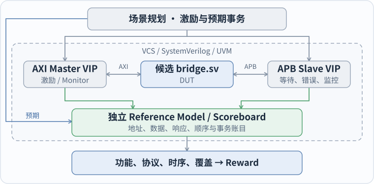
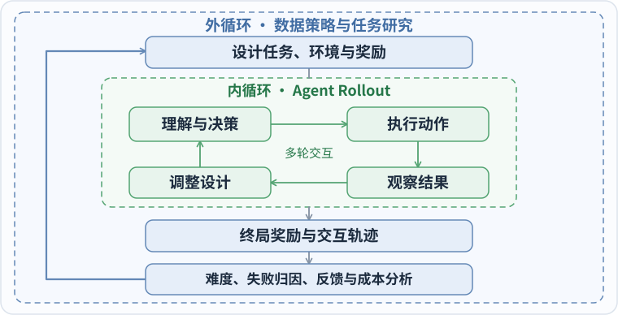

# ProtocolBridge-RL

**将真实芯片工程问题转化为可执行、可交互、具有可信奖励的 Agent 强化学习任务。**

ProtocolBridge-RL 以 AXI → APB 协议桥（X2P）为切入点，利用工业协议 VIP、独立功能验证和真实 EDA 工具构建专业 Agent 环境。项目既研究 RTL 能否正确生成，也研究模型如何通过工具探索、定位和修复工程问题，以及这些过程怎样形成有价值的后训练数据。

<p align="center">
<strong>4 个 RTL 任务</strong>　·　<strong>9 种受控动作</strong>　·　<strong>88 条研究试次</strong>　·　<strong>轨迹交换 v1–v3</strong>
</p>

> **当前阶段：** 已建立任务、环境、独立奖励与固定模型 Rollout 的工程闭环；尚未进行模型参数训练或训练收益评估。九种动作分配置开放。

[任务体系](#2-任务体系) · [验证与奖励](#3-验证与奖励) · [Agent 环境](#4-agent-工程环境) · [研究成果](#5-数据策略与研究发现) · [项目结构](#7-项目结构) · [快速开始](#8-快速开始)

---

## 1. 项目整体逻辑

芯片领域的 Agent 后训练需要回答三个问题：**让模型做什么、怎样与工程环境交互，以及如何可靠判断它做得对不对。**

<p align="center"></p>

Task 定义问题，Environment 提供求解工具，Verifier 负责独立验收；Quality Gate 验证任务与奖励的可靠性，实际 Rollout 为数据策略研究提供依据。这些环节共同构成从真实工程到可执行训练资源的生产体系。

## 2. 任务体系

协议转换具有明确输入输出、成熟规范与丰富的微架构设计空间。每个 Task 包含 Spec、初始 RTL、能力与版本元数据，以及独立验证和验收材料。修复研究也可从历史 Agent 生成的真实错误 RTL 出发。

<p align="center"></p>

| Task | 核心能力与工程约束 | 任务包 / 报告 |
| :--- | :--- | :--- |
| **001** 单事务 | 独立 AW/W、等待、错误、复位；单目标、全局一笔 Outstanding | [任务](tasks/axil_to_apb4_001/README.md) · [报告](mvp-evaluation-report.md) |
| **002** 多目标 | 三目标译码、局部地址转换、响应 MUX、DECERR；仍为单事务 | [任务](tasks/axil_to_apb4_router_002/README.md) · [报告](docs/task002-evaluation-report.md) |
| **003** 队列仲裁 | 独立 AW/W/AR FIFO、配对与轮询；每通道两个未退休名额，执行与响应消费耦合 | [任务](tasks/axil_to_apb4_queue_003/README.md) · [报告](docs/task003-evaluation-report.md) |
| **004** 执行解耦 | 每通道三个未退休名额；独立 B/R 响应 FIFO、并发更新、非二次幂回绕与数据快照 | [任务](tasks/axil_to_apb4_decoupled_004/README.md) · [报告](docs/task004-evaluation-report.md) |

002 与 003 分别扩展空间路由和时间并发能力，并非简单线性升级。004 则允许 APB 在旧 AXI 响应积压时继续执行新事务。目前四个任务均为 AXI4-Lite → APB4。

**实现入口：** [Task Registry](tasks/registry.json) · [Registry Schema](tasks/registry.schema.json) · [任务目录与统一 CLI](docs/task-catalog.md)

## 3. 验证与奖励

### 独立 Verifier

<p align="center"></p>

VCS 执行仿真；Synopsys AMBA VIP 产生真实协议激励、模拟目标等待与错误、监控事务并检查协议合规性；独立 UVM Scoreboard 根据 Spec 与实际接受的请求维护预期行为，核对跨协议地址、数据、字节使能、响应、顺序和事务账目。

**协议合规不等于跨协议功能正确。** Bridge 将地址 A 错误转换为 B 时，两侧协议仍可能合法。任务专用 Scoreboard 才能判定语义错误，它不使用参考 RTL 作为运行时答案，也不依赖候选内部计数器决定正确行为。

| Reward | 终局含义 |
| :--- | :--- |
| `1.0` | 所有必要测试、检查与覆盖条件完整通过 |
| `0.0` | 已确认候选 RTL 编译、功能、协议或时序错误 |
| `null` | 无有效提交、验证不完整或基础设施问题，无法可靠判定 |

`null` 不是数值零，无法归因的超时不直接记为 RTL 失败；Reward=1 也不是对任意输入的正确性证明。

**实现入口：** [评分与场景](verifier/) · [003 Scoreboard](verifier/task003/scoreboard.sv) · [004 Scoreboard](verifier/task004/scoreboard.sv) · [验证架构](docs/architecture.md)

### Task Quality Gate

用于后训练的奖励自身也需要验收。仅有一份正确参考 PASS，不能证明错误答案会被拒绝，也不能证明其他合法实现会被接受。

<p align="center"></p>

| Task | 合法参考通过 | 已知错误检出 | 完整 / 公开 case | 验收证据 |
| :--- | :---: | :---: | :---: | :--- |
| 001 | 1/1 | 10/10 | 22 / 17 | [576/576 必要交叉 bin](experiments/industrial-v3/README.md) |
| 002 | 2/2 | 13/13 | 26 / 21 | [40 项机制检查](experiments/task002-v1/quality/result.json) |
| 003 | 2/2 | 15/15 | 21 / 19 | [33/33 需求 bin、40 项机制检查](experiments/task003-v1/quality/result.json) |
| 004 | 2/2 + 额外合法延迟参考通过 | 14/14 | 23 / 21 | [37/37 需求 bin、40 项机制检查](experiments/task004-v1/quality/result.json) |

001 完整回归的 2,868 笔计划事务包含 2,842 笔正常检查完成、26 笔按规格复位取消。错误对照可在首个明确错误处停止，不将未运行 case 记作通过。002–004 的准入证据绑定源码与工具链，变更后须重新获得匹配证据。

**实现入口：** [正反对照 RTL](fixtures/) · [质量门禁](environment/task_quality.py) · [验收方法](docs/task-quality-gate.md) · [验证计划与盲区](docs/verification-plan.md)

## 4. Agent 工程环境

真实工程不只是编写 RTL，还包含编译、测试、观察行为、提出假设与验证修复。项目将这些工作方式映射为受控 Action / Observation 交互。

<p align="center"></p>

| 能力 | 动作 | 当前范围 / 入口 |
| :--- | :--- | :--- |
| 文件操作与交付 | `read` / `edit` / `submit` | 阅读、修改、冻结候选；[Session](environment/policy_session.py) |
| 公开功能验证 | `test` | [反馈策略](docs/observation-policy.md) |
| 独立编译与诊断 | `compile` / `inspect` | Task003；[工程工具](docs/engineering-tools.md) |
| 综合与结构检查 | `synth_check` | Task003/004；[综合工具](docs/synthesis-tools.md) |
| 主动实验与观测 | `experiment` / `observe` | Task003；[运行时接口](docs/runtime-experiments.md) |

控制器使用 DSH 和自定义文本 JSON 动作协议，严格解析并执行动作，返回受控结果；并非模型 API 的原生 Tool Calling。不同 Capability Profile 独立版本化，尚未全部组合为一个环境。

### 从被动测试到主动实验

Agent 可以选取公开场景、构造受限自定义事务，并查询最近实验的接口信号与握手时间线。例如下列两个动作需逐次调用：

```json
{"tool":"experiment","scenario":"write_fifo"}
{"tool":"observe","start":24,"count":8}
```

实验复用真实 VIP 和 Scoreboard，通过[只读引脚观测器](environment/runtime/observer.sv)采样边沿前后信号，按实际握手计算未退休额度。观测绑定具体 RTL 版本。当前不支持任意内部信号查询或可执行自建 SV Testbench。

综合检查使用 Design Compiler；可信侧已实测 DC → Formality 自身网表等价 → PrimeTime/PX 教学库测量流程。综合及自身网表等价通过不代表功能正确，教学库面积、时序和功耗不进入功能奖励，也不是工业 PPA 签核证据。

### 信息边界：求解与评分分离

<p align="center"></p>

| 基础策略 | 求解时可见信息 |
| :--- | :--- |
| A · Spec-only | Spec 与 RTL，不允许公开功能测试 |
| C · Test-verdict | 公开测试判定 |
| E · Test-diagnostic | 额外提供错误类别、首错 case 与受控诊断 |

增强配置分别在 E 上增加工程检查、综合或运行时实验；权限、预算和实际反馈曝光均独立记录。自主实验 PASS 不直接产生终局奖励，保留集结果不替换终局 Reward。

隐藏的是测试输入与内部证据，而非规格。私有评分与保留评估共享验证后端，可能存在共同盲区；受限 HDL、白名单、进程隔离和超时也不构成针对任意恶意代码的完整安全证明。

**进一步阅读：** [Agent 工作流](docs/agent-workflow.md) · [Observation / Feedback Policy](docs/observation-policy.md) · [环境源码](environment/)

---

## 5. 数据策略与研究发现

项目具有两个嵌套的循环：**内循环**是 Agent 对具体任务的多轮求解，**外循环**是研究者依据实际结果改进任务、环境与奖励。

<p align="center"></p>

### 任务难度：不是越难越好

固定模型 `deepseek-flash` 的主要独立生成批次如下。成功表示私有 Reward=1，并非训练后的能力提升。

| 任务 | A | C | E | 成功 / 启动 |
| :--- | :---: | :---: | :---: | :---: |
| 001 · 基础转换 | 7/10 | 8/10 | 8/10 | **23/30** |
| 002 · 多目标路由 | 2/3 | 2/3 | 2/3 | **6/9** |
| 003 · 队列仲裁 | 0/3 | 1/3 | 0/3 | **1/9** |
| 004 · 执行解耦 | 0/2 | — | 0/2 | **0/4** |

003/004 暴露出并发状态及事务生命周期问题。任务契约、样本量与条件不同，不能据此严格排名；004 有一条因动作格式问题未形成编辑候选，仍保留在启动分母中。

### 工具、反馈与有效修复

| 真实实验 | 终局成功 | 研究报告 |
| :--- | :---: | :--- |
| 001 同握手错误起点：C vs E | 1/3 vs 3/3 | [批量研究](docs/batch-evaluation-report.md) |
| 003 同队列错误起点：C vs E | 0/3 vs 0/3 | [配对修复](docs/task003-repair-report.md) |
| 003 原 E vs E + 编译/诊断 | 0/2 vs 0/2 | [工程工具](docs/engineering-tools-evaluation.md) |
| 003 E + 综合检查（独立生成） | 0/1 | [综合研究](docs/synthesis-tools-evaluation.md) |
| 003 主动实验：判定 vs 时间线 | 0/1 vs 0/1 | [运行时研究](docs/runtime-tools-evaluation.md) |

#### 代表性发现：队列空位不等于 Outstanding 额度

Task003 的未退休容量必须保留到相应 AXI 响应握手。多个真实候选却在 APB 选择或完成时提前释放额度。以下是已知错误 RTL 的实际仿真事件：

| 周期 | 接口事件 | 未退休 AW / W / AR |
| ---: | :--- | :--- |
| 14 | 接受 AW、W | 2 / 2 / 0 |
| 15 | APB Setup | 2 / 2 / 0 |
| 16 | APB 完成 | 2 / 2 / 0 |
| 17 | 再次接受 AW，尚无 B 退休 | **3 / 2 / 0（违规）** |

[真实事件证据](experiments/runtime-tools-v1/observed-capacity-counterexample.json)

后续 Agent 修复试次已收到类似时间线，却未改变关键错误窗口；另一次试次的错误 RTL 甚至通过了综合和自身网表等价。这提示我们需要区分**工具可用、实际使用、有效反馈、错误定位与成功修复**，而不是只统计编辑或调用次数。

这些仍是探索性证据，不能宣称某种反馈具有普遍优势或无效。动作格式问题与基础设施故障也必须同 RTL 缺陷分开分析。

### 数据生产成本

最近两条运行时试次合计约 **866 秒**，其中 VCS 编译约 753 秒、仿真约 64 秒、模型请求约 44 秒（含 SDK/网络开销，不含前置门禁）。编译复用、局部实验与评分调度也是后续规模化采集的重要变量。

[多任务研究总结](docs/multi-task-research-report.md) · [研究索引](experiments/engineering-stage-research-index.json) · [全部研究报告](docs/README.md)

## 6. Rollout 数据交付

一次 Rollout 是模型在固定任务与环境条件下的完整求解。轨迹交换保留任务、模型、环境版本、实际动作与观察、候选、提交、终局奖励及失败归因。

<p align="center"></p>

| 版本 | 已验证的交付范围 |
| :--- | :--- |
| v1 | 六批 77 条结果记录、37 条已审查工具轨迹 |
| v2 | 九批 85 条结果记录、45 条已审查工具轨迹；支持编译/诊断 |
| v3 | 额外三条试次；支持综合、主动实验和运行时观测 |

合计 **88 条研究记录、48 条已审查工具轨迹**（v2 + 新增 v3，v1 已包含于 v2）。保留失败与不可判定记录，不根据统计补造轨迹，也不混合不同实验条件计算成功率。

当前交付尚缺原始模型采样、Token IDs、行为策略 Log Probability 与精确权重版本，不是无损 on-policy 训练数据。在线 Collector 与 RL 参数优化尚未接入。

**实现入口：** [数据契约](docs/rollout-data-contract.md) · [导出器](scripts/export_rollout_exchange.py) · [v3 导出](scripts/rollout_exchange_v3.py) · [v2 验收](experiments/trajectory-exchange-v2/validation.json) · [v3 证据](experiments/runtime-tools-v1/exchange/manifest.json)

---

## 7. 项目结构

```text
ProtocolBridge-RL/
├── tasks/          # 四个任务包、Spec、初始 RTL、Registry
├── environment/    # Agent Session、Policy、工程工具、质量门禁
│   ├── policies/
│   ├── synthesis/  # DC / Formality / PT 脚本
│   └── runtime/    # 只读接口观测器
├── verifier/       # 任务专用场景、VIP/UVM、Scoreboard、评分器
├── fixtures/       # 合法参考与错误 RTL 对照
├── scripts/        # 任务 CLI、批量分析、审计、轨迹导出
├── schemas/        # 已版本化的数据交换约束
├── tests/          # 自动化机制与边界测试
├── experiments/    # 已审查实验及证据
└── docs/           # 架构、运行手册、研究报告、diagrams/
```

| 阅读目的 | 建议入口 |
| :--- | :--- |
| 复用任务与运行流程 | [Task Catalog](docs/task-catalog.md) · [统一 CLI](scripts/tasks.py) |
| 理解核心源码 | [任务](tasks/) · [环境](environment/) · [验证器](verifier/) |
| 查阅工程与验证方法 | [架构](docs/architecture.md) · [质量门禁](docs/task-quality-gate.md) · [运行手册](docs/mvp-running.md) |
| 查阅研究证据 | [文档索引](docs/README.md) · [实验目录](experiments/) |
| 复用数据交换 | [Rollout Data Contract](docs/rollout-data-contract.md) |

## 8. 快速开始

以下查询、历史基线核对和自动化测试不启动商业仿真，也不调用模型：

```bash
git clone https://github.com/5Mcv4He/ProtocolBridge-RL.git
cd ProtocolBridge-RL
python3 scripts/tasks.py list
python3 scripts/tasks.py show axil_to_apb4_queue_003
python3 -m environment.check_baseline
python3 -m unittest discover -s tests -v
```

工业验证需要合法授权的 VCS、AMBA SVT VIP、UVM 与对应 Linux 环境；真实试次另需 DSH Runtime 和模型 API 配置。参见[配置示例](environment/config.example.json)、[运行手册](docs/mvp-running.md)及[工具链说明](docs/toolchain.md)。

<details>
<summary><strong>实际运行 Task003：reset / test / submit / quality / rollout</strong></summary>

创建工作区，再编辑其中的 `bridge.sv`：

```bash
python3 scripts/tasks.py reset axil_to_apb4_queue_003 .local/queue-work
python3 scripts/tasks.py test axil_to_apb4_queue_003 .local/queue-work .local/queue-public
python3 scripts/tasks.py submit axil_to_apb4_queue_003 .local/queue-work .local/queue-submit
```

对当前源码与工具链完成质量验收，再启动真实模型评测：

```bash
python3 scripts/tasks.py quality axil_to_apb4_queue_003 .local/queue-gate
python3 scripts/tasks.py rollout axil_to_apb4_queue_003 -- \
  --admission .local/queue-gate --out .local/queue-pilot \
  --protocol text-json-atomic-v2 --repeats 3 --limit 9 \
  --max-tokens 600000 --max-seconds 5400
```

手动 submit 使用可重放的默认验证输入，正式试次则冻结私有评分与保留输入。所有运行使用新输出目录，不覆盖历史证据。商业工具与库、私有输入不随仓库分发；公开哈希用于核对证据同一性，非确定性模型采样也不保证生成相同 RTL。

</details>

---

## 当前边界与下一阶段

| 已建立 | 研究方向 |
| :--- | :--- |
| 四个任务与统一 Registry | 细粒度难度梯度、能力组合、可扩展任务生成 |
| 独立 Verifier 与质量门禁 | 补足验证盲区，探索可信奖励 |
| 分配置的九种受控动作 | 事件定位、主动实验与工具组合 |
| 固定模型 Rollout 与失败归因 | 更多错误起点、模型及推理条件对照 |
| 离线轨迹交换 | 在线采集、资源调度、训练接口及收益评估 |

自动任务生成、完整自建 Testbench、全设计形式属性证明、工业 PPA 奖励及模型参数训练尚未实现。有限仿真和正反对照不能证明验证器完备，公开 Spec、参考实现及验证代码也存在预训练污染可能。

**长期目标：** 建立能够持续生产、验证、校准与改进专业 Agent 强化学习任务和环境的体系，让真实芯片工程经验成为可执行、可验证、可研究的后训练资源。
