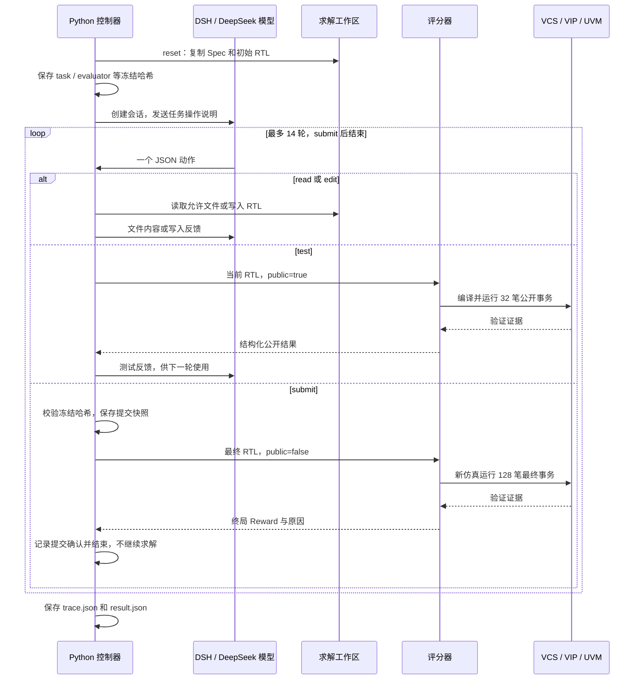

# 真实 Agent：DSH、权限、执行轨迹与奖励

本文解释已经运行的真实模型试次。模型决定动作并生成 RTL；宿主 Python 程序执行允许的动作；VCS + VIP + UVM 验收代码；固定规则输出奖励。当前没有模型参数更新或 RL 训练。

[返回首页](../README.md) · [架构与 Scoreboard](architecture.md) · [运行命令](mvp-running.md) · [实测报告](../mvp-evaluation-report.md)

## 1. DSH 在哪里，谁运行什么

| 对象 | 位置与职责 |
|---|---|
| DeepSeek 官方模型服务 | 接收会话请求并生成动作／RTL；模型不是部署在 UTM 里 |
| DSH Runtime + Python SDK | 在宿主 Mac 的 Python 虚拟环境中运行，管理模型调用和会话 |
| `environment/agent.py` | 本项目控制器：限制动作、执行工具、记录轨迹和调用评分 |
| 每次试次的 `dsh/` | 会话配置和持久化记录；不是 SDK 安装目录 |
| UTM Linux 中的 VCS / AMBA VIP | 编译和仿真待测 RTL |

实际试次使用预先安装的虚拟环境，通过 `from deepseek_harness import DeepSeekHarness` 启动 SDK/Runtime，没有要求 `dsh` 必须在全局 PATH。公开文档用 `PB_AGENT_PYTHON=/path/to/harness-python` 表示该解释器，不发布开发机的私有绝对路径。

已验证 SDK 和 runtime-bin 均为 `0.2.2rc2`。当前未交付独立的一键安装环境；新机器需要准备依赖和有授权的 EDA 环境。

当前 [控制器配置](../environment/agent.py)：provider=`deepseek-official`，model 默认 `deepseek-flash`，profile=`sdk-minimal`，reasoning=`off`，`max_tokens=6000`，单次模型请求超时 150 秒，最多 14 个动作轮次。`--model` 可以更换该 provider 下的模型名；只有报告中的模型实际验证过。

## 2. 一次试次的时序



控制器使用 `session.run(prompt)` 得到模型响应，解析第一个有效 JSON 动作，执行后把反馈作为下一轮会话输入。多个动作不会被隐式全部执行。提交确认记录在轨迹中；提交后没有下一次模型调用，也不会把最终检查细节送回求解过程。

它是受限动作 Agent：动作和 RTL 来自真实模型 API 响应，Python 负责执行，没有用预写答案替代模型求解。

## 3. Agent 可以看到什么

最初提示说明任务操作方法，要求读取 Spec 和模板、实现、公开测试并提交。实际系统提示是简短的软件工程助手提示。

| 内容 | 本次会话中的可见性 |
|---|---|
| `solve/spec.md` | 通过 read 获取 |
| `solve/bridge.sv` | 通过 read 获取，包括自己改写后的版本 |
| 先前响应及工具反馈 | 作为会话上下文保留 |
| 公开测试摘要 | 通过 test 获取 |
| 参考实现、错误变体、UVM 源码 | 当前工具不提供读取能力 |
| 最终测试输入与最终错误细节 | 求解过程中不提供 |
| API key、许可证、本机任意文件 | 不作为任务提示或允许的文件读取结果提供 |

公开反馈包含编译／仿真状态、错误分类、失败摘要、事务计数、Scoreboard 统计及激励计数。它不直接返回完整商业仿真日志；某些错误摘要较粗，如 `Read data mismatch`，尚未提供完整的定位调试体验。

仓库公开了参考实现和测试生成器。上述表格描述本次会话的工具边界，不能证明模型从其他渠道从未见过类似代码，也不能把公开输入称为安全隐藏评测集。

## 4. Agent 可以做什么

| 动作 | JSON 示例 | 控制器行为 |
|---|---|---|
| 读取 | `{"tool":"read","file":"spec.md"}` | 只允许 `spec.md` 和 `bridge.sv` |
| 编辑 | `{"tool":"edit","content":"完整 RTL 内容"}` | 覆盖求解区 `bridge.sv`，保存候选快照；最多 40,000 字符 |
| 测试 | `{"tool":"test"}` | 运行当前 RTL 的公开验证 |
| 提交 | `{"tool":"submit"}` | 固定最终代码并评分，结束动作循环 |

DSH 的 `persistent-bash`、`persistent-pwsh`、`tool-fs` 和 `tool-working-directory` 插件被禁用。Agent 没有直接调用 shell、SSH、VCS 或任意文件操作的工具。读写和仿真操作由宿主白名单分发器执行。

初始提示要求先读取两个文件并公开测试，但控制器没有把这一顺序强制实现成状态机；模型可以提前提交。它提交什么就验证什么，不会自动替它补齐实现。达到轮数上限但未提交时，当前结果为 `agent_incomplete`、`reward=null`。

## 5. 已运行试次的真实轨迹

| 顺序 | 动作 | 结果 |
|---|---|---|
| 1 | read Spec | 返回任务规格 |
| 2 | read RTL | 返回初始端口模板 |
| 3 | edit | 保存第一版候选 |
| 4 | edit | 保存第二版候选 |
| 5 | test | 32 笔公开事务通过 |
| 6 | submit | 128 笔最终事务通过，Reward=1.0 |

两次编辑都发生在公开测试之前。这条轨迹证明真实模型完成了本任务，没有证明“根据失败反馈修复复杂 RTL”的能力，也不能估计模型成功率。

终局统计：计划 128、AXI 完成 128、APB 完成 128、Scoreboard 检查 128、功能错误 0；冻结文件未变化。最终评分复用了输入哈希匹配的公开编译产物，复制到新远端目录并实际运行最终向量，没有复用公开测试的 PASS 结论。

证据：[精简动作轨迹](../experiments/industrial-v2/agent/trace.json)、[最终代码](../experiments/industrial-v2/agent/final.sv)、[最终结果](../experiments/industrial-v2/agent/result.json)、[冻结清单](../experiments/industrial-v2/agent/freeze.json)。

另有一次早期 Harness 格式处理失败，控制器中止了编译，记录为 null；见 [失败摘要](../experiments/harness-format-failure/README.md)。它不被计为模型 RTL 功能失败。

## 6. 奖励如何计算

[grade.py](../verifier/grade.py) 运行 VCS，解析 UVM 结构化输出、报告摘要和退出状态。模型不自评，也没有另一个模型充当裁判。

| 情况 | category | reward |
|---|---|---:|
| 完整执行、事务数一致、功能／协议无错、必要激励命中 | `pass` | 1.0 |
| 能确认归因于候选 RTL 的编译错误 | `compile_error` | 0.0 |
| 任务时序错误或完成仿真中的协议检查错误 | `protocol_timing_error` | 0.0 |
| 事务数据／响应错误，或已完成检查发现丢失／重复事务 | `transaction_functional_error` | 0.0 |
| 仿真发出明确周期 watchdog 标记 | `test_timeout` | 0.0 |
| 工具／许可证故障、运行不完整、必要激励缺失、无法分类 | `infrastructure_error` | null |
| 控制器耗尽轮数且没有提交 | `agent_incomplete` | null |

通过条件同时要求：

```text
simulation_exit = 0，并有 PB2_DONE 和 PB2_RESULT
planned = AXI 完成数 = APB 完成数 = checked = 预期事务数
Scoreboard errors = 0
UVM_ERROR = 0 且 UVM_FATAL = 0
七个必要激励计数全部非零
```

评分器先识别已知初始化／许可证错误，再判断功能、时序与周期超时。对不能可靠归因的编译失败、进程中断或未知结果保留 null。若多个失败同时发生，`category` 是按解析优先级选择的一个主分类，不是所有错误的完整分类集合；具体证据保留在日志和失败摘要中。

操作系统的 wall-clock 超时与 DUT 周期 watchdog 不同：前者通常表示执行不完整，保留 null；后者用于判定仿真内的进展失败。

公开 test 也含 `reward` 字段，供模型调试；项目终局评价以 submit 结果为准。覆盖计数只作通过门槛，没有按百分比给分。当前没有用这些奖励更新模型参数。

## 7. 隔离和防作弊的实际边界

已实现工具白名单、受限读写、冻结哈希检查、提交快照和新仿真目录。提交文件的只读权限用于避免误改，不是独立安全账号；哈希检查也不等于文件不可修改。

尚未实现 OS 沙箱、安全私有测试和恶意 RTL 强隔离。Spec 禁止文件 I/O、层级访问、仿真终止等行为，但尚未把这些约束全部转成强制执行机制。候选 RTL 最终会交给仿真器执行，公开仓库也暴露测试和参考实现。

因此本版本适用于可复现的开放任务基线，不能宣称具备不可绕过的防作弊能力。

## 8. 保存哪些文件，怎样再跑一次

```text
NEW_RUN/
  solve/                 Spec 与可编辑 RTL
  dsh/                   DSH 配置和会话状态
  freeze.json            开始前的文件哈希
  harness-*.json         各轮模型响应及事件（本地保留）
  candidate-*.sv         编辑后的候选快照（本地保留）
  trace.json             动作与反馈
  public-*/              公开测试日志和结果
  submission/            最终 RTL、哈希和评分证据
  result.json            试次终局结果
```

配置好 EDA 环境和 `DEEPSEEK_API_KEY`，将 `PB_AGENT_PYTHON` 指向安装所需 SDK/Runtime 的解释器，在仓库根目录运行：

```bash
"$PB_AGENT_PYTHON" -m environment.agent .local/agent-002 --model deepseek-flash
```

该命令自动 reset 并启动模型。要先跑参考／错误变体回归，再跑模型：

```bash
bash environment/reproduce.sh .local/full-run-002 --agent
```

输出目录必须是新的。重新调用模型具有随机性，不保证相同代码或相同 Reward；重放已提交 RTL 不需要模型 API，见 [复现说明](mvp-running.md)。

GitHub 发布最终 RTL、精简动作轨迹、结果、事件摘要和哈希；完整模型响应、候选快照、编译产物和商业日志留在本地。导出器 [export_mvp.py](../scripts/export_mvp.py) 使用允许列表，读写正文在公开轨迹中以哈希和字节数表示；最终代码单独发布。
