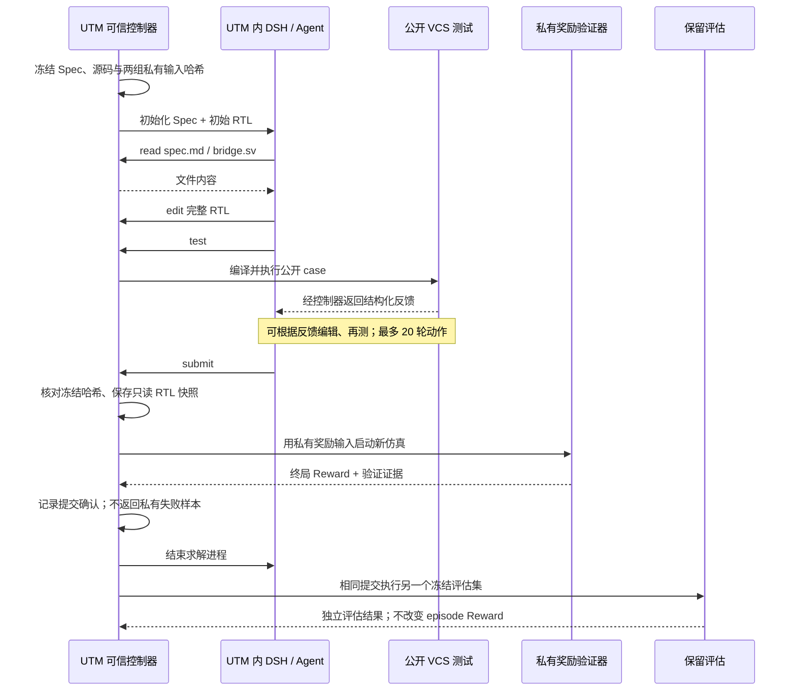

# 真实 Agent、DSH、权限和奖励

[项目入口](../README.md) · [架构](architecture.md) · [验证计划](verification-plan.md) · [运行](mvp-running.md) · [实测报告](../mvp-evaluation-report.md)

本页描述保留的 revision 3 原始执行入口。新增 A／C／E 信息条件对照使用独立的 [Observation / Feedback Policy 入口](observation-policy.md)，其公开测试权限、预算和提交要求由策略控制，不能套用本页旧入口的“提交前必须 test”规则。

## DSH 在哪里

revision 3 的 DeepSeek Harness SDK / Runtime 0.2.2rc2 安装在 **UTM 内的 Ubuntu 22.04 用户态**，使用 Python 3.10。该用户态运行于现有 CentOS 内核，不是第二台虚拟机。模型在 DeepSeek 服务端推理，发起 API 请求的客户端进程在 UTM 内。

Mac 的 `environment.agent` 仅部署原创源码和配置、通过 SSH stdin 传递密钥、启动可信控制器并取回结果。密钥不写进 shell 命令或 Git。可信控制器 `utm_agent.py` 调用 root-owned launcher，启动低权限 chroot worker `utm_worker.py`。SDK 的 shell／任意文件工具关闭，控制器只执行四种允许的 JSON 动作。

## 一次试次怎样运行

模型必须先读取两份文件，并且对最终版本调用过公开 `test`，才允许提交。公开测试失败也允许有效提交，终局真实失败应保留为 Reward=0；未完成、工具中断等不能伪造为成功。

## Agent 看得到、做得到什么

| 对象／动作 | 权限 |
|---|---|
| 当前 Spec、初始和自行编写的 bridge.sv | 可通过 read 获取 |
| bridge.sv | 可通过 edit 整体替换 |
| 公开测试 | 可调用 test，得到逐 case 错误／计数／覆盖反馈 |
| 最终提交 | 可调用 submit；此后不再修改候选 |
| 参考 RTL、故障实现、评分器源码、私有向量 | 不放入求解文件系统，不提供读取工具 |
| 任意 shell、文件路径、额外 API 工具 | 不提供 |
| 最终评分／保留评估的具体输入与调试反馈 | 不返回求解模型 |

公开源码仓库中的参考实现可能已被模型预训练接触，这种知识污染无法靠运行时隔离排除。具体私有输入仍在试次开始前另外生成、冻结，并保留本地。当前只验证了文件系统、进程和权限边界；网络仍可用于 API，RTL 编译／仿真进程未做完整恶意输入沙箱。详见[工具和隔离边界](toolchain.md)。

## 奖励如何计算

功能判据来自 VCS 中的 UVM Scoreboard、商业 VIP 和断言。Python 只解析证据并执行固定门槛，不让 LLM 自评，也不把覆盖率直接作为奖励。

| 结果 | Reward | category 示例 |
|---|---:|---|
| 有效提交，全部必要 case 完整通过，账目与必要覆盖齐全 | 1.0 | pass |
| 已确认候选 RTL 编译错误 | 0.0 | compile_error |
| 协议、稳定性、复位或进展上限违反 Spec | 0.0 | protocol_timing_error |
| 地址、数据、字节使能、响应、事务数量错误 | 0.0 | transaction_functional_error |
| 已初始化仿真触发周期 watchdog | 0.0 | test_timeout |
| 工具／许可故障、墙钟超时、激励没有按要求执行、覆盖缺失、结果不完整 | null | infrastructure_error |
| 超出允许的提交语言／没有有效提交 | null | invalid_submission / agent_incomplete |

最终评分可在首个确定错误处停止，此时 Reward=0，但 `verification_complete=false`；它表示已足以判负，不表示所有 case 都执行完。只在全部必要检查完成时返回成功。

## 随机测试与 RL 的关系

公开集帮助求解；私有奖励集产生 episode Reward，未来训练可利用该 Reward；保留评估集不反馈给 Agent，用于冻结模型／策略后的独立检查。不能把参与训练奖励的测试称为永久独立的 holdout。

当前三层都遵循同一 Spec。公开和默认回归可由固定 seed 重放；真实试次的奖励和保留评估用独立随机 seed，向量与哈希私下保存。生成方法和功能类别公开，私有具体样本不上传。随机轨迹不是每次随意变换的判分标准：试次开始前冻结，重放同一提交使用同一份输入。

## 留下哪些证据

本地保留全部外部模型响应、工具动作与反馈、每版候选、最终提交、冻结哈希、编译／仿真原始日志、完整私有输入和结果。公开交付使用允许列表导出：精简动作轨迹、最终 RTL、逐 case 结果、覆盖／延迟统计和原始证据哈希。读文件／编辑的大块内容用内容哈希关联，商业日志、密钥和私有输入不上传。

一个模型试次成功只能说明这次提交通过这些检查；不能推断模型总体成功率、任务难度足够或 RTL 对所有输入正确。当前只交付标准基线的试次；已保存的冻结清单对应其记录的 Git 提交，不因清理废弃文件而重写。
