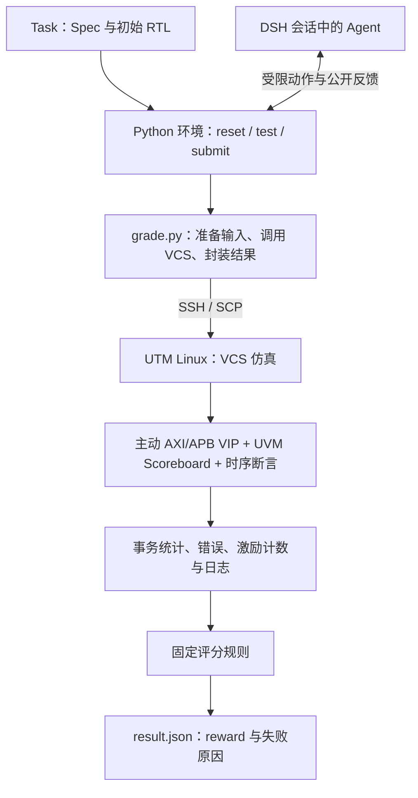
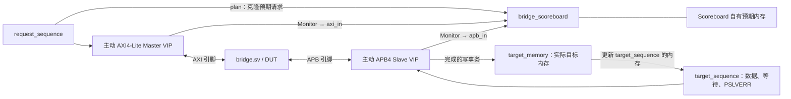

# 当前架构：Task、环境、验证器与 Scoreboard

本文解释已经运行的 AXI4-Lite → APB4 基线。它是一个工业 VIP 驱动的单任务 Agent 评测闭环；尚未实现 RL 参数训练、通用多协议任务加载或工业签核。

[返回首页](../README.md) · [真实 Agent 的执行与奖励](agent-workflow.md) · [运行命令](mvp-running.md) · [实测报告](../mvp-evaluation-report.md)

## 1. 系统分成哪些部分

| 层 | 解决的问题 | 当前入口 |
|---|---|---|
| Task | RTL 应当实现什么 | [Spec](../tasks/axil_to_apb4_001/spec.md)、[模板](../tasks/axil_to_apb4_001/workspace/bridge.sv)、[元数据](../tasks/axil_to_apb4_001/task.yaml) |
| Agent 环境 | 如何初始化、修改、测试、提交 | [environment/](../environment/) |
| 验证器 | DUT 的事务与时序是否正确 | [vip.sv](../verifier/v2/vip.sv)、[tb.sv](../verifier/v2/tb.sv) |
| 评分器 | 仿真是否有效、应返回什么 Reward | [grade.py](../verifier/grade.py) |
| 验证器自检 | 正确实现能否通过、错误实现能否被发现 | [validate.py](../environment/validate.py)、[fixtures/](../fixtures/) |

“环境”有两层：外层 Python 环境管理 Agent 的工作流程，内层 UVM 环境负责硬件验证。Python 不计算预期读数据、不比较转换后的事务；功能 Reference Model 与 Scoreboard 都在 SystemVerilog/UVM 中。

## 2. Task 的边界

当前任务支持单时钟、32-bit 地址和数据、单笔未完成事务。AW/W 可以独立到达，支持 WSTRB、APB 等待和错误响应、AXI 响应背压。请求地址原样传递，具体行为以 Spec 为准。

请求方必须等上一笔 B/R 握手结束后再开始下一笔事务，不允许读写重叠。没有 burst、ID、乱序或跨时钟处理。

`task.yaml` 目前是描述性元数据。`reset.py` 和验证代码直接针对这个任务，尚未实现任务注册器或按 YAML 动态组装环境。

## 3. UVM 环境的连接

这些类目前集中在 `verifier/v2/vip.sv`：

| 类 | 职责 |
|---|---|
| `request_sequence` | 读取向量、配置 AXI 请求和延迟，在发送前登记预期请求，等待响应后发下一笔 |
| `target_sequence` | 为 APB Slave VIP 提供读数据、等待周期和错误响应 |
| `target_memory` | 订阅实际 APB 完成事务，按写数据和 PSTRB 更新目标内存 |
| `bridge_scoreboard` | 比较计划、AXI 实际事务和 APB 实际事务，维护预期内存 |
| `bridge_vip_test` | 创建 VIP、连接 analysis port、启动 sequence、管理 UVM objection |

VIP 负责实际驱动和监视信号，DUT 不由 Python 仿真或替代。

## 4. Scoreboard 怎样配对和判断

`bridge_scoreboard extends uvm_scoreboard`，内部保存三个队列：

| 队列 | 来源 | 表示什么 |
|---|---|---|
| `intended` | `request_sequence` 调用 `sb.plan(req)` | 原计划执行的请求 |
| `axiq` | AXI Monitor 的 `item_observed_port` | AXI 端实际完成的事务 |
| `apbq` | APB Monitor 的 `item_observed_port` | APB 端实际完成的事务 |

预期请求直接调用 `plan()`；两端观察事务通过 UVM analysis port 接入。三路对象均先 clone，避免 VIP 复用对象后改变历史记录。

每当三个队列都有数据，`compare_pending()` 按 FIFO 各取一项。这个匹配方法依赖单笔未完成、按序执行的任务约束，不能直接用于乱序协议。

一次配对会检查：

1. AXI 实际请求地址和读写类型是否符合计划。
2. APB 地址和读写方向是否符合计划。
3. AXI/APB 写数据和字节使能是否符合原请求。
4. APB 错误响应是否符合目标模型，AXI BRESP/RRESP 是否正确映射。
5. APB 读数据和 AXI 读数据是否都等于预期内存值。
6. 最后检查计划数、AXI 完成数、APB 完成数、已配对检查数是否一致，发现丢失或重复事务。

因此，“VIP 协议检查无错”只是其中一个条件。合法但转错地址、数据或字节使能的事务仍会失败。

### 实际内存与预期内存为什么分开

APB 目标内存根据 **Monitor 观察到的实际写入**更新；Scoreboard 内存根据 **原计划写入**更新。两份状态不共享。

例如，原请求要写地址 A，但 DUT 错写到 B：实际目标更新 B，预期模型仍更新 A。Scoreboard 当场检查地址，后续读取也会暴露内存状态差异。

当前目标模型的规则是：

- 未写过的地址返回 `address XOR 32'h9e3779b9`。
- 地址 bit 12 为 1 时返回错误；这是测试目标的行为，不是桥的地址译码要求。
- 成功写入按每个 WSTRB/PSTRB 字节更新；错误写入不改变内存。
- 等待周期由地址的 `address[6:2] % 5` 决定。
- 测试中的事务间复位不会清空这两份外设内存状态。

Reference Model 当前嵌在 Scoreboard 中，尚未拆成单独的 predictor 类。实际与预期状态独立，但规则由同一项目实现，仍存在共同建模错误的风险。

## 5. 协议、功能和时序检查的分工

| 机制 | 负责的检查 |
|---|---|
| 商业 VIP | AXI/APB 协议合法性 |
| UVM Scoreboard | 事务转换语义、数据、响应、顺序和完成数量 |
| 自定义引脚断言／计数器 | 任务特定时序限制、信号稳定性、实际激励是否命中 |

`tb.sv` 检查 APB Setup/Access/等待期间的稳定性、读 PSTRB、复位输出、AXI 背压期间响应稳定性、不能提前响应，以及请求接受／APB 启动／响应的 16 周期限制。全局 watchdog 为 40,000 个周期。

观察计数包括 AW 先到、W 先到、同时到达、响应背压、APB 等待、APB 完成时 AXI READY 已有效及事务间复位。通过门槛要求这些计数非零。这是最低激励有效性检查，不是功能覆盖闭合，也不是覆盖率奖励。

## 6. 公开测试与最终测试

[vectors.py](../verifier/vectors.py) 只生成激励，不做功能比对。

| 模式 | 事务数量 | Python 向量生成种子 |
|---|---:|---:|
| 公开 `test` | 32（16 写 + 16 读） | 17 |
| 最终 `submit` | 128（64 写 + 64 读） | 20261124 |

向量包含地址、数据、字节使能及延迟设置，包含重复地址的部分写入。当前 VCS 随机种子固定为 17；公开和最终输入的差异来自向量生成器。

两种测试共用同一验证实现，最终测试使用另一组输入。代码和输入生成器公开，不能宣称它是安全隐藏测试。

## 7. reset / test / submit 的实际行为

| 接口 | 实现 | 输出与性质 |
|---|---|---|
| `reset(work)` | 创建新目录，复制 Spec 和初始 RTL | 不覆盖已有目录；只初始化文件，不启动仿真 |
| `test(work, out)` | 对当前 `bridge.sv` 调用 `grade(public=True)` | 每轮完整公开仿真，返回结构化反馈 |
| `submit(work, out)` | 复制 RTL、设为只读、记录 SHA-256，调用最终 `grade()` | 保存提交快照及最终结果 |

每轮测试重新启动仿真，从复位开始，不延续上一轮仿真的硬件状态。编辑后再次测试，需要新的输出目录。

`grade.py` 从配置取得 SSH 和 EDA 路径，保存 RTL／向量，复制输入到远端，调用 VCS，保存日志并解析结果。Agent 路径可以在候选与验证源码哈希、远端主机都匹配时复用公开编译产物：复制到新远端目录，再执行最终输入。CLI 直接提交默认重新编译。

哈希冻结、文件只读和新仿真目录提供版本追踪与流程隔离，不提供 OS 安全边界。奖励的具体判定见 [Agent 与奖励文档](agent-workflow.md#6-奖励如何计算)。

## 8. 怎样复用，哪些地方必须改

| 目标 | 当前复用方式 |
|---|---|
| 换一个同端口、同 Spec 的桥实现 | 使用 reset/test/submit，验证器不变 |
| 重放已提交 RTL | 直接调用 `verifier.grade`，无需模型 API |
| 再跑真实 Agent | 新建试次目录，调用 `environment.agent` |
| 接入其他 Agent | 调用现有 Python 生命周期接口；当前 DSH 控制器的 provider 固定，其他 provider 需适配 |
| 改激励或增加检查 | 修改向量／UVM／断言后先跑正反控制组，再冻结新版本并重新评价 |
| 支持并发、乱序或另一协议 | 修改 Spec、VIP 配置、sequence、Scoreboard 匹配和断言；仅修改 YAML 不足以支持 |

控制组回归将参考与六个错误实现编译成一个模块组，每个选择启动独立仿真，仅将选定实现的输出连接到 VIP。Scoreboard 不知道选择编号。Agent 提交单独编译，不进入这个模块组。

本次参考实现通过、六个错误实现被检出，证明验证器能识别这些已注入错误；不证明所有缺陷都能识别。事务中复位、完整覆盖闭合、综合／形式验证和恶意提交隔离仍未完成。
