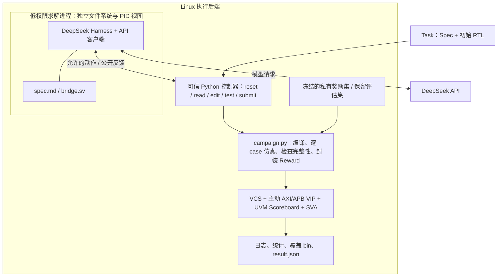
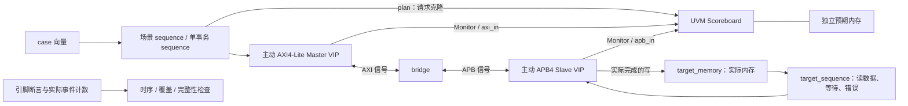

# 当前架构：Task、环境、验证器与 Scoreboard

项目共同的闭环是：初始化任务材料 → Agent 在权限范围内修改、验证 → 提交冻结 → 独立验收 → 保存奖励与轨迹。任务可以要求交付 RTL，也可以要求交付测试激励；**共同的是控制与审计边界，具体正确性判据由任务决定。** 当前没有进行 RL 参数训练。

## 先找到任务所属的执行路径

| 任务范围 | Agent 交付什么 | 执行与验收入口 |
| --- | --- | --- |
| 四个原始 X2P 任务 | 协议桥 RTL | 根 Registry 与 `scripts/tasks.py`；各任务专用 VIP/UVM、Scoreboard 和时序检查 |
| 七个生成 X2P 契约 | 特化路由、队列或组合桥 RTL | `scripts/tasks.py --package PACKAGE`；依赖匹配的包及工业准入 |
| 六个有限工程契约 | UART RTL、事务 JSON 或累加器 RTL | `environment.artifact_task`；工业解码加周期模型、固定设计对照或独立参考等价 |

[任务目录](task-catalog.md)列出三条路径及可复用命令，[六个有限契约的使用说明](tasks/README.md)说明各自修改范围。它们没有被合并成一个万能验证器，也不会自动继承同一工具权限。

可信控制器负责动作白名单、预算、候选内容哈希、反馈投影与提交冻结。公开反馈供模型继续求解；终局验收和独立保留评估在求解结束后执行，结果分开保存。九动作综合配置目前在特定 X2P 队列上验收，六个有限契约的已发布试次使用 read/edit/test/submit；详见[综合环境](engineering-lab.md)与[有限任务运行器](../environment/artifact_task/runner_v5.py)。

例如，UART 的“没有协议错误”不能证明 busy 期间不会重复装载；需要额外周期模型检查输入锁存。累加器则用候选与独立参考的状态转移等价判定，不能以候选对自身综合网表的等价代替。三种验收依据及真实缺陷见[研究报告](verification-resources-tasks.md)。

## 001 revision 3：具体实现与历史验收范围

下文保留单笔桥的详细配对、复位账目及复现方式，仅适用于 001。实际通过状态见[revision 3 评估报告](../mvp-evaluation-report.md)；队列、组合及有限交付不能沿用这里的单活动请求假设。

[文档入口](README.md) · [Agent 与奖励](agent-workflow.md) · [验证计划](verification-plan.md) · [复用命令](mvp-running.md)

### 系统分工



启动端负责发起运行与收回证据。DSH、SDK 与 API 客户端在 Linux 求解环境内执行；VCS 与可信评分器在该进程的隔离文件系统之外运行。revision 3 的具体部署和工具版本见[历史工作流](agent-workflow.md)，机器身份不是 Task 契约。

| 概念 | 负责什么 | 实现入口 |
|---|---|---|
| Task | 支持行为、限制、接口、提交规则 | [Spec](../tasks/axil_to_apb4_001/spec.md)、task.yaml、workspace/bridge.sv |
| 外层环境 | 管理 Agent 文件、动作、试次和提交 | [environment/](../environment/) |
| 激励计划 | 定向 case、交叉组合、随机输入与复位位置 | [scenarios.py](../verifier/scenarios.py) |
| 内层 UVM 环境／验证器 | 驱动接口，检查协议与转换语义 | [vip.sv](../verifier/v3/vip.sv)、[tb.sv](../verifier/v3/tb.sv) |
| 评分器 | 判定验证是否完整，将真实结果映射为 Reward | [campaign.py](../verifier/campaign.py) |
| 验证器自检 | 参考实现 + 10 个故障实现 | [validate_v3.py](../environment/validate_v3.py)、fixtures/ |

Python 生成激励、调度工具、解析 UVM 证据；预期数据计算与功能比对在 SystemVerilog/UVM 中完成。task.yaml 仍是描述性元数据，没有多协议自动组装器。

### UVM 数据流



`bridge_vip_test` 创建两端 VIP、Scoreboard、内存订阅器，连接 analysis port 并管理运行阶段。普通场景共享单事务发送机制；复位 sequence 额外执行中断和恢复。case 是场景输入集合，sequence 是执行它的 UVM 对象，不能用类数量代替覆盖充分性。

### Scoreboard 如何配对

001 Spec 只允许一笔未完成事务，所以 `bridge_scoreboard` 保存一个活动的 `expected` 请求，以及 `have_axi`、`have_apb` 两个完成标记。发送前克隆预期请求；两端 Monitor 回调到达后立即比较，不依赖回调先后顺序，不使用旧版三个 FIFO 队列。

每笔检查地址、方向、写数据、字节使能、APB 错误注入、AXI BRESP/RRESP、APB 与 AXI 读数据。两个完成标记齐全才计为 `checked`。额外或重复事务立即报错；结束时还检查完整账目。

实际目标内存根据 **APB Monitor 观察的地址、数据和 PSTRB** 更新。预期内存根据 **原计划地址、数据和 WSTRB** 更新。两份状态独立；错误地址、错误字节使能不会因两端照抄同一错误事务而逃过比对。未写地址返回 `address XOR 32'h9e3779b9`；成功写更新选中字节，错误写不更新。等待和错误由输入独立指定，不再由地址位推导。

预期内存在 APB 完成时提交写入。这样复位发生在 B 响应背压期间时，已完成的外设写仍保留。复位发生在 APB 完成前则取消整笔请求；VIP 在复位时发布的取消通知与正常完成分开计数。

```text
planned = checked + aborted
AXI completed = checked
APB completed = checked + aborted_after_apb_completion
```

不能要求所有复位 case 的 AXI/APB 完成数相等：APB 已完成、AXI 响应被复位取消时，两者本来就不同。Reference Model 嵌在 Scoreboard 中，尚未拆成 predictor；实际与预期规则仍可能有共同建模错误，需靠故障对照和后续交叉验证降低风险。

### 检查和评分的分工

商业 VIP 检查协议；Scoreboard 检查转换语义和完整性；SVA／引脚计数器检查复位、稳定性、提前响应与 Spec 的 16 周期进展上限。每个 case 有 400,000 周期 watchdog，另有工具运行的墙钟超时。二者失败分类不同。

APB 完成之外的 PRDATA/PSLVERR 被刻意扰动，避免提前采样的错误设计因目标恰好保持数据而通过。逐笔核对实际等待／背压与请求激励，最终检查必要的 576 个交叉 bin。性能统计包含接受请求至 Setup、APB 完成至 AXI VALID；没有 PPA 奖励，也没有宣称最大吞吐率已验证。

具体场景、随机策略、公开／私有分层和未覆盖边界见[验证计划](verification-plan.md)。001 标准基线使用 `verifier/v3/` 后端；已删除旧 128 笔实现及其生成器。

### 生命周期和复用

`reset(work)` 创建新工作区并复制 Spec／模板；`test(work,out)` 编译当前 RTL 并跑公开集；`submit(work,out)` 保存只读快照和 SHA-256，再执行完整回归。CLI 完整回归使用公开可复现 seed；真实 Agent 的终局评分由外部控制器传入预先冻结的私有输入。

每个 case 启动独立仿真。最终评分使用新运行目录；只有 RTL 与验证 SV 哈希相同才允许复制已有编译产物，不能复用测试结论。控制组为节约编译时间将 11 个实现编成一组，每次仅将选定实现连到 VIP；Scoreboard 不读取选择编号。Agent RTL 单独编译。

同 Spec 换 RTL 可以直接复用生命周期接口。修改 Spec、激励或验证器后，需重跑正反对照，冻结新版本，再评价 Agent。增加并发、乱序或其他协议需要重新设计配对和约束，不能只改 YAML。
