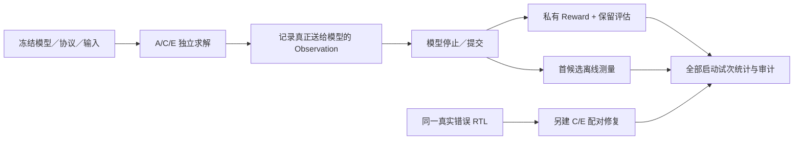

# 001 X2P：固定模型能力与反馈研究

[阅读入口](README.md) · [实验执行契约](batch-study.md) · [证据索引](../experiments/batch-study-001/README.md)

本文研究固定模型在同一 Task 和最终验证标准下的求解行为，没有模型参数训练。revision 3 的 Spec、模板、主动 VIP/UVM Scoreboard、事务与时序检查以及 1/0/null 奖励语义均未修改。历史 Policy v1 数据和历史工具链清单保持原样，不与本轮合并。

**自主生成正式批次完成30次：A 7/10、C 8/10、E 8/10。三组全部生成有效编辑候选并有效提交，无基础设施失败或null。动作格式错误2/153（1.3%），均恢复后完成试次。组间差异不足以支持策略排名。**

| 模式 | 启动／有效提交 | 私有成功率（Wilson 95%） | 首候选公开PASS | 实际反馈曝光 | 0 / 1 / null |
|---|---|---|---|---|---|
| A | 10 / 10 | 7/10；39.7–89.2% | 7/10 | 0/10 | 3 / 7 / 0 |
| C | 10 / 10 | 8/10；49.0–94.3% | 8/10 | 9/10 | 2 / 8 / 0 |
| E | 10 / 10 | 8/10；49.0–94.3% | 6/10 | 7/10 | 2 / 8 / 0 |

有效编辑／有效提交分母均为10，因此相应条件成功率与主成功率相同。按实际反馈曝光筛选后，C为7/9（45.3–93.7%），E为6/7（48.7–97.4%）；A无曝光分母，不能计算。曝光由Agent自己选择，这两个条件比例不能用来排名策略。

私有奖励与保留评估30/30判定一致。23个成功提交的两套campaign共46次完整通过，每次均为22case、2868 planned／2842 checked／26 aborted，576/576必要交叉bin。7个失败均由真实仿真确认为protocol_timing_error；终局编译错误、事务功能错误、测试超时、环境故障、无候选和未提交在这个新批次中均为0。早期候选包含两次编译失败，均在E组被修改后修复；它们不应被写成终局失败。

9次预实验为A3/3、C2/3、E3/3；44动作中1次格式错误，审计和质量门槛通过。预估30次37.3万Token／7504.5秒，实际38.7万Token／7042.8秒控制器试次计时。随后按预定配对轮次复查，最终30次门槛通过。详见[预实验](../experiments/batch-study-001/text-v2-independent/pilot-analysis.md)、[全部30次统计](../experiments/batch-study-001/text-v2-independent/batch-analysis.md)和[扩容决定](../experiments/batch-study-001/text-v2-independent/expansion-decision.json)。

## 反馈实际利用

| 指标 | A | C | E |
|---|---:|---:|---:|
| 公开调用总数 | 0 | 11 | 10 |
| 收到过FAIL的试次 | 0 | 2 | 3 |
| 反馈后修改源码的试次 | 0 | 2 | 2 |
| FAIL后修改源码的试次 | 0 | 1 | 2 |
| FAIL后修改且最终通过 | 0 | 0 | 2 |

C两条FAIL曝光中，一条改写后仍失败，一条未改写。E三条FAIL曝光中，两条编译错误得到修复，另一条得到具体功能诊断后未修改。C还存在PASS后改写；因此“反馈后编辑”不等同于“失败修复”。本批没有证据说明E的详细**功能**诊断已经优于C；观察到的是两次编译类别反馈后的恢复。

没有同一份最终源码“公开PASS、私有FAIL”的观测。最终源码未实际调用公开测试时记为未知，不能用首候选离线结果替代。精确曝光内容与候选哈希见[feedback-history.json](../experiments/batch-study-001/text-v2-independent/feedback-history.json)。


## 方法与可解释范围

A 没有功能测试反馈，但可以读取自己的 RTL、修改多次再提交；不是只生成一次。C/E 使用相同初始提示、工具、两次公开调用、20次总动作和17个公开 case，区别是实际测试后返回的字段。E 返回错误类别、首个失败 case 与固定短诊断，不返回原始 VIP 报文或波形。每轮三组共享冻结的22 case私有奖励输入及另一份保留输入，下一轮换独立种子。组序按轮次轮换；模型会话、Harness home 和工作区每次重新创建，单并发运行。

首个通过源码语言门禁的编辑是“有效编辑候选”，不等于编译或功能通过。首候选公开表现可在求解停止后离线测量，该结果没有回流给模型。最终私有奖励和保留评估也在模型停止后执行。没有编辑或提交的试次保留在主分母；明确 RTL 错误为0，未提交／无法判定或环境故障为null，并另外列原因。验证器在首个确定错误处停止：此时0仍可判定，但未执行余下case，不宣称完成全部22case或不存在其他缺陷。实际case、事务与复位计数保存在精简campaign结果中。

成功率主分母是全部启动试次。有效提交、实际获得反馈等条件分母同时列出，但这些条件由模型行为决定，不宜作为策略的因果比较。Wilson 95%区间是小样本描述；配对输入、时间相关性以及质量门槛导致的提前停止都限制其解释。保留集与私有集共享生成器、VIP和Scoreboard，判定一致不能排除共同盲区。



## 已停止的旧协议批次：保留全部17次

| 组 | 全部启动／有效编辑／有效提交 | 功能成功 | 描述性 Wilson 95% | Reward 0 / 1 / null | 格式错误／动作 |
|---|---|---|---|---|---|
| A | 6 / 5 / 5 | 5/6 | 43.6–97.0% | 0 / 5 / 1 | 16/51 |
| C | 5 / 4 / 5 | 4/5 | 37.6–96.4% | 1 / 4 / 0 | 7/34 |
| E | 6 / 2 / 6 | 1/6 | 3.0–56.4% | 5 / 1 / 0 | 18/48 |

41次格式错误由32次JSON解析错误和9次字段错误组成，占133动作的30.8%。17次均至少出现过一次格式错误，其中6次没有生效编辑。A的一次未提交为null（agent_incomplete），没有把它算成RTL功能失败；6个reward=0均有真实仿真错误证据。没有基础设施失败。由于质量停止使各组实际样本数不同，这不是预定固定30次的完整实验。

有效编辑候选的11次中有10次最终通过，但这是合规行为筛选后的条件统计，不能称为模型的无偏“纯RTL成功率”。首候选公开PASS共8次、FAIL3次，无候选6次；私有与保留评估的16个可判定结果全部一致。

| 典型轨迹 | 实际行为与证据 |
|---|---|
| C r01 | 首版编译失败，只收到FAIL；改写后公开PASS，最终私有和保留PASS。 |
| E r02 | 将edit与其他动作连写，整条拒绝，最终提交未修改模板；未获得诊断。 |
| A r05 | edit反复携带content_note，多余字段被拒绝；20动作耗尽、0编辑、未提交。 |
| E r05 | 3次编辑、2次FAIL；始终未在APB ACCESS完成时及时撤销PSEL/PENABLE，VIP检出时序错误。模型收到的是通用时序诊断，不是VIP原始报文。 |
| A r06 | 无公开反馈；首版离线FAIL，自行阅读并改写，最终私有和保留PASS。 |

[全部17次统计](../experiments/batch-study-001/text-v1-stopped/batch-analysis.md)与[所选轨迹清单](../experiments/batch-study-001/text-v1-stopped/publication.json)保留了失败及空候选，没有只导出成功样本。

## 动作协议与停止规则

首批 `text-json-atomic-v1` 的9次预实验通过事先门槛，随后扩大采样。扩展数据出现无生效编辑、多对象回复及额外 `content_note` 字段；检查发现旧分析仅将 JSON 解析错误计入格式错误，字段错误归在通用拒绝。离线统计补充字段错误并分列；原9次预实验没有字段错误，原扩容决定不变。16次完成时发现累计质量不合格，停止启动新试次，允许已启动的第17次完整收尾。全部17次仍保留，既不剔除模型失败，也不算成环境故障。

重新冻结 `text-json-atomic-v2`，三组全部重新运行。保留原子解析器和拒绝规则，只明确“每次一个动作、精确字段”，并在格式拒绝后给固定字段说明。非法动作依然整体拒绝，没有拆分、补写 RTL 或自动删去多余字段。新增提示和拒绝帮助同时改变，因此不能分离两者各自的贡献；旧新协议也不能混成一张策略成功率表。两批还有新的私有输入与执行时间，未做协议版本的随机化交叉对照；接口合规改善是本批观测，不是单独归因于某句Prompt的因果估计。

DSH 0.2.2rc2 的高层 Python SDK 未提供当前调用链可直接使用的自定义工具回调参数；官方 Cordis/MCP 扩展确实存在。本次没有完成原生工具到可信控制器的适配与隔离验收，因此 **v2仍是文本 JSON，不是原生 Tool Calls**。接口调查及官方链接见[执行契约](batch-study.md)。

v2在首次模型调用前冻结运行源码、分析代码、Prompt、Policy、工具链及输入哈希。前三轮后逐完整配对轮次检查：审计通过、阶段完整、没有环境失败、格式错误且无有效候选的比例低于1/3、格式错误动作不超过30%。触发则保存停止原因并禁止同批 resume。成本按试次边界限制，单次可能超出阈值；没有无限重试或替代失败样本。

## 版本和证据口径

| 项目 | 配置 |
|---|---|
| v1执行源码 | `5375091f2f7fc4b310cd6a5dc1934e498133e3c3` |
| v2执行／分析源码 | `ec655afdc6cff7241ce31760c3db1573b4afb242` |
| 模型 | `deepseek-flash`，SDK maxTokens=7000、reasoningEffort=off |
| 采样 | temperature/seed为provider默认值，未声称确定性或不可变权重ID |
| Harness | DSH SDK/runtime 0.2.2rc2，Python 3.10.12 |
| 可信执行器 | Python 3.6.9 |
| RTL仿真 | VCS-MX O-2018.09-SP2，AMBA VIP R-2020.12，UVM 1.2 |
| 并发 | 一次一个Agent试次／EDA作业 |
| 基线 | revision 3；Policy v1权限与功能反馈不变 |

工具版本差异属于复现元数据，不是任务或方法进展。官方模型别名可以随服务更新，不能把别名当作已验证的权重快照。

每次完成立即取回原始轨迹、冻结清单、候选、提交及仿真证据，原始SDK事件和私有向量保留在可信本地。公开目录保留所有试次的统计行、哈希和少数明确选择的完整精简轨迹；没有把未选中的失败从分母中删除。公开算术复核不等于重跑RTL，也不能凭哈希恢复私有向量。

## 执行器验收与未完成项

实际运行验证了独立会话、拒绝动作、投影反馈、提交后停止、私有/保留评分顺序及源码/输入哈希。v2每批开跑前执行37项真实机制检查（原31项加6项格式帮助与拒绝检查），这些受控对照不计入模型试次数。客户端观察进程停止再恢复时，远端任务PID及启动标识不变，恢复接收同一任务而非重跑。完成试次不会因resume重新调用模型或评分。

实验运行前的53项单元检查通过。全部试次结束后，复核发现“目录已创建但supervisor启动状态文件缺失”的观察循环没有上限，发布代码增加三次观察后的停止保护，并拒绝未知状态，不重启不明任务；新增两项检查后55项单元测试通过。这个异常启动分支只有单元测试证据，没有重新运行模型，53条轨迹仍对应上述冻结提交。

故障注入与敏感字段泄露检查经过单元测试；未故意破坏真实License服务。未验收宿主断电、任意磁盘损坏的自动恢复；状态不明的孤儿任务会停止并等待检查。现有文件／进程／权限隔离继续使用，但没有新增完整网络隔离或恶意RTL编译沙箱。没有综合、形式证明、完整代码覆盖闭合或RL参数训练。

## 典型 RTL 与反馈轨迹

新版 C r03 在第一次公开FAIL后，未编辑就再次测试相同源码，耗尽两次预算。第二版修正了APB完成时PSEL/PENABLE多保持一拍的问题，但 `s_awready` 仍被 `w_have` 屏蔽，W先到时无法接受AW；最终私有和保留评估在 `strobe_cross_early` 检出接受超过16周期。它取得了反馈、修改了代码，但没有完成全部修复。两个公开FAIL均只有status和剩余次数。

新版 E r04 未调用test，`cur_write` 在完成写入后保持1，而AWREADY/WREADY包含 `!cur_write`，连续写被阻塞。A r06同样未获功能反馈，写启动条件却要求 `!is_write`，保留的方向状态阻止下一笔APB写。前者在AXI接受、后者在APB启动的16周期界限触发；不是把环境超时当成RTL失败。

新版 E r05实际收到 `compile_error` 和短诊断“RTL compilation failed.”，没有编译日志或行号。原版在连续赋值中使用尚未声明的 `psel_r/penable_r`，当前VCS编译报错；模型将声明前移并改写中间表达式后，公开17case、私有及保留各22case通过。E r10同样在仅收到编译类别后，修正 `s_arvalid_tmp/have_ar` 的声明及引用，随后三套验证通过。两条都是分类反馈后的真实编译恢复，不是已经证明详细功能诊断提高了修复率。

A r07还出现自行修改后的回归：首个候选在提交后离线公开17case通过，第二版却将AWREADY和WREADY都绑定到两个缓存同时为空，破坏独立握手，最终私有和保留失败。模型从未收到首版PASS；这是两个不同源码哈希，不能写成同一候选“公开PASS、私有FAIL”。

C r08将表示0/1/2三个APB阶段的 `apb_active` 声明为单比特，写入2被截断，PENABLE无法拉高。模型实际收到FAIL后没有修改，保留一次测试额度就提交；公开、私有和保留均有VIP时序错误。这属于“已曝光、未尝试修复”，与修复后仍失败分开统计。

E r08真实收到两次 `protocol_timing_error`、`channel_gaps` 及“AXI request acceptance exceeded the 16-cycle limit.”，却重复测试同一源码后直接提交。两个写通道共享的idle要求AW/W缓存同时为空，导致独立握手死锁。详细诊断确实送达，但未发生修复动作；不能把“E允许诊断”当成“E已经利用诊断”。

A r10的最终BVALID表达式等价于 `bpend && !s_bready`，同时BREADY为高就清掉pending。提前为高的BREADY使写响应无法发出，`address_data` 检出AXI响应超过16周期；这是响应产生逻辑错误，和AW/W接受死锁不同。

这些根因来自原始验证结果与提交源码的联合检查，不声称知道模型内部推理。旧协议的编译修复、格式拒绝和未修复APB时序错误另保存在旧批次，不能合并成新版成功率。

## 配对修复预实验：C 1/3，E 3/3

使用历史 Agent 的同一份失败候选，SHA-256为 `6438d7c9ed3ea1ea99dd6e1c2ca194b0e45c9b4714597216cd98d8a0eb466cff`。新批次启动前重新公开验证，`reset_w_only` 实际失败，Reward=0；原问题是WREADY依赖AW已经缓存。初始代码未人工改写。见[起点及复测](../experiments/batch-study-001/text-v2-repair/starting-validation.json)。

C/E均先读Spec和同一RTL，再强制调用第一次公开test，才允许编辑或提交；这次test占相同的两次调用预算。两组修复提示完全一致，动作协议仍为text-json-atomic-v2、最多20动作。新配对输入独立冻结，C/E同轮共享，不能与自主生成成功率混合。

| 组 | 启动／有效提交／FAIL曝光／实际修改 | 私有成功（Wilson 95%） | 保留评估成功 | 公共调用／编辑／总动作 | 0 / 1 / null |
|---|---|---|---|---|---|
| C | 3 / 3 / 3 / 3 | 1/3；6.1–79.2% | 1/3 | 6 / 3 / 18 | 2 / 1 / 0 |
| E | 3 / 3 / 3 / 3 | 3/3；43.8–100.0% | 3/3 | 6 / 3 / 18 | 0 / 3 / 0 |

六条实际流程均为 read Spec → read RTL → test FAIL → edit → test → submit；每条6动作、1次有效编辑、2次公开调用，格式错误0/36，基础设施故障0。全部通过曝光与修复过程的有效性检查。C看到的首次反馈只有FAIL和剩余1次；E额外看到protocol_timing_error、reset_w_only及“AXI request acceptance exceeded the 16-cycle limit.”。这些是实际送入SDK的观察，不是事后补写。

| 配对轮次 | C | E | 实际修改差异 |
|---|---|---|---|
| 1 | PASS | PASS | 两者均移除WREADY对aw_have的依赖，并分别调整地址保持方式。 |
| 2 | FAIL | PASS | C删掉快捷APB启动分支，仍保留错误WREADY条件；E移除该条件并调整写启动判定。 |
| 3 | FAIL | PASS | C移动请求捕获逻辑，仍保留错误WREADY条件；E的功能修改仅移除这一依赖。 |

C的两个失败继续由私有与保留集的channel_gaps检出接受超过16周期。通过者的公开、私有和保留检查未发现回归；失败者提前停止，不能排除后续其他缺陷。源码差异见[patches](../experiments/batch-study-001/text-v2-repair/patches)，逐条人工逻辑复核见[repair-review.json](../experiments/batch-study-001/text-v2-repair/repair-review.json)。

这次确实观察到E更准确地修改了相关握手条件，而C两次修改了其他位置；它是值得继续验证的机制线索。**只有一个错误起点、三个配对轮次，置信区间很宽，不能据此宣布E普遍优于C。** 源码本身和Spec也可以帮助识别错误，曝光后发生修改不能单独证明诊断是必要原因。按照预定六次上限停止，没有扩到每组10次或追加替代失败样本。

## 成本与资源

共执行53条真实模型轨迹：旧协议17条、新协议自主生成30条、独立配对修复6条。各自条件不同，不能把53条合成一个模型成功率。所有试次的SDK用量均可取得，包括被拒绝动作所消耗的Token。

| 批次 | Token总数（含缓存读取） | 试次累计秒 | API/SDK请求秒 | VCS编译秒 | 仿真秒 | 价目表美元估计区间 |
|---|---:|---:|---:|---:|---:|---|
| 旧协议17次 | 553072 | 3371.0 | 362.3 | 1564.2 | 1412.1 | $0.0502–$0.1003 |
| 自主生成30次 | 387054 | 7042.8 | 346.0 | 3133.4 | 3506.5 | $0.0471–$0.0942 |
| 配对修复6次 | 100054 | 1881.5 | 62.5 | 986.6 | 820.8 | $0.0080–$0.0159 |

合计 **1,040,180 Token、204.9分钟控制器试次计时**，价目表折算约 **$0.105–$0.210**；实际账单费用仍为null。该区间使用2026-11-25查询的[官方定价](https://api-docs.deepseek.com/quick_start/pricing/)与SDK的未缓存输入／缓存读取／输出分项，未以账户余额差冒充费用。机器、许可证和电力费用未估算。

API请求时间包含SDK、网络和服务等待，不是纯GPU推理时间；模型会话跨度包含等待公开测试，不能拿它代替请求时间。VCS编译／仿真计时来自原始命令外围测量，包含shell和对应日志读取，不改变验证命令。试次计时包含提交后评分与离线测量，但不含批次机制验收、起点复测、试次间下载／轮询／暂停以及报告整理；批次起止跨度另存于batch-analysis.json。

自主生成批次真实执行40次编译、1515次仿真进程；配对修复执行12次编译、356次仿真进程。失败会提前结束，所以较短用时不表示更高求解效率。数值CPU资源脚注另见各批次eda-resource-analysis.json；未采集宿主峰值RSS，VCS的data-structure Mb不是峰值内存。实际调用与工具时间、Token分项见[cost-summary.json](../experiments/batch-study-001/cost-summary.json)。

本轮预先限制合计200万Token／4小时累计试次计时，实际未超出；预算在试次边界检查，单次可能越过界限。新的独立批次自身上限120万Token／9000秒；修复批次在剩余预算内另限40万Token／2400秒，最多六次。单并发与磁盘保留检查在运行中生效，未因为吞吐量增加并发。

## 当前结论与下一步

1. **无功能反馈条件下的经验成功率为7/10。** 这回答当前模型别名、参数、动作协议和001任务下的完整Agent试次表现，不代表一次生成正确率或模型能力上限。首候选、后续自修复和自行引入回归需要分别查看。
2. **自主生成中未观察到可靠的策略排名。** C/E都是8/10，实际反馈曝光与修复行为差异很大；终局相同不能推出反馈机制相同，也不能推出诊断无用。
3. **配对修复提供了更明确但仍很小的线索。** C1/3、E3/3，全部真正收到失败反馈并修改；应在更多真实错误起点重复，而非只对这一份容易定位的WREADY错误反复采样。
4. **001尚无充分的能力饱和证据。** 自主生成仍有7/30真实RTL失败，涉及独立握手、连续写状态、APB状态位宽和AXI响应产生。当前无需为制造失败而修改Spec或增加隐藏要求。E在这一份修复起点3/3不等于整个任务饱和。
5. **奖励有区分度，但尚未证明训练价值。** 新自主生成A/C/E的确定性0/1样本熵分别为0.881/0.722/0.722bit，null均为0；修复C/E为0.918/0bit。这只是边际分布，不是奖励与正确推理的互信息，也不能证明RL参数训练有效。旧协议失败中格式与未编辑占主导，更不能把它们都当作RTL设计失败训练信号。

最有价值的下一步是**多真实错误起点的配对修复**：从已确认的握手、响应、APB相位／位宽、连续事务错误中选择起点，保持同一协议和预算，扩大错误类型与配对样本。优先测量FAIL后是否针对相关逻辑修改，再决定是否细化受控诊断。可以另设Spec-only修复或Compile-only对照，区分源码自诊断、编译反馈和功能反馈的贡献；任何新增条件都应另行冻结，不回改本批数据。

暂不优先扩展任务难度或增加RTL case。原生工具调用可以作为后续接口研究，但本轮新协议已无阻塞编辑失败，当前更大的测量问题是模型是否利用功能反馈及单一错误起点的外推范围。任务、参考实现与验证源码公开还存在预训练污染风险；现有隔离不能消除模型先验或共享验证器的共同盲区。


## 复现

先配置自己的授权EDA、DSH及凭据。统计复核不调用模型或商业仿真器；新模型实验会消耗API额度，生成新的私有种子。

```bash
python3 -m unittest discover -s tests -v
python3 -m environment.check_baseline
# 基线检查只核对历史源码／证据，不启动新的仿真
python3 -m environment.policy_experiment --out .local/new-v2 \
  --protocol text-json-atomic-v2 --repeats 10 --limit 9 \
  --max-tokens 1200000 --max-seconds 9000
python3 scripts/batch_analysis.py .local/new-v2 --limit 9
# 门槛和剩余预算允许后，继续同一冻结批次
python3 -m environment.policy_experiment --out .local/new-v2 \
  --protocol text-json-atomic-v2 --repeats 10 --limit 30 --resume
# 独立修复研究；不能与上面的自主生成成功率合并
python3 -m environment.policy_experiment --out .local/new-repair \
  --protocol text-json-atomic-v2 --policies test_verdict,test_diagnostic \
  --repeats 3 --limit 6 --starting-rtl CONFIRMED_AGENT_FAILURE.sv
```

完全重放已发布私有输入需要可信侧保留的原始输入；公开发布的是输入哈希及必要计数，不提供私有向量、商业VIP、密钥或完整原始日志。
