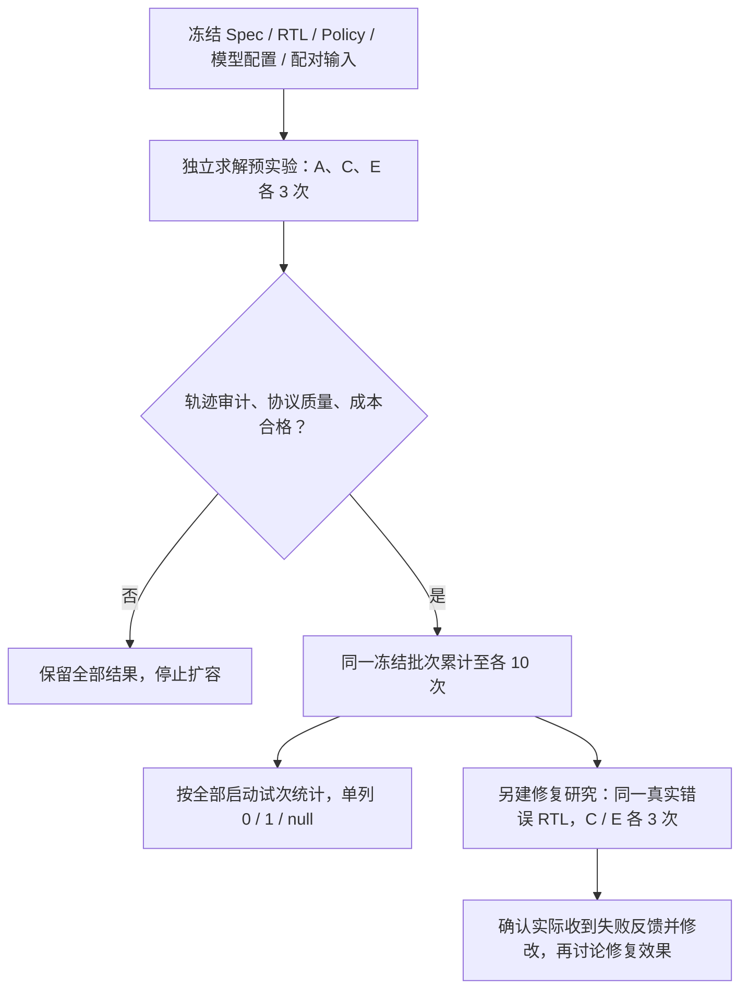

# 固定模型批量研究：执行契约

本研究复用 revision 3、Policy v1 的权限与预算以及严格的单对象动作解析。原始失败动作不拆分、不修补。不是模型参数训练。历史 v1 数据不混入新批次。



每条轨迹都是新的模型会话、Harness home 和 RTL 工作区。公开测试只经策略投影反馈；求解者停止后，才运行私有奖励、保留评估和必要的首候选离线测量。这些提交后结果不会回流到同一条求解轨迹。

当前 DSH 0.2.2rc2 高层 Python SDK 接口未发现直接传入自定义工具 schema／Python 回调的参数。这不表示 DSH 不支持扩展：[官方工具注册服务](https://github.com/deepseek-ai/deepseek-harness/blob/master/packages/core/tools/README.md)支持通过 Cordis 插件注册工具，[Python SDK 文档](https://github.com/deepseek-ai/deepseek-harness/blob/master/docs/user/guide/python-sdk.md)提供 profile／patch 扩展方式。模型 API 也支持 [Tool Calls](https://api-docs.deepseek.com/guides/tool_calls/)。本轮尚未完成将这些原生工具接入可信控制器，并保持相同权限、预算、提交后停止与隔离边界的实机验收，因此冻结后继续测量原文本协议，不在批次中更换接口。原生工具协议若另行实现，必须另冻结版本并对全部组重新运行。

独立求解预先冻结十轮输入与轮换组序，先执行前三轮（9 次）。每组相同模型别名及 SDK 参数；temperature/seed 仍为 provider 默认值。每试次最多20动作；C/E最多2次公开调用。独立会话与工作区，单并发。预算默认最多30试次、已完成试次累计4小时、200万实际SDK Token；时间及Token在试次边界检查，因此最后一个试次可超出阈值，货币成本未知。每次启动前要求至少4GiB可用磁盘。

预实验质量门槛在结果前确定：全轨迹审计通过；无基础设施失败；9次完整保留；因格式错误且无有效编辑的试次少于1/3；格式错误动作比例不超过30%。门槛失败则停止扩大到30次，不删除模型失败。门槛通过也需按实际成本及剩余资源检查扩容是否可行。

远端任务通过可信 supervisor 脱离 SSH 会话，凭据只经标准输入和进程内存传递。每个任务目录只能首次创建，重复请求不启动第二次执行。客户端恢复同一冻结清单，已取得完成结果不会重跑或重新评分；仍运行的远端任务只继续观察。确认异常退出且无完整指标时保留失败封套和原始目录；存活状态不明时停止，不自动重跑。恢复不会清理运行中的编译目录。下载先进入临时目录，完整取回后改名。

```bash
python3 -m environment.policy_experiment --out .local/study-new --repeats 10 --limit 9
python3 scripts/batch_analysis.py .local/study-new --limit 9
# 质量、资源和成本检查通过后，保持原清单继续；不会重做前9次
python3 -m environment.policy_experiment --out .local/study-new --repeats 10 --limit 30 --resume
```

配对修复是独立的 `repair-v1` 研究：显式记录初始失败 RTL SHA-256，C/E使用相同修复提示；要求读文件后先test，才允许edit/submit。这次test占原有两次预算，拒绝动作也占20次额度。此约束不会施加到独立求解或历史Policy v1。若模型仍未取得反馈或未进行编辑，应记录并判定该试次未进入有效修复过程，而非人为替它修改。

```bash
python3 -m environment.policy_experiment --out .local/repair-new \
  --policies test_verdict,test_diagnostic --repeats 3 --limit 6 \
  --starting-rtl PATH_TO_CONFIRMED_AGENT_FAILURE.sv
```

分析使用全部启动试次为主分母，null单独列出；无有效编辑、不提交、协议错误均保留。失败标签允许重叠，不能将其相加当成互斥总数。Wilson区间是小样本描述，不支持因果排名。实际反馈曝光、反馈后编辑与最终奖励分别统计，不以允许test推断使用反馈。

新增计时仅包装原grader的subprocess调用，不改命令、激励或判定。compile/simulate wall time包含对应shell及日志读取开销；复用编译计为I/O，不冒充新编译。模型会话跨度包含等待公开EDA测试，不能称为纯模型推理时间。原始SDK Token与EDA日志保存在可信侧。

## 读取结果

`batch_analysis.py` 从完整本地证据生成 `batch-analysis.json`、`batch-analysis.md` 和 `trial-measurements.csv`，不重新调用模型或评分。指标口径：

- “有效编辑候选”指实际接受的编辑通过源码语言门禁，不代表编译成功；首候选正确性另以公开集实测表示。没有候选或测量不完整记为未知。
- “有效提交”与功能成功分别计数。模型未提交、格式错误及基础设施故障都留在启动分母；null 不转为 0。
- 格式错误动作比例、出现格式错误的试次比例、因格式错误且没有编辑候选的比例分别列出。一次被拒绝但随后恢复的读取动作，不等于整个 RTL 求解失败。
- “反馈曝光”要求实际送入模型的 PASS／FAIL；ENV_ERROR 单列为环境问题。“反馈后编辑”和“反馈后源码 SHA 改变”分别统计；这些行为证据不证明模型在内部理解了诊断。
- 成功率主分母为所有启动试次，另列有效提交和反馈曝光条件下的比例及 Wilson 95% 区间。这些条件分母受模型行为影响，不能当作随机分组的因果比较。
- Reward 二元熵只描述已判定 0/1 的样本分布，明确排除 null；不能用它直接推断 RL 训练有效性。公开与私有比较必须针对同一个最终源码哈希。

`continue_study.py` 可在人工启动9次预实验后等待其结束，执行事先声明的质量／用量门槛，再接续至30次和独立6次修复预试验；门槛失败即停止。它不会追加替代失败样本。

```bash
python3 scripts/continue_study.py .local/study-new \
  --repair-out .local/repair-new --starting-rtl CONFIRMED_AGENT_FAILURE.sv
# 只导出经人工选择的典型轨迹，但保留整批统计分母
python3 scripts/export_batch.py .local/study-new experiments/study-new \
  --trials r01-spec_only,r01-test_verdict
```

完整轨迹审计需要可信侧原始 SDK 输入、输出和验证证据；公开导出中的哈希及精简轨迹用于核对，不声称能从脱敏文件重建被保留的私有向量。停止客户端并恢复的实测只证明 SSH／客户端观察中断可恢复；宿主断电、任意磁盘损坏及不确定孤儿状态仍需人工检查，不能自动重跑并重复计数。

## `text-json-atomic-v2`：重新冻结的交互协议

第一批 v1 在9次预实验通过门槛后继续采样；扩展数据出现了反复追加 `content_note` 字段和多个动作连写。字段错误原先只归入通用动作拒绝，离线分析现将其与 JSON 解析错误分列并合计；原9次预实验没有这类字段错误，原扩容决定不变。发现累计质量不合格后停止新试次，已启动者完整收尾。旧数据不能与 v2 合并。

v2 保持同一个原子解析器、工具权限、20次动作、C/E两次公开调用，以及完全相同的功能反馈投影。变化只有初始单动作／字段说明和格式拒绝提示：拒绝后列出允许的字段，**不自动删除多余字段、不拆分多个对象、不执行非法回复中的 RTL**。这仍是文本 JSON 协议，不是原生 Tool Calls。C/E 的初始提示及格式帮助相同，功能反馈粒度仍是组间变量。

新协议另行重跑三组预实验；达到9次之后，每完成一轮配对样本重复同一质量检查。触发停止条件即保存 `quality-stop.json`，禁止用 resume 继续同一批次。统计代码也纳入冻结哈希。此持续质量规则在 v2 首次模型调用前确定；属于执行有效性停止，不能把较早停止的数据当成固定样本量的无偏成功率估计。

```bash
python3 -m environment.policy_experiment --out .local/study-v2 \
  --protocol text-json-atomic-v2 --repeats 10 --limit 9 \
  --max-tokens 1200000 --max-seconds 9000
# 仅在质量与剩余总预算允许时续跑；必须显式给出相同协议
python3 -m environment.policy_experiment --out .local/study-v2 \
  --protocol text-json-atomic-v2 --repeats 10 --limit 30 --resume
```

批量原始结果与 SDK 回包留在可信侧；对外报告需同时列出被停止的 v1、v2 各自实际样本数、全部失败及未执行部分，不能只展示接口改善后的数据。
