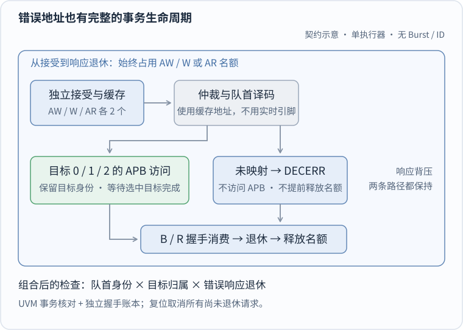

# 组合契约怎样进入真实 Agent 求解

地址路由解决“请求属于哪个目标”，请求队列解决“哪些请求已经接受、何时执行及何时释放容量”。组合以后，这两件事必须始终对应：一个访问目标 2 的请求不能在等待期间借用目标 0 的响应，也不能因为遇到未映射地址而丢掉退休账目。

本阶段保持已有组合 Spec 与独立验证器不变，补齐从实例功能资格到受控求解、独立评分和轨迹审计的路径。两份新实例已完成来源匹配运行准入；此前的控制银行及其真实失败记录保持原样。一条预声明模型试次已完成并通过审计，最终提交功能失败，终局与独立保留评估分别为 0。这是有效失败轨迹，不是任务或工具通过率。

[运行验收证据](../experiments/task-space-v1/composed-runtime-v1/manifest.json) · [实际模型证据](../experiments/task-space-v1/calibration-composed-v1/manifest.json) · [任务契约与生成方法](../task_families/composed_v2/README.md)



[查看原尺寸结构图](diagrams/composed-route-retirement.svg)。窄屏阅读时，可结合上文的请求归属与退休说明理解边界。

## 为什么功能对照之后还要验收运行路径

正反对照说明给定工程契约的判据在已检查范围内能区分合法实现与特定错误。运行准入还要回答另一个问题：模型编辑的是否就是被测试和被评分的那份源码？测试额度是否真的生效？提交后能否再看到私有失败并继续修改？

复用已有原生调用机制需要完全匹配 worker、controller 和 Session 的来源；组合域仍要独立执行公开、终局与保留评分。这里没有用单事务路由任务的通过凭据代替队列组合的功能证据。

在三目标、每通道两笔未退休额度、单 APB 执行器的有限域中，两个地址布局共用同一运行入口，不增加 Task ID 分支。每个布局仍引用自己的两种合法结构、38 个错误对照和 66 项实际覆盖。三个目标与六个复位阶段的 18 项交互，是组合新增的验证义务；它们通过真实接口事件确认。

实际适配验收共 14 项通过，用时约 1087.7 秒。参考实现分别完成公开 42、终局 44、保留 44 个场景；终局账目为 868 笔计划事务、756 笔检查完成、112 笔复位取消，66 项必要覆盖全部命中。第三次测试没有启动仿真，提交后禁止编辑；无效源码、候选编译错误与环境故障分别分类。20 动作上限与原生权限复用九份字节一致的机制来源及既有实际验收。

记录审计另拒绝了源码、向量、单场景结论及角色的四种篡改；准入审计拒绝错误任务身份、材料哈希、配置哈希和后端类型。两份实例各 210 条既有仿真通过重放，没有重新计算旧奖励。临时工作目录隔离仍共享固定用户和网络空间，不宣称完整对抗性系统隔离。

## 真实求解记录与结论边界

一条预先选择的 shifted 契约试次：deepseek-flash、reasoning off、20 动作、20 模型请求、2 次公开测试；仅 read/edit/test/submit。温度沿用服务默认，未取得固定采样种子及精确权重版本。输入、提示、来源与停止规则在调用前冻结，没有追加成功样本。

模型共执行 9 个动作、4 次编辑和 2 次公开测试，8 次模型请求均得到响应，没有动作格式拒绝。两次 FAIL 均确认送达后续模型请求；提交结束求解，随后才进行终局与保留评分。

| 实际版本与动作 | 模型当时获得的信息 | 独立可核查的结果 |
| --- | --- | --- |
| 编辑 03，随后编辑 04 | 尚无功能反馈 | 03 未测试，不能判断正确性 |
| 测试 05，针对 04 | FAIL、功能错误类别、剩余 1 次、候选哈希 | 首个公开场景拒绝错误响应通道 |
| 编辑 06，测试 07 | FAIL、时序错误类别、剩余 0 次、候选哈希 | 同一公开场景拒绝缺失的预期 Setup |
| 编辑 08，提交 09 | 没有对 08 的公开验证 | 最终训练侧 Reward=0；独立保留也为 0，分别在首场景发现功能违例并早停 |

最终提交的关键关系很具体：`iswrite` 保存是否选择了写请求，`BVALID` 却以 `!iswrite` 为条件，`RVALID` 以 `iswrite` 为条件。写请求应从 B 通道返回写响应，这组表达式将两者颠倒；首个公开失败与最终独立评分都支持这个原因。[候选变化记录](../experiments/task-space-v1/calibration-composed-v1/candidate-analysis.json)连接实际源码与观察。

中间编辑还把 32-bit 的 `sel_addr` 改为隐式 1-bit wire；接下来的公开测试更早报告 Setup 缺失。最终版本恢复了地址位宽，却保留响应方向错误。源码与日志支持检查这些具体变化，但没有另行隔离每项缺陷、测试版本 03，或证明某个中间版本整体正确。两个公开场景都失败，不能把它写成已经测得的整场景 PASS→FAIL 回归。

模型只收到错误类别，**没有收到上述具体失败文本**。因此，本记录证明工具交付正常、失败反馈实际曝光且随后发生编辑；没有证明模型准确定位了问题，也没有证明更多测试额度或更详细反馈必然改善结果。基础响应映射已经导致早停，这条试次不能单独衡量更深层队列交互能力。

## 结果与成本一起解释

本条消耗 **63,090 Token、约 430.5 秒**。公开两次、终局和保留各一次，四次独立编译报告合计 351.726 CPU 秒，四次实际仿真合计 2.34 CPU 秒。早停使每次只执行一个场景，不能把“输入包含 44 场景”写成候选全部跑完。SDK 模型步骤区间约 31.514 秒；它不是服务端纯推理时间，编译／仿真独立墙钟时间与 API 货币费用尚不可取得。

相比之下，参考实现的运行资格验收需要实际完成全部角色输入，耗时约 18 分钟。少量模型失败的运行成本低于完整正向验收，并不说明扩大到大量合法候选也同样便宜。

[数据用途复核](../experiments/task-space-v1/data-use-v1/manifest.json)使用本阶段全部五条完整交换记录，另保留一条原始 null 中断研究记录，总分母为六条已启动试次。不同契约与条件不合并为一个成功率。三条可进入正确实现示范的人工复核，其中一条有实际 FAIL→PASS 修复证据；本条组合失败适合研究反馈后修改及未测最终提交，不能作为成功修复示范。分类只使用训练侧反馈与终局结果，不使用保留评估或事后候选评分。

## 复用到了哪里

公共机制能够复用原生工具、预算、提交冻结与记录格式；有限任务域仍需要各自的输入派生、评分适配和审计。当前实现降低了同域新实例的专用工作，尚未消除新任务域接入时的适配代码。两份实例通过不代表所有合法地址组合都已准入，三种域的少量试次不能合并为稳定成功率。

本阶段六条模型启动已达到预设上限，没有补抽成功样本。下一步最有价值的是固定这份已确认错误的候选，比较“类别反馈”与“受控首错／事件定位”能否帮助纠正响应归属，保持任务、起点与其它预算一致。需要新计划和新的资源预算，不从这条失败推断反馈的因果效果。继续增加并发复杂度之前，先检验模型是否能够利用已有判据完成这个明确修复。

## 怎样复用这条路径

需要合法的 VCS/AMBA VIP 环境、任务族生成的修订执行包，以及该实例完整控制银行。先按[生成说明](../task_families/composed_v2/README.md#从契约生成候选)取得材料。可信控制器使用包自身场景生成器，在独立 Python 进程中派生公开、终局、保留三个完整输入文件；`input-plan.json` 的 `inputs` 保存三类文件路径，`seeds` 为三个不同的有界整数。输入与运行配置留在可信侧。

```bash
python3 -m environment.composed_acceptance_v1 PACKAGE CONFIG INPUT_PLAN ACCEPTANCE
python3 -m environment.composed_admission_v1 qualify NATIVE_EVIDENCE ACCEPTANCE PACKAGE CONFIG QUALIFICATION
python3 -m environment.composed_admission_v1 admit PACKAGE CONTROL_EVIDENCE QUALIFICATION CONFIG ADMISSION
python3 -m environment.task_pool_v2 PRIVATE_POOL_INDEX
```

这些命令分别检验运行适配、复用来源严格相同的原生机制、审计具体实例和查询当前可执行任务。环境观察记录不一致时必须提供可核对的内容一致性证据；不能机械替换历史哈希。`admit` 不接受 router-only 凭据。

新试次需按[运行器](../environment/native_tools/run_composed_v1.py)要求冻结模型、提示、预算、源码集合、准入记录与三类输入，再由[可恢复批次入口](../environment/native_tools/composed_batch_v1.py)执行。已完成试次不会再次调用模型或重新评分；已启动但未完整封存的目录要求先核对状态。

```bash
python3 -m environment.native_tools.composed_batch_v1 STUDY_PLAN RUNS
python3 -m scripts.generated_exchange STUDY_PLAN RUNS EXCHANGE
```

[统一导出入口](../scripts/generated_exchange.py)按固定研究配置分派已有路由 v10、寄存器 v11 和组合 v12 的审计器，不接受任意任务提供的模块名。实际复验中，前两类历史轨迹的导出清单哈希保持完全一致。新组合记录先经过[动作重放](../scripts/check_composed_replay.py)与[实际评分重放](../scripts/composed_grade_audit.py)，再分别交付真实反馈、训练侧终局奖励和独立保留评估。缺失的 Token IDs、行为概率及精确权重版本保持缺失。
