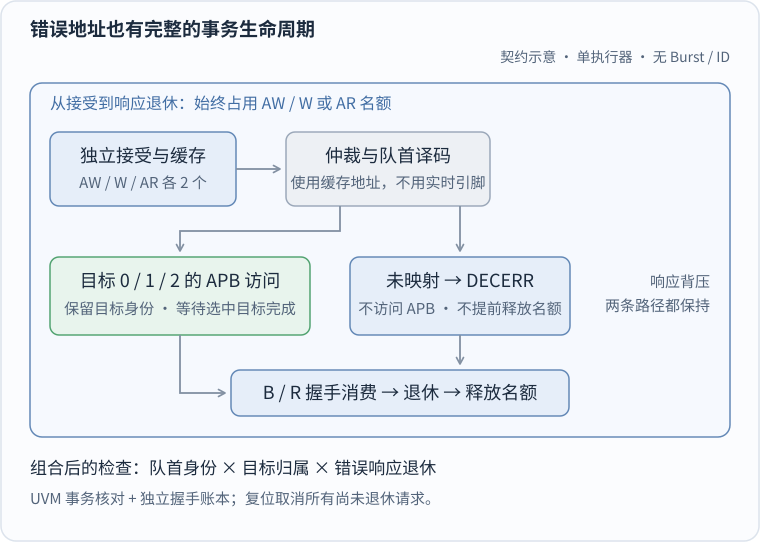

# 当地址路由遇到排队请求

地址路由回答“这个请求去哪个外设”，请求队列回答“哪些请求已经接受、何时可以执行”。将它们组合后，设计还必须保存**排队事务自己的目标身份**，并正确处理没有外设可访问的请求。这个页面解释新的 `x2p_routed_queue_v1` 组合契约及其生产方法；工业准入与模型结果应以对应源码的验收证据为准，生成成功本身不授予准入。

例如，队首写请求发往目标 1，AXI 引脚已经在发送目标 2 的下一个地址。APB 必须继续访问目标 1，并返回目标 1 的响应。再例如，一个地址未映射的读请求可以立即形成 DECERR 错误响应，但若 AXI 尚未消费响应，它仍占用一个未退休名额。没有 APB 操作，不等于没有需要管理的事务。



[查看原图](diagrams/composed-route-retirement.svg)。图描述规定的外部行为，不约束实现必须采用图中的内部模块划分。

## 先限制组合范围，再检查交互

这个契约保留 AXI4-Lite/APB4、单时钟、32 位数据与单执行器。AW、W、AR 分别有两个未退休名额；AW 和 W 独立接受、按顺序配对，读写按规定的轮转优先级选择。三个目标各有一个 64 KiB 地址窗口，向 APB 输出减去窗口基址的局部地址。

映射请求执行 Setup/Access，等待选中目标完成。未映射请求参与相同的 FIFO 顺序与仲裁，在选中后注册输出 DECERR，读数据为零，不产生 APB 访问。两者都保持响应及名额直到 B/R 握手退休。这里没有引入 Burst、ID、多个 APB 执行器或执行与响应解耦；它不是此前 Task004 的所有能力与路由能力的叠加。

[契约参数](../task_families/composed_v1/contract.json)是一个经审查的有限实例，不是允许任意修改的参数生成接口。原 Task001–004、路由族和队列族保持各自历史版本。

## 为什么不能只合并已有测试

| 组合风险 | 必须观察到的行为 | 独立判据 |
| --- | --- | --- |
| 使用实时地址覆盖排队目标 | 不同目标的请求排队、目标切换 | 有序请求身份与目标编号、局部地址同时核对 |
| 跨目标地址别名或响应串线 | 多个目标同一局部地址保存不同数据 | 各目标独立存储；错误的未选中响应不能被当作有效数据 |
| DECERR 提前释放容量 | 未映射请求的响应背压、后续请求竞争 | 只根据 AXI 接受与退休握手维护独立名额账本 |
| 错误请求绕过仲裁 | 映射与未映射读写同时等待 | 同一队首与轮转规则涵盖错误路径 |
| 特定目标的状态未在复位时清除 | 在各目标上实际打断活动事务 | 按目标记录复位覆盖，并核对输出清零与取消账目 |
| 复位将错误响应误计为 APB 完成 | 复位打断未消费 DECERR | 取消请求与物理 APB 完成分别记账 |

生成的 `obligations.json` 将交互义务关联到场景、检查器、实际覆盖和错误对照。UVM Scoreboard 保存有序请求身份，并根据地址区间和减法独立推导目标及局部地址；合法参考使用位字段译码。字面边界锚点进一步核对译码含义，但不同表达式及有限锚点仍不能证明不存在共同理解错误。

周期账本另行统计 AW/W/AR 接受减去 B/R 退休，并逐边沿与 Scoreboard 核对。检查器未连接、未实际运行或彼此不一致时，应归为可信验证环境不可判定，不能把候选实现判成错误。必要覆盖也必须由实际事件置位，不能用“场景文件存在”代替。

## 生成与复用入口

```bash
python3 -m task_families.composed_v1.generate .local/composed-candidate
python3 scripts/tasks.py --package .local/composed-candidate list
python3 scripts/tasks.py --package .local/composed-candidate \
  quality x2p_routed_queue_v1 .local/admission
```

需要配置合法可用的工业后端。相对工作路径以生成包为基准；质量门禁返回 `accepted=true` 才表示该源码及工具链完成本版验收。生成器拒绝覆盖已有目录。

[`capsule.py`](../task_families/capsule.py)复用固定基础源码展开、范围收敛、运行组件测试、文件清单与来源哈希；[组合生成器](../task_families/composed_v1/generate.py)保留目标特有的语义转换、检查器与错误对照。这是对实际重复步骤的提取，没有将已有冻结生产器改写成新框架，也没有建立跨工具版本的二进制缓存。

组合 v1 的求解入口只开放原有 Observation Policy。单目标的运行时引脚观察尚未适配三目标接口，因此不能把另一任务上的工具验收自动继承到本任务。

已通过的初版验证仍发生过目标相关复位漏检。当前生成器使用验证器修订 2；[同源码复验与边界](composed-environment-evaluation.md)解释了为什么需要新增交互义务，历史初版 PASS 不代表修订版准入。

## 怎样继续核查

- [路由族的地址覆盖漏检案例](router-family-evaluation.md)：契约变化为何会增加验证义务。
- [队列族的独立账目与真实回归](queue-family-evaluation.md)：接受、执行和退休为什么需要分别观察。
- [统一任务入口](task-catalog.md)：任务身份、源码清单和工业准入各自承担什么职责。

有限仿真、正反对照与覆盖用于提高奖励可靠性，不构成所有输入下的形式正确性证明。后续扩大契约空间时，必须重新推导交互义务并验收，不能仅调整参数后继承本例的结论。
