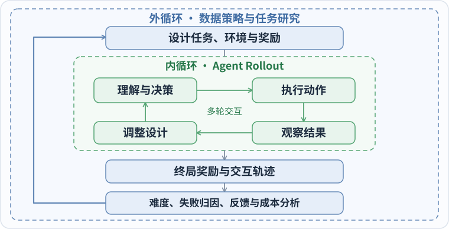

# 面向人类的文档设计规范

文档的工作，是帮助读者建立正确的工程认识、判断证据并复用成果。**先决定读者需要理解什么，再决定怎样排列文字、图形和链接。** 风格一致来自稳定的认知顺序与图形语义，不来自统一的章节数量。

本规范适用于 README、任务介绍、架构说明、研究报告、技术设计和运行手册。机器可读数据、冻结清单、原始日志与工程证据不按展示要求重排或改写；需要解释时，在它们之外建立人类入口。公开内容仍遵守[项目交付规则](../AGENTS.md)。

[组织阅读路径](#先设计阅读路径) · [选择表达形式](#让表达形式承担不同工作) · [图形语言](#沿用项目图形语言) · [交付审查](#完成后另做一次阅读审查)

## 从当前首页学什么

本规范以 `ca7301e` 的[首页](https://github.com/5Mcv4He/ProtocolBridge-RL/blob/ca7301e6124b53c2eec91e6a2296ce6ea1968a69/README.md)和[原有八张架构 SVG](diagrams/README.md)为视觉设计起点，并在后续首页中强化跨领域阅读与认知解释。借鉴的是以下方法，而不是复制首页的篇幅和排版：

- **先给系统地图，再进入实现。** 首页先回答工程问题如何成为 Task、Environment 和 Verifier，再解释任务能力、独立奖励及 Agent 交互；代码目录放在读者已有概念之后。
- **关系决定图形。** 任务演进用分支表达空间路由与时间并发的区别，不把任务编号画成难度排名；内外循环用包含关系区分一次求解与研究迭代。
- **边界是主线信息。** 求解与评分图把 submit 放在边界上，标明冻结并停止、私有细节不回流；尚未接入的 Trainer 在图中直接标识，不依靠页尾免责声明。
- **每层都有继续核查的入口。** 图建立认识，正文解释原因，短表呈现结果，“实现入口”连接代码和证据。读者无需先理解仓库目录才能找到答案。
- **细节按需要展开。** 首页保留最小开始步骤，把真实商业仿真流程放入折叠区域；失败、样本量和关键限制仍在主线上。

下面这张既有图可同时说明两个设计选择：嵌套区域表达作用域，外侧回路表达研究如何利用实际结果。它不是装饰，也不表示已经进行参数训练。

[查看原尺寸 SVG](diagrams/research-loop.svg)；窄屏可结合上文理解内外循环的区别。

## 先设计阅读路径

动笔前明确主要读者、阅读目的和读完后应能做的判断。例如，研究报告要让读者判断证据支持什么；运行手册要让操作者知道前置条件、执行顺序和怎样确认成功。不要把内部开发记录直接改标题后发布。

通常从整体到局部、目的到机制、概念到实现、结论到证据展开。但这不是固定模板：

| 文档类型 | 优先解决的阅读问题 |
| --- | --- |
| 首页、任务介绍 | 为什么值得做 → 在系统中的位置 → 能力与边界 → 如何进入细节 |
| 架构、技术设计 | 要解决的约束 → 责任与数据关系 → 机制及取舍 → 实现与验收 |
| 研究报告 | 主要发现与限制 → 研究问题和对照条件 → 结果与失败分析 → 证据及复现 |
| 运行手册 | 适用版本与前置条件 → 最小可运行路径 → 预期输出及判据 → 分支操作与排错 |

开头用一小段说明本页回答什么、属于哪个系统环节、当前完成到什么程度。术语首次出现时解释职责和相邻概念的关系：例如“Scoreboard 根据接受的请求核对跨协议事务语义，补足 VIP 的单端协议检查”，比仅展开英文缩写更有帮助。面向熟悉读者的深层页面可以链接已有定义，避免重复整段背景。

标题应表达问题或内容判断，不能全是“概述、其他、补充”。短页不必附目录；长页给少量阅读入口。不要为填满模板而创造章节。

## 面向跨领域读者建立认知支架

首页及重要人类入口的读者可能了解芯片设计但不了解后训练，也可能了解机器学习却不熟悉 RTL 验证。目标不是从零讲完两门专业课程，而是让相邻领域读者不必先掌握所有术语，就能顺着主线理解问题、方法、机制、证据与价值。

采用三种相互补充的写作原则：

| 原则 | 在本项目中的做法 |
| --- | --- |
| Reader-oriented Writing（以读者为中心） | 从读者已知的问题和研究目的出发，再引出必要的技术概念 |
| Progressive Disclosure（渐进式信息披露） | 先交代整体位置和关键关系，再展开工程机制、实验细节与代码入口 |
| Cognitive Scaffolding（认知支架） | 在读者需要某个概念时提供必要定义、具体例子和推理前提，使其能进入下一个概念 |

**不要把理解所必需的推理过程误当作冗余。** 例如，先解释芯片模块需要通信、不同协议需要转换，再介绍 Bridge、Spec 与 RTL；先解释为什么人工评分不适合大量 Rollout，再引出独立 Verifier；先解释错误奖励为何有风险，再引出质量门禁。第一次使用 FIFO、Outstanding、Scoreboard 或 Rollout 时，不仅要说明它叫什么，还要交代它在当前问题里做什么。

公开入口尽量选择一个真实、有源码和实验依据的案例贯穿多个层次。例如用 Task003 的容量规则依次解释任务输入、独立检查、工具反馈、实际修复轨迹和终局奖励，再引出任务难度与数据策略。示意流程须明确标注为示意；实际失败轨迹不能改写成成功故事。不要用泛泛的类比替代必要的工程事实，也不要为每个术语增加完整教程。

关键概念应当有继续学习的入口：任务规格、协议或机制说明、真实证据与源码链接。读者应能知道自己尚缺什么知识、它为什么相关，以及去哪里继续了解。保持专业术语及其精确定义；深入参数、实现细节和复现命令可进入专门文档。

## 让表达形式承担不同工作

**浏览层**由标题、开头结论和关键图提供；**理解层**由机制解释、例子和结果对照组成；**核查层**用明确链接进入源码、版本、实验与命令。这三层应互通，不能把必要解释全部藏进链接。

| 内容 | 优先形式 | 避免 |
| --- | --- | --- |
| 模块、系统边界、数据或依赖关系 | 结构图及简短语义说明 | 用目录树冒充架构；不标含义的连线 |
| 执行步骤、事务生命周期 | 流程图或时序图 | 将接受、执行、响应和退休合为一个事件 |
| 结果、条件、能力差异 | 短表或带单位的数据图 | 单元格塞入整段解释；混合不同分母 |
| 工程机制、因果判断、取舍 | 连贯正文及必要示例 | 仅凭箭头声称因果；堆术语或碎片列表 |
| 复现、代码与详细证据 | 有含义的链接、代码块 | 裸路径堆积；没有前置条件和输出判据的命令 |

图表达关系，正文解释为什么，表格便于比较；三者不逐字重复同一份信息。段落围绕一个意思展开，遇到条件变化或新问题再分段。列表用于真正并列或有顺序的内容，避免多层嵌套。重要结论可以加粗，整段加粗会消除重点。

主线必须直接展示：任务边界、关键失败、结论限制和复现所需条件不能折叠隐藏。长命令、逐项参数和补充案例可放在 `
` 中，summary 要说明展开后得到什么；不要多层折叠。表格过宽时优先拆分比较问题或把解释移到表外，不靠缩小字体挤进去。

保持标题、段落、列表、表格和代码块之间的空行；分隔线用于大的阅读阶段切换，不用于每个小节。少用徽章、图标和装饰性色块，让视觉强调对应信息重要性。

## 沿用项目图形语言

### 先确定图要证明的关系

重要系统图优先使用可精确布置的 SVG；简单关系可用 Mermaid，数值研究图宜由可复现绘图脚本生成。选择依据是读者能否更快理解，而非哪种生成方式省事。不要为了本规范把所有旧图转为 SVG。

每张图只承担一个主要问题。先写出一句图意，再确定节点、分组和连线；不能准确命名连线含义时，先澄清机制。主流向一般从上到下或从左到右，相同责任层级对齐、同类节点保持尺寸一致。真正的分支、并行、循环和边界须在空间布局中可辨认；对称只用于对等关系。

连接尽量走短路径并避开文字。回绕用于真实反馈循环，不为迁就节点摆放而绕远；不要让线穿过节点、箭头压住边框或标签。区域包含必须有明确标签。虚线在现有图中既用于作用域，也用于未接入关系，**不能仅凭虚线判断状态**：写明“求解阶段”“尚未接入”等含义，必要时增加图例。

### 可复用的视觉基准

以下数值来自现有 SVG 源码，是新图的起点，不是禁止调整的像素模板。复杂图应拆分或改变布局，不应持续缩小文字。

| 元素 | 当前基准与使用原则 |
| --- | --- |
| 画布 | `viewBox` 宽 760，高度随内容；显式画布底色，外框圆角 15 |
| 节点与区域 | 节点圆角 9，区域约 12；边框 1.5；同类元素统一内边距与间距 |
| 字体 | 系统无衬线；保留 PingFang SC、Microsoft YaHei、Noto Sans CJK SC / Noto Sans SC 回退 |
| 文字层级 | 主标签常用 19 / 600，次标签 15–17，辅助标签 13–14；关键内容不得依赖极小字 |
| 连线 | 常用 1.8，圆形端点和转角；主循环可用 2.2；开放式箭头与现有 marker 一致 |
| 间距 | 同排、同层保持规律，先给标签与连线留空间；不要求不同语义层之间机械等距 |

稳定颜色表示角色，不是通用 PASS/FAIL 编码：

| 角色 | 浅色填充 / 边框 | 深色填充 / 边框 |
| --- | --- | --- |
| 蓝：核心对象、任务、奖励 | `#e6eef9` / `#6388b6` | `#253951` / `#78a4d8` |
| 绿：执行、工具交互、正对照 | `#e8f4ed` / `#52a371` | `#203c31` / `#68bd87` |
| 灰：控制、基础设施 | `#edf0f4` / `#9ba8b9` | `#293443` / `#8c9bb0` |
| 琥珀：错误对照 | `#fcf2de` / `#c69c55` | `#423624` / `#d4ad6c` |

画布为浅色 `#fbfcfe` / 深色 `#161e29`；主文字为 `#1c2b3e` / `#edf2f8`，辅助文字为 `#53647a` / `#b0bdcf`。新增语义先复用已有角色；确需扩展时记录含义，不让同色在相邻图中任意变义。即使去掉颜色，标签、形状或布局也应保留区分。

### 源码、替代文本与适配

图源放在 `docs/diagrams/`，采用表达主题的文件名。优先复用最接近语义的现有图的样式和 marker，再重新设计布局；不要只替换节点文字。SVG 保持可读文本与逻辑分组，避免无必要的浮点噪声。不依赖脚本、远程字体、外链图片或商业资源；若使用生成器，保留生成源码和重建方式，避免同时维护两个真源。

每张 SVG 保留 `viewBox`、`role="img"`、`title`、`desc` 及对应 `aria-labelledby`。Markdown 图片也需有描述关系的 alt 文本；“架构图”不足以替代图意。附近正文说明关键边界，并给出所对应的实现或证据链接。图的含义不能只存在于颜色中，重要结论也不能只存在于图片里。

现有 SVG 内嵌 `prefers-color-scheme: dark`，支持时切换深色，不支持时仍有完整浅色画布。**系统偏好与 GitHub 账户主题不一定一致，不能凭 CSS 存在就宣称主题适配完成。** 在实际嵌入方式下检查浅/深背景；若需提供双主题文件，维护共同源并检查两份语义一致。

至少检查正常正文宽度与窄屏。760 单位的图缩到手机宽度后，小字可能不可读；应提供原图链接及正文解释，必要时拆图或做语义一致的纵向版。不要把“能等比缩放”当作“窄屏已可读”。正文、表格与代码块也需检查横向溢出。

## 准确性先于展示效果

图中的箭头和包含关系也是技术断言。确认它表示数据流、控制流、时间先后还是能力扩展；能力分支不等于成功率或难度排序，分析循环不等于模型参数更新。求解侧可见反馈、私有奖励和保留评估必须清楚区分。

明确标注已实现、已验收、探索性发现、推论和计划。数据旁说明任务/版本、样本量、分母、单位及证据入口；小样本不画出虚假的精确趋势。失败和 null 保留真实分类，不能为视觉整齐合并成 0 或删去。截图和示意事件不得冒充真实仿真证据。

当前能力说明可以更新；已冻结的实验、输入哈希与原始记录保持不变。若旧说明存在错误，用更正说明和版本链接澄清，不重写历史结果。个人部署、许可状态及临时调试继续留在私有记录；影响研究有效性时公开必要的分类和统计即可。

## 完成后另做一次阅读审查

写作完成后，暂时离开作者视角，按以下顺序重新读；不要求每次增加流程文档或调用另一名 Agent。

1. **只看标题、开头与图。** 新读者能否说清目的、系统位置和结论边界？标题顺序是否依赖知道开发历史？
2. **通读主线。** 从相邻领域读者视角检查：是否能在不了解全部专业术语的情况下跟上因果链？术语是否有必要解释，实例是否连接概念和实际实现，缺失知识是否有继续学习的入口？删掉的是重复而非必要推理吗？图、表、正文是否各有作用？
3. **沿证据核查。** 任选关键结论，能否定位代码或实验？版本、数字、分母和图中权限是否一致？失败与限制是否可见？
4. **检查真实呈现。** 在可用 Markdown 预览器中查看正文、图、折叠和代码；重要图检查浅/深色及正文/窄屏宽度、文字裁切、箭头与标签、图片载入和链接。XML 解析或链接脚本只检查结构，不能替代目视审查。
5. **审查公开范围。** 查看最终 diff，排除敏感信息、内部运维、无关重排及冻结证据变动。确认索引和相互链接可达。

提交说明简要记录修改范围、完成的检查和仍未核验的呈现条件。只能做本地预览时明确其不等同于 GitHub 实际渲染，不必把截图或临时检查日志提交到仓库。文档变更通常不需要重跑 EDA；涉及功能描述时核对相关真实证据即可。

## 逐步应用，避免文档工程膨胀

新增文档从这套方法起步；修改既有文档时先优化本次相关部分。公共机制集中说明，任务和研究页链接复用，避免维护多份容易漂移的解释。重要入口明显难读时再单独优化，不批量改写历史成果。

本规范负责设计方法，[图形目录说明](diagrams/README.md)负责图源索引，根目录 [AGENTS.md](../AGENTS.md)只保留核心约束。保持这三个入口同步，不要求建设文档生成平台或新增图形依赖。
