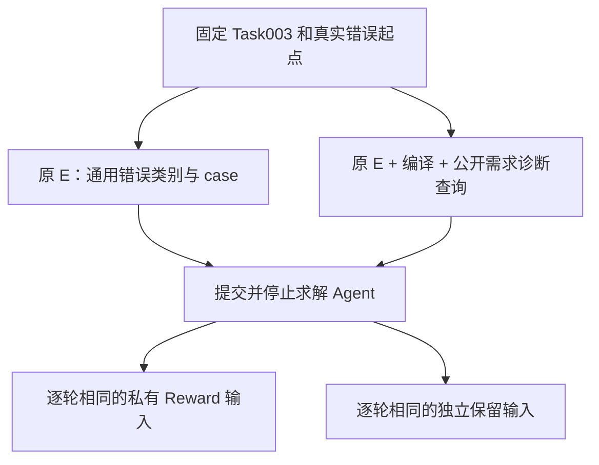

# 受控工程工具：Task003 同起点修复探索

本轮没有观察到成功率提升，但观察到了具体诊断曝光后的相关 RTL 修改。四条真实 DSH 试次全部提交，终局和保留评估均为 0；没有动作格式失败或基础设施失败。这里的零奖励代表确认的 RTL 错误，不代表工具没有运行，也不能据此认定诊断无价值。

## 研究设计

固定 Task003 v1、同一份历史失败 RTL、deepseek-flash、DSH 0.2.2rc2、text-json-atomic-v2、20 动作和两次完整公开测试。基线使用原 E 策略；增强组在同一策略上增加 `engineering-tools-v1`：两次独立编译和两次公开检查查询额度，仍共享 20 动作总预算。接口见[工程工具说明](engineering-tools.md)。不进行模型参数训练。

起点 SHA-256 为 `09bb88ff0c77d76ef4b8c6efa35a5ce17db179da05fe2f1c3ccd9c9deebd52ac`，来自此前真实失败轨迹。源码冻结于 `ee0309b810f18e819dca04721e2816f82e20ee89`；001/002/003 的 Spec、参考实现和终局 UVM 判据未变。每轮两组使用相同冻结私有 Reward 和保留输入，实际执行顺序为基线1、增强1、增强2、基线2。每次新会话、Home、工作区；SDK最大输出7000tokens、reasoning off，temperature/seed使用供应商默认，非确定性。

这比较的是**组合工具可用性**，包含工具说明的必要 Prompt 差异，不是单独某个工具的因果消融。没有把历史 E 组样本混入这四条新试次。

## 验收和结果

[Task003 新源码门禁](../experiments/engineering-tools-v1/task003-quality/)通过两个合法实现、15个错误对照、40项真实机制检查及隔离探针。新增接口通过[20项机制验收](../experiments/engineering-tools-v1/mechanism.json)、独立缺失配置 ENV_ERROR 探针及单元测试。合法 RTL 编译、语法错误、禁止源语言、额度拒绝、公开诊断和终局评分均实际调用对应实现。没有将纯解析单元测试当成 RTL 仿真。

[四组精确评分输入资格检查](../experiments/engineering-tools-v1/input-qualification/result.json)均由正确参考实际通过21/21case，各506计划、474检查完成、32复位取消，33/33必要bin。它发生在求解结束后，不改变 Agent 奖励，不提供额外反馈。

| 条件 | 启动 / 提交 | 成功 | Wilson 95% | 0 / 1 / null | 动作格式错误 |
|---|---:|---:|---|---|---:|
| 原 E 基线 | 2 / 2 | 0/2 | 0–65.8% | 2 / 0 / 0 | 0/13动作 |
| E + 工程工具 | 2 / 2 | 0/2 | 0–65.8% | 2 / 0 / 0 | 0/19动作 |

四条均先实际测试错误起点，再进行编辑；首个编辑候选均未通过公开测试。没有公开 PASS、私有 FAIL 的分歧；最终候选若在最后一次公开测试后又编辑，报告不会把较早候选的公开结果当成最终结果。全部终局评分与保留评估在求解进程停止后执行。

## Agent 实际做了什么

| 试次 | 实际反馈与修改 | 最终确认错误 |
|---|---|---|
| 基线1 | 通用时序诊断后，将 AW/W 的退休点也提前到选择时，保留原 AR 缺陷 | `address_data`：未退休请求容量超限 |
| 基线2 | 两次编辑，加入执行中写事务的 `wr_busy` 计数；待处理计数仍有多处同周期赋值 | 同上 |
| 增强1 | 两次查询均收到 `Q_CAPACITY`；增加 `exec_read`，用待处理数量加执行中事务限制 ARREADY | `read_fifo`：容量仍超限 |
| 增强2 | 两次收到 `Q_CAPACITY`，最后改为未退休计数与可选择计数分开；独立编译 PASS 后提交 | `address_data`：已存在可选择请求但没有规定时刻的 APB Setup |

增强组两条都主动获取了非空需求诊断，随后修改容量相关逻辑。增强1仍在同一时序块里分别对 AR 接收和选择赋值；同时发生时，后面的递减会覆盖递增。增强2新增的 `*_avail` 计数也存在这种更新风险，并混用了前进后的 head 与未退休数量计算插入位置。这些是源码审查发现的具体缺陷；实测首错支持失败判定，但没有声称证明了每条轨迹唯一的内部致错周期。

增强2的最后一次编译反馈明确包含 `functional_correctness_checked=false`。语法通过、终局失败是预期的职责分离。四次具体诊断曝光、一次独立编译均保存在[实际审计汇总](../experiments/engineering-tools-v1/study-report.json)及[增强组轨迹](../experiments/engineering-tools-v1/tools/)中；[基线轨迹](../experiments/engineering-tools-v1/baseline/)独立保存。没有补写模型代码或将人工修正计入成功。

## 成本和结论边界

| 条件 | SDK tokens（含缓存读） | 动作 / 编辑 / 完整公开测试 | inspect / compile | 试次总秒 | 功能验证编译秒 / 仿真秒 |
|---|---:|---|---|---:|---|
| 原 E | 60,298 | 13 / 3 / 4 | 0 / 0 | 474.8 | 421.7 / 22.6 |
| E + 工具 | 106,458 | 19 / 3 / 4 | 4 / 1 | 489.0 | 420.1 / 34.4 |

共166,756tokens，约16.1分钟试次时间；新增独立编译约1.2秒。表内不包括门禁、输入资格检查和部署准备。请求耗时和更细费用字段在各组 `batch-analysis.json` 中；模型请求墙钟包含SDK/网络开销，不等于纯GPU推理时间。无法取得实际货币账单。

当前结果支持三个有限结论：

1. 更具体的公开需求反馈已真正进入求解过程，且出现相关逻辑修改；“工具可用”与“实际获取反馈”在证据中分开记录。
2. 需求级解释仍不足以保证模型正确实现并发状态更新。下一步有价值的是受控的公开握手/事件时间线，或隔离的 Agent 自建实验，用于检验“接收与选择同周期”的假设；仍需先做安全与正确性验收。
3. 本修复样本的终局奖励全为0，无法区分错误传播、局部修正和新增回归。这不证明所有RL算法无效，也不证明任务无解。已有合法参考和独立求解成功；当前模型远未显示 Task003 饱和。

每组只有两条、只有一个错误起点，又同时增加两个工具，不能进行成功率排名、宣称工具无效或推断训练收益。任务复杂度与工具能力应继续分别冻结和测量。复现时先检出上述源码版本并重新完成匹配门禁；当前HEAD的新增任务不会被当成这批旧实验的输入。
