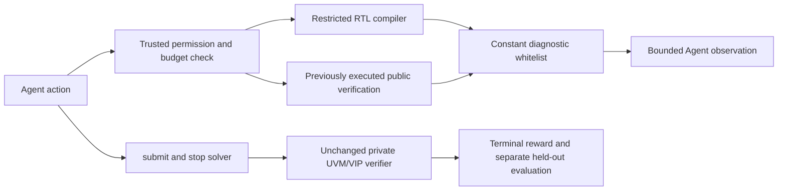

# Controlled engineering tools

`engineering-tools-v1` adds two optional actions to Task003's `test_diagnostic` environment. It is a separate capability profile; historical Policy v1 observations and budgets are unchanged. The terminal UVM/VIP verifier and binary/null reward rules are unchanged.

| Action | Input | Observation | Limit |
|---|---|---|---|
| `compile` | `{"tool":"compile"}` | PASS / FAIL / ENV_ERROR / INVALID, up to four fixed compiler diagnostics with candidate line numbers | Two invocations; 90-second compiler timeout, bounded output/file size and address space |
| `inspect` | `{"tool":"inspect"}` | Most recent public test's first failed requirement, fixed explanation, source hash and original action index | Two queries; no new simulation |

Both consume the existing 20-action budget. The existing two public tests remain unchanged. `inspect` can describe an older candidate after an edit; its source hash identifies that candidate. It never reads a terminal or held-out result. Unknown checker messages have no detailed invariant rather than copying arbitrary log text. There is no arbitrary path, command, compiler flag or signal-expression argument.



The compiler uses the current single-module synthesizable submission subset, including prohibition of file I/O, imports, directives and arbitrary simulator tasks. It does not execute the resulting simulation binary. Raw output and execution paths remain trusted-side artifacts. This extends the existing restricted-HDL boundary; it is not a claim of adversarial security against compiler vulnerabilities. Agent-authored testbench execution would require a separate boundary and is not enabled here.

## Actual tool capability probes

| Toolchain | Actual result | Interpretation |
|---|---|---|
| VCS-MX O-2018.09-SP2 with `+lint=all` | Valid RTL accepted, syntax error rejected, intentional width truncation accepted without a corresponding warning | Useful compile check; not comprehensive lint |
| SpyGlass 2017.12-SP2 | Real lint invocation stopped because the required `checker` feature could not be checked out | Installed, unavailable for this study; no licensing changes attempted |
| Design Compiler O-2018.06-SP1 | Analyze/elaborate/check_design ran on legal controls and Task003 reference; syntax control failed analysis; width control produced LINT warnings | Frontend structural checks are usable, but warnings do not establish functional failure; not yet exposed to Agent |
| Target-library synthesis / formal verification | No completed mapped synthesis or formal proof in this stage | Not claimed as available Agent capabilities |

DC's process exit code alone was not sufficient: the syntax control exited zero while `analyze` returned zero. Any future adapter must inspect tool-native completion/error status and project warnings separately. The current profile intentionally contains only the two already qualified tools.

## Reproduction

Use the licensed backend configured through the existing local configuration. Complete source-bound Task003 admission for the checkout being executed, then:

```bash
python3 -m unittest tests.test_engineering_tools
python3 -m environment.engineering_acceptance .local/engineering-acceptance-new
python3 -m environment.policy_experiment \
  --task axil_to_apb4_queue_003 --admission .local/current-task003-gate \
  --policies test_diagnostic --protocol text-json-atomic-v2 \
  --capabilities engineering-tools-v1 \
  --starting-rtl <confirmed-failing-RTL> --repeats 2 \
  --out .local/engineering-study-new
```

Omit `--capabilities` for the existing environment. To pair distinct capability conditions, the trusted operator can supply `--paired-inputs <directory>` containing `r01-reward.json`, `r01-evaluation.json`, and so on. These files remain private; compare the resulting suite hashes across conditions and qualify those exact inputs with positive references. `scripts/engineering_report.py` checks matched inputs, actual delivered tool feedback, action budgets, edits and resource measurements across two completed batches. A different source checkout needs a fresh admission, not an edited historical hash.

This study changes available tools together, so its results measure the combined capability condition. They cannot isolate compiler value from invariant-query value. Subsequent per-tool ablations require a separately frozen design.
