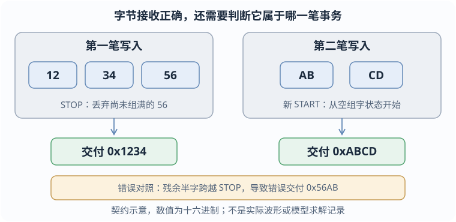

# 从总线传输到事务局部状态：有限 I²C 写入任务

一个串行接收器可能正确地接收每个位，却错误地组合两个事务的数据。新任务族从有限 I²C 写入角色出发：byte 版本交付每个字节；word 版本将同一笔事务的两个字节拼成一个字，并在 STOP 时丢弃残余半字。这里变化的是状态的有效范围，不是地址或随机种子。

两份契约完成了 32 项工业验收和 28 项真实接口检查。预声明的两条模型试次分别得到终局／保留 **1／1、0／0**：字节版本在多次失败后修复，却没有公开测试最后一版；组字版本提交了已知失败源码。每个契约只有一条样本，这些结果支持具体行为分析，不支持稳定难度排名。

[任务与判据](#判据怎样互相补充) · [生成器拒绝](#生成失败与准入失败分别说明什么) · [真实修复与回归](#模型如何修改验证和提交) · [成本和交付](#成本与可复用交付)

## 为什么选择这个边界

I²C 用 SCL 提供串行时钟、用 SDA 传输地址和数据；接收方在每个字节之后的第 9 拍把 SDA 拉低，表示确认接收（ACK）。本任务还使用独立的系统时钟交付数据，因此总线上的接收事件与内部输出时刻必须对应。

工业 VIP 可以驱动主设备、采样事务并检查协议时序，但并不知道下游模块应该交付字节还是双字节组合。因此可信验收同时保留三条依据：VIP 的事务观察、独立的实际引脚解码，以及按任务契约核对的输出事件。

例如第一笔写入 `12 34 56`，第二笔写入 `AB CD`。word 任务应该只输出 `1234`、`ABCD`；错误地把 `56` 留到下一笔会输出 `56AB`。协议层可能仍然完全合法，任务功能却已经错了。

[查看原图](diagrams/i2c-word-boundary.svg)。图是契约示意，不是实测波形。

## 有限角色与明确边界

固定 100 MHz 系统时钟、100 kHz 总线、7 位地址 0x52、写方向，每笔 1–17 字节。没有读、重复 START、多主设备、拉伸、事务中复位或输出反压。数据交付有单周期与延迟要求；ACK 的低电平驱动也具有明确保持时间。这样的限制使设计有实际时序行为，同时能够用有限、可核查的正反对照验收。

公开仓库只提供自建代码与商业 API 的调用，不分发 VIP 或工具。运行需要对应合法安装及本地配置；资源的启动或厂商例程通过不能替代本任务准入。

## 判据怎样互相补充

可信序列先确定发送字节。实际 SDA/SCL 引脚上的数据由独立事件解码器重新构建，不能只相信驱动器已经发送成功。VIP Monitor 再核对完成事务、地址、数据长度和 ACK 数量。最后，将允许交付的项与 DUT 的单拍输出逐一比较，检查是否提前、超时、重复、丢失、顺序错误或错误跨越事务。

VIP 从设备配置为被动观察者，不代替候选应答。`no_ack` 错误对照用来检查这个关键边界：如果测试台中的另一个驱动器替 DUT 应答，那么“候选不产生 ACK”就可能被掩盖；必须在实际引脚上拒绝它。

Reward=1 需要完整活动账目与所有必要检查通过；已确认的候选功能或时序错误为0。随机化失败、不完整执行、未能解释的 VIP 错误等属于不可判定，不能仅凭进程退出0判为成功，也不能自动归罪候选。

## 生成失败与准入失败分别说明什么

第一版生成器在组字分支与后续状态赋值之间缺少词法分隔，生成 `endstate`，导致 word 合法参考编译失败。整轮 32 项门禁因此拒绝，未启动模型。八个功能反例也在编译阶段失败；旧门禁子项只比较 Reward=0，曾将这些结果标为符合预期，但它们并不能证明对应功能缺陷被检出。

修订 2 保留原任务契约，修正生成代码的分隔，并要求功能负对照必须以事务不匹配或协议时序错误被拒绝。语法错误只在专门的编译负例中计为预期结果。原始失败保留在 `quality-rejected-v1.json` 与提交 `1b0b227`，不回填为通过。

这一发现说明，质量门禁不仅要验证“错误实现没有得到1”，还要确认它实际进入了目标验证路径。未能编译的错误设计没有提供数据次序或事务生命周期检查的有效证据。

## 实际验收到了哪一层

[完整门禁](../experiments/i2c-sink-v1/quality.json)包含 12 次合法实现通过：两种契约、移位／按位存储两种结构、公开／终局／保留三个输入集合。16 个功能对照以明确事务或时序错误被拒绝，包括错误地址、不应答、数据位丢失、输出持续有效、复位未清零、字节次序及残余半字跨事务。另有 3 项无效交付和 1 项语法错误检查。

[真实接口检查](../experiments/i2c-sink-v1/runtime.json)实际执行 6 次 VCS 验证，核对预算拦截不启动后端、旧反馈不跟随新候选、提交冻结、停止后评分与私有信息不进入观察，共 28 项通过。[171 项单元测试及历史基线核对](../experiments/i2c-sink-v1/acceptance-summary.json)另外保留；历史基线核对只是文件与证据哈希检查，不是新的 RTL 仿真。

[工具版本](../experiments/i2c-sink-v1/toolchain.json)来自实际运行日志：VCS O-2018.09-SP2、I²C VIP R-2020.12、UVM 1.1d。本次把 I²C 推进到自建对象、正反对照、独立奖励和真实 Rollout 层。此前确认的 RFFE 读回例程仍只有厂商例程层，没有新增 RFFE Task。选择 I²C 是因为有限写入角色能够以引脚事件和下游交付建立清楚的独立判据；没有因为某个例程零错误就把它直接授予任务资格。

## 模型如何修改、验证和提交

[预声明计划](../experiments/i2c-sink-v1/study-plan.json)在第一次调用前冻结 69 个来源文件，代码提交为 `c20f937`。两条独立会话均使用 deepseek-flash、DSH 0.2.2rc2、reasoning off、20 次动作、4 次公开测试和 1,500 秒求解上限。精确模型权重、采样种子和温度不可固定；保留评估不回流求解。Session v3 仅为新任务增加明确的事务错误类别，不改变历史 Session。

| 契约（各 n=1） | 实际公开结果 | 编辑／动作 | 最终版本公开状态 | 终局／保留 |
| --- | --- | --- | --- | --- |
| byte | 4 次时序 FAIL | 5／15 | 未测试 | 1／1 |
| word | 编译 FAIL、时序 FAIL、事务 FAIL、时序 FAIL | 4／12 | FAIL，同一源码 | 0／0 |

**字节试次发生了可核查的成功修复。** 前四次公开检查均发现 ACK 保持时间错误。最后一次编辑把直接在检测到下降沿时修改 ACK，改为先保存驱动目标、再等待计数器到 49 才更新输出。在 100 MHz 下，这增加约 50 个周期的等待，实际引脚变化还包含同步检测延迟。最后候选随后通过完整终局和保留检查。公开额度已用完，模型没有获得这个候选的公开 PASS；不能把事后评分补写成它提交前已获得的信息。

**组字试次出现了编译修复和新的连接回归，但未修复最终时序错误。** 首份编辑把 5 个枚举状态放入 2 位类型，编译失败；第二份完成编译后暴露 ACK 保持时间问题。第三份又删掉 item_valid／item_data 输出连接，实际仿真在复位输出检查时失败。第四份恢复连接，但 ACK 问题仍在；模型直接提交同一已失败源码。

这些结论来自[候选变化与实际反馈对应表](../experiments/i2c-sink-v1/behavior-cases.json)、[审计后的工具轨迹](../experiments/i2c-sink-v1/exchange/training/rollouts.jsonl)及[结果汇总](../experiments/i2c-sink-v1/study-results.json)。模型实际只收到类别和候选身份，详细失败原因属于可信侧离线分析。没有额外测试未被模型测试的中间候选，也没有用私有或保留结果替模型选择提交。

两条都用完公开测试，但未用完动作；不能据此断言预算导致失败。word 的最终失败发生在两个契约共有的 ACK 时序上，因此也不能把它直接解释成组字能力更难。格式拒绝分别为 3 次和 1 次，全部保留，控制器没有拆分或修复非法回复。

## 成本与可复用交付

| 试次 | Token | 模型请求时间 | 编译请求时间 | 仿真请求时间 | 全程 |
| --- | ---: | ---: | ---: | ---: | ---: |
| byte | 80,397 | 59.2 s | 203.6 s | 79.7 s | 354.4 s |
| word | 65,149 | 34.8 s | 176.0 s | 43.4 s | 265.2 s |

合计 145,546 Token，高于事前约 120,000 的成本估计；没有因此追加或替换试次。模型请求时间含网络与 Harness 开销，不是纯推理时间。12 次编译请求中有一次失败，实际启动 11 次仿真。API 货币账单未取得，保持 null。相较于早先的简单 VCS 检查器，这套 VIP 检查的编译成本更高；扩大采样前值得研究严格依赖匹配下的编译复用。

[成功门禁耗时](../experiments/i2c-sink-v1/costs.json)合计约 1,467 秒，另保留失败门禁约 752 秒。两者均为对应控制运行的墙钟时间和传输／控制开销之和，不是整个开发成本，也不能把失败门禁从生产成本中抹去。

当前严格材料化入口为 [production_v4](../verification_resources/production_v4.py)，使用 materialization-v7。十二份有限契约均完成检查与 reset，包含 Registry 在内的 [736 次单项依赖遗漏](../experiments/i2c-sink-v1/materialization.json)全部被拒绝。旧清单不修改；源码不匹配时使用相应历史 checkout，而非更新旧哈希。

[导出器修订 3](../scripts/artifact_exchange_v3.py)沿用 v7 数据分区，并识别 runner v9。实际动作和送达反馈进入 training，保留结果进入 evaluation，事后解释进入 analysis。[四项篡改检查](../experiments/i2c-sink-v1/audit-negative.json)与[逻辑身份重复检查](../experiments/i2c-sink-v1/audit-identity.json)分别拒绝反馈污染、错配、提交变更、未停止却评分，以及把同一试次的目录副本重复计数。新两条使[研究库存](../experiments/i2c-sink-v1/exchange-inventory.json)达到 127 条记录、87 条已审查工具轨迹。

这些交付支持研究工程修复、回归与提交决策；有效导出或 Reward=1 不等于已证明训练价值。Token IDs、行为概率、精确权重版本仍不可用，本轮没有参数训练。

## 复用范围与盲区

两种契约共享 VIP 驱动、事务观察、引脚解码、受限运行器和公共交付接口；组字状态及 STOP 丢弃义务仍由 I²C 任务专用判据处理。生成器只支持已声明的两种交付模式，不是任意 I²C 从设备生成器。

该门禁检查有限数字事务及输出时序，不是完整 I²C 协议符合性证明，不覆盖模拟电气行为、亚稳态、全部 SCL 相位或任意输入序列，也未以综合或形式验证证明所有候选。两种参考在位存储结构上不同，仍共享部分控制设计；独立事件模型和错误对照用于降低共同错误风险，不能将其消除。

## 如何复现，以及下一步最值得测量什么

[任务指南](tasks/i2c-write-sink.md)提供配置、参考验证、reset/test/submit、生成与材料化入口；[证据索引](../experiments/i2c-sink-v1/README.md)连接各版本和完整计划。复现模型试次会消耗 API 与工具资源，应使用新运行目录，并作为新的复现实验记录，不计入这两条冻结样本。

下一项优先研究：在同一份已经确认的 ACK 时序错误起点上，对照“错误类别”与“受控的实际引脚时间测量”反馈。保持任务、评分和预算不变，观察模型是否把时钟周期、下降沿与驱动延迟联系起来。这个方向来自两条真实轨迹暴露的共同问题，但详细测量是否更有效尚未验证。RFFE 有限对象、更多 I²C 行为和更大任务库存仍是后续工作，不列为本轮已完成能力。
