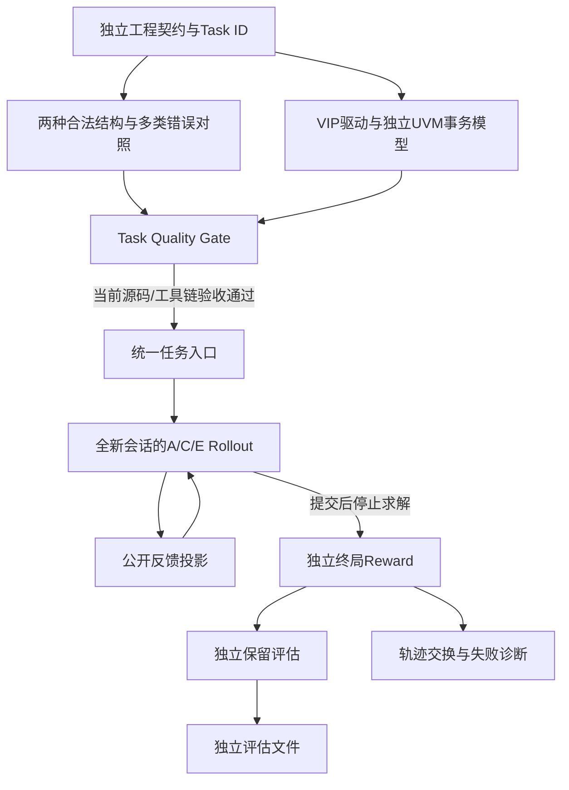

# 从单任务实验到可复用RTL任务体系

当前系统已具备三个不同工程契约、真实工业仿真、源码绑定的任务准入、统一运行入口，以及可审计轨迹交换。它可以持续采集并分析固定模型试次；尚不是自动生成Spec/Verifier的系统，也没有模型参数训练结果。

## 方法与交付

- [任务目录](task-catalog.md)描述能力、版本、输入、验证后端和Policy；统一reset/test/submit/quality/rollout调用真实任务实现。001旧入口保持可用。
- [质量门禁](task-quality-gate.md)检查参考、错误对照、分类、Policy机制与运行边界，只有与当前源码和工具链匹配的证据才能启动002/003评测。不机械改哈希迁移准入。
- [轨迹交换](rollout-data-contract.md)保留每条启动记录、模型及Task/Verifier/Policy版本、动作、实际观察、提交和0/1/null。保留集及事后首候选测量独立存放。未公开轨迹明确缺失，不从统计补造。

002和003均有两种不同结构的合法参考通过，分别13和15个明确错误对照被检出，均通过40项真实Policy机制检查。003建立三条实际接受队列与独立仲裁/退休账目；不能把001单笔事务检查器换名字当作并发验证器。每道任务的Spec、覆盖、错误类别和盲区见各自任务包。

## 经验难度与行为

以下是不同任务和批次的描述性观察，不能合并成一个能力分数。

| 契约 | 独立生成有效提交 | 最终成功 | 观察到的新失败模式 |
|---|---:|---:|---|
| 001单笔转换，text-v2 | 30/30 | A7/10、C8/10、E8/10 | 独立AW/W、等待、响应与复位 |
| 002三目标路由 | 9/9 | A2/3、C2/3、E2/3 | one-hot目标值误作lane索引、未映射响应退休 |
| 003有限队列与仲裁 | 9/9 | A0/3、C1/3、E0/3 | 容量提前释放、FIFO头/尾/计数错误、启动时序、提交前回归 |

001另有17条旧动作协议停止批次与6条同起点修复，均完整保留，不与新版独立生成混算。旧协议动作格式错误污染了能力评估；新版仍拒绝非法动作，但没有自动修补模型输出。003的3次非法字段动作均被模型自行重发，全部试次最终有合法提交，因此当前主要失败来自RTL行为，而不是接口完全不可用。

001在当前受限规格上成功较多，却未证明饱和；002和003都出现0/1混合，003观察上更难。003还包含明确registered启动时序约束，不能把差异完全归因于“并发”。小样本、供应商采样参数未固定、执行时间及任务契约差异使绝对难度和策略因果排序均未确定。

公开测试许可不等于反馈曝光。002的E组没有实际获得错误诊断；003的C成功者没有测试，C唯一测试者不修改失败候选，E唯一测试者修改后仍失败。这些结果支持进一步做同起点、实际FAIL曝光的修复研究，不支持简单宣布C或E更好。

Task003随后完成[6条同起点修复](task003-repair-report.md)：C/E各0/3，全部实际获得FAIL后编辑，0/39动作格式错误。多条编辑仅改变无关表达式；一条E修复原容量检查后，在背压FIFO配对处失败。这说明编辑次数、修复相关性和终局成功应分开测量，不能把六个0当成六条完全相同的行为。

## 奖励和数据的价值边界

两个新增任务的独立生成共18条：002为6个1/3个0，003为1个1/8个0，均无null；这只是逐任务结果的库存核对，不是合并成功率。成功与失败提供可区分的终局信号，具体失败轨迹还指向工程能力缺口。但二值分布不足以推断某种RL算法会有训练收益；全相同奖励的小组也不能据此宣称对所有算法无价值。

首候选、最后候选、在线反馈和终局评分分开记录尤为重要：003有一条A试次先生成公开通过的实现，随后自主修改引入过期负载。训练或评测不能悄悄用“最佳候选”替换submit版本；否则会把另一种选择机制的能力算到模型头上。

实际公开反馈只来自可信投影层。原始私有向量、商业日志、部署配置及凭据不进入GitHub；保留结果不反馈给已停止的求解Agent。公开Spec、验证源码和参考实现仍有预训练污染可能，不能宣称这是永远秘密的benchmark。权限探针通过也不构成针对任意恶意代码的完整安全证明。

当前交换数据缺少完整模型token、行为log probability及精确权重版本；它是工具轨迹和Reward的数据交付基础，不是可直接用于所有on-policy训练算法的数据集。真正对接Rollout Collector时，应在现有权限边界上采集模型原始采样信息，再由独立终局评分器返回训练奖励。

## 下一步的判据

同起点修复已确认能稳定产生FAIL曝光，但Task003本次没有终局成功，E使用固定泛化诊断。下一步应单独冻结需求级诊断版本，控制安全信息范围后重做C/E对照；不得中途改当前投影器。若已能观察修复差异，再增加错误起点与样本量，比立刻增加协议数量更有价值。

自动任务生成应等到能够自动检查新契约、独立Scoreboard和多种合法实现之后再推进。换随机种子只是输入重采样，不能计作新Task。综合/PPA和形式验证尚未验收；应作为单独有证据的工程能力扩展，不能用当前仿真PASS代替。

证据导航：[001批量研究](batch-evaluation-report.md)、[002研究](task002-evaluation-report.md)、[003研究](task003-evaluation-report.md)。全部研究仍是固定模型推理试次，未更新模型参数。

本阶段新增24条真实模型轨迹（002独立9、003独立9、003修复6），共598,347tokens。未继续扩大样本；正反对照、冻结输入资格检查与事后候选探针不计作模型试次。数据交换验证覆盖所列六批77条记录，其中37条附已审查工具轨迹；其他项目历史smoke/Policy试次不在这个库存内。当前已交付Task与质量门禁、统一入口、经验校准报告及离线数据约定；自动Task生成、Collector服务和参数训练尚未实现。
