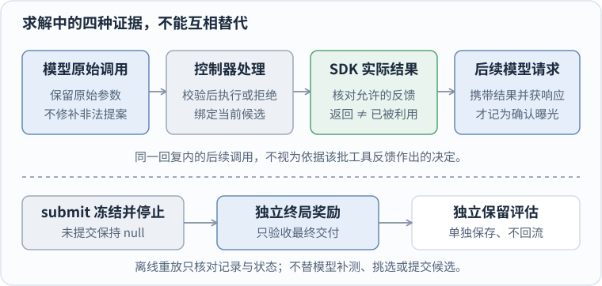

# 先确认动作执行，再判断工程能力

模型提出了修改，不代表代码已经改变；工具产生了结果，也不代表模型在下一次决策前已经收到它。本阶段把这两条边界落实为原生工具接口、真实运行验收和可重放的轨迹。**固定文件名接口在本次 RFFE／I²C 复验中实现了有效编辑，但工程修复与最终提交仍未解决。** 五条任务试次全部保留，没有一次获得终局 Reward=1。

这是[多验证资源阶段](task-production-stage-v3.md)之后的一项交互与数据研究。任务库存仍为 31 个身份、29 个去重功能／结构契约；没有增加任务或降低验收标准。以下结果分别属于两个预先冻结的小样本批次，不与历史文本 JSON 条件合并计算成功率。

## 为什么先研究动作交付

RFFE W1C 任务要求设计串行寄存器从设备，其中写入的每个 1 清除相应状态位。此前模型曾把多条动作或额外字段放进文本回复，控制器拒绝后，RTL 根本没有被修改。将这种失败直接解释为“不懂寄存器更新”会混淆工程能力与交互能力。

本次使用实际安装的 DSH SDK 0.2.2rc2 / Runtime 0.2.2-rc.2 注册 `read/edit/test/submit`，让模型通过服务支持的原生工具调用提交参数。模型仍然只读 Spec 和自己的交付物。控制器逐次校验权限、候选内容与预算；没有把非法回复自动拆开或补写成合法动作。

[原尺寸图](diagrams/native-delivery.svg)。图中的四步分别有原始证据：同一回复中的后续调用不能依赖该回复内尚未收到的工具结果；只有后续请求携带相应结果并获得模型响应，才记为确认曝光。这是送达证据，不是模型理解或利用了反馈的证明。

## 两种接口实际遇到了什么

首批 native v2 中，`edit` 只接受 `content`。JSON Schema 明确禁止额外字段，但模型仍反复附加 `file`，说明原生调用不保证参数合规。RFFE 的 8 次、I²C 的 16 次编辑提案因此被拒绝，控制器没有偷偷删除字段。

之后单独冻结 native v3：`edit` 必须同时提供 `file` 和 `content`，且 `file` 必须等于本任务唯一交付文件。这个字段先接受权限检查，再将内容传入原有单文件 Session。缺字段、额外字段和其他文件名仍拒绝。**这是新的明确接口契约，不是宽容解析旧回复。** 两个批次的非接口提示、模型、任务与评分器保持一致，但新会话的随机生成过程不匹配，样本也仅为每任务每条件一条。

共同条件为 deepseek-flash、关闭 reasoning、单次输出最多 7,000 Token、最多 20 次动作／20 次模型请求／4 次公开测试。没有可取得的固定随机种子或精确权重版本，采样温度采用服务默认值。交互循环限时 900 秒；启动和 EDA 另有既定超时，不能把 900 秒理解为所有阻塞子调用都被同一计时器硬中断。计划在首个模型调用前冻结，使用基准提交加逐文件 SHA-256 保存当时尚未提交的新源码。

| 任务与条件 | 有效编辑 / 公开测试 | 公开结果 | 提交 | 终局 / 保留 |
| --- | ---: | --- | --- | --- |
| FIFO 深度 5 Checker · v2 | 1 / 1 | PASS | 无 | null / 未运行 |
| RFFE W1C · v2 | 0 / 0 | 未测试 | 初始版本 | 0 / 0 |
| I²C 组字补全 · v2 | 0 / 0 | 未测试 | 无 | null / 未运行 |
| RFFE W1C · v3 | 7 / 4 | 四次 FAIL | 有 | 0 / 0 |
| I²C 组字补全 · v3 | 1 / 1 | PASS | 无 | null / 未运行 |

[首批冻结计划](../experiments/task-production-v4/native-study-plan.json) · [独立复验计划](../experiments/task-production-v4/fixed-file-study-plan.json) · [逐条结果与成本](../experiments/task-production-v4/native-study-results.json)

### 编辑能够执行之后，问题发生了变化

RFFE v3 的四次公开检查均返回 `transaction_mismatch`。可信侧记录进一步定位到非二态串行帧位；该细节没有作为新增诊断回流给模型。模型在四次测试之后又修改了一版并提交，最终提交没有对应的公开测试，独立终局及保留评估仍失败。这支持“交互阻碍解除后仍有功能问题”，不支持“七次修改都无意义”，也不能据此断定最后一次编辑引入回归。本批没有对未测试中间版本补测。

FIFO v2 与 I²C v3 的公开 PASS 均真实发生，但模型随后用文字结束而未调用 `submit`。控制器没有代替它提交，也没有执行终局或保留评估。因此只能说公开测试通过，不能升级为完整功能成功。后续可以独立研究更清楚的完成条件提示；本批没有加入自动提交、强制测试或候选排名。

## 控制边界通过了哪些检查

[真实 SDK 机制验收](../experiments/task-production-v4/native-runtime-acceptance.json)用确定性提案经过实际注册、预执行检查和原生执行器，覆盖合法动作、错误文件、未知工具、空参数、重复键、测试超额、20 次总动作及提交后拒绝。两组分别送入 13 与 25 个调用，计入 12 与 20 次动作；第一组只触发两次测试回调，第二组没有测试。这里的回调是验收夹具，**不是 RTL 功能验证**。另有 30 项本地接口测试。

五条模型试次则实际调用原有、来源匹配的工业后端：VCS O-2018.09-SP2，适用任务使用 I²C/RFFE VIP R-2020.12、UVM 1.1d；具体协议包与执行来源以冻结任务清单为准。Checker 使用 VCS 执行独立事件判据。没有改动任务 Spec、功能检查或 Reward 分类。

新 worker 在每次启动时拥有独立工作目录、临时目录及进程／IPC 命名空间，以无特权身份运行；只暴露四种受控工具。实际检查了旧工作区和可信文件不可见、安装文件不可写、无法自行切换根目录及候选来源绑定。**网络命名空间仍共享，执行身份共用；这些检查不构成完整恶意多租户隔离证明。** 没有向模型开放任意 shell、测试台或可执行外部代码。

提交冻结后先结束求解进程，再调用终局评分和独立保留评估。未提交的三条记录保留 `agent_incomplete/null`。SDK 实际工具结果、宿主动作及后续请求全部核对；[五条离线重放](../experiments/task-production-v4/native-offline-replay.json)再次核对候选与状态。[六种证据篡改](../experiments/task-production-v4/native-replay-challenges.json)——送达标记、执行标记、反馈、原始参数、最终源码和奖励——均被拒绝。离线审计没有重新运行模型或评分。

## 成本与可复用数据

五条任务试次共报告 **444,017 Token**，完成 10 次 VCS 编译；编译约 302.4 秒，仿真约 58.3 秒，整条试次耗时合计约 527.4 秒。这些时间包含命令与通信开销，不能解释为净工具性能。v3 RFFE 一条占 116,901 Token、六次编译（四次公开、终局、保留）；避免编辑格式问题没有自动减少工程调试成本。

另外四条低成本 API 接口探针共 13,179 Token，仅验证交付与反馈循环，不计入工程任务试次库存。货币费用、Token IDs、行为概率及精确模型权重均不可取得。新版交换保留可取得的模型请求步骤耗时、编译与仿真时间，不能凭总耗时推断纯推理时间。

五条任务轨迹进入 [v9 交换](task-rollout-exchange.md#原生调用的-v9-记录)，累计库存为 **137 条研究记录、97 条已审查工具轨迹**。v9 分别保存原始调用参数、实际执行、反馈送达、候选及终局奖励；保留评估单独存放。所有失败与未提交记录都可核查，但并不自动具有相同训练用途。

[历史数据用途规则](trajectory-data-uses.md)进一步从已有 132 条记录中识别可审查的实现、修复与失败分析材料。它不使用保留评估筛选，不把审计通过当作训练收益。

## 下一步研究选择

本次证据支持继续使用明确固定文件名的原生接口开展有限任务研究，保留对未提交与参数拒绝的独立统计。它尚不能证明原生工具普遍改善工程能力，也没有建立稳定成功率。

最近的一步是将已有寄存器工程对象转为受控状态检查器任务，区分串行引脚实现与寄存器语义建模的能力要求；同时保留 RFFE 的真实串行失败作为后续定向观测对象。新 VIP 自建对象、结构优化任务和更大规模生产仍待实际验收。本阶段没有因交互改善就扩大模型采样，也没有进行参数训练。
