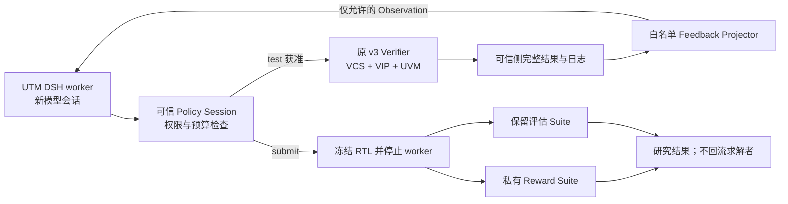

# Observation / Feedback Policy：固定模型对照

[文档入口](README.md) · [实测报告](policy-evaluation-report.md) · [原 v3 Agent](agent-workflow.md) · [验证计划](verification-plan.md)

这是固定模型的推理阶段 Rollout 对照，不更新模型参数。任务仍是 revision 3 的 001 X2P；功能 Spec、VCS/VIP/UVM Scoreboard、终局判据均不改变。原 `environment.agent` 与旧证据保持原样，新实验使用独立入口。

## 三个策略

| 参数 | A：spec_only | C：test_verdict | E：test_diagnostic |
|---|---|---|---|
| 可读 | Spec、当前 RTL | 相同 | 相同 |
| 可写 | bridge.sv | 相同 | 相同 |
| 工具 | read / edit / submit | 增加 test | 与 C 相同 |
| 最大 Agent 动作 | 20 | 20 | 20 |
| 最大公开测试调用 | 0 | 2 | 2 |
| 测试反馈 | 无 | PASS / FAIL / ENV_ERROR、剩余次数 | C 的字段，加类别、首个失败 case、受控诊断 |
| 提交前要求 | 已读 Spec 与 RTL；不要求测试 | 相同 | 相同 |
| 最终评分细节 | 不返回求解者 | 相同 | 相同 |

C／E 的项目初始 prompt 字节完全相同；新会话的 SDK 会话标识等运行元数据另行记录。策略字段只在 `policy_id` 和 `feedback_level` 上不同；不是给 E 额外测试次数或更简单的测试。20 次动作包含无效／被拒绝动作；被拒绝测试不执行 VCS。已经启动的公开调用都占一次预算，包括失败及 ENV_ERROR，避免环境失败造成无上限重试；ENV_ERROR 不因此变成功能 FAIL。

配置使用 JSON，避免在 CentOS Python 3.6 引入 YAML 依赖。当前仅允许这三个经过校验的版本 1 配置；未知字段、额外工具、任意路径或扩大预算直接拒绝。未来扩展策略需显式升级校验及测试，不静默降级。

`max_feedback_chars=512` 限定公开测试反馈的序列化长度，不限制被明确允许读取的 Spec／RTL 文件长度。

## 数据流与信任边界



当前复用原项目的文本 JSON 动作协议：DSH 返回 `read`／`edit`／`test`／`submit` 对象，由可信控制器执行，并非模型直接启动 shell 或调用任意 SDK 原生工具。因此工具格式合规率也是本次系统表现的一部分，需要与 RTL 能力分开分析。

动作传输按整条响应原子解析：仅接受一个对象，不从说明文字或损坏的编辑内容中继续扫描后面的 `test`／`submit`。多对象、重复字段、说明文字或解析失败都会整条拒绝，消耗一次动作额度但不执行工具。编辑字符串允许原始换行，避免多行 RTL 因 JSON 转义问题被跳过；这个兼容规则对三组相同。被拒绝时返回固定的格式说明，不包含测试信息。

`environment.policy_session.Session` 是实际执行权限的唯一调度点，确定性机制验收也调用这个类。它不接收模型指定的测试路径、私有 seed、日志路径或命令。模型没有任意 shell／文件工具，不能通过 read 访问 Policy、参考答案、Verifier 或私有输入。Policy 只存在可信侧；模型会获知必要的工具协议和预算说明。SDK 另外提供固定的 `You are a helpful software engineer assistant.` 系统提示及 `/work/policy-<随机标识>` 当前目录元数据；这些对三组采用同一规则，不包含目录列表、Verifier 或测试内容。审计会检查 Harness 实际 `user/message`、`system/message`、runtime-context 与请求参数，发现额外输入则报错。

`feedback.project` 从空字典构造响应。C 恰有两个字段。E 的类别、case 名和诊断均受允许列表约束；诊断来自固定文案及精确匹配，不复制原始日志、异常字符串、期望数据或模型可控字符串。未知／不完整结果投影为 ENV_ERROR。非法提交语言单独记录为 `invalid_submission`，终局 Reward 为 null；公开投影为 ENV_ERROR，E 可见其类别。它不是基础设施成功，也不是已确认的 RTL 功能错误。

宿主 grader 的完整结果保存在 `public-*/`，不会作为模型工具结果直接返回。异常只返回固定状态；内部异常类型另存可信证据。求解者停止并确认冻结未变之后，才执行私有评分、保留评估和任何离线候选测量。

现有隔离仍有原来的边界：root-owned worker、低权限 chroot、PID/mount namespace 和工具白名单可用；没有完整网络沙箱、独立 UID 的跨试次文件隔离或恶意 RTL 编译沙箱。全新试次创建新的工作目录、Harness home 和模型 session；不把旧候选或上下文作为输入。不能把这些说成完整的对抗性安全隔离。

同一个错误地址映射实现，在真实机制验收中的首次公开反馈如下（这是固定故障对照，不是模型试次）：

C：

```json
{
  "status": "FAIL",
  "remaining_test_calls": 1
}
```

E：

```json
{
  "status": "FAIL",
  "remaining_test_calls": 1,
  "category": "transaction_functional_error",
  "first_failed_case": "address_data",
  "diagnostic": "Transaction mapping, data, response or completion accounting failed."
}
```

## 运行与复用

按[运行手册](mvp-running.md)配置授权 EDA、UTM DSH 与 `DEEPSEEK_API_KEY`。在仓库根执行：

```bash
python3 -m unittest discover -s tests -v
python3 -m environment.check_baseline
python3 -m environment.policy_experiment \
  --out .local/policy-experiment-new \
  --policies spec_only,test_verdict,test_diagnostic \
  --model deepseek-flash --repeats 3
```

运行器先校验 v3 基线与安装的 worker／launcher 哈希，再部署原创源码。每轮重复生成并冻结一份私有奖励输入和另一份保留评估输入，同轮 A／C／E 共享这两份输入。公开输入固定为原 v3 `suite(True,17)`。轮次顺序预先确定并循环轮换，不能看结果后挑选策略顺序。

首先执行不调用模型的真实 VCS 机制验收。用一个明确错误的地址映射 RTL 验证 A 的禁止测试与直接提交、C／E 两次测试与第三次拒绝、真实反馈字段和三种模式共同私有判据。机制失败则停止，不启动模型试次。这个受控 RTL 不是 Agent 产出。

每个真实试次复用原 UTM SDK worker。公开测试不是强制动作；模型是否调用、是否修改均由它决定。模型、SDK 参数、prompt、Policy 内容和 SHA-256、部署文件哈希与私有输入哈希都记录。SDK 使用现有 `reasoning_effort=off`、`max_tokens=7000`；temperature／模型随机 seed 未显式固定，记录为 provider/SDK 默认值，不宣称 API 完全确定性。

模型最终提交后，先停止求解 worker，再评分。A 的首个有效候选也会在此后进行公开集离线测量；结果不返回模型、不计入 Agent 测试调用次数。这里的“有效候选”指被控制器接受的编辑且通过现有提交语言门禁，不包括因尚未读完两份文件而被拒绝的编辑，也不等于编译或功能已通过。若模型先前测试过完全相同的候选，复用其已发生的结果；否则重新仿真。最终评分及保留评估始终重新仿真；只允许原 grader 按源码与验证器哈希复用编译产物。

为适应 UTM 磁盘空间，运行器取回完整证据后仅删除本次 release 下的临时 `builds/`。旧实验不受影响；新实验的源码、日志、向量、模型事件和私有输入保留在可信位置。被删除的编译缓存路径不应被当作可继续复用的缓存。

## 审计与解读

- `experiment.json`：预设顺序、所有源码／策略／prompt 哈希、各轮配对输入哈希。
- 每次 `freeze.json`／`policy.json`：具体配置、核心源码和私有输入冻结。
- `trace.json`：动作、是否执行、投影后的观察，以及该反馈是否被发给后续模型调用。submit 的确认不再触发一次新模型调用。
- `observations.json`：实际发给 DSH 的逐轮 prompt；`harness-*.json`：原始响应事件。二者本地保留。
- `public-*/`、`submission/grade/`、`reserved-evaluation/`：完整可信结果；`first-candidate-result.json`：离线或已发生的首候选测量。
- `metrics.json`／`summary.json`：提交、Reward、动作／编辑／测试次数、最终候选公开与私有差异、保留集结果。`analysis.json`／`usage-derived.json` 从原始 SDK 事件提取实际 Token：仅累计去重的 `assistant/message.data.usage`，不重复计算 stream chunk 或 notifications。运行时指标原件保持原样；未取得的货币费用为 null，不能当作零。`wall_seconds` 包含编译、最终评分、保留评估及离线候选测量，不是纯模型推理耗时。

C/E 的差别是能获得的信息，不保证模型一定调用测试。小样本中全部通过或全部失败都应原样记录。应同时报告未提交、语言门禁拒绝、真实 RTL 失败与基础设施故障，不能只统计成功提交。不同 seed 的私有输入仍使用同一生成器和验证器，不能排除共有验证盲区。

先对完整本地证据做审计，再脱敏导出：

```bash
python3 scripts/audit_policy.py .local/policy-experiment-new
python3 scripts/analyze_policy.py .local/policy-experiment-new
python3 scripts/export_policy.py .local/policy-experiment-new experiments/policy-experiment-new
```

导出保留真实投影反馈、候选、最终 RTL、结果计数、哈希和 Harness 事件元数据；不上传完整商业日志、完整模型响应、机器部署路径或私有向量。当前实测样本量与结果见[Policy 实验报告](policy-evaluation-report.md)。
