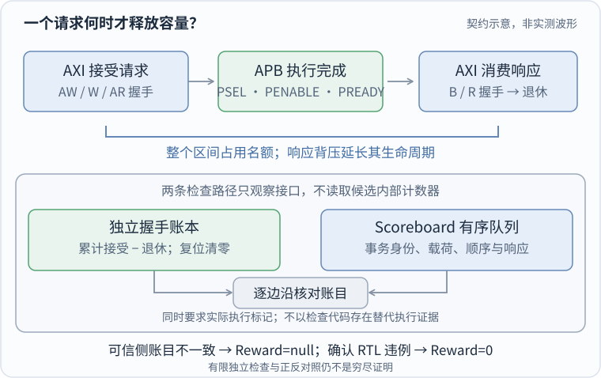

# 从静态地址到动态队列：第二类任务族

地址路由主要回答“这笔请求应去哪里”；队列任务还要回答“现在能否接收、轮到谁执行、哪一刻才能释放容量”。同样的请求，在不同历史状态下可能需要完全不同的行为。本轮以这一差别检验任务生产方法：能否在改变容量契约时，同时产生足够具体、实际会执行的验证义务。

本页解释有限队列任务族的契约与生成机制。生成成功、工业验收和模型求解是三个不同阶段；实际状态与结果以[配套研究报告](queue-family-evaluation.md)和[来源绑定的证据](../experiments/queue-family-v1/README.md)为准。原 Task001–004 与路由任务族保持各自冻结版本。

## 先理解名额为什么不能提前释放

假设一个写请求已经传到 APB 外设，外设也完成了写入，但 AXI 请求方尚未准备好接收 B 响应。此时外设操作结束了，这笔事务却还没有退休。如果实现用 APB 完成事件减少未退休计数，就可能继续接受本不应接收的请求，超过 Spec 规定的容量。

**退休**在这里有严格含义：BVALID/BREADY 或 RVALID/RREADY 同时成立，响应被请求方消费。**信用或名额**是未退休容量的剩余额度。写地址 AW 和写数据 W 可以错开到达，因此需要分别记录已接受的半部，再按各自接受顺序配对；读地址 AR 则独立排队。

[查看原图](diagrams/queue-lifecycle-obligations.svg)。图中是契约关系，不是伪装成实测数据的时序波形。复位会取消未完成事务并清空状态，验收单独核对取消与退休账目。

## 三个契约分别改变什么

本族保留 [Task003](../tasks/axil_to_apb4_queue_003/spec.md) 的单时钟、32-bit 接口、独立 AW/W/AR 接收、FIFO 顺序与读写轮询。执行器在旧响应消费前不调度下一笔 APB，因而**没有引入 Task004 的执行与响应解耦**。FIFO 是按接收顺序取出请求的存储结构。

| 契约 | AW / W / AR 未退休容量 | 新的设计关注点 |
| --- | --- | --- |
| `single` | 1 / 1 / 1 | 最小方向独立容量；半部配对、读写竞争与退休边界 |
| `three` | 3 / 3 / 3 | 非二次幂回绕、多个请求的身份与顺序、容量边界 |
| `readheavy` | 1 / 1 / 3 | 读写资源不对称，分离读方向缓冲与写方向容量 |

一个名额不等于 Task001：这里可以同时保有一个读请求和一个写请求，甚至只接到写的一半；Task001 则是全局单笔。深度三也不只是把数组长度改成三：自然二进制递增会产生索引 3，设计需要明确返回索引 0，并正确处理同周期接受与退休。

三者是同一能力族中的参数化契约，不是三种独立协议或已标定的难度等级。当前只接受这三个经审阅组合；没有开放任意深度、任意仲裁或 AW/W 不等容量。

## 契约变化怎样成为验证义务

生成器将容量规则转成 `obligations.json`。这个文件不是“已经验证”的声明，而是把每条要求连接到激励、独立判据、实际覆盖和错误对照，供门禁核查。

| 验证义务 | 怎样真正触发 | 检查什么 / 为什么需要 |
| --- | --- | --- |
| 容量各级与边界 | 施加连续请求、等待与响应背压 | 观察每通道 0 到容量上限的占用；确认不超额且有空位时及时接收 |
| 多轮使用有限存储 | 一个复位区间内接受超过三倍容量的不同请求 | 逐笔核对身份、APB 地址和载荷，检出回绕后丢失、错配和别名 |
| 退休边界 | 在 B/R 消费时仍有新请求待接收 | 仅按响应握手释放信用；检查同时移位与插入不破坏队首 |

[结果报告器](../task_families/report.py)还将义务中声明的每个覆盖项逐一与两种合法参考的真实 case 结果核对，并确认所列错误对照确实被拒绝。若只有元数据声明、实际记录却缺少相关行为，它不会生成通过摘要。这一连接补足了“有场景”与“真的触发了检查”之间的区别。

覆盖中的“多轮”来自实际接口接受计数，而不是读候选内部指针；场景名字或计划行数都不能代替实际事件。每次仿真还要记录独立账本已运行。所有这些检查都是有限行为范围，不能宣称穷尽了并发交错。

两种合法参考分别使用环形索引和移动数组，避免将验证器绑定到一种实现。移动数组参考可以同周期复用刚释放的名额，环形参考可以保守到下一周期；Spec 允许两者，所以必要覆盖要求退休时存在待接受请求，**没有要求所有合法实现必须在同一边沿接受它**。但支持同周期接受的实现仍须保持正确：对应错误对照故意在移位后用旧索引插入新 AW，检查是否会丢失请求。

## 谁来检查 Scoreboard 的账目

UVM Scoreboard 用有序队列记录被接受的事务身份，再核对协议两侧数据和响应。另一个独立账本不调用其队列操作，只从外部引脚累计接受、退休与复位清零，并逐边沿比较数量。

两条路径仍共享规格和接口采样，不能称为完全独立的形式证明。但它们不共享更新队列的实现，因此能够暴露例如“Scoreboard 也在 APB 完成时错误出队”的共同误解。若两账本不一致，首先是可信验证流程不能自洽，结果为 `null`，而不是强行给候选 Reward=0。

验收还包含两个故障注入：将同一份已知提前释放信用的错误 RTL 分别交给正常与故意破坏的检查器；以及在合法参考仿真中移除账本调用，确认即使仿真走到结束也不能得到 PASS。这是受控故障研究，不是将主动注入说成发现了历史漏检。实现见[账本模板](../task_families/queue_v1/anchor.sv.in)和[故障复验入口](../task_families/queue_fault_probe.py)。

## 复用什么，仍然复制什么

路由族和队列族都能复用任务初始化、Policy 权限、提交冻结、工业执行、门禁、隔离和轨迹审计。两者的语义检查则不同：地址译码不能替代队列身份与生命周期检查。当前队列生成器选择 Task003 专用后端进行有限特化，没有建立通用协议规则引擎。

本族生成包只保留运行组件与历史基线核查必要证据，省去研究报告、图形和无关历史试次的副本。门禁仍绑定完整运行源码，没有为了减少包大小而放宽验证要求，也没有在不同契约之间共享候选编译二进制。相同源码输入下的编译复用继续校验来源；跨任务的更细粒度依赖冻结仍是后续问题。

[生成器使用方式](../task_families/queue_v1/README.md) · [有限契约](../task_families/queue_v1/contracts.json) · [统一任务入口](task-catalog.md) · [上一任务族的真实漏检](router-family-evaluation.md)
