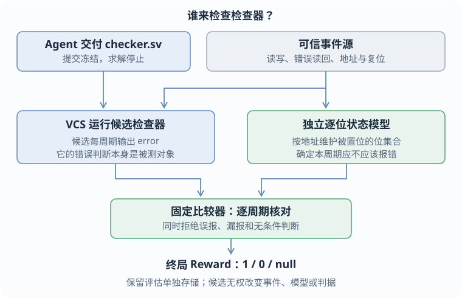

# 同一寄存器语义，另一种工程交付

RFFE 设备任务要求模型实现串行通信并维护寄存器状态。新的检查器任务把这两层分开：监测器已经提供完整事务，模型负责预测状态并判断读回是否正确。**RW 与 W1C 两个生成契约均通过独立工业准入，各一条真实模型试次均在首份编辑后公开通过并提交，终局与保留评估均为 1。** 小样本说明任务能运行和求解，尚不能证明稳定成功率或修复能力。

这是[原生动作交付研究](native-tool-delivery-evaluation.md)之后的一项任务形式扩展。没有增加协议种类，也没有将旧 RFFE VIP 的准入直接移植给新任务。它使用 VCS 与独立事件模型，**不运行串行 VIP，不评价引脚时序或完整 RFFE 符合性**。

## Agent 要交付什么，谁检查它

Agent 只获得 Spec 和 `checker.sv`，每个时钟沿接收最多一条完整写入或读回事件。写事件更新预测状态，读事件比较实际读回；错误必须当拍报告并保持到复位。可信侧生成合法与错误事件，以独立模型逐拍比较候选输出。检查器自己不能决定奖励，也不能修改测试输入。

| 契约 | 寄存器更新 | 引入的判断要求 |
| --- | --- | --- |
| [RW](../tasks/register_checker_rw_v1/spec.md) | 复位为 0，写入替换字节 | 新值覆盖旧值、读无副作用、地址独立 |
| [W1C](../tasks/register_checker_w1c_v1/spec.md) | 复位为 255，写入的 1 清除对应位 | 清除与保持、重复写入幂等、同地址累积清除 |

例如 W1C 的 FF 先写 01 再写 02，结果为 FC；重复写 02 仍为 FC。把它误当作普通覆盖寄存器，会预测成 02。这个差异来自工程契约，不是测试随机种子。两个契约还共同要求无效事件不改变状态、复位压过同拍事件、不能错误拒绝合法读回。

下图展示 Checker 任务的职责边界：候选检查器是被测对象，可信判据在外部。这里复用原有事件执行方式，而寄存器预测状态使用独立的逐位模型。

## 从语义到实际验证义务

参考 RTL 用字节数组维护状态；第二种合法结构用每个地址独立的状态进程。可信模型则把每个寄存器表示为“哪些位为 1”的集合，用集合替换或删除来更新。不同表达方式本身不能保证独立正确，因此另用人工可核查的 11 拍 RW、12 拍 W1C 字面量样例约束关键语义；场景构造器、逐位判据和参考实现不互相调用更新函数。

每份公开、终局及保留输入均有 **4,648 拍**，实际覆盖全部 16 个地址和 128 个“地址 × 错误数据位”组合。每次写入后检查同地址、其他地址、重复读、忽略字段、无效事件和复位恢复；错误后继续检查 sticky error。覆盖按实际执行完成的事件账目记录，场景存在或必要计数命中不等于验证完备。

[38 项工业门禁](../experiments/register-checker-v1/quality.json)包括：

- 两种合法结构 × 两种契约 × 三套输入，共 12 项完整通过。
- 两种契约各 11 个错误对照，共 22 项实际输出不一致：无条件通过／拒绝、读写别名、高地址丢失、忽略有效信号、错误更新、读副作用、错误不保持、复位不恢复和最高位漏检。
- 空提交、错误接口、伪造报告被判无效；单独语法错误被判编译失败。这四项不冒充功能错误检出。

六个[材料化与准入负向检查](../experiments/register-checker-v1/README.md)还确认：删除必要依赖、遗漏文件、修改规格、缺少合法对照，以及将功能负例的结果改成编译错误，都不能取得准入。源码依赖集合由可信代码重建，不由提交清单决定。有限仿真仍可能遗漏长序列或未构造的状态交互，当前没有形式完备性结论。

## 两条真实求解说明了什么

[预声明计划](../experiments/register-checker-v1/study-plan.json)在调用前冻结任务、全部运行依赖、三套输入哈希、模型与顺序。使用 deepseek-flash、reasoning off，20 动作／20 请求／4 次公开测试；RW、W1C 各一个全新会话，没有重抽样。工具仍为原生 v3 四动作，本轮 rollout v4 增加明确的“调用 submit 才算完成”说明，因此不与上一批作为同条件对照。

| 任务 | 实际过程 | 终局 / 保留 | Token | 总耗时 |
| --- | --- | --- | ---: | ---: |
| RW 检查器 | 两次读取 → 一次编辑 → 公开 PASS → submit | 1 / 1 | 6,269 | 22.2 s |
| W1C 检查器 | 两次读取 → 一次编辑 → 公开 PASS → submit | 1 / 1 | 6,312 | 21.3 s |

每条最终源码与首份编辑、实际公开测试的源码相同。模型没有收到失败反馈，也没有进行修复；因此这两条可以支持有限状态建模与正确实现示范审查，不能作为多轮调试成功的证据。[实际结果](../experiments/register-checker-v1/study-results.json)、[原始提案与反馈交换](../experiments/register-checker-v1/exchange/manifest.json)和[离线重放](../experiments/register-checker-v1/replay-audit.json)分别保留，可核对没有代替模型提交或补写观察。

在前一批中，模型对 RFFE 串行实现进行了多次失败修改；本批能写出对应状态检查器。这提出“问题可能集中在串行时序或能力组合”的研究方向，但任务交付与提示均不同、样本极小，不能据此排除其他解释。

## 生产成本与复用边界

生成包每份 18 个文件，共享运行依赖以 106 个源码哈希绑定，没有将完整研究仓库复制进包。新的[事件运行后端](../verifier/event_runtime.py)只负责受限编译、仿真与结果保存；寄存器语义、事件构造、错误对照仍由专用实现负责。旧 FIFO 与 RFFE 运行器保持不变。

门禁实际执行 35 次编译、38 项检查，总计约 152.3 秒；另有一次开发探针、六次 Session 机制调用。两条模型试次共 12,581 Token、六次编译，编译约 12.0 秒、仿真约 6.5 秒，整条耗时合计 43.5 秒。各项包含命令开销，API 货币成本未知。[成本分区](../experiments/register-checker-v1/costs.json)避免把工业准入与模型求解混为同一成本。

当前库存变为 **33 个任务身份、31 个去重功能／结构契约**；研究记录为 **139 条、已审查工具轨迹 99 条**。新增两个身份测量一种新的状态检查任务形式，不等于新增两种协议能力，也不纳入此前只绑定 132 条历史记录的数据用途筛选。

下一步最值得做的是在新协议或串行角色中验证这套职责划分能否复用，同时为已失败的串行实现提供与具体错误相关的观察。当前两个简单检查器尚无必要扩大重复采样；应先找到能产生真实误判、修复或回归的专业能力组合，再决定下一批数据。
