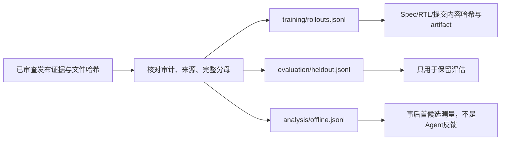

# 轨迹交换与训练数据准备

这里的77条来自六个明确列出的研究批次，不声称涵盖项目所有历史smoke或其他Policy试次。

当前可交付的是Task/Environment、独立Reward及可审计工具轨迹。尚未训练模型参数，也不宣称已具备完整on-policy训练数据。`scripts/export_rollout_exchange.py`已在77条已发布真实试次上执行；它读取经过审查的发布证据，不读取私有向量、商业日志或API请求凭据。

## 输出与边界



每条记录关联Task及版本、模型、动作协议、Policy版本与哈希、源码/Verifier清单哈希、同轮私有Reward输入哈希、工具链、真实动作/投影反馈、最终提交、0/1/null及归因、Token与用时。`episode_id`由冻结实验清单哈希和试次ID组成；重复导入同一来源直接拒绝。

- `training/rollouts.jsonl`保留全部已启动试次，不因失败或null删除。null维持不可判定，编译错误等已确认失败仍为0。目录名表示消费方向，不表示每条已适合某种训练算法。
- 只对已公开的代表性轨迹提供`tool_events`和代码artifact；其余为`null`，绝不根据统计补造动作。`trajectory_available`区分二者。
- 原始模型回答、token IDs、行为log probabilities及精确模型权重修订不可得，各字段明确标为不可用。因此不能直接用于要求这些信息的重要性采样或on-policy优化。
- 保留评估和事后首候选表现分开写到`evaluation/`、`analysis/`；不合并进Agent Observation，不用保留得分替换训练Reward。训练侧的基础设施标志只来自公开调用或终局评分，不继承保留/事后测量的故障标志。
- repair任务记录真实起始错误RTL哈希，不能把它替换为空模板。读取文件的观察以原内容哈希连接artifact，不把参考答案加入数据。非法动作中未导出的额外字段会列在`omitted_action_fields`，不会假装这些字段原本不存在。
- 各Task、text-v1/v2、独立生成与同起点修复保留不同cohort。汇总导出条数不等于合并计算能力成功率。

[记录Schema](../schemas/rollout-exchange-v1.schema.json)约束顶层字段。发布文件哈希、审计通过、逐条来源、提交和编辑artifact哈希都由导出器实际核对。它不能证明原始审计未发现的漏洞不存在；公开参考实现也仍有预训练污染风险。

## 使用

```bash
python3 scripts/export_rollout_exchange.py --out .local/exchange \
  experiments/batch-study-001/text-v1-stopped \
  experiments/batch-study-001/text-v2-independent \
  experiments/batch-study-001/text-v2-repair \
  experiments/task002-v1/pilot \
  experiments/task003-v1/pilot \
  experiments/task003-v1/repair
python3 scripts/test_rollout_exchange.py
```

该命令目前输出77条结果记录，其中37条有已发布的工具轨迹。原始全部轨迹仍在可信本地，未发布不等于未保存。导出目标必须是新目录；失败或重复运行不能覆盖已有交付。导出器的5项自动化测试已在本地Python3.14及执行主机Python3.6.9通过。测试核对真实样本分母、null保留、训练/保留隔离、内容哈希、路径边界和重复拒绝，不调用模型或VCS。

对接通用Rollout Collector时，应让Collector直接驱动已验收的reset/read/edit/test/submit边界，保留模型实际采样数据，由独立评分阶段返回终局Reward。当前适配器提供离线交换与审计基础，未实现Collector服务、优化器、GPU训练或训练收益评估。
