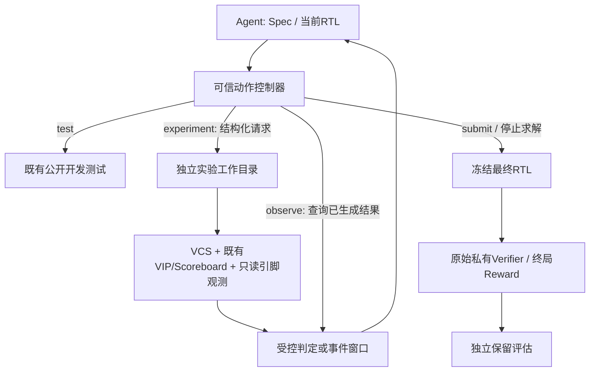

# 运行时观测与受控工程实验

这项能力帮助 Agent 观察“请求接受 → APB 执行 → AXI 响应退休”的实际过程。它使用 Task003 既有 VCS、主动 AXI/APB VIP 和独立 UVM Scoreboard，另加只读接口观测器。**任务规格和终局评分代码不变，开发实验不会直接产生终局 Reward。**

## 三个相互隔离的区域



实验区为原有 testbench 建立副本，在原 Scoreboard 采样前记录引脚、在边沿后一个仿真时间单位记录更新后的输出。没有修改 DUT 内部状态、Scoreboard 或激励算法；终局验证器不会加载观测副本。正反例验收比较带观测和不带观测的事务结果，检查观测没有改变判定。

DVE、Verdi 和 VPD 转换程序可在后端找到，但本阶段没有将“程序存在”当成功能验收。采用文本化引脚采样，避免额外 GUI、波形数据库和许可证依赖。这里不是任意内部信号查询器，也不声称具备完整波形调试功能。

## 两种匹配的实验条件

| 配置 | 相同的动作与预算 | 实验反馈差异 |
| --- | --- | --- |
| `runtime-verdict-v1` | E 的 read/edit/test/submit，加 experiment/observe | 只返回 PASS/FAIL/INVALID/ENV_ERROR 和剩余次数、查询关联 |
| `runtime-observe-v1` | 完全相同 | 加固定需求诊断、源文件 SHA、实际引脚窗口、握手事件、未退休请求计数和首个错误位置 |

两组均为最多 20 动作、2 次完整公开测试、3 次实验运行、4 次结果查询。所有实际实验调用均消耗预算，包括基础设施失败；非法请求在运行前拒绝。查询不重新启动 VCS，也不消耗实验运行次数。两个配置的 Prompt 仅反馈模式值不同，不与历史 E、engineering-tools-v1 或 synthesis-tools-v1 混合统计。

本版本没有同时叠加 compile/inspect/synth_check，便于单独测量运行时信息的作用。后续组合配置需另行版本化和验收。

## Agent 可以做什么

选一个公开场景：

```json
{"tool":"experiment","scenario":"write_fifo"}
```

可选名称来自 Task003 固定公开集，包括读写队列、半包等待、仲裁、响应背压、随机和事务中复位场景。完整列表由 Prompt 提供；不接受私有场景名或文件路径。

或者主动构造事务：

```json
{"tool":"experiment","transactions":[[1,256,123,15,0,0,8,16,0,0],[0,256,0,0,0,0,2,8,0,0]]}
```

每行严格为 `[write,address,data,strobe,address_delay,data_delay,APB_wait,response_stall,error,start_delay]`：1–16 行，读写/错误位为 0/1，地址为四字节对齐的 32 位地址，数据 32 位，strobe 为 0–15，延迟和等待均为 0–64。所有值必须是整数，不能夹带字符串、命令、额外字段或布尔值。字段沿用已有 VIP sequence 的事务设置；它不是任意逐周期驱动接口。自定义事务暂不包含复位，复位实验使用已公开的命名场景。

结构化输入的时序含义沿用已冻结的 VIP 驱动：各行并发启动，`start_delay` 是相对本批启动的时钟等待，不是逐行累加的间隔；实际发出次序仍受 VIP 调度和通道握手约束。写事务在 `address_delay > data_delay` 时选择 data-before-address，此时地址延迟相对首个 WVALID、数据延迟相对前一写数据握手；否则地址延迟相对前一地址握手、数据延迟相对本事务 AWVALID。响应停顿相对对应 BVALID/RVALID；APB_wait 配置目标等待。读事务不使用写数据与字节使能字段。用户不能据行顺序假定读写之间存在全局完成顺序。

v1 的求解 Prompt 列出了字段和取值范围，但没有完整展开上述 VIP 延迟参照事件。这是主动实验接口的当前说明限制；本批冻结后没有补充模型 Prompt。下一版应把这些参照事件一并放入 Agent 可见的工具契约，再重新冻结实验。

查询最近一次实验中的周期窗口：

```json
{"tool":"observe","start":24,"count":8}
```

`start` 范围 0–4095，`count` 范围 1–12。查询结果绑定那次实验的 RTL SHA；之后修改 RTL 不会让旧波形变成新候选的证据。没有任意路径、日志搜索表达式、层级信号或 Agent 编写的 SystemVerilog Testbench 接口。

## 如何读事件窗口

- `signals` 定义 `pins` 数组的固定顺序，涵盖 AXI AW/W/AR/B/R 和 APB 接口数据及控制信号。X/Z 表示为 null，不假装成零。
- `pre` 在上升沿检查器处理前采样，此时 VALID && READY 才计为接受/退休事件；`post` 是边沿后的更新，不重复计算握手。
- `events` 记录 AW/W/AR 接受、B/R 退休、APB Setup/等待/完成以及复位。APB Setup 的读写方向是可观测的选择结果；未读取 DUT 内部仲裁信号。
- `unretired` 为从引脚独立累计的 `[AW,W,AR]`：接受增加，B 退休减 AW/W，R 退休减 AR，复位清零。它不是读取候选 RTL 自己声明的 FIFO 计数。
- `first_error` 是日志中第一个实际检查错误附近最后一个采样位置。仿真可能立即退出，不能承诺有错误之后的周期。观测在 4096 周期处截断；之后的错误不会伪造为最后一个已捕获周期的错误。
- 默认返回首错附近的局部窗口，最多 24 条 pre/post 样本；可用 observe 查询其他已捕获范围。返回长度上限 16,000 字符。原始日志、完整采样和向量留在可信侧。

固定词表诊断、整数引脚、事件名、哈希和错误坐标由白名单重建，不直接转发任意日志片段。实验先验证参数，再检查受限 RTL；每次在独立进程中运行，总时限 240 秒、地址空间 3 GiB、单文件 128 MiB，并禁用 core dump。超时终止该进程组。资源界限不等于能够抵御 EDA 编译器漏洞的完整安全证明。

## 判定与复现

实验 PASS 表示这一个选定/自建实验完成并通过；FAIL 是已确认的候选错误；INVALID 是提交语言或动作不支持；ENV_ERROR 是无法可靠完成。即使 Agent 构造了一个什么都没有测到的“容易通过”实验，也无法以此获得终局 Reward=1：提交后的完整私有判据和覆盖条件保持不变。

在准备好的可信后端运行真实机制验收：

```bash
python3 -m environment.runtime_acceptance .local/runtime-acceptance-new --full
```

通过当前源码绑定的 Task Quality Gate 后，从常用控制入口启动试次：

```bash
python3 -m environment.policy_experiment \
  --task axil_to_apb4_queue_003 --admission .local/current-task003-gate \
  --policies test_diagnostic --protocol text-json-atomic-v2 \
  --capabilities runtime-observe-v1 --repeats 1 \
  --starting-rtl path/to/confirmed-failed-candidate.sv \
  --out .local/runtime-repair-new
python3 scripts/audit_policy.py .local/runtime-repair-new
```

配对条件使用 `runtime-verdict-v1`，并通过 `--paired-inputs` 指向同一套可信冻结输入。新目录、会话和工作区互相独立。工具能力验收与原 Policy 机制检查在模型开始前运行。

数据交换 v3 支持本轮两种实验配置及此前 synthesis-tools-v1 的实际反馈：

```bash
python3 scripts/export_rollout_exchange.py --schema-version 3 \
  --out .local/exchange-v3-new .local/your-audited-raw-cohort
```

v3 必须先审计原始轨迹；保留评估、事后首候选测量与训练侧终局奖励分目录保存。没有 raw SDK 推理、token ID、行为策略 log probability 或精确模型权重版本，不是无损 on-policy 训练数据。历史 v1/v2 入口和已发布数据不改写。
