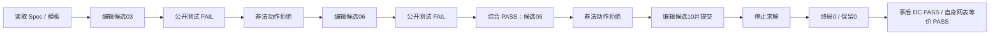

# 综合检查、实现等价与功能正确性：首轮实测

本轮完成了 `synthesis-tools-v1`：Agent 可以对自己的 RTL 调用受控 DC 综合检查，可信侧可以另行执行 Formality 和 PT/PX。**真实试次得到了一份“综合通过、与自身综合网表等价，但不满足任务规格”的 RTL。** 这条失败记录说明新增工具与功能评分各自检查了什么；尚不能说明工具提升或降低了模型能力。

研究对象仍是 Task003 的深度 2 请求队列与仲裁。没有修改 Task001–004 的 Spec、初始 RTL、VIP/UVM 判据或 Reward，也没有建立新任务、执行参数训练。完整接口、权限、框图和命令见[工具说明](synthesis-tools.md)，可公开证据见[证据索引](../experiments/synthesis-tools-v1/README.md)。

## 冻结条件

- 运行源码：`780d1827cc952ff455b0decfa487a694c35ff4ff`。报告和统计工具随后整理，分析脚本另存 SHA-256。
- 模型 `deepseek-flash`，DSH `0.2.2rc2`，动作协议 `text-json-atomic-v2`；使用 SDK 固定设置，服务端 temperature/seed 默认值无法固定，不宣称确定性采样。
- E 公开诊断策略，加独立 `synth_check` 能力；最多 20 动作、2 次公开测试、2 次综合检查。本轮没有同时叠加旧 `compile/inspect` 配置。
- VCS-MX `O-2018.09-SP2`，AMBA VIP `R-2020.12`，UVM `1.2`；DC/Formality/PrimeTime 均为 `O-2018.06-SP1`。
- 任务、Policy、Prompt、执行源码、公开集、私有奖励集、保留集、综合脚本、约束、教学库和环境入口均记录哈希。私有向量与原始日志留在可信本地环境。
- 求解停止后才执行终局评分、保留评估；后续对正参考和最终候选的可信侧检查不回流给模型，不修改该试次 Reward。

旧实验与旧冻结证据未改写。本轮新能力试次也未混入历史 A/C/E 成功率或原有 85 条数据交换记录。

## 实际验收

| 范围 | 实际结果 | 能说明什么 |
| --- | --- | --- |
| 历史基线校验 | 通过；命令明确输出 `simulation_executed:false` | 历史源码/证据可追溯，不等于重新仿真 |
| Python 自动测试 | 102 项通过 | 权限、投影、分类与兼容性等代码检查 |
| 新能力真实验收 | 27/27 检查通过 | DC/FM/PT 正反例和真实 Session/VCS 流程可执行 |
| Task003 源码绑定门禁 | 两种参考各完整 21 case、公开 19 case PASS；15 个错误对照被拒绝；40 项机制检查、隔离探测通过 | 新运行源码下原有任务验收仍成立 |
| 精确私有输入正参考复核 | 奖励集、保留集分别 Reward=1；各 506 计划、474 检查完成、32 复位取消；33/33 必要需求 bin | 本次两套冻结输入能接受正确实现 |

门禁将不同控制实现编译为一个受信任控制 bank，再按 variant 选择。因此 `task003-admission.json` 中多个控制共享 bank 的 source SHA；单独控制源码哈希在 admission freeze 中。这不是把同一参考反复当作不同实现。

综合验收包括正常计数器、候选语法错误、锁存器、禁止的仿真构造、故意不等价网表和 Task003/004 正参考。语法错误实际产生 FAIL；禁止构造执行前拒绝；锁存器只给结构警告，没有擅自改成任务失败判据。故意不等价网表有 4 个失败比较点，Formality 判 FAIL。

Task003 正参考自身网表等价通过 **435 个比较点**，Task004 通过 **1,165 个比较点**。另有已知提前释放信用的错误控制：DC PASS，但公开功能测试 FAIL，提交后 Reward=0。第三次综合、额外脚本参数、私有文件读取、提交后继续调用均在执行前拒绝。单元测试还注入敏感字段、缺失环境、超时及不完整工具输出，确认不能直接泄露或误判成功。

## 一条真实 Agent 轨迹

| 指标 | 结果 |
| --- | --- |
| 启动 / 有效编辑 / 有效提交 | 1 / 1 / 1 |
| 终局功能成功 | 0/1，Reward=0 |
| 保留评估 | Reward=0 |
| 公开功能反馈曝光 | 1/1 试次；两次 FAIL 均实际送回模型 |
| 综合反馈曝光 | 一次 PASS，带受控结构警告，明确 `functional_correctness_checked:false` |
| 编辑 / 总动作 / 动作格式错误 | 3 / 11 / 2 |
| 首个有效候选 | 公开测试确认容量违规，Reward=0 |
| 最终候选的公开测试 | 未运行；它在最后一次公开测试之后又被修改 |
| 试次基础设施失败 | 0 |

两次非法回复以解释文字而非单个 JSON 对象开头，均被原样拒绝；没有提取其中代码、补写 RTL 或自动执行动作。动作格式错误占本试次 2/11，但没有阻止最终有效提交。

**实际收到的 E 诊断**是 `protocol_timing_error`、首个失败公开 case `address_data`，以及 “A protocol timing or stability requirement failed.”。它没有告诉模型具体的 `Request capacity exceeded` 内部断言。综合诊断仅为固定词表中的 LINT-1/31/52 和结构警告，不提供原始信号路径或网表。

公开 FAIL 后确有代码改变：最终版本重新实现了同周期入队/出队，并允许 APB 开始时接收新请求。这说明模型尝试了修复，但没有修复已确认缺陷。综合反馈后发生一次编辑只能证明时间顺序；不能据此断言该编辑利用了结构警告。

### 失败根因：队列空位不等于未完成事务额度

[最终 RTL](../experiments/synthesis-tools-v1/candidate-10.sv) 的 `aw_cnt/w_cnt/ar_cnt` 在 **APB 开始执行时**递减，READY 根据这些计数和同周期出队产生。Task003 的 Spec 则规定：请求额度需要一直保留到相应 **AXI B/R 响应握手退休**。

因此 RTL 把“请求已从等待 FIFO 取出”当成“这个事务额度可以再次使用”，没有把正在执行和等待响应消费的事务计入接收额度。两次公开测试、终局和保留评估都确认了 `Request capacity exceeded`。这不是编译问题，也不能通过消除未连接端口警告来修好。

例如两个请求尚未退休，取出其中一个开始 APB 后又接受第三个，就可能超过两个未退休事务的上限。**这是根据源码推导的说明，不是从波形提取出的本次具体事件时间线。** 已公开固定失败标签及原结果哈希，不公开私有向量。

### 同一最终候选的事后实现检查

求解与独立评估结束后，对未改动的最终 RTL 另开输出目录执行 DC→Formality：DC PASS，Formality **429 个比较点 PASS**。最终 SHA 为 `27fa0729dd5f5bd0e84cf4199e66bd445610efb7bd8c2877f13482b08bb6402d`，与终局评分一致。

该检查没有再次评分，也没有返回 Agent。它与求解时的综合调用不同：求解时综合 PASS 对应候选06，不能把它冒充最终候选的测试。公开证据分别绑定了两个源文件哈希。

## 实现检查与测量的实测边界

Task004 的 SVF 引导证明尝试曾在 300 秒界限内未完成，记录为 ENV_ERROR，而不是 RTL 不等价。针对这些小型桥设计，改用 **Auto Setup 模式下的直接匹配/验证，不加载 SVF** 后，Task004 完成等价检查约 4.6 秒；随后重新通过完整正反例验收再冻结运行版本。SVF 仍作为生成证据保留。

这只是当前设计与工具版本的观察，不是普遍性能结论。Auto Setup 使用与综合实现兼容的 RTL 解释；Formality 证明的是这套解释下 RTL 到自身网表的一致性，不是独立 Spec 证明。对未知态、综合指示、初始化及未支持结构的完整语义一致性仍需单独研究，当前不能将它直接升级成优化任务的完整安全判据。

PT/PX 通过了正参考的 link、时序路径和 averaged power 流程。`class.db` 的 DBR-207 在显式教学测量模式中被保留并接受；PT-063 没有再次阻断本轮结果。固定假设活动率没有代表真实工作负载，教学库缺少部分功耗表，internal/leakage 的零值不是实际零功耗。这些结果只支持流程验收和谨慎的同库相对分析，**没有纳入任何 Reward**。

没有把 `pwr_shell` 当成网表输入入口；没有宣称 VC Formal FPV、SpyGlass 或新许可条目对应的未验收产品已经可用。

## 成本、结论与下一步

这条真实试次整体耗时 **307.27 秒**。SDK 事件测得模型请求约 **32.74 秒**，候选相关 VCS 编译累计 **251.43 秒**、仿真 **16.38 秒**，求解阶段 DC **4.27 秒**。这些不是完整项目开发成本；启动、传输和审计等开销也不应误计为纯模型计算。事后最终候选检查另耗约 **8.86 秒**（DC 4.94、FM 2.09 秒，其余为流程开销），正反例验收不计入 Agent 求解成本。

SDK 报告 **76,914 Token**：非缓存输入 3,734、输出 8,796、缓存读取 64,384；无法取得准确货币账单，未估造 API 费用。此次只有 **一条新模型试次**。此前有一次尚未启动模型的准备阶段因基础设施中断而停止，保留本地记录，不计入 Agent 成败分母。

成功比例 0/1 的描述性 Wilson 95% 区间约为 **[0, 79.3%]**。这一样本只足以证明新接口真正被使用、边界审计通过、工具与功能奖励保持独立；不足以比较 E 与 E+synthesis、重新标定 Task003 难度、判断能力饱和或断言训练收益。奖励分布为 0:1、1:0、null:0，不应由单一样本的恒定奖励推论任务对所有 RL 算法无效。

最有价值的下一步是为 **现有 Task003 的已确认容量错误**增加受控公开握手时间线：在不返回测试源码、私有输入或答案的前提下，展示有限个接受、APB 执行、响应退休事件及计数，再做同起点配对修复对照。它直接针对此次模型误判的生命周期问题。此项尚未在本轮实现，不能把现在的泛化短诊断描述成已经具备事件级定位能力。

物理优化任务应另立契约，先限定合法 RTL 语义、独立功能验收、候选自身等价、约束和活动模型，再决定是否使用经授权且数据完整的工艺库。当前优先补足可定位缺陷的反馈，而不是继续堆叠工具或将教学功耗值变成奖励。
