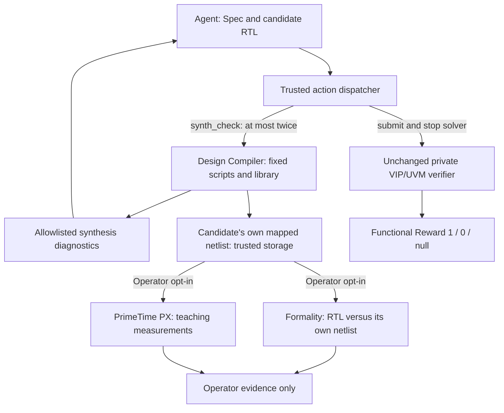

# Synthesis diagnostics and trusted implementation checks

`synthesis-tools-v1` separates three questions: can this RTL be synthesized, did synthesis preserve its behavior, and does the RTL implement the task? Only the existing private VIP/UVM verifier answers the last question and assigns terminal Reward. Task001–004 contracts and historical evidence are unchanged.



## Agent interface

The profile applies to Task003 or Task004 with E (`test_diagnostic`). It adds exactly `{"tool":"synth_check"}` to read/edit/test/submit. It does not include the separate `engineering-tools-v1` compile/inspect actions. This permits a later E versus E+synthesis comparison without bundling several tools together.

Read Spec and RTL first. A synthesis call consumes one of the existing 20 actions and one of two synthesis invocations, including an infrastructure failure. A third call, extra arguments, private-file read or post-submission action is rejected before execution. The existing two public functional tests are unchanged. Synthesis is optional for submission.

The response contains `status`, at most five fixed `diagnostics`, `functional_correctness_checked: false` and `remaining_synth_calls`. It never returns raw logs, netlists, Tcl, library paths, private results, Formality results or timing/power values. Diagnostic text is regenerated from a vocabulary, including when the backend supplies additional fields. A synthesis PASS is not a functional PASS; inferred latches and structural warnings are advisory, not new Task requirements.

Recognized candidate syntax errors produce FAIL. Forbidden HDL produces INVALID before launching DC. Missing tools, unavailable licenses, timeouts, unknown failures and incomplete runs produce ENV_ERROR. The adapter checks native completion markers and errors rather than trusting exit code alone.

Limits: 40,000-byte restricted single-module RTL; DC 180 seconds, trusted Formality 120 seconds, trusted PT 90 seconds; 2 GiB address space and 16 MiB per file. These controls extend the existing HDL boundary. They do not establish security against compiler vulnerabilities. No Agent-supplied shell, Tcl, testbench or compiler flag is accepted.

## Trusted checks and measurement scope

Formality compares a candidate with **its own synthesized netlist**, using Synopsys Auto Setup Mode for implementation-compatible RTL interpretation, then direct matching and verification. The generated SVF is retained but not loaded in this bounded flow; it does not compare all legal designs with a canonical reference. Interpretation warnings remain in trusted logs. An incomplete proof is ENV_ERROR, not a confirmed mismatch. There is no VC Formal FPV capacity/arbitration proof in this interface.

PrimeTime runs averaged PX analysis. Fixed constraints use a 10-unit clock, 0.1 input/output delay and 0.01 output load. Activity is a uniform assumed toggle rate of 0.2 and static probability 0.5, not activity measured from a task workload. Library bytes, environment-entry hash, candidate, constraint and measurement scripts are frozen; path records remain private. Batch runs reject a different synthesis binding, including on resume.

`class.db` is a teaching library. DBR-207 is accepted only in this explicitly teaching measurement flow; other PT errors fail closed. Area, slack and power support workflow checks and possible same-library relative comparisons. Missing internal/leakage power tables make reported zeros unsuitable as physical evidence. These numbers never enter terminal Reward and do not establish timing closure, physical PPA or a real-process optimization gain. A future physical optimization task requires a separately qualified library, constraints, activity model and reward contract.

## Reuse

Set `eda_env_script` in private `.local/config.json` to an administrator-maintained absolute shell-script path. It must provide `dc_shell`, `fm_shell`, `pt_shell`, `CLASS_DB` and the authorized tool environment. The runner sources it in each fresh shell. A missing/failing entry is not replaced with guessed variables. The historical frozen config example is intentionally unchanged.

```bash
python3 -m unittest discover -s tests
python3 -m environment.synthesis_acceptance .local/synthesis-acceptance-new
# Include operator-side Formality and PT/PX positive/negative controls:
python3 -m environment.synthesis_acceptance .local/synthesis-trusted-new --trusted
python3 -m environment.synthesis_tools candidate.sv .local/candidate-check-new
# Operator only:
python3 -m environment.synthesis_tools candidate.sv .local/implementation-check-new --equivalence --measure
```

Run mechanism acceptance on the prepared trusted Linux checkout after loading its configured environment; the experiment launcher does this inside its remote deployment. All output directories must be new. Private outputs include RTL, stage results, timings, raw reports, generated netlist/SVF/SDC and hashes. They are not automatically publishable.

After source-bound Task Quality Gate admission:

```bash
python3 -m environment.policy_experiment \
  --task axil_to_apb4_queue_003 --admission .local/current-task003-gate \
  --policies test_diagnostic --protocol text-json-atomic-v2 \
  --capabilities synthesis-tools-v1 --repeats 1 \
  --out .local/synthesis-pilot-new
python3 scripts/audit_policy.py .local/synthesis-pilot-new
```

Default acceptance covers DC diagnostics and a real VIP/UVM negative control. `--trusted` additionally requires the Formality and PT/PX controls to finish successfully; an incomplete proof keeps that extended acceptance incomplete.

The launcher reruns capability acceptance on its frozen deployment before starting a model. It preserves source/runtime hashes, actual observations and `synth_calls`; the auditor checks candidate identity, projection, budget and environment binding. Terminal and held-out evaluation remain after solver shutdown. Historical exchange v1/v2 export deliberately rejects this capability contract. The subsequently added [v3 exporter](runtime-experiments.md) audits and represents synthesis observations separately from trusted implementation checks; historical evidence remains unchanged.

See the [acceptance report](synthesis-tools-evaluation.md) for actual results and limitations. Tool availability alone is not evidence of improved Agent repair ability.

Public commands create new runs. Exact replay of a recorded private grading input requires its trusted-side frozen input files; published hashes do not expose those vectors. Model sampling is not deterministic.
