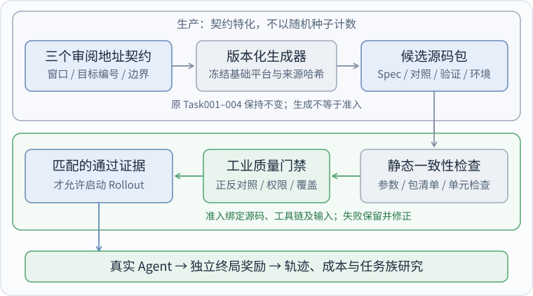

# 从单任务实现到有限路由任务族

本轮研究任务生产方法：已验收的协议、验证和交互基础，能否复用为一组具有明确不同地址契约的完整任务包。目标是证明生成、准入和真实求解可以衔接，不是将三组地址常量宣传成三种独立工程能力。

[查看原图](diagrams/task-family-production.svg) · [生成器及复现入口](../task_families/router_v1/README.md)

## 从一个地址实例理解任务族

假设处理器发起对 `0x00002000` 的写请求。在 compact 契约里，这个地址落在两个目标之间的空洞中：桥不能发起 APB 访问，必须返回地址译码错误 DECERR。在 adjacent 契约里，同一个地址恰好是目标 1 的起点：桥应选中该目标，向它发送局部地址 0，并等待真实 APB 完成后返回响应。

请求内容可以完全相同，正确行为却因工程契约而不同。这与只换一个随机测试种子不同。但两道题仍共享协议转换与范围译码的设计方法，因此也不能把它们说成两种全新的工程能力。

**Task Family（任务族）**在这里指一组保留共同规则、只允许特定契约变化的任务。生成器负责同时变更 Spec、实现对照和独立验证；质量门禁负责判断生成结果是否真的可用。若只改 Spec、不改验证器，上面的合法目标访问可能被错误判罚；若参考和验证器一起生成错，错误设计又可能被共同接受。这就是本轮不能只检查“生成了多少文件”的原因。

## 为什么先做三目标路由

Task001 的协议转换、独立 AW/W、等待、背压与复位可复用；Task002 在此基础上增加译码、局部地址转换和响应路由。Task003/004 则改变未退休容量、请求配对和响应生命周期，需要不同 Scoreboard，不能只替换场景参数就认为完成新任务。

首个任务族固定三目标接口、单笔未完成事务和原有错误响应语义，只改变窗口长度、位置及目标编号与地址顺序的关系。没有增加协议、并发行为或隐藏需求。此限制避免在尚未验证生产方法时，同时泛化 VIP lane 数量与全部任务分派。

| 候选契约 | 区别 | 能测量什么 |
| --- | --- | --- |
| compact | 相近但分离的不同长度窗口 | 地址空洞、目标选择和局部偏移 |
| irregular | 非二次幂长度、目标编号与地址排序不同、高位窗口 | 范围比较、索引绑定及完整 32 位译码 |
| adjacent | 两目标窗口紧邻，另有较大高位窗口 | 边界应切换目标而非返回 DECERR |

这些是**同一工程能力族中的参数化契约**。改变随机 payload 或 seed 是输入变化；改变窗口是任务契约变化；增加队列或 Burst 才是另一类能力组合。当前未建立绝对难度排序。

## 生成产物与责任划分

生成器输出隔离的源码包，称作 task capsule。每个包有独立 Task ID、Spec、初始 RTL、两种合法参考、14 个错误实现、验证场景、独立 UVM Scoreboard、Policy/Session、质量门禁及统一 CLI。包清单记录基础 Git 提交、生成器、参数、场景模板及所有产物哈希。

基础平台当前有硬编码的任务分派。v1 将其绑定到包内新身份，复用完整执行路径；原仓库 Task001–004 不改写。包内 `task002` 是复用后端的模块名，不是实验身份。此方案保守但有源码副本和较大冻结范围的成本；只有实测确认哪些依赖可拆后，再引入动态组件注册。

根入口增加 `scripts/tasks.py --package PACKAGE ...`，先检查源码清单，再委派到包内原有 `reset/test/submit/quality/rollout`。生成目录必须新建，不覆盖已有包；包内单元检查须在昂贵的工业验收之前通过。候选能开发测试，但正式模型试次仍需当前源码和工具链匹配的质量准入，清单验证本身不能授予准入。

## 如何控制共同错误风险

参考 RTL 比较 `base <= address < base + size`，SV 判据则使用包含两个端点的地址范围，刺激分类采用地址差值与长度；三者没有调用同一解码函数。边界测试覆盖下界前一个字、下界、上界最后一个字、上界后一个字及地址位翻转，同时读写验证数据路径。窗口内部还要检查局部偏移跨越二进制进位点的行为，例如从 `0xffc` 到 `0x1000`；仅检查窗口首尾，可能漏掉中间地址被错误映射的问题。

另有手工审阅的语义锚点，即不通过解码生成函数计算、直接写明预期目标编号（lane）和局部偏移（offset）的具体地址实例。例如 irregular 契约中，`0x00023ffc` 应属于目标 0、偏移为 `0x2ffc`，而紧接着的 `0x00024000` 应未映射。这些锚点独立于生成的两个解码表达式。每次仿真需记录锚点检查已执行；缺失或不符属于基础设施/验证器问题，不能误罚候选为 Reward=0。正反对照、必要覆盖、隔离与机制检查继续使用原质量门禁。

表达式不同不等于完全独立；共享规格参数仍可能存在共同误解。有限锚点、边界和故障对照也不构成穷尽证明。当前仅接受三种审阅配置，任意参数组合被拒绝。

## 工程边界与后续决策

当前重点是生成方法与准入。运行时事件导航、综合工具组合、队列任务族尚未在这一版本中扩展，也未改变已有工具研究条件。后续先根据生成与真实求解的失败判断瓶颈：若规格或验证不一致，修正生产方法；若大量成本来自重复打包和编译，再研究组件级冻结；若任务都容易或都失败，再设计能力梯度，而不是增加常量组合数量。

真实验收、漏检案例、模型结果和成本在[任务族研究报告](router-family-evaluation.md)中按版本说明。本页描述实现机制，生成成功本身不代表仿真通过。
