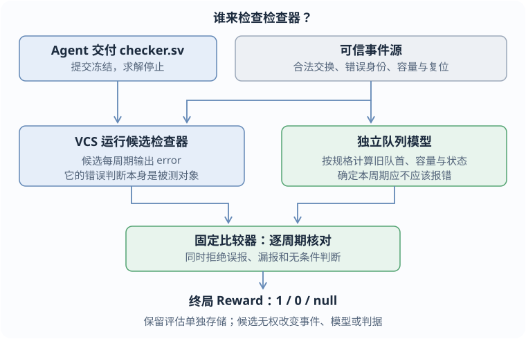

# 让验证组件成为任务，并检查任务自己的检查能力

> 本页保留 Checker／状态寄存器四条试次及其冻结阶段。后续新增 I²C 两份契约与真实求解，当前总览见 [I²C 研究](i2c-sink-evaluation.md)和[任务目录](task-catalog.md)；下文旧统计与当时路线不回写。

专业工程任务不必总是要求模型实现一个 DUT。工程师也要编写检查器、处理软硬件共享状态，并判断验证资源是否真的执行了有意义的检查。本阶段新增两类、四份有限契约：**FIFO 身份检查器设计**与**写 1 清除状态寄存器修复**。它们均完成正反对照和真实求解；另外修复了 UART 停止位边界漏检及材料包依赖集合不完整的问题。

新增四条预声明模型轨迹中，三条终局通过、一条提交了未修改的错误起点。这个分布只是研究库存，不是共同成功率：两个任务族测量不同能力，每个契约仅一条样本。最有信息量的结果，是一条检查器轨迹经历三次功能失败后修复，以及门禁自身先漏检、后以同源码复验纠正的完整证据。

[任务与判据](#交付物不同可信判据也不同) · [两次交互漏检](#单独覆盖两个维度仍会漏掉交互) · [真实行为](#模型怎样修改验证与提交) · [复现](#怎样复用而不继承失效证据)

## 交付物不同，可信判据也不同

### FIFO 检查器：候选不能给自己打分

FIFO 按先进先出顺序保存尚未退休的请求。检查器收到入队与退休事件，需要判断退休身份是不是旧队首、是否超容量，以及复位后旧请求是否已经失效。重复身份合法，满队列同周期退休与入队合法；空队列同周期入队与退休则不能被视为直通。

这次 Agent 编写的是 `checker.sv`，输出每周期的错误标志。可信侧先用独立队列模型计算期望，再让 VCS 运行候选逐周期比较。无条件报错会误拒合法事件，无条件不报错会漏掉非法事件，两者都失败。**被评价的 Checker 与决定奖励的固定比较器是两个不同对象。**



[查看原图](diagrams/checker-task-boundary.svg)。该任务使用 VCS，不声称借用了某个 VIP 的协议检查。深度 2 与深度 3 分别覆盖二次幂和非二次幂存储管理；它们是同一能力族的两个契约，不是两个独立协议。

[36 项门禁](../experiments/task-production-v2/checker-quality-v2.json)包含两种合法结构在公开、终局、保留三个阶段的 12 次通过，19 个功能错误拒绝，以及空交付、接口、报告伪造和语法错误。必要事件包括存储多轮使用后的错误身份、满队列交换、复位取消与错误保持；完成标记必须对应全部输入行，零活动不能通过。

### 状态寄存器：同一拍谁优先，必须成为明确契约

硬件把事件位设为 1，软件写 1 表示清除已经处理的事件。这类 W1C（write-one-to-clear）寄存器常出现同一位同时置位和清除的情况。两种任务分别规定硬件置位优先与软件清除优先；没有隐含的“更正确”选择，正确性取决于明确需求。

例如旧状态为 `0x81`，硬件置位 `0x42`，软件清除 `0xC0`：置位优先应得到 `0x43`，清除优先应得到 `0x03`。同周期的不同位必须独立更新；无软件写使能时，写数据不应产生影响。

候选与可信参考接受 **Formality 顺序等价**，并接受独立逐位真值表的 VCS 核对。真值表显式列举旧值、置位与清除的关系，避免只把同一 RTL 表达式换一种写法作为“独立模型”。VCS 还检查时钟沿之间输出不得因复位异步变化。两种合法结构均通过；[39 项门禁](../experiments/task-production-v2/status-quality-v1.json)分别用等价路径与独立仿真拒绝优先级、写使能、掩码、硬件置位丢失及复位错误。

每个完整仿真执行 66,048 个周期检查，Formality 合法对照报告 16 个通过比较点；未证明、缺少比较点、黑盒或工具故障不算通过。这不是候选与其自身综合网表的比较，也没有教学库 PPA 奖励。

## 单独覆盖两个维度，仍会漏掉交互

### UART：忙碌输入不等于停止位结束边界输入

旧 UART 检查已经遍历所有字节，并在 busy 期间提供额外请求，但最后停止位结束附近撤掉了 valid。一份人工错误实现因此可以在最后一个 busy 沿提前装载下一帧，违反“沿前 ready 与 valid 同时成立才接受”的契约，却得到 Reward=1。

修订 5 保持尾部 valid，实际触发每种格式 256 次停止边界请求。两份**完全相同的错误源码**从旧评分器 PASS 变为明确功能失败；替代合法实现也通过。[32 项新门禁](../experiments/task-production-v2/uart-quality-v5.json)与[同源码对照](../experiments/task-production-v2/uart-stop-boundary-finding.json)保留了这条证据链。任务 Spec 不变，历史奖励不回写；旧 UART 轨迹保留研究用途，不能自动视为当前评分版本的训练候选。

### Checker：回绕与错误身份必须在同一次执行中相遇

初版 Checker 门禁单独触发了回绕，也触发了错误身份，却没有在回绕后的退休位置再次注入错误身份。深度 3 的错误实现按四个槽回绕，仍得到 Reward=1。越界读取可能产生未知值，条件判断因此没有执行预期的报错分支；只在初始队首注入错误身份发现不了这一点。

[被拒绝的初版门禁](../experiments/task-production-v2/checker-quality-rejected-v1.json)保留了 36 项中这一项不符合预期的结果。修订 2 增加存储复用后各退休位置、满队列交换时的错误身份激励；[同源码复验](../experiments/task-production-v2/checker-interaction-finding.json)在`row=1977`（从 0 计数）发现应报错却未报错。补测没有识别候选指纹，也没有改写旧结果。

这两次发现说明：生成器需要派生**生命周期 × 输入条件**的交互义务。必要覆盖命中只能说明这些义务实际执行，仍不能证明没有其他漏检。

## 模型怎样修改、验证与提交

两批各两条试次在调用模型前冻结。[Checker 计划](../experiments/task-production-v2/checker-study-plan.json)和[状态寄存器计划](../experiments/task-production-v2/status-study-plan.json)均使用 deepseek-flash、DSH 0.2.2rc2、reasoning off、20 次总动作和 4 次公开测试。每次全新会话、工作区及 Harness Home；采样种子、精确权重版本和温度不可固定，不能声称匹配随机生成过程。

| 契约 | 实际公开结果 | 有效编辑 | 终局 / 保留 | 可观察事实 |
| --- | --- | ---: | --- | --- |
| FIFO 深度 2 | FAIL、FAIL、FAIL、PASS | 4 | 1 / 1 | 三次失败后修复并复验同一提交 |
| FIFO 深度 3 | PASS | 1 | 1 / 1 | 首次有效编辑通过 |
| 状态寄存器：置位优先 | PASS | 1 | 1 / 1 | 首次有效编辑修复起始缺陷 |
| 状态寄存器：清除优先 | FAIL、FAIL、FAIL | 0 | 0 / 0 | 重复测试后仍提交已知错误原文件 |

深度 2 的前三个候选只在同时 push/pop 时检查身份，单独 pop 时没有比较 `pop_id` 与旧队首。最终版本把所有 pop 统一进入身份检查分支，公开测试通过，再提交同一哈希。前三个失败均为实际 `transition_mismatch`；模型只收到该类别，没有收到第几行、期望值或参考修复。源码变化与实际复验支持“完成一次功能修复”，不证明能读取模型内部推理，也不证明这种反馈优于其他反馈。

清除优先轨迹包含六次动作解析错误和两次前置条件拒绝，没有任何实际编辑。最终提交与三次公开 FAIL 对应同一源码。它值得用于研究交互失败和提交决策，但不能据此说模型已尝试 RTL 修复仍无能力完成。失败样本没有被替换，保留评估也未用于选另一个候选。

全部 4 条通过原始响应重放审计；反馈、候选身份、预算和停止后评分可核查。新 v7 交换沿用训练、保留、离线三个分区。没有事后中间候选仿真，没有补写模型当时未获得的诊断。

### 结果与成本一起看

| 契约 | 动作 / 测试 | Token | 模型请求秒 | 整条秒 |
| --- | --- | ---: | ---: | ---: |
| FIFO 深度 2 | 12 / 4 | 25,371 | 29.93 | 60.61 |
| FIFO 深度 3 | 6 / 1 | 8,982 | 15.03 | 31.66 |
| 置位优先 | 7 / 1 | 7,266 | 21.55 | 43.72 |
| 清除优先 | 15 / 3 | 33,938 | 17.50 | 40.21 |

合计 75,557 Token；货币费用不可取得。模型请求时间含传输与 Harness 开销，不能当作纯推理计算。编译、仿真、等价检查的分项墙钟见[Checker 结果](../experiments/task-production-v2/checker-study-results.json)和[状态寄存器结果](../experiments/task-production-v2/status-study-results.json)。两族数据分开解释，不把 3/4 宣传为稳定能力。

验收成本也不同：[本轮门禁记录](../experiments/task-production-v2/quality-costs.json)中，UART 32 项约 390.72 秒，Checker 36 项约 147.06 秒，状态寄存器 39 项约 171.79 秒。这些不含研发、旧版漏检调查和全部历史运行；不能视作任意新任务的固定生产价格。

## 怎样复用，而不继承失效证据

材料包清单的职责是绑定“实际需要的全部依赖”。旧检查器只遍历清单已经列出的条目，删掉一个运行器依赖后仍能通过；清单内部自洽不等于依赖完整。[复现与修正](../experiments/task-production-v2/materialization-dependencies.json)保留这一失败。

当前生产器从可信入口求本地 Python 导入闭包，再加入明确的非 Python 文件和质量证据，要求依赖集合、哈希、生产器、运行器及包文件精确匹配。动态资源仍须显式列入，不能认为 AST 分析自动发现一切。[十份实际材料化](../experiments/task-production-v2/materialization-v6.json)完成生成、检查及 reset，520 次逐项删依赖探针全部被拒绝。生产检查不替代新的 EDA 验收。

```bash
# 在匹配源码与合法 EDA 配置下，OUT 使用全新目录
python3 -m verification_resources.production_v3 produce fifo-checker depth3 .local/checker-package
python3 -m verification_resources.production_v3 check .local/checker-package
python3 -m verification_resources.production_v3 reset .local/checker-package .local/checker-work
python3 -m environment.artifact_task test fifo_checker_d3_v1 .local/checker-work .local/checker-public
python3 -m environment.artifact_task submit fifo_checker_d3_v1 .local/checker-work .local/checker-submit

# 重做正反对照，不启动模型
python3 -m verifier.fifo_checker.quality_v2 .local/checker-quality-new
python3 -m verifier.status_register.quality .local/status-quality-new
```

Checker 的有限生成域为深度 1–5，但只有深度 2、3 获得当前准入；其他深度会被拒绝进入这条运行路径。状态寄存器生产域为两个明确优先级。均使用相同公共 Session 接口，语义 Oracle 保持领域专用，没有建立任意协议规则引擎。

## 验证资源扩大到了哪一层

VCS O-2018.09-SP2 用于 Checker 与状态真值表，Formality O-2018.06-SP1 用于独立参考。UART 延续 VIP R-2020.12 / UVM 1.2。RFFE 的新探针使用 VIP R-2020.12 / UVM 1.1d，从新编译开始运行 `basic_write_read_test`，实际运行 3,464,980 ps，完成一次读回数据比较，warning/error/fatal 均为零。[资源证据](../experiments/task-production-v2/rffe-activity-recheck.json)保留独立退出状态与原始日志哈希。

这支持 RFFE **厂商例程层**，不支持自建 DUT、针对性错误对照或任务奖励层。旧 `base_test` 仅运行 10,000 ps；零错误本身不能升级为评分能力。其他工具的历史状态不因本轮工作自动改变；没有引入新的商业产品或 PPA 指标。

## 下一步首先做什么

本阶段已将“编写验证组件”与“处理硬件／软件共享状态”变为可生成、可验收、可求解的契约，研究库存达到 11 个 X2P 身份加 10 个有限契约。四条新轨迹使已审查库存达到 125 条研究记录、85 条工具轨迹；[库存清单](../experiments/task-production-v2/exchange-inventory.json)保留各历史版本用途，不合并成功率。

最值得继续的一项是：**将 RFFE 已确认的事务观察能力推进为有限寄存器对象的独立验收**，先完成活动、合法与错误对照，再决定是否进入模型采样。当前仍没有新增 RFFE Task，也没有达到“多个新协议任务已经完成”的阶段目标。

同时保留两个明确边界：检查器错误机制和真实模型样本仍少，不能给绝对难度排序；公开源码有潜在预训练污染，运行时文件隔离不等于题库长期保密。本轮证明的是这些有限工程闭环实际可执行与可审计，不是完整验证证明，更不是已经取得参数训练收益。
