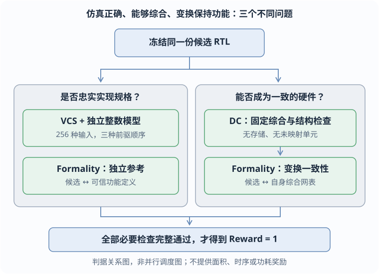

# 从验证资源到不同形式的工程任务

同一段 RTL 可能在仿真中算对结果，却无法综合；同一条协议总线可能帧格式正确，却读回了错误寄存器。任务生产需要先确定究竟要判断什么，再组合工具与独立判据。本阶段沿三个具体对象推进：RFFE 寄存器、八位组合运算、以及已有 I²C 接收器的局部功能补全；同时扩展 FIFO Checker 的有限生成域。

本阶段新增八个通过工业准入的任务身份，并完成四条分层模型试次和一条独立版本的反馈改进试次。观察到了真实的指针修复，也观察到了动作格式阻碍实际编辑。下文把任务可靠性、模型行为和数据用途分别讨论；历史任务与轨迹保持不变。这里研究固定模型的工程求解，不进行模型参数训练。

## 新任务要求什么，谁判断它

| 工程对象与任务形式 | 新增要求 | 独立判据与当前证据 |
| --- | --- | --- |
| [RFFE 寄存器实现](tasks/rffe-register.md) | 从引脚命令到地址、数据、奇偶校验和寄存器更新；RW 与 W1C 两种语义 | 主动 VIP、被动事务观察、独立引脚解码和寄存器模型；33 项门禁通过 |
| [组合运算综合修复](tasks/bitfold-synthesis-repair.md) | 保持置位计数或末尾零计数，消除不可展开的数据依赖循环，满足无状态结构要求 | 全部 256 个二值输入、DC 结构检查、独立参考等价与自身网表等价；31 项门禁通过 |
| [I²C 骨架补全](tasks/i2c-completion.md) | 在正确接收／ACK 基础上交付字节或事务内双字节 | 复用原有总线与输出判据；18 项新材料门禁通过 |
| [FIFO Checker 深度 1／5](tasks/fifo-checker-expanded.md) | 单槽满交换，以及非二次幂容量与多轮身份维护 | 独立事件队列模型；39 项门禁通过 |

这些变化并非八种新的独立能力。I²C 两个起点保留原功能契约，只改变模型需要完成的部分；Checker 深度变化属于有限参数域中的边界要求。RFFE 与综合修复则引入新的协议或结构判定关系。任务身份、功能契约和能力类别应分别统计。

## 验收不是把工具成功相乘

[查看原尺寸图](diagrams/functional-structural-acceptance.svg)。综合修复的起始 RTL 是一个具体例子：它能通过整数功能检查，但 DC 无法展开数据相关的循环。因此功能正确不是这个任务的全部要求。相反，错误运算即使可以综合，也不能获得奖励。候选与自己的网表等价只说明综合变换保留了行为，不能替代与独立规格参考的比较。

RFFE 开发中也遇到了可信配置问题。最初未固定 VIP 的同步读模式，造成独立引脚账目与 VIP 奇偶校验判断不一致，评分返回不可判定。固定到规格支持的普通读模式后，同一候选和输入通过；随后重新执行完整正反对照。没有关闭奇偶检查，也没有把不可判定记录回写为成功。[同源码配置复验](../experiments/task-production-v3/rffe-configuration-review.json)保存了这条证据链。

所有功能负例都必须实际进入相应功能检查。编译错误不能冒充寄存器语义、ACK 时序或指针错误被检出的证据；综合修复则额外用相同的错误运算运行独立 Formality，确认其负例路径确实执行。

## 生产成本与适用边界

已完成门禁的累计调用墙钟时间：Checker 约 154 秒，RFFE 约 1,013 秒，综合修复约 189 秒，I²C 补全约 979 秒。这些是当前环境实际门禁调用之和，不含前期探索，也不是未来采样的固定价格。RFFE 与 I²C 需要较重的 VIP 编译，简单事件 Checker 的成本明显不同；后续成本比较必须将编译、仿真、模型请求和总耗时分开。

目前继续采用源码与工具链严格绑定的重新编译，没有以跨候选二进制复用换取吞吐量。材料包的内容重复度只能说明潜在存储成本，不能自动授予编译缓存或旧评分结果的复用权限。

教学库只支持本任务约定的可综合、无状态与映射检查；没有面积、时序或功耗奖励。RFFE 限于普通读写、单主设备和有限寄存器，不包含完整协议功能。SPMI 与 SWD 仍只有厂商例程层级的证据，没有被列为可靠任务后端。

## 模型究竟完成了什么

首批在第一次 API 调用前[冻结四条分层试次](../experiments/task-production-v3/study-plan.json)：每类一个任务、一次独立会话。统一使用 deepseek-flash、reasoning off、20 次总动作与 4 次公开检查。最初考虑八条，依据构建存储成本在采样前缩为四条，未降低验证标准。精确权重版本、服务端随机种子和固定温度不可取得；不同任务的一次试验不能构成可靠难度排序。

| 首批任务（各 n=1） | 有效编辑／公开检查 | 终局 Reward | 独立保留评估 | 实际行为 |
| --- | --- | --- | --- | --- |
| 深度 5 Checker | 2／2 | 1 | 1 | 首候选失败，修改回绕后通过并提交 |
| RFFE W1C | 0／4 | 0 | 0 | 编辑被格式检查拒绝，反复测试并提交初始模板 |
| 位计数综合修复 | 1／1 | 1 | 1 | 首次有效编辑满足功能与结构要求 |
| I²C 组字补全 | 0／4 | 0 | 0 | 多动作回复被整体拒绝，提交未修改的骨架 |

四条均提交并完成独立评分，没有基础设施失败。两条 Reward=0 对应真实不满足规格的提交，但不代表模型提出的 RTL 已被执行和判错：那些被拒绝的文本从未写入工作区，也没有事后补测。两条失败因此首先暴露交互问题，不能据此判断骨架补全没有作用或串行协议过难。[逐条结果](../experiments/task-production-v3/study-results.json)和[候选演变证据](../experiments/task-production-v3/behavior-cases.json)保留这一差别。

### 一个可以核查的工程修复

深度 5 的存储只能使用索引 0–4。首个 Checker 候选用三位自然加法推进队头和队尾，因而在索引 4 后进入不存在的索引 5，直到 7 才回绕。公开测试返回 `transition_mismatch` 后，模型把单独退休和同周期接受／退休分支改成显式的“4 → 0”，并删除一个组合临时量。修改后的同一源码通过公开、终局和保留检查。

这是实际失败反馈之后的有效修复。模型没有收到失败输入行或私有向量；不能进一步声称仅错误类别就导致了修复，也不能把所有效果归因于唯一一行修改。位计数任务则是另一类数据：模型直接把数据相关的 `while` 改为固定八次累加，首份有效编辑即通过，没有观察到失败反馈后的调试过程。

### 一次明确版本化的交互改进，没有得到成功结果

首批 40 次动作中有 12 次格式错误；RFFE 的三次编辑额外携带不允许的 `file` 字段，I²C 的六次回复包含多个 JSON 动作。控制器没有自动拆分、补写或执行这些内容。针对这一实际问题，[后续计划](../experiments/task-production-v3/action-diagnostic-plan.json)只增加一次 RFFE W1C 试次：Session v5 在格式拒绝时给出固定的合法动作形状，明确 edit 不带 `file`。初始提示、任务、私有输入、模型条件和预算不变，功能反馈不变；运行器与反馈版本单独冻结。

这次出现三次有效编辑和三次真实公开检查，但 20 次动作中仍有 12 次解析失败。三个候选都被引脚检查发现非二值帧位，未得到可验证修复；动作耗尽前没有 submit，故 **Reward=null，类别为未完成，未执行终局与保留评估**。这不是基础设施中断。仅前两次公开失败送达模型，最后一次检查位于第 20 个动作，结果保存在可信记录中，没有下一轮模型请求，不能算作实际反馈曝光。

[后续结果](../experiments/task-production-v3/action-diagnostic-results.json)中的 `submitted=false` 是解释结果的前提：其 `final_public_status=UNTESTED` 表示没有最终提交可关联，不表示三个工作区候选未经测试。一次独立样本只能说明“本次有效编辑发生了”，不能证明新提示稳定改善动作遵循，更不能与首批合并计算方法成功率。原生受控工具调用尚未完成实际验收；不能仅凭 SDK 接口存在就把它列为已解决方案。

## 运行与数据交付怎样核查

八个新起点通过 [107 项真实运行机制检查](../experiments/task-production-v3/runtime-acceptance-v2.json)，实际调用后端 27 次；新拒绝提示另通过 [16 项检查、6 次实际调用](../experiments/task-production-v3/diagnostic-runtime-v3.json)。所有动作共用总预算，测试对应当前源码，提交冻结并停止求解，之后才执行私有与保留评估。现有受限 worker 的[实际隔离探针与边界](../experiments/task-production-v3/runtime-isolation.json)单列，不能理解为不同试次之间已经实现完整操作系统文件隔离。

全部二十份有限材料包可初始化；八份新包的 790 次单项依赖遗漏、118 次任务文件遗漏及额外文件均被拒绝。新代码完成 196 项单元测试。源码身份检查只核对 Git 对象和冻结哈希，不等于重新执行仿真。

五条真实记录均通过重放审计，进入 v8 交换；首批与后续分别保存在 [exchange](../experiments/task-production-v3/exchange/manifest.json) 和 [diagnostic-exchange](../experiments/task-production-v3/diagnostic-exchange/manifest.json)。[负向审计](../experiments/task-production-v3/diagnostic-audit-validation.json)检查未授权反馈、送达内容篡改、奖励篡改、虚假停止和重复逻辑试次。当前累计为 **132 条研究记录、92 条已审查工具轨迹**，不是 132 条可直接用于训练的样本。

原始模型回复、全部源码版本、实际反馈与完整验证结果在可信本地保留。公开交换分别保存工具轨迹、最终训练奖励和独立保留评估；本阶段没有中间候选事后评分。Token IDs、行为概率、精确权重版本与货币账单不可取得，保持缺失。导出或审计成功只能说明记录符合交付契约，不能证明训练收益。

## 成本决定下一批先解决什么

| 实际开销 | 首批四条 | 独立后续一条 |
| --- | --- | --- |
| 报告 Token | 143,590 | 207,620 |
| 模型请求墙钟（含接口开销） | 90.4 秒 | 60.7 秒 |
| VCS 编译次数／墙钟 | 19／428.4 秒 | 3／108.6 秒 |
| VCS 仿真墙钟 | 70.2 秒 | 11.5 秒 |
| 完整试次墙钟 | 652.2 秒 | 188.3 秒 |

另有 DC 9.1 秒、独立参考 Formality 7.0 秒、自身网表 Formality 4.3 秒，均来自位计数试次。五条合计 351,210 Token；货币成本未知。模型请求时间包含网络与 SDK，工具时间也含命令开销，各列不能直接解释为净计算性能。以上只计模型试次，不含前述门禁、开发探针与机制验收；[成本明细](../experiments/task-production-v3/rollout-costs.json)保留实际分项。

下一批最值得先做的是一个小型、受控的动作接口验收：确认模型能把单次工程交付可靠送到已有权限边界，再用固定任务、起点和验证器重新冻结极小规模校准。继续放宽文本提示尚无稳定效果证据，而这次未完成的单条试次已经消耗多于首批四条的 Token。它是专业能力测量的前置问题，不应演变为无限 Harness 重构。

任务生产继续保留两条独立主线：在准入证据严格匹配时研究 VIP 公共编译成本；从 SPMI／SWD 等例程中选择能建立独立语义对象的下一个协议。两者均未实现。I²C 引脚时序反馈、Checker 更广生成域和组合任务交互覆盖也仍待验证，不以增加任务数量代替这些质量工作。

## 阶段完成度与继续入口

| 目标 | 本阶段实际状态 | 下一项可验证工作 |
| --- | --- | --- |
| 资源到任务 | RFFE 从例程推进到自建 DUT、33 项门禁与真实试次；其他协议未自动升级 | 一个新协议的独立语义对象与正反对照 |
| 同对象不同任务形式 | I²C 新增正确 ACK 骨架起点，两份通过门禁；组字样本没有有效编辑 | 先确保有效编辑，再研究局部能力难度 |
| 新判定方法 | DC 结构要求＋两条职责不同的 Formality 路径已执行 | 进一步结构契约须独立冻结，不加入教学库 PPA 奖励 |
| 有限生成域 | Checker 深度 1／5、RFFE RW／W1C、两种位运算已准入 | 新参数必须重新派生义务与实际负例 |
| 生产与模型校准 | 新增 8 个身份、121 项门禁、4＋1 条真实试次 | 修正交互测量前提，随后按成本分层采样 |
| 长期库存目标 | 31 个身份、29 个去重功能／结构契约标识 | 35–50 是规划范围，尚未达到；不以种子或导出数充数 |

复现从[证据与命令入口](../experiments/task-production-v3/README.md)开始；[任务库存](../experiments/task-production-v3/task-inventory.json)分别记录准入与模型使用，[来源清单](../experiments/task-production-v3/source-provenance.json)绑定两批冻结代码。有限正反对照不能证明验证器完备，单个样本不能给出稳定成功率或通用难度排名。本阶段的可复用成果是不同专业判据下的生产、准入与审计链条，以及能够区分真实修复和交互阻碍的证据。
