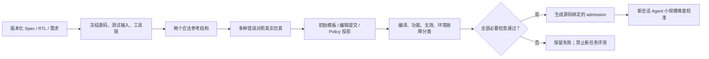

# 任务质量门禁

门禁回答“这个任务是否有足够的实际验证证据进入模型评测”，不把Spec文字完整、测试数量或一个PASS当作可靠奖励的证明。当前实现是小范围任务验收工具；尚未建设自动任务生成平台。

`environment.task_quality`按任务声明调用真实Verifier。正确实现必须完整通过公开及完整回归，并满足必要功能交叉覆盖。错误实现必须被实际仿真确认为功能／协议／周期超时错误；编译不成功不能代替错误RTL对照的功能检出。每个错误的首选case只改变执行顺序；若未发现错误，继续剩余完整回归，不使用源码指纹判分。

为避免重复编译商业库，正反对照可组成可信控制bank，一次只将一个候选的输出接到VIP。独立候选源码仍保留；该bank不接受Agent提交，也不是参考答案匹配器。Agent提交单独编译，使用相同检查逻辑。

门禁保存冻结清单和逐项结果，完成项不重复运行。不明中断目录保留并停止，不能自动重试并掩盖故障。`--resume`只接受相同源码、输入和工具链；修改验证器或Spec后须新建验收目录。对新任务，批量入口必须提供与当前源码、工具链匹配的验收记录，未通过就不会启动模型。

规格质量仍包含工程审查：地址区间、通道顺序、复位、无效场景及输出有效范围需要逐条核对。自动标签和控制测试不能证明规格不存在所有矛盾，也不能证明验证器完备。信息边界的证据包括真实工具拒绝、反馈白名单、安装运行时哈希及UID/PID/能力探针；不声称完整网络隔离或恶意原生代码防护。

既有001的默认命令、revision 3源代码与历史证据保持不变。Task002使用独立任务包和Verifier；只为复用现有批量执行器增加显式任务选择与任务专用反馈白名单。大范围Registry和自动任务生成推迟到更多新任务通过验收之后。
