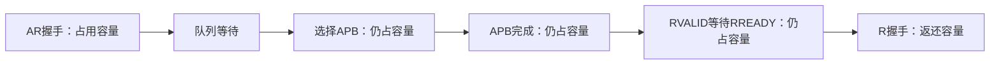

# Task003同起点修复：编辑发生了，目标错误是否修好？

在Task003独立生成之后，另外运行C/E各3条修复试次。六条均实际获取初始FAIL、执行编辑并提交，但最终均为Reward=0，保留评估也均为0。没有动作协议错误或基础设施故障。这个结果属于同起点修复，不能混入空模板独立生成成功率。

## 冻结方法

起点来自真实试次`task003-pilot-01/r01-test_diagnostic`的最终RTL，研究者未修改。SHA-256：`09bb88ff0c77d76ef4b8c6efa35a5ce17db179da05fe2f1c3ccd9c9deebd52ac`。选择它是因为公开`read_fifo`已稳定检出未退休读超过容量2，而非根据后来C/E的结果选择。没有证明起点只有一个缺陷。

同一个Spec、deepseek-flash、DSH0.2.2rc2、text-json-atomic-v2、20动作、2次公开测试；最大输出7000tokens、reasoning off，供应商temperature/seed默认，非确定性。每次新会话、Harness Home和工作区；三轮顺序为C/E、E/C、C/E，同轮冻结相同私有Reward与保留输入。源码冻结于`b18b6c33370ac63f724b86ec801843436c9e28db`，工具链与独立生成相同。

可信控制器要求初始公开测试先于编辑或提交，消耗通常的两次预算之一。C只收到FAIL及剩余次数；E额外收到类别、首错case和固定短说明。E首次实际文本为“A protocol timing or stability requirement failed.”，不是完整checker报告，也没有直接告诉模型“AR容量提前释放”。研究侧知道根因，不等于Agent知道根因。

[实际冻结输入资格检查](../experiments/task003-v1/repair-input-qualification/)逐组使用正确参考执行这三轮的私有Reward与保留输入，六组均21/21case通过，各506计划/474完成/32取消、33/33必要bin。它是提交后的研究侧检查，不改变原奖励或回流求解过程。

## 结果和实际改动

| Policy | 启动 / 有效提交 | 初始FAIL曝光 / 后续编辑 | 成功 | Wilson 95% | 0 / 1 / null |
|---|---:|---:|---:|---|---|
| C Test-verdict | 3 / 3 | 3 / 3 | 0/3 | 0–56.2% | 3 / 0 / 0 |
| E Test-diagnostic | 3 / 3 | 3 / 3 | 0/3 | 0–56.2% | 3 / 0 / 0 |

每条均调用2次公开测试；3条E都实际获得诊断字段，3条C均未获得这些字段。完整轨迹审计和批次质量审计通过，全部模型在私有/保留评分前停止。0/39动作格式错误，失败不能归因为没有成功调用编辑工具。

| 试次 | 实际代码变化 | 最终首错 |
|---|---|---|
| r01-C | 加入再删除一个冗余分支；最终去掉注释/空白后的token序列与起点完全相同 | `read_fifo`容量超限 |
| r01-E | 将入队索引条件式改为count-bit条件式，再改为head XOR count-bit；未改AR退休点 | 同上 |
| r02-E | 除注释排版外，只交换AW/W非空条件的书写顺序 | 同上 |
| r02-C | 新增`b_consume/r_consume`信号，却未接入计数/指针更新 | 同上 |
| r03-C | 将AR退休从选择时移至APB完成时，仍早于AXI响应消费 | 同上 |
| r03-E | 将AR计数退休移至R消费，但head仍在选择时前进；第二次edit与第一次逐字节相同 | `intake_r_stall` FIFO头不匹配 |

正确容量生命周期如下。实际执行与响应待消费都仍计入两个未退休名额：

r03-E不是毫无进展：第二次公开测试依次通过`address_data`、`write_fifo`、`read_fifo`、`intake_b_stall`，随后在`intake_r_stall`失败。计数保留、head却提前移动，使背压期间新请求的入队位置与待退休计数不一致。它修正了一个释放点，却没有同步FIFO指针生命周期；第二次收到新错误后只是重交相同代码。终局依然0，不能因通过更多case而改成部分功能奖励。

[完整汇总与六条审查轨迹](../experiments/task003-v1/repair/)、[实际反馈](../experiments/task003-v1/repair/feedback-history.json)、[人工RTL归因](../experiments/task003-v1/repair/repair-review.json)和[代码变化审计](../experiments/task003-v1/repair/repair-code-changes.json)分别保存。`scripts/repair_changes.py`核对首测候选哈希、实际送达观察、每次保存的编辑及最终提交，并输出diff。它能排除纯注释/空白变化；token不同不证明语义不同，更不证明修复有效。该工具7项测试在本地及Python3.6.9通过，未替代VCS验证。

## 资源和研究含义

| Policy | tokens（含缓存读） | 动作 / 编辑 / 测试 | 试次秒 | 请求秒 | 编译秒 | 仿真秒 |
|---|---:|---|---:|---:|---:|---:|
| C | 84,100 | 19 / 4 / 6 | 690.8 | 37.9 | 577.6 | 69.5 |
| E | 93,157 | 20 / 5 / 6 | 704.7 | 41.8 | 576.8 | 81.0 |

共177,257tokens、约23.3分钟试次时间。编译CPU页脚1129.577秒、仿真CPU43.08秒；墙钟含启动开销，请求时间含SDK/网络。货币账单不可取得，不以估计价格冒充实际费用。

六个相同终局0使本批二值终局奖励无法区分无效改写和部分修复；这不等于任务无解，或对所有RL算法无价值。任务已存在多种正确参考及真实独立求解成功，当前暴露的是**这份错误起点、当前模型与反馈条件下的修复困难**。也不能因C/E都0就证明两种反馈等效；样本小、错误起点单一，E的信息增量仍然有限。

最有价值的下一步是单独冻结需求级诊断的新版本，例如以白名单说明“等待消费的响应仍占容量”或“选出的队列头应对应最早接受的请求”，不返回测试向量或私有日志；用同起点C/E重新对照，并增加另一种真实错误起点。当前批次不改投影、不补写模型代码、不扩大到10次/组。

复现入口与准入要求见[统一任务入口](task-catalog.md)。在匹配源码并完成质量门禁后，可向统一rollout追加`--policies test_verdict,test_diagnostic --starting-rtl <固定错误RTL> --repeats 3 --limit 6`。提交后的私有输入、保留输入及完整原始日志留在可信环境；发布哈希审计不能代替新仿真。
