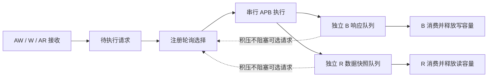

# Task004：请求、执行和响应生命周期解耦

Task004 的新增能力是独立管理已接收、待执行、执行中、已完成但未消费四种事务状态。它沿用 AXI4-Lite/APB4 和同一基础 Agent 工具接口，不引入完整AXI Burst/ID。本阶段的另一条研究轴是[固定 Task003 的工程工具对照](engineering-tools-evaluation.md)，两批不能混合计算成功率。

## 为什么选择这个扩展

Task003 已暴露容量提前释放和同周期计数更新问题，但其 APB 执行器等待当前 AXI 响应消费后才继续。Task004 要求 APB 在旧响应积压时继续处理可选请求，并且读写响应可以同时有效。这引入响应存储预留、不同生命周期的计数、每方向顺序与读数据快照，而非仅增加队列深度。

每个 AW/W/AR 通道有三笔未退休容量，只有 AXI 响应握手才释放；三深度也检验非二次幂回绕。选择使用此前已接受的 FIFO 头，注册轮询初始偏好读，每次选择翻转；部分写请求不能阻塞读。接受和响应分别有明确16周期界限。确切端口、时序、复位和不支持行为见[Spec](../tasks/axil_to_apb4_decoupled_004/spec.md)，不能以此摘要替代契约。

## 验证怎样跟随新能力变化

[独立 UVM Scoreboard](../verifier/task004/scoreboard.sv)维护请求队列、未退休容量、完成响应队列及外部参考存储器，分别消费 AXI/APB VIP Monitor 事务。它不读取 DUT 内部状态，也不把参考RTL作为运行时答案。读数据在 APB 完成时保存；之后同地址写入只更新外部存储器，不改旧读响应的期望值。

| 能力 | 实际验证场景 | 错误对照 |
|---|---|---|
| APB 不依赖响应消费 | 写/读流水、B/R积压时另一方向推进 | 阻塞于B、阻塞于R |
| 三笔未退休容量 | 三笔积压、长流、AW/W先后到达 | 提前释放容量、接受第四笔读 |
| FIFO与并发更新 | 回绕、同周期响应入队/出队、同时B/R握手 | 错误回绕、响应倒序、同周期丢失出队 |
| 数据快照与转换 | 同地址读后写、16种strobe、错误、等待 | 活数据代替快照、丢strobe、丢错误、忽略PREADY |
| 仲裁与复位 | 轮询、部分请求、八类复位阶段与恢复 | 固定写优先、残留响应、残留AW容量 |

公开21case，默认完整23case；完整集包含三条随机流，公开集一条。37个必要需求bin用于确认关键行为实际发生，不是全部状态组合覆盖率。复位核对三类守恒关系：计划=检查完成+取消，APB完成=正常检查+已完成但取消响应，通道接受=退休+复位取消。外部已完成写入跨复位保留。

为避免只接受某一种响应延迟，响应同步场景同时门控DUT的READY和VIP侧VALID，让双方观察同一握手；DUT侧仍检查完整背压区间。另以不同FIFO结构与合法延迟响应实现进行正对照。

## 验收与研究状态

源码冻结于 `2d29d2f`，使用 VCS-MX O-2018.09-SP2、AMBA VIP R-2020.12、UVM1.2。[完整质量门禁](../experiments/task004-v1/quality/result.json)已实际通过：

| 检查 | 实际结果 |
|---|---|
| 环形FIFO参考，完整/公开 | 23/23与21/21 PASS |
| 移位FIFO参考，完整/公开 | 23/23与21/21 PASS |
| 完整集账目（每个参考） | 589计划，541检查完成，48复位取消；37/37必要需求bin |
| 公开集账目（每个参考） | 249计划，201检查完成，48复位取消 |
| 14个错误对照 | 全部在真实仿真中拒绝；8个时序/容量类、6个事务功能类 |
| Policy与边界 | 40项真实机制检查、隔离探针通过；初始模板正确判负 |
| 分类探针 | 编译错误=0，无效提交=null，缺少运行配置=null |

错误对照在首个确认错误处停止，不宣称每个都完整运行23case。第一次门禁因许可服务中断被拒绝，`reward=null`与原始记录均保留；[中断摘要](../experiments/task004-v1/interrupted-acceptance.json)不计作模型失败。恢复后使用新目录、相同冻结源码重新完成门禁，没有覆盖旧结果或修改SHA来通过。任务元数据中的candidate是冻结声明，实际准入由匹配源码与工具链的门禁证据决定。

[额外合法延迟参考](../experiments/task004-v1/latency-control/)在每个队首响应增加八周期等待，也通过完整23/23、公开21/21和37/37必要bin。这补充检验验证器没有强制立即响应；不是所有合法微结构均已证明可通过。历史001/002/003契约和结果未变。

## 小规模模型校准

使用 deepseek-flash、DSH0.2.2rc2、text-json-atomic-v2，20动作、E最多两次公开测试；A不允许在线功能测试。四条从空模板独立开始，顺序A1→E1→E2→A2，新会话、Home和工作区；同轮共享冻结私有Reward/保留输入。两组均未启用Task003专用工程工具。SDK输出上限7000tokens、reasoning off；temperature/seed使用供应商默认，不能宣称确定性或固定模型权重修订。

[全体结果及四条轨迹](../experiments/task004-v1/pilot/)已按全部启动试次统计，没有删除未编辑者：

| 条件 | 启动 / 提交 | 形成RTL编辑候选 | 成功 | Wilson 95% | 实际获得公开反馈 | 格式错误动作 |
|---|---:|---:|---:|---|---:|---:|
| A | 2 / 2 | 2 | 0/2 | 0–65.8% | 0 | 1/9 |
| E | 2 / 2 | 1 | 0/2 | 0–65.8% | 1 | 5/15 |

有效提交表示提交内容已进入真实评分，**不等于模型已经生成了实现**。E1提交原模板也保留在分母中。仅对形成编辑候选的试次统计，A为0/2、E为0/1；仅反馈实际曝光者，E为0/1。三个首编辑候选的公开集测量均失败，其中E2首先为编译失败；A的该测量在求解停止后执行，没有额外反馈给A。四条终局与保留均0，没有null、公开PASS/私有FAIL或终局/保留分歧。失败评分在首个明确违约处停止，不能说每份失败RTL都执行了全部23case。

完整输入/权限/预算/会话/提交审计和预定批次质量阈值通过。6/24（25%）的格式错误仍明显影响解释：E组只有一条真正进入RTL调试，因此不做A/E优劣判断，也不继续扩大量。

四组[实际冻结输入资格检查](../experiments/task004-v1/input-qualification/result.json)均由正确参考通过23/23case，每组589计划、541检查完成、48复位取消、37/37必要bin。它们在四条求解结束后独立执行，未重新评分模型或返回额外反馈。

### 行为与具体缺陷

| 试次 | 实测与源码审查 | 反馈利用 |
|---|---|---|
| A1 | 复位未赋值PSEL/PENABLE，首个时序检查失败 | 无在线测试；重复发送两个submit对象被拒绝一次，随后合法提交 |
| E1 | 五次edit回复重复`tool`成员，被原有严格解析器拒绝；最终提交初始模板 | 没有有效编辑，也没有测试曝光；主要归因动作协议 |
| E2 | 首次把enum类型名当状态变量，编译失败；修正声明后，因选择事务时提前释放未退休容量而失败 | 编译FAIL后确实编辑并修正；容量时序FAIL后直接提交，未继续修复 |
| A2 | READY依赖的计数在APB选择时递减，提前接受第四笔未退休请求 | 无在线测试；源码注释虽称容量持有到B握手，实际方程不符 |

E2与A2还使用二位自然回绕指针访问三元素数组；A2的`do_grant`把选择方向当作选择有效位，使只读可选时不选择。这些是源码审查发现的额外隐患，未声称独立仿真隔离了每一项。公开[RTL归因记录](../experiments/task004-v1/pilot/rtl-failure-analysis.json)将实际首错与静态发现分开；[格式归因](../experiments/task004-v1/pilot/action-format-analysis.json)记录拒绝回复的哈希。没有恢复被拒绝的编辑、人工补写候选或重新计算模型奖励。

### 成本和奖励信息量

| 条件 | SDK tokens（含缓存读） | 动作 / 编辑 / 公开测试 | 模型请求秒 | 功能编译秒 / 仿真秒 | 试次总秒 |
|---|---:|---|---:|---|---:|
| A | 26,748 | 9 / 2 / 0 | 25.6 | 168.9 / 10.9 | 209.4 |
| E | 95,638 | 15 / 2 / 2 | 64.1 | 168.1 / 9.3 | 244.8 |

共122,386tokens，454.1秒试次时间；模型请求时间包含SDK/网络开销，不是纯GPU计算时间。表中包括提交后评分和事后测量，不包括门禁及正确参考的输入资格检查；实际货币费用不可得。单个许可批次顺序执行，未为吞吐量增加并发。

本批终局0/1/null为4/0/0，二值经验熵为0；其中包含“没生成实现”“编译修正但容量仍错”“复位遗漏”等不同过程。相同终局奖励无法区分这些局部进展，但不能据此宣称任务对所有RL算法无价值。正确参考通过证明任务有可接受实现，不证明当前模型有足够成功样本。当前没有能力饱和迹象，也不能凭四条试次给Task004标定绝对难度或证明它一定比003更难。

## 复现和限制

[任务包入口](../tasks/axil_to_apb4_decoupled_004/README.md)给出统一reset/test/submit/quality/rollout命令。需要合法VCS、AMBA VIP、UVM和隔离DSH；准入绑定当前源码和工具链，禁止修改旧freeze哈希来复用。

本 Task004 契约未实现参数化 Outstanding、多目标与并发组合、Burst/ID、位宽转换、综合/PPA 签核或形式证明。后续组合任务和独立参考等价已另立契约与证据，见[当前任务目录](task-catalog.md)；这些能力不回填到 Task004。有限仿真不覆盖全部任意等待/背压交错；当前VIP回调次序仅在记录的工具链上验证。公开参考与验证源码可能进入未来预训练，运行时私有输入隔离不证明模型从未见过题目。

Task003 已较难，因此新增Task004不意味着应该立即大规模采集更难题。新任务先检验生命周期能力是否产生不同失败模式，再依真实试次判断适合独立求解、修复还是暂缓训练数据生产。小样本只能描述观察，不能建立普遍难度排序或推断RL训练收益。

下一步优先处理已观测的交互阻碍：在新版本中给出重复字段等明确、受控的拒绝原因，继续拒绝非法动作，不恢复或自动执行它们；所有对照组使用同一新版本重新冻结。随后从这些真实容量错误实现出发，研究受控的公开接收/选择/退休事件时间线是否帮助验证计数假设。这比立即扩展Burst/ID更贴近当前证据，但工具能否改善修复仍须实测。波形查询、自建Testbench、独立Lint动作、映射综合与形式工具尚未接入Agent。
