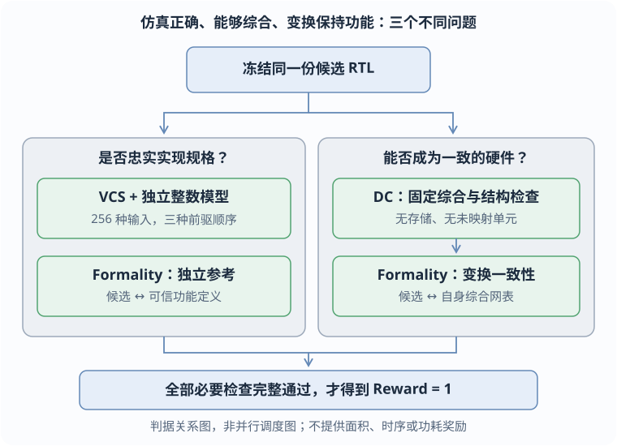

# 功能正确的循环，为什么还需要修复

软件式循环可能在仿真中终止并给出正确答案，却无法被综合器展开为有限的组合电路。本任务把这一区别变成明确的工程交付：**保持位运算功能，改写数据相关的循环，让固定综合流程生成完整的无存储网表。** 没有面积、时序或功耗优化奖励。

候选任务包含两个八位函数。位计数返回输入中 1 的个数；尾零计数返回从最低位开始连续 0 的个数，并规定零输入返回 8。例如 `40 = 0b00101000`，位计数为 2，尾零计数为 3。两者使用同一个 8 位输入、4 位输出接口，但硬件计算关系不同。

## 四条必要检查，解决三个不同问题



[查看原图](../diagrams/functional-structural-acceptance.svg)。图表示判据关系，不表示工具并行执行；窄屏可打开原图阅读。

VCS 先检查全部 256 种输入，分别按升序、降序和独立打乱顺序执行，共 768 次输出核对。独立 Python 模型依据位字符串计算结果，避免直接复用 RTL 算式。独立参考路径用 Formality 比较候选与可信参考，并检查没有黑盒、缺失比较点、未证明点或中止点。

DC 使用固定脚本和库完成展开、链接、设计检查及映射。网表必须没有存储元件或未映射单元。最后，第二条 Formality 路径比较**候选与它自己的综合网表**，检查综合变换是否保持行为。它不能替代前面的独立参考关系。实际完整执行顺序为 VCS → DC → 独立参考 Formality → 自身网表 Formality，前置检查失败就停止该候选的后续流程。两条证明使用单独的工作目录，避免无意消费综合生成的默认指导文件。

教学库只参与这一固定结构流程；库哈希与工具脚本随证据绑定。综合得到更少单元不自动增加奖励，也不表示获得真实工艺的 PPA 改善。

## 初始缺陷和验收状态

[位计数](../../tasks/bitfold_population_repair_v1/spec.md)的起点不断清除最低有效 1；[尾零计数](../../tasks/bitfold_trailing_zero_repair_v1/spec.md)的起点不断右移，直到最低位为 1。二者均为人工构造的可综合性修复起点，不是历史模型错误。

[31 项工业门禁](../../experiments/task-production-v3/bitfold-quality-v1.json)已全部符合预期：两种合法结构在三个阶段通过，初始循环通过整数功能检查却被 DC 明确拒绝，错误位与零／极值边界同时被仿真和单独的独立参考 Formality 拒绝。两条完整证明各报告 4 个通过比较点；空交付、位宽错误和语法错误也有对应分类。位计数已完成一条真实试次：首份有效编辑改为固定八次累加，公开、终局与保留检查通过。尾零任务尚未模型采样；单条成功不构成稳定难度结论，详见[分层校准](../task-production-stage-v3.md)。

```bash
# 从确定的有限契约生成候选
python3 -m task_families.bitfold_synth_v1.generate population .local/bitfold-candidate
# 完整候选检查；OUT 必须是新目录
python3 -m verifier.bitfold_synth.campaign bitfold_population_repair_v1 \
  tasks/bitfold_population_repair_v1/reference.sv .local/bitfold-reference-new
# 正反对照；不调用模型
python3 -m verifier.bitfold_synth.quality .local/bitfold-gate-new
```

执行需要合法的 VCS、Design Compiler、Formality 及可信环境中的 `CLASS_DB`。候选不能提交 Tcl、库或约束。具体接口、修改范围与奖励分类以 Spec 为准；[独立模型](../../verifier/bitfold_synth/oracle.py)、[评分流程](../../verifier/bitfold_synth/campaign.py)和[严格结果分类](../../verifier/bitfold_synth/results.py)供进一步核查。
