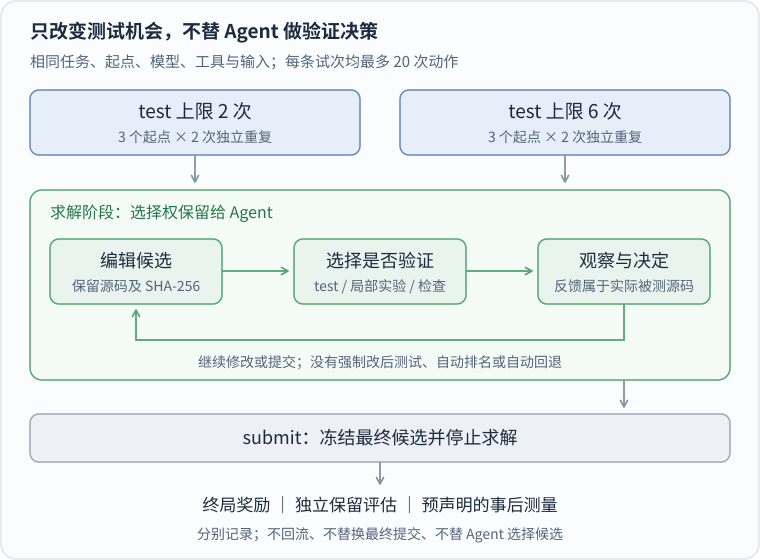

# Agent 会把额外验证机会用在哪里？

一次修复不仅需要生成正确代码，还需要判断哪些修改值得验证、当前结果属于哪一份源码，以及最后应提交哪个版本。上一轮真实轨迹中，模型曾放弃一个事后公开测试通过的中间版本，回到已知失败版本。这个观察提出了问题，但不能证明失败由测试额度不足造成，也没有证明那个中间版本通过私有验证。

本研究固定三深度队列任务、九种工程工具和三个错误起点，只改变公开 `test` 的上限：2 次或 6 次。两组都只有 20 次总动作；增加测试机会会占用动作并消耗 EDA 资源，因此这不是等成本比较。



[查看原图](diagrams/verification-budget.svg)。图示为研究设计，实际结果与完成数量见下文证据。

本轮使用[三深度队列契约](../experiments/queue-family-v1/three/spec.md)：写地址 AW、写数据 W 和读地址 AR 分别最多保留三笔尚未退休的请求，按顺序配对和执行。这里“退休”指 AXI 请求方实际接收响应；APB 外设完成操作还不能释放名额。因此，正确设计不仅要保存数据，还要处理接受、执行、响应消费在相邻或同一时钟沿发生的关系。三个错误起点分别切入这一关系中的调度、存储插入与指针回绕；进一步解释见[队列生命周期](queue-family-production.md)。

## 12 条试次回答了什么

**额外验证机会被使用了，但本批没有观察到它带来新的成功修复。** 6 次条件中 4/6 条试次用了第 3–5 次测试，共增加 10 次调用，全部返回 FAIL。两组的 5 条成功轨迹都在首份编辑候选上获得公开 PASS，然后直接提交。另有 3 条 6 次条件轨迹把 20 次动作全部用完，最后仍在编辑，没有 submit；其奖励是 null，不是功能失败 0。

12 条试次全部按[预先冻结的计划](../experiments/verification-budget-v1/study-plan.json)执行，无替换、追加或基础设施故障。每个表格单元按第一、第二次重复列出终局 Reward；null 表示未提交。

| 错误起点 | test 上限 2 | test 上限 6 |
| --- | --- | --- |
| 响应调度 | 0，0 | 0，null |
| 同沿插入 | 1，0 | 1，null |
| 指针回绕 | 1，1 | 1，null |

以全部启动试次为分母，成功比例分别为 **3/6（50%）与 2/6（33%）**；描述性 Wilson 95% 区间分别约为 19%–81% 与 10%–70%。有效提交分别为 6/6 与 3/6；若只在有效提交内计算，成功比例又是 3/6 与 2/3。两种分母回答不同问题，不能用后者隐藏未提交试次，也不能把 null 改成 RTL 失败。

保留评估另行记录：2 次条件执行 6 条，3 条通过、3 条失败；6 次条件执行 3 条，2 条通过、1 条失败，另外 3 条未运行。已提交的 9 条中，终局与保留结果一致；5 条通过的候选各自完成终局 23 case 与保留 23 case。4 条失败在首个 case 得到确定违例并提前结束，`verification_complete=false` 不表示基础设施中断；其 `verdict_determinate=true` 支持 Reward=0。本轮没有验证所有中间候选，不能据此宣称不存在更好的版本。

这些数据是每个起点、每个条件仅两次的探索性观察。它们不能证明大预算使模型变差，也不能证明预算完全没有作用；不同模型随机输出、任务理解和行动安排仍无法在这批小样本中分离。[逐条结果](../experiments/verification-budget-v1/study-results.json)、[跨试次审计](../experiments/verification-budget-v1/study-audit.json)和[成本与行为汇总](../experiments/verification-budget-v1/cost-and-behavior.json)提供核查入口。

## 怎样让预算差异可解释

每个错误起点各运行两次独立重复，每次包含两个预算条件，预定共 12 条试次。条件按预定顺序交错执行，每条使用全新模型会话和工作区。相同输入不意味着随机生成过程配对：服务没有提供固定随机种子或精确权重版本。

三个起点分别是历史模型产生的 RESP 调度回归，以及来自已验收合法参考的同周期移位／插入、FIFO 回绕错误。后两者是受控错误注入，不是模型历史失败。它们用来区分模型在时序与存储更新上的修复行为；不能把跨起点的差异直接解释为预算效果。

这里的错误分别落在不同的工程关系上。移位队列在同一时钟沿退休旧请求、接受新地址时，新地址应该写入移位后的尾部 `ac-bpop`；错误起点写入旧位置 `ac`，计数公式即使正确也会丢失事务身份。深度为 3 的环形队列则必须从索引 2 回到 0；`(awp+1)&3` 会访问索引 3，不能用二次幂掩码代替三深度回绕。历史 RESP 起点在消费响应后仍根据旧的 `resp_valid` 退出状态，延后下一笔请求的 Setup。这些解释对应起始源码和真实失败，并不保证历史模型源码只有一个缺陷。

| 冻结起点 | 来源 | 首个公开失败类别 |
| --- | --- | --- |
| 响应调度 | 历史 Agent candidate-05 | 协议／时序错误 |
| 同沿插入 | 合法移位结构上的受控错误 | 事务功能错误 |
| 指针回绕 | 合法环形结构上的受控错误 | 事务功能错误 |

三个起点的首个失败 case 均为 `address_data`。证据中的标识依次是 `resp_schedule`、`same_edge_insert` 和 `fifo_wrap`，对应 Q_GRANT（退休后调度）、G_RETIREMENT_BOUNDARY（同时退休与插入）及 G_MULTIPLE_LAPS（存储多轮使用）验证义务。

[起点复验](../experiments/verification-budget-v1/qualification/summary.json)记录完整源码和输入哈希；[源码](../experiments/verification-budget-v1/starts/)与[新源码包的工业准入](../experiments/verification-budget-v1/quality/result.json)可分别核查。准入包含两种合法实现、14 个错误对照、40 项机制检查和隔离检查。参考实现通过公开 21 case 及完整 23 case；48 个需求覆盖项全部命中，但这不是所有时序组合的完备证明。

模型为 deepseek-flash，reasoning 关闭，DSH 0.2.2rc2，text-json-atomic-v2，每轮输出上限 7,000 Token；采样温度沿用 SDK／服务默认，不能固定随机种子。工具链为 VCS O-2018.09-SP2、AMBA VIP R-2020.12、UVM 1.2。完整版本与冻结哈希见研究计划。

工具与反馈格式保持一致。已有修复规则要求先测试起点，这次测试计入各自额度；本研究没有增加改后强制测试、候选排名或自动回退。两组非预算提示逐字一致。提交结束求解，之后才运行独立终局验证和保留评估。

## 预算条件怎样经过验收

新增预算配置使用 Policy 版本 2，历史默认配置不变。控制器在执行前检查工具权限、各工具额度和共同动作上限，公开测试失败也消耗一次额度。两组共享同一套已冻结源码，提示文本除 `2`／`6` 的 test 额度外逐字相同。

[真实机制验收](../experiments/verification-budget-v1/mechanisms/summary.json)在第一次模型调用之前完成：运行时 29 项、综合 20 项、综合环境 17 项、通用机制 40 项，以及本轮预算专项 21 项。专项实际调用了 8 次公开验证和 2 次终局验证，确认两组分别能执行 2／6 次失败测试，第 3／7 次请求不会启动后台仿真；总动作 20 次后也不能继续测试。编辑后查询旧结果仍保留旧源码身份，submit 后结束求解，再执行独立终局评分。

[全批审计](../experiments/verification-budget-v1/study-audit.json)确认 12 条的提示、Policy、起点、输入、执行依赖、工具链与计划一致，模型 Session 独立，执行顺序一致。离线审计另用复制证据注入提示、预算和来源篡改，均被拒绝；没有改动真实记录。

每条试次仍使用新的模型会话、工作区和独立评分。只有公共前置验收可以复用，而且必须严格匹配源码文件、安装的 Runtime、工具链、任务准入、综合绑定和能力配置；任何一项不一致或证据哈希改变都会拒绝复用。复用不包括候选、模型上下文、终局结果或跨机器编译产物。

## 哪些行为能被证据确认

源码哈希用于识别版本，不能证明正确性。分析把每次编辑、实际公开测试及送达反馈串起来，检查最终提交对应 PASS、FAIL 还是从未测试，以及模型是否回到了同一份已失败源码。编辑后没有再次测试，与这份源码从未被测试也要区分：回到完全相同的旧版本时，其原有结果仍可核查。局部实验的失败另外记录，不能因为最终版本没有跑完整公开回归，就忽略模型已获得的局部错误证据。

同一冻结公开输入上，先前版本 PASS、修改后版本 FAIL，才构成这一验证范围内的回归证据。未测试的编辑仍属未知；局部实验 PASS 也不能代替完整公开测试，更不能代替私有终局奖励。原子动作回复不说明模型内部动机，本研究只能描述它提交时有哪些可见证据和实际行动。

首份被环境接受的编辑候选（不保证编译通过）沿用既有控制器的事后测量规则：没有匹配的实际公开测试时，在求解停止后补测一次。其结果单独保存，不回流为模型观察，不替换终局奖励。本轮不额外筛选其他中间候选做私有或保留评分。

## 哪些候选真正得到验证

| 可观察行为 | test 上限 2 | test 上限 6 |
| --- | --- | --- |
| 实际公开测试 | 12 次 | 22 次 |
| 编辑动作 | 9 次 | 18 次 |
| 编辑后有同源码公开测试 | 6/9 | 13/18 |
| 最终源码的公开状态 | 3 PASS、3 未测 | 2 PASS、1 FAIL、3 未提交 |
| 收到 PASS 后继续编辑 | 0 | 0 |
| 提交同一份已公开 FAIL 的源码 | 0 | 1 |

“编辑后验证”按编辑动作计数，6 次条件有一次重复写入完全相同的源码，不算新版本。按每条试次内去重，2 次条件有 3/9 份编辑源码从未完整公开测试，6 次条件有 4/17 份。inspect／observe 查询旧结果不能算重新测试；局部 experiment 则保留自己的验证范围。

三个 2 次条件的失败提交都没有完整公开验证最终源码，但观察并不相同：首条响应调度最后编辑后没有再调用验证工具；第二条响应调度的最终源码收到局部 experiment FAIL；第二条同沿插入最终源码只收到 compile PASS。最后一条把尾部插入写成“有 pop 写索引 1，否则写索引 0”，忽略队列当前长度，会覆盖已有请求；终局与保留均发现 FIFO 头不匹配。[源码与实际送达记录](../experiments/verification-budget-v1/trials/r2-same_edge_insert-test2/candidate-decisions.json)能核查编译通过与功能错误同时成立，不能把编译 PASS 当作选择该版本的功能依据。

6 次条件的 4 条长轨迹都使用了额外 test，却没有耗尽测试额度：分别用了 4、5、5、4 次。第一条在第 18 次动作提交已知失败源码；其余三条在第 20 次动作仍编辑，剩余 1、1、2 次 test 额度。三次额外测试重复运行了此前相同源码、相同公开输入，仍为 FAIL。可以确认机会被消耗和最后可用证据，不能据原子动作回复推断模型内部为何作出选择。

本轮没有观察到公开 PASS 后编辑、放弃已公开 PASS 候选或完整公开 PASS→FAIL 回归。首份编辑的测量结果为 5 PASS、7 FAIL：11 条复用同源码的实际公开结果，只有第二轮 FIFO／6 次条件额外执行了预定的事后首候选测量，得到编译错误。它不曾作为完整公开结果送达模型。其余未测中间版本没有追加评分，不能标记为已修好或退化。

## 从源码和反馈理解不同结果

同周期插入起点的首条 6 次条件轨迹，把 `aq[ac]` 改为 `aq[ac-bpop]`，并给接受逻辑增加容量保护。这个改动直接处理退休与插入在同一沿发生时的存储位置。模型对修改后源码运行完整公开测试，收到 PASS 后提交，终局与保留验证分别得到 1。它只用了两次公开测试，因此这次成功没有用到新增的第 3–6 次机会。[最终源码](../experiments/verification-budget-v1/trials/r1-same_edge_insert-test6/exchange/artifacts/a5c942624cae3841605b3f4d76bf2dbbe194e4091afe9798c41a720b6d5f5b98.sv)和[实际验证决策](../experiments/verification-budget-v1/trials/r1-same_edge_insert-test6/candidate-decisions.json)可核对这一链条；这是一次有限验证内的成功修复，不是对所有时序的形式证明。

相比之下，RESP 起点的首条 6 次条件轨迹确实使用了第 3、4 次测试，但两次之间没有编辑；两次都返回 FAIL。它改写状态分支的组织方式，却保留 `S_RESP` 中的 `if (!resp_valid) state <= S_IDLE`，未消除原有退休后调度延迟。最后在仍剩两次 test、总动作未耗尽时提交这份已失败源码，终局与保留均为 0。[最终源码](../experiments/verification-budget-v1/trials/r1-resp_schedule-test6/exchange/artifacts/657c546e1b39284ea365e428c9fca6a727d4a60e010392cb97e762c3531b3786.sv)、[反馈与候选链](../experiments/verification-budget-v1/trials/r1-resp_schedule-test6/candidate-decisions.json)和[终局违例](../experiments/verification-budget-v1/trials/r1-resp_schedule-test6/final-verification.json)相互对应。这里可以确认额外测试被使用、目标问题仍存在，不能由此确定模型内部为何停止修复。

另一个不同的结果是第二轮 FIFO／6 次条件：原始错误 RTL 的独立编译 PASS，第一次编辑后却出现语法错误；模型继续编辑，后续公开测试触发 Q_ACCEPT 接受时限违例。它总共调用了 5 次公开测试，最后第 20 次动作仍是编辑，没有 submit。这条轨迹的终局记录是 `agent_incomplete`、Reward=null，保留评估未运行；不能把它改记为功能失败 0，也不能替它提交最后一版。[实际工具事件](../experiments/verification-budget-v1/trials/r2-fifo_wrap-test6/tool-summary.json)显示编译层面的新增问题，以及全部动作耗尽的过程。最后一份编辑源码没有经过测试，本轮不追加测量它。事后首候选编译失败记录单独留在离线分析中，不替代终局结果。

第二轮同周期插入／6 次条件提供了另一类源码证据：第一次编辑把插入位置改为 `ac-bpop`，同时却把移位条件从 `if(bpop)` 改为 `if(ac>bpop)`。队列非空、没有响应退休时，后者仍为真，会提前移走队头；它还一度用 AW 接受代替独立 W 接受来保存写数据。最后一份实际测试的版本恢复了独立写数据接受，但仍保留错误的移位条件，公开测试持续报告 Q_HEAD。这里可以指出具体新增的语义错误，不能声称观察到了一个完整公开 PASS 版本退化成 FAIL；这条轨迹从未收到公开 PASS。它使用了 4 次 test，两个格式错误和两个不满足条件的工具请求也占用了动作，最终第 20 次仍在编辑，没有提交。[首次修改](../experiments/verification-budget-v1/trials/r2-same_edge_insert-test6/exchange/artifacts/430d9fbcc9b998ff0e5e06c56cd23f008620f89eaded026d177ac3ee49ab04a0.sv)、[最后已测试版本](../experiments/verification-budget-v1/trials/r2-same_edge_insert-test6/exchange/artifacts/809b9c92fd0024bb77b47b2303343cc149c2d997a5a27e96bc4fb47593598510.sv)与[实际事件](../experiments/verification-budget-v1/trials/r2-same_edge_insert-test6/tool-summary.json)支持这些观察。未测试的最后编辑仍保持未知。

## 成本与失败分类如何影响解释

| 六条试次合计 | test 上限 2 | test 上限 6 |
| --- | --- | --- |
| DSH 报告 Token | 451,596 | 978,558 |
| 总动作 | 65 | 91 |
| 模型请求时间 | 106 秒 | 218 秒 |
| VCS 编译 | 24 次／2,055 秒 | 32 次／2,672 秒 |
| 仿真 | 226 次／1,102 秒 | 169 次／808 秒 |
| 整体用时之和 | 3,287 秒 | 3,728 秒 |

合计 1,430,154 reported tokens，约 117 分钟试次用时；Token 总数包含缓存读取，货币费用不可取得。模型请求计时包含 SDK／网络开销，并非纯模型计算时间。试次耗时含公开工具、终局、保留及预定首候选测量，不含公共机制前置检查约 1,236 秒和工业准入。编译／仿真是进程墙钟时间，不是 CPU 时间。

6 次条件在这批数据中使用约 2.17 倍 Token、1.30 倍编译时间和 1.13 倍整体时间。它的仿真次数反而较少，是因为三条没有提交、未执行终局／保留，且失败用例提前结束；不能把这一数字解释为验证更高效。synth_check 虽然可用，本轮实际调用为零。全部调用及逐条成本保留在结果文件中。

12 条都有被接受的 RTL 编辑；9 条有效提交，无无效提交或基础设施失败。四条确定功能失败分别为三条调度时序违例、一条事务身份违例；三条未提交单列。动作格式错误共 3/156 次动作（约 1.9%），出现在 2/12 条轨迹：一条恢复后成功，一条未提交。还有三次工具前置条件／额度拒绝。因此不能把所有失败归因于 JSON 格式；另两条动作耗尽轨迹没有格式错误。

## 下一轮最值得验证什么

本轮更直接暴露的是**修复过程中的动作分配与停止决策**：所有新增测试都失败，三条在仍有 test 余额时用完总动作，而不是先找到公开 PASS 再选错版本。工程理解问题也有源码证据，例如保留 RESP 调度延迟、非退休时移位以及固定索引覆盖；但没有足够证据确定两者各自的因果份额。

下一项优先研究可收敛为一个更小对照：保持 test=6、总动作=20、模型与工具不变，只增加明确的“剩余总动作数”反馈，观察是否减少未提交，并继续分别评估功能正确性。它不强制提交、改后测试、排名或回退；应另立版本、重新冻结，不能混入本轮。先用响应调度起点做 2 条现有反馈＋2 条计数反馈的平衡预试验，有助于判断改进是否仅产生更多已知失败提交。按本轮该起点 6 次条件的均值粗估，4 条约 92 万 reported tokens、44 分钟试次用时，另计必要验收；这是波动较大的容量估计，不是费用报价。本轮没有启动这些追加调用。

若明确总动作反馈仍不能改善交付或修复，再单独考察推理条件；不应同时叠加更多工具与样本。组合任务“目标身份 × 生命周期阶段”的缺口作为独立质量工作保留，不能因本轮预算研究而被视为已解决。

## 这批数据可以支持什么用途

原始模型回复、实际送达反馈和所有候选保存在可信研究存储。公开 v5 记录保留经过审计的工具事件与内容哈希引用：`training/` 是实际求解轨迹及最终奖励，`evaluation/` 是独立保留评估，`analysis/` 是事后首候选测量与离线成本。这三条数据路径不能互相替代。尤其是没有 submit 的轨迹可以用于研究动作分配，却没有一个可直接当作功能训练标签的 0／1 终局奖励。

成功轨迹提供了“相关修改—公开验证—提交—独立评分”的可检查链条；失败轨迹则提供错误条件、重复验证、未验证提交及动作耗尽等行为证据。它们是否适合某种训练方法，仍取决于算法的数据要求与后续验证。有效 JSON、完整导出和最终 PASS 都不足以证明训练收益。

## 复现与数据边界

[预算环境生产入口](../task_families/verification_budget_v1/README.md)生成独立源码包。完整研究使用冻结计划，调用 [verification_budget_study.py](../scripts/verification_budget_study.py)；批次恢复只核对已完成证据，不重新调用模型或重新评分。可信前置检查只允许在源码、工具链和准入身份完全匹配时复用。

[候选决策分析](../scripts/candidate_decisions.py)与[分层汇总](../scripts/summarize_verification_budget.py)属于离线研究，不向求解模型新增工具反馈。无需商业工具或私有日志，可以从公开逐条结果重新计算描述性成本与交换库存：

```bash
python3 -m scripts.summarize_budget_evidence \
  --evidence experiments/verification-budget-v1 \
  --base-inventory experiments/composed-stage-v1/exchange-inventory.json \
  --out .local/budget-public-recheck
```

输出目录必须是新的；重算应与公开的 `cost-and-behavior.json`、`exchange-inventory.json` 一致。这是采样后新增的离线派生入口，不改变预先声明的指标、源码选择或原冻结分析器。经审计的轨迹继续采用统一 v5 交换，终局奖励、保留评估和事后测量分别保存。没有取得 Token IDs、行为概率或精确模型权重版本，也没有进行参数训练。

组合任务的“目标身份 × 生命周期阶段”覆盖仍有待扩展。本轮保留其质量工作记录，但不同时升级该验证器或增加协议能力，以免混淆预算研究。
