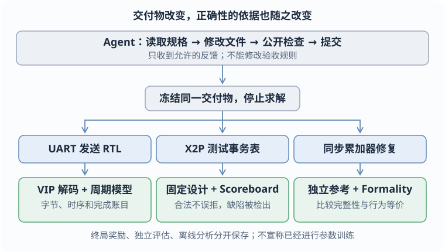

# 从验证资源到不同类型的芯片工程任务

一个工具能够启动，不等于它能够给 Agent 的交付物打分。本阶段保留 X2P 的成熟基线，进一步研究三种不同的工程交付：写一个串行发送器、写一份有效测试，以及修复一个同步数据通路。共同问题是：**如何把交付物与可独立核查的工程性质连接起来，而不是把“工具没报错”直接当作成功？**

本阶段已经形成三类共六份有限契约，当前 51 项任务准入检查符合预期。真实采样暴露了动作接口误用、可核查的 RTL 修复与验证器自身缺陷。它们分别记录，不用少量通过推断稳定成功率。已冻结的输入、历史失败和既有 X2P 结果保持不变。



[查看原图](diagrams/verification-bases.svg)。图表示三类任务的责任边界；各类实际验收状态见下文，不能用架构图代替验收。

## 先纠正“例程已通过”的证据口径

本轮读取了最近一批 31 个 VIP 例程的原始构建与仿真日志。批处理摘要把没有找到 UVM 计数的运行默认写成“1 个错误”，因此原先的“11 个零错误、10 个带一个错误、10 个编译失败”不能直接作为能力清单。

[重新审计的结果](../experiments/verification-resources-v1/batch-audit.json)如下：

| 实际日志证据 | 数量 | 能支持的判断 |
| --- | ---: | --- |
| UVM 零 error/fatal，具有结束记录 | 11 | 对应例程完成；仍需检查有效活动 |
| OVM 零 error/fatal，具有结束记录 | 1 | 对应 OVM 例程完成；不能当作 UVM 缺少计数的失败 |
| 构建脚本不支持所选模拟器 | 5 | 没有执行仿真 |
| 编译缺少源文件 | 4 | 没有执行仿真 |
| 构建驱动提前失败 | 10 | 尚不能归因为 RTL 或 VCS 语言兼容性 |

其中部分零错误例程只运行极短时间；没有真实事务账目，不能直接用来评分。原批次没有分别保存每个编译和仿真进程的退出状态，审计明确保留这一缺口。[日志审计器](../verification_resources/batch_audit.py)不以缺省计数推断通过。

随后针对 UART 选择了实际存在的 UVM directed 例程，使用同一 VCS O-2018.09-SP2 与 VIP R-2020.12 完成新的编译和仿真。再推进到自建发送器、工业接收 Monitor 与独立周期模型。这样，“厂商例程可运行”和“任务交付物可判断”形成了不同的证据层次。

## 工具就绪度只按实际流程判断

[能力映射](../experiments/verification-resources-v1/capability-map.json)分开记录启动、厂商例程、自建对象、正反对照和真实任务五层证据。VCS/AMBA、UART 与独立参考 Formality 在本轮都有任务级原始证据和审计轨迹。DC、PT/PX 的历史摘要仍保留，但本次未找到其摘要所指向的部分原始文件，不能把它们表述为本轮独立复核通过。ICC2、TetraMAX 仍不是本轮评分后端；例程零错误的其他 VIP 也没有因此自动成为新任务。

工具版本为 VCS O-2018.09-SP2、VIP R-2020.12、UVM 1.2、Formality O-2018.06-SP1，DSH SDK/runtime 0.2.2rc2。研究成本与可判断性质都对应这些具体流程，不能外推其他版本或完整协议实现。

## 为什么选择这三类任务

| 任务 | Agent 交付 | 工具已有能力 | 项目必须补充 |
| --- | --- | --- | --- |
| UART TX 8N1 / 8E1 | 单模块 RTL | UART VIP 解码、协议监测 | 接受字节与解码字节对应；每位 16 周期；ready 和帧完成账目 |
| X2P mapping / timing 测试 | 有界 JSON 事务表 | AMBA VIP 驱动、监测；已有独立 UVM Scoreboard | 合法设计先通过；错误设计的明确功能拒绝；超时不能当检出 |
| 回绕 / 饱和累加器修复 | 单模块 RTL | Formality 比较独立 RTL 参考 | 参考语义审查、有限状态转移仿真锚点、完整比较与无黑盒检查 |

这六个契约不是六种互不相关的协议能力。UART 的第二实例增加偶校验；测试生成的第二实例从数据映射转向等待、通道错开和响应稳定性；累加器的第二实例把回绕变为饱和算术。每种变化都带来新的判据，而非仅更换随机种子。

### 一个等价检查实例：为什么必须审查参考

在回绕任务中，`q=250,value=10` 的累加结果应为 4；饱和任务则应为 255。若 load 同时有效，两者都必须装载 10。Formality 能判断候选与参考是否等价，却不能替我们判断参考是否忠实表达了这些要求。

因此两个参考先接受独立整数模型的 VCS 核对：各遍历 **65,536 组当前状态与操作数**，检查装载优先级、累加和保持，并检查同步复位；每个参考实际执行 196,610 次检查。另一种控制或算术写法的合法实现也通过 Formality。错误复位、错误时钟边沿、异步复位、使能、保持、装载优先级与进位判断均有实际拒绝证据。

[15 项准入检查](../experiments/verification-resources-v1/independent-reference-quality.json)还包括空提交与语法错误。空交付为无效提交、Reward=null；可确定的编译错误为 0；完整等价为 1；黑盒、缺少比较点、未证明、超时或环境问题不会被当作完整通过。这是有限同步模块的参考等价任务，**不是候选与自己的综合网表相同，也不是 PPA 优化证明**。

## UART：两次真实漏检怎样改变验收

UART VIP 能接收正确的帧，但它不能凭空制造接口端没有发生的请求。最初的自建测试遍历了全部 256 个字节，却没有在 busy 期间再次拉高 valid。一份把 `else if (ready)` 改为 `else if (ready || valid)` 的错误实现因此通过：只有忙碌期间真的出现新请求，错误的重新装载才会发生。

修订 2 增加忙碌期请求和紧邻帧。**同一份错误源码从 PASS 变成明确的串行位／时长错误**，不是通过候选指纹拒绝。8N1 实际出现 5,888 次 busy 请求，8E1 为 6,400 次；两者均有 256 次接受、255 次紧邻帧接受。[同源码复验](../experiments/verification-resources-v1/uart-blindspot.json)保留了旧奖励与新结果。

随后接口审查又发现：测试台按端口位置连接 DUT，全部改名仍然 PASS，但规格明确要求固定端口名称和顺序。修订 3 增加提交接口检查、按名连接和实际位宽检查；[同源码复验](../experiments/verification-resources-v1/uart-interface-blindspot.json)中这一提交被判为无效，Reward=null。功能错误与接口交付不合法不是同一种失败。修订 3 的[24 项验收](../experiments/verification-resources-v1/uart-quality-v3.json)包含全部既有正反对照、直接候选编译、终局／保留阶段、非法控制包、改名端口及错误位宽。

当前准入采用修订 4；修订 1–3 的源码、试次和奖励均保留。修订 3 的一条真实试次触发了编译错误分类缺陷：VCS 明确拒绝了候选的非法切片，但分类器把工具版权说明中的 license 一词误当成许可故障，提前停止求解。该试次未提交，历史 Reward=null 保持不变。修订 4 限定故障匹配条件，并将实际失败源码与语法错误加入[26 项准入](../experiments/verification-resources-v1/uart-quality-v4.json)；[分类缺陷记录](../experiments/verification-resources-v1/uart-classification-finding.json)及[同任务、同源码复验](../experiments/verification-resources-v1/uart-classification-recheck-same-task.json)区分可信验证器错误与候选错误，不能把这条中断算成外部环境不稳定。这些发现说明：**测试数据多样性、实际事件覆盖和交付接口约束是不同的验证义务。** 位宽检查也不能证明任意实现正确；当前仍是有限仿真，不包括事务中复位、任意波特率或对所有异步毛刺的完备检查。

## 测试生成：怎样避免“无条件报错”获得奖励

这类任务交付的是最多 32 条结构化事务，而不是可执行检查代码。模型可设置读写、地址、数据、字节使能、AW/W 延迟、APB 等待、响应背压和错误响应；不能替换检查器或填写期望 PASS/FAIL。字段单位及参照事件写在 [mapping 规格](../tasks/x2p_stimulus_mapping_v1/spec.md)与 [timing 规格](../tasks/x2p_stimulus_timing_v1/spec.md)中。

可信运行器先把事务交给合法桥。合法桥必须完成读写及必要活动，才能继续检查错误设计。之后，已有 UVM Scoreboard 根据实际握手核对事务：错误地址、字节使能、读数据、等待处理或响应稳定性必须被明确的功能／时序判据拒绝。超时、编译失败、工具失败都不能充当“检出缺陷”。公开调试、终局和保留阶段使用不同的错误设计，求解进程不能读取它们。

[10 项实际验收](../experiments/verification-resources-v1/stimulus-quality.json)覆盖两种契约的三个阶段、弱激励和空提交。实际两条模型轨迹都生成了有效事务并检出相应终局错误；保留评估也通过，单独存储。它说明这个有限任务形式可执行，不能说明测试已能发现所有未知缺陷。当前保留变体的语义范围仍很窄，也没有允许模型编写任意 SystemVerilog Testbench。

## 首批模型试验：先把交互失败与 RTL 失败分开

首批每种算术契约各运行一条真实 DSH / deepseek-flash 试次，最多 20 次动作、4 次公开检查。提示、源文件、参考、检查脚本和执行顺序在首次模型调用前冻结；模型采样种子与精确权重版本不可取得。

| 条件 | 回绕任务 | 饱和任务 | 可观察事实 |
| --- | --- | --- | --- |
| 初始拒绝反馈 v1 | Reward=1；独立仿真通过 | 未提交，Reward=null | 饱和试次没有执行有效编辑，三次检查均仍针对初始错误源码 |
| 明确拒绝反馈 v2 | Reward=1；独立仿真通过 | Reward=1；独立仿真通过 | 两条均在一次格式拒绝后完成编辑、检查和提交 |

v1 饱和试次多次在一条回复中同时给出 edit、test、submit，控制器按规则拒绝整条回复。模型后来认为编辑工具不可用。这里有明确的交互证据，不能把最终未提交解释为不会写饱和逻辑。

v2 只增加固定的拒绝解释：“整条回复没有执行；请只发送一个 JSON 动作，收到结果再继续”。它没有拆开执行多动作，也没有补写模型代码；任务与评分保持相同。新批次每个契约一条，提前声明，不替换 v1 失败。v2 的成功支持这一反馈方式可用，**不证明稳定的修复收益或因果效应**：样本少，provider 采样未配对，回绕与饱和本身也不是同一个契约。

计划：[v1](../experiments/verification-resources-v1/formal-study-plan.json)、[v2](../experiments/verification-resources-v1/formal-study-plan-v2.json)。轨迹分别通过原始回复重放审计：[v1 交换清单](../experiments/verification-resources-v1/formal-exchange-v1/manifest.json)、[v2 交换清单](../experiments/verification-resources-v1/formal-exchange-v2/manifest.json)。原始模型响应保存在可信研究存储；公开交换包含实际动作、反馈曝光、内容哈希、提交和分别保存的终局与独立评估。

## 怎样读模型结果与成本

[逐试次分析](../experiments/verification-resources-v1/study-results-current.json)分别列出全部已启动试次的交付、奖励、独立评估、实际编辑／检查次数、格式拒绝、Token 和时间；[证据索引](../experiments/verification-resources-v1/README.md)连接各批预声明计划与交换记录。各批次最多 20 次动作、4 次公开检查；没有扩大工具集合来解释反馈修订的结果，也没有补抽成功样本。

前四批成功均发生在首份被接受的编辑上。修订 3 的 8N1 试次则先输出 MSB-first（最高位先发）的帧：首份编辑选择 `frame[9]` 并左移，与规格要求的最低位先发相反。实际公开检查 FAIL 后，模型改为 `frame[0]`、右移并调整帧计数，再请求检查，取得公开、终局和独立评估 PASS。[源码与反馈对照](../experiments/verification-resources-v1/behavior-cases.json)提供了一条有实际反馈曝光、相关源码变化和重新验证的修复轨迹；不能仅凭先后顺序推断模型内部推理或稳定工具收益。首个有效编辑成功与这种修复成功分别统计。未提交的饱和任务与提交原始错误 UART 的试次都没有完成有效编辑，主要可观察问题是动作协议，而不是已经测得的 RTL 能力上限。

修订 3 的 8E1 轨迹还提供了一个失败机制实例：源码用 `shift[10]` 判断发送是否完成，但它正是装载时已经为 1 的停止位。因此第一位结束就会提前退出 busy。第一次反馈后，模型改变了计数方向，却保留这个判断，第二次公开测试仍失败；之后又把 data 改成标量，触发了前述分类器缺陷。提前退出的解释来自源码与实际失败记录的联合分析，不是模型收到的详细诊断，也不代表能够读取模型内部思维。

模型请求时间含网络与 Harness 开销；整条耗时还含公开、终局和独立评估。VCS 编译／仿真 CPU 时间仅在日志可解析时报告；缓存复用与缺失值分别记录，不补造时间或货币成本。相邻批次改变了反馈或验证器版本，又没有可固定的模型随机种子，因此不合并成一个成功率，更不能用几条成功推断任务已饱和。

### 实际完成的样本与开销

六批计划全部执行，共 **14 条真实模型试次**；其中 UART 与测试生成同批各两条，下面按条件分开列出。全部记录通过相应重放审计，包括一条未提交和一条可信分类器缺陷导致的中断。没有剔除失败、续跑中断记录或替换样本。

| 条件 | 样本 | 当时终局 Reward | 独立评估 | 主要观察 |
| --- | ---: | --- | --- | --- |
| 独立参考，反馈 v1 | 2 | 1 / null | 1 / 未运行 | 饱和试次没有有效编辑或提交 |
| 独立参考，反馈 v2 | 2 | 1 / 1 | 1 / 1 | 两条首个有效编辑通过 |
| 测试生成 v1 | 2 | 1 / 1 | 1 / 1 | 两条实际构造有效测试；并非未知缺陷完备性证明 |
| UART 验证器 1 | 2 | 0 / 1 | 0 / 1 | 一条提交初始源码；验证器已被取代 |
| UART 验证器 2 | 2 | 1 / 1 | 1 / 1 | 首份编辑通过；接口检查缺口后来被发现 |
| UART 验证器 3 | 2 | 1 / null | 1 / 未运行 | 一条修复位序；另一条因可信分类器缺陷停止 |
| UART 验证器 4 | 2 | 1 / 1 | 1 / 1 | 8N1 修复帧存储位宽，8E1 首份编辑通过 |

修订 4 的 8N1 首候选把 10 位帧装入 8 位移位寄存器，丢失高位数据／停止位。FAIL 后模型重新阅读文件，把存储和移位改为 10 位，重新测试与提交通过。它与修订 3 的位序修复是两条不同的工程实例；两者均只收到允许的失败类别，没有收到参考修复、私有案例或研究者的源码解释。

在各自当时的检查条件下，9 条试次首个有效编辑公开 PASS，2 条在实际 FAIL 后修改并通过，另有 2 条没有执行有效编辑、1 条多次修改后中断。这是可观察轨迹分类，**不是跨验证器的统一正确率**。总计 119 次动作中 35 次被动作协议拒绝，主要集中在两条没有有效编辑的试次。

实际消耗 **234,026 Token、1,105.13 秒整条试次时间**，其中模型请求约 201.75 秒。记录中有 31 次 VCS 编译、44 次仿真；可解析的编译／仿真 CPU 时间分别约 437.04 / 25.73 秒，不能与远程调用的墙钟时间直接相加。测试生成复用了严格来源匹配的可信控制包，故试次没有新增编译；其首次构建成本属于准入阶段。货币费用、Token IDs、行为概率和精确权重不可取得。

当前三类门禁所记录的检查墙钟合计约为 Formality 43.47 秒、测试生成 227.72 秒、UART 修订 4 为 254.74 秒。这些是本轮具体输入和缓存条件下的验收成本，包含控制运行，不含开发、旧版漏检调查和所有历史重验；不能宣传为生产任意新任务的固定成本。

### 下一项最值得做的研究

优先把本轮真实发现的 **UART 忙碌期重装载错误**转为一项固定检查器下的激励构造／修复研究：要求模型主动产生忙碌期新请求，观察接受字节与输出帧的差异，再验证修改。它同时利用了非 AMBA 样板与测试生成形式，缺陷机制已有同源码证据，成本可由现有编译与仿真记录估算。

这比立即增加协议数量更能回答当前缺失的问题：模型能否把失败现象转成有效工程实验并完成修复？下一批仍应预先固定条件与数量；本报告不把这个建议描述为已完成实验或训练收益。

公开仓库中的参考和错误对照便于研究核查，但不构成对未来模型训练语料的保密保证。当前信息隔离保证求解进程在该试次无法读取可信文件；不保证公开题库没有预训练污染。六份契约的参数域仍很有限，保留评估也不是长期保密 benchmark。

## 从样板到有限生产：哪些部分能复用

[有限生产器](../verification_resources/production.py)支持三个族、每族两个已经审查的选择。它输出规格、初始交付物、任务元数据和依赖清单；引用共享运行器与可信验证器，不复制商业源码或编译产物。参数选择是工程契约选择，不是随机测试种子。

```bash
python3 -m verification_resources.production produce uart-transmit 8e1 .local/package
python3 -m verification_resources.production check .local/package
python3 -m verification_resources.production reset .local/package .local/work
```

生产前检查质量证据的源码哈希；初始化前再次核对任务文件及依赖。改写规格并自行更新文件哈希、遗漏验证依赖、复用已失效的 UART 准入都会被拒绝。[当前材料包核对](../experiments/verification-resources-v1/materialization-v4.json)记录六份包均完成生成、检查及初始化。它们是六份有限契约的可复用生产，不是六种全新协议，也不意味着可以任意组合参数。

公共层复用任务身份、文件权限、动作预算、候选哈希、提交冻结和轨迹审计。任务专用层保留串行周期模型、错误设计检出逻辑、算术参考与完整证明判据。这些语义不能仅靠统一 JSON Schema 代替。源码依赖仍较保守；源文件变化后必须重新判断证据是否适用，不能机械更新历史哈希。

## 使用边界与复现入口

旧 X2P 入口与已冻结实现不变。新增有限交付任务通过以下入口使用：

```bash
python3 -m environment.artifact_task list
python3 -m environment.artifact_task reset uart_tx_8n1_v1 .local/my-uart
# 编辑 .local/my-uart/uart_tx.sv
python3 -m environment.artifact_task test uart_tx_8n1_v1 .local/my-uart .local/my-uart-test
python3 -m environment.artifact_task submit uart_tx_8n1_v1 .local/my-uart .local/my-uart-submit
```

这些是人工复现入口。真实模型由隔离 worker 运行，受控控制器只提供 read/edit/test/submit；原 X2P 九动作配置保持独立，本阶段没有声称六个新任务都支持所有工程工具。提交冻结后停止求解，再执行终局与独立评估。源码和公开结果绑定 SHA-256；旧候选的结果不能充当新候选的验证证据。

运行需要合法的商业工具与 VIP 安装，以及本地忽略的后端配置。UART 使用 `uart_vip_setup_root` 指向依法生成的 UART VIP 编译接口目录，`uart_uvm_root` 指向已验证的 UVM 根目录；配置与商业源码不进入 Git。模型密钥仅通过受控 stdin 传入隔离 worker。完整复现包括实际工具运行，读取已有结果不等于重新验收。

有限测试、参考等价和轨迹审计分别回答不同问题。当前不接入训练器，不提供 token IDs、行为概率或精确模型权重，不依据独立评估选择更好的中间候选。教学库时序/功耗、ICC2 和 ATPG 不用于本阶段终局奖励；其他工具只按各自已有证据深度描述，不因安装或启动而升级为可靠评分后端。
