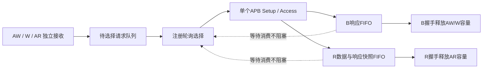

# Task004：执行与响应解耦

这个任务测量请求接收、APB 执行和 AXI 响应消费三个生命周期的管理。与003相比，APB不能等待旧B/R响应被消费后才执行下一笔；读写分别保序排队，读数据必须保留APB完成时的快照。容量为每个AW/W/AR通道三笔未退休请求，用于检验非二次幂回绕；新能力不只是“深度从2变3”。

精确契约以[Spec](spec.md)和[初始RTL](workspace/bridge.sv)为准；[元数据](task.json)列出参考实现、错误变体和质量要求。实测验收和模型校准集中于[研究报告](../../docs/task004-evaluation-report.md)，本页不把任务声明当作运行证明。



独立UVM模型维护待执行请求、完成响应、外部存储器、未退休容量及复位取消账目；同时核对DUT引脚事件和双端VIP Monitor事务。读响应比较保存的完成快照，避免后续同地址写入污染期望值。所有检查均不读取DUT内部层次。

公开21case、默认完整23case；包含响应FIFO积压、跨方向推进、部分AW/W、轮询、同地址快照、同周期响应/出入队、定向等待与错误、三条完整集随机流、八种复位阶段。37个必要需求bin不是完整笛卡尔覆盖或形式证明。专门的响应同步场景同时门控DUT READY和VIP侧VALID，使双方看到相同握手；DUT侧断言仍检查整个背压区间。这让同周期检查不依赖某一种合法响应延迟。

```bash
python3 scripts/tasks.py reset axil_to_apb4_decoupled_004 .local/work-new
python3 scripts/tasks.py test axil_to_apb4_decoupled_004 .local/work-new .local/public-new
python3 scripts/tasks.py submit axil_to_apb4_decoupled_004 .local/work-new .local/submit-new
python3 scripts/tasks.py quality axil_to_apb4_decoupled_004 .local/gate-new
python3 scripts/tasks.py rollout axil_to_apb4_decoupled_004 -- \
  --admission .local/gate-new --protocol text-json-atomic-v2 \
  --policies spec_only,test_diagnostic --repeats 2 --out .local/pilot-new
```

需已配置合法VCS、AMBA VIP、UVM和隔离DSH运行环境。Gate绑定完整源码快照及工具链；不能修改历史哈希来沿用准入。A/C/E保留原来的文件权限、20动作与最多两次公开测试；本任务尚未启用Task003专用的`engineering-tools-v1`诊断。最终Reward仍为1/0/null，保留评估独立执行，不回流求解。

不支持Burst、ID、多目标路由、CDC、位宽转换或参数化深度；未做综合/PPA签核或形式完备性证明。有限随机验证不保证所有交错。公开参考与验证源码也存在未来预训练污染风险，运行时隔离不能排除模型先验见过题目。
