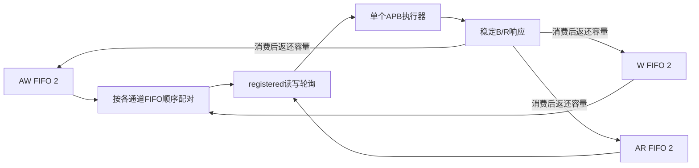

# Task003 — 有限请求队列与串行APB仲裁

本任务测量独立AW/W/AR队列、有限容量记账、读写仲裁、响应配对及复位清理。每个通道最多两个未退休请求；执行中的请求和等待消费的响应仍占容量。读写可重叠，APB执行器保持串行。它不是Task002加随机种子，也不是允许任意深度乱序的AXI总线。

- [Spec](spec.md)：精确容量、FIFO顺序、registered仲裁时刻、背压和复位契约。
- [任务元数据](task.json)：测量能力、正确/错误对照、验收要求和盲区。
- [初始RTL](workspace/bridge.sv)：只有接口，不含实现。
- `verifier/task003/scoreboard.sv`：新的多请求UVM事务模型；未沿用001的单笔请求假设。



主动AXI VIP发起多个请求；Scoreboard记录实际AW/W/AR接受队列，独立选择应执行的头部事务。APB/AXI monitor返回完成事务，与预期地址、数据、字节使能、错误和内存比较。独立账目核对每个通道的接受数=退休数+复位取消数。目标内存在复位时保留已完成写入；VIP请求源取消包括尚未开始在引脚上发送的旧请求。

公开19个case、完整21个case：地址/数据、各FIFO容量与回绕、B/R反压期间继续接收、两种独立写半部、读写轮询和历史偏好、等待/错误/内存、随机交叠、8个复位阶段。必要覆盖是33个明确需求bin，**不是完整笛卡尔积交叉覆盖**。完整验收需两种合法参考、15种错误对照、空模板、编译/环境分类和真实Policy机制检查全部通过；声明本身不能让任务获得准入。

```bash
python3 -m environment.task003 reset .local/queue-work
python3 -m environment.task003 test .local/queue-work .local/queue-public
python3 -m environment.task003 submit .local/queue-work .local/queue-submit
python3 -m environment.task_quality tasks/axil_to_apb4_queue_003 .local/queue-gate
# 仅在上一步真实通过后：
python3 -m environment.policy_experiment --task axil_to_apb4_queue_003 \
  --admission .local/queue-gate --protocol text-json-atomic-v2 \
  --out .local/queue-pilot --repeats 3 --limit 9 \
  --max-tokens 600000 --max-seconds 5400
```

保留001所有默认入口；每个新任务需要与当前源码和工具链匹配的门禁证据。A/C/E仍为20动作、C/E两次公开测试，提交后停止求解，独立终局评分与保留评估不回流模型。实际准入状态由匹配版本的质量验收记录确认，缺少证据时不得启动评测；模型难度须由真实试次校准。不宣称综合/形式通过或覆盖完备。
